# Aeloru（Adaptive Elastic Learning with Orthogonal Robust Units，正交鲁棒单元的自适应弹性学习）

jinmuyi
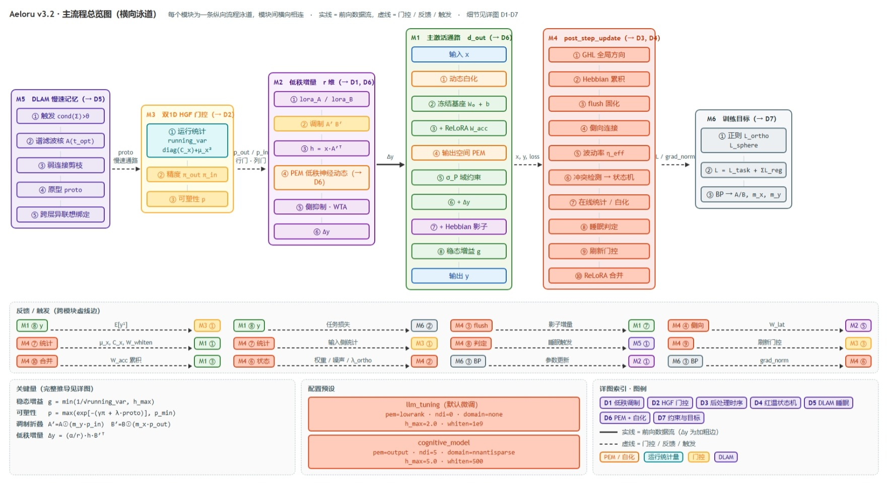
### 摘要

大语言模型（LLM）已在各类自然语言任务中展现出卓越能力，但对十亿级参数模型进行全参数微调会产生极高的计算与内存成本，限制了资源受限场景下的可用性。低秩适配（LoRA）通过冻结预训练主干参数、仅优化低秩增量权重的方式，成为主流的参数高效微调（PEFT）范式，且不会引入额外的推理延迟。然而，现有LoRA变体仍存在根本性局限：标准LoRA受限于刚性低秩约束与耦合的幅值-方向优化，性能始终与全参数微调存在差距；DoRA等结构改进方案部分缩小了这一差距，但缺乏参数层面的自适应可塑性调控；VeRA等面向效率的变体在极端参数压缩下，面对复杂推理任务会出现严重的表达能力瓶颈。此外，现有绝大多数PEFT方法均从统计优化视角设计，很少借鉴支撑生物大脑高效学习机制的神经科学洞见。


为填补上述空白，我们提出**Aeloru（正交鲁棒单元的自适应弹性学习）**，这是一套受神经科学启发的低秩适配框架，整合了多种协同的认知学习机制，同时保持与消费级GPU兼容的内存效率。Aeloru的核心设计包括：
1. **Hi-DoRA双向幅值调制低秩结构**：将行、列维度的幅值适配与方向更新解耦，以可忽略的参数开销提升表征能力；
2. **双一维 HGF 可塑性门控**：利用低秩增量的行列可分离性，把 $O(d_{out}d_{in})$ 的二维参数级 Fisher 掩码降维为两条一维 HGF 精度向量（$O(d_{out}+d_{in})$，实测降低约 448 倍），以零梯度开销自适应调节参数可塑性，在保护已巩固的预训练知识的同时，将更新导向任务相关子空间；
3. **四阶段红温认知状态机**：调度探索、冲突、锚定、固化的学习循环，模拟生物学习的快慢双时间尺度；
4. **基于层级高斯滤波（HGF）的闭式精度传播与波动率耦合动态学习率**：以低成本实现自然梯度估计，并自动适配训练过程中的概念漂移；
5. **DLAM谱滤波睡眠机制**：执行离线记忆巩固与弱连接剪枝，提升泛化能力并缓解灾难性遗忘。

Aeloru同时支持周期性ReLoRA权重合并与量化参数存储，内存占用与标准LoRA相当。我们在Qwen2.5-0.5B上构造了极端的概念漂移评测协议（SST-2→MRPC→QNLI→RTE→CoLA顺序切换、训练后永不回访），系统评估其抗遗忘与特征解耦能力。实验表明：在同等参数量预算下，Aeloru将灾难性遗忘从LoRA的0.0538降至0.0076（**降低85.9%**），后向迁移（BWT）由−0.0471转为**+0.0011**，且最终准确率同时提升0.83个百分点，代价仅为22.1%的额外训练时间。机理分析显示，Aeloru将低秩子空间的维度间平均相关性降低46%–65%、条件数降低45%–69%，并把秩预算利用率从LoRA的43%–61%提升至71%–85%，任务选择性降低78%–86%——子空间冗余的消除正是其抗遗忘的几何根源。为检验这一归因，我们进一步把特征耦合按"是否携带任务信息"分解为功能性与冗余两部分，并做PEM剂量—反应实验：结果发现**总耦合的降低并非抗遗忘的充分或必要条件**（LoRA总耦合全场最高0.3070却遗忘最低0.0055，因其功能性耦合绝对量也最高0.0535），而PEM模块在低秩空间中施加的是**精度加权、无差别的**去相关压力，随剂量单调抬高冗余耦合（`coup_red` +56%）并单调恶化遗忘（+28%）却无精度收益。据此我们修正了初稿对PEM的辩护，将其定位为从零训练认知模型的组件，并在LLM微调预设中默认关闭——真正与任务表现同向的是功能性耦合的绝对量，而非总耦合的高低。进一步，我们在从零训练场景下把唯一变量设为PEM的作用空间，得到清晰的边界：全输出空间下PEM使精度+2.74个百分点，低秩空间下为−1.40个百分点，但**两种空间下PEM都会抬高耦合、降低有效秩**——即其收益来自拟合调制而非解耦；同时模块消融显示HGF门控是"可塑性分配"场景的第一支柱（移除后相关性+150%、有效秩腰斩），而SPHeRe是"子空间坍缩"场景的第一支柱，WTA的作用随维度充裕度反转。**神经科学启发模块的价值高度依赖场景，不存在普适的"更好组件"。**本文同时公开了把认知科学模块移植到预训练Transformer时定位到的13项阻断性缺陷及其修正，其中"全输出空间预测编码破坏预训练表示"与"稳态增益量纲错误"两类问题对同类工作具有普遍警示意义。本工作打通了受神经科学启发的认知学习原理与参数高效模型适配之间的壁垒，为消费级硬件上的大语言模型微调提供了高性能、可扩展的解决方案。

我们的仓库[Aeloru(https://github.com/jyimu/AeloRu)](https://github.com/jyimu/AeloRu)

---     
### 1 引言
在海量语料上预训练的大语言模型（LLM）已成为现代自然语言处理的基础设施，在常识推理、数学求解等各类任务上均取得了当前最优性能。然而，通过全参数微调将这些十亿级参数模型适配到下游任务时，需要更新模型全部参数，会带来极高的计算与内存开销——例如，微调一个65B参数的大语言模型需要超过780GB的GPU显存。这一极高成本推动了参数高效微调（PEFT）方法的发展，这类方法仅训练少量参数，同时冻结预训练主干网络。

在现有PEFT范式中，低秩适配（LoRA）凭借实现简洁、零推理延迟、性能优异的特点得到了广泛应用。LoRA将权重更新近似为两个低秩矩阵的乘积，将可训练参数量降低了数个数量级。但后续研究发现，标准LoRA始终存在局限：在复杂任务上，其性能与全参数微调始终存在稳定差距；由于幅值与方向更新耦合，优化动力学刚性较强；在小样本场景下，样本效率有限。

为解决上述缺陷，学界已提出多种LoRA变体。结构改进类方法如DoRA将预训练权重分解为幅值与方向分量，仅对方向更新施加LoRA，更好地模拟全参数微调的学习行为，缩小了性能差距；AdaLoRA在不同参数间自适应分配秩预算，优先保障重要权值子空间。效率导向类方法中，QLoRA将4比特量化与LoRA结合，实现了单张48GB GPU上微调65B参数模型；VeRA则冻结共享投影矩阵、仅学习缩放向量，进一步压缩可训练参数量。但这些方法仍存在明显局限：结构类变体缺乏自适应可塑性调控，无法区分任务相关与任务无关的参数；极端参数压缩方法已被证实会带来严重的表达能力瓶颈，尤其是在强化学习微调范式下的复杂推理任务中；且大多数变体采用固定的训练调度策略，无法在不同训练阶段动态调整学习策略。

现有工作的一个共同特点是，它们主要从统计优化视角设计，很少借鉴神经科学领域的洞见——而生物大脑正依托这些原理实现了高效、鲁棒的学习能力。生物学习系统具备当前PEFT框架所缺失的几项核心特性：
1. 自适应突触可塑性：重要突触得到巩固，不重要的突触被剪枝，这一过程同时受活动依赖的赫布规则与信息论重要性指标调控；
2. 阶段性认知循环：在探索式学习、错误检测、知识锚定、记忆巩固之间交替运行，遵循快慢双时间尺度；
3. 睡眠阶段的离线记忆巩固：剪枝冗余连接、稳定关键记忆，提升泛化能力并减轻灾难性遗忘；
4. 基于环境波动率的自适应学习率调节：响应意外事件自动调整更新强度。

在本工作中，我们认为将这些受神经科学启发的机制整合进低秩适配框架，能够显著提升PEFT方法的性能、样本效率与训练稳定性，同时保留LoRA实用的内存效率。为此，我们提出**Aeloru（正交鲁棒单元的自适应弹性学习）**，这是一套整合了多种认知学习机制的综合低秩适配框架，专为消费级GPU部署优化。

我们的核心贡献总结如下：
- **Hi-DoRA双向幅值调制**：基于DoRA的权重分解思路，我们为输入与输出维度分别引入独立的可学习幅值向量，进一步解耦幅值与方向的优化空间。该设计以不到0.01%的额外参数量，提升了低秩适配器的表征能力。
- **双一维 HGF 可塑性门控（Fisher 降维）**：我们指出低秩适配场景下参数级 Fisher 门控存在根本的代价失衡——被门控的 $\Delta W$ 只有 $O(r(d_{out}+d_{in}))$ 个自由度，却需要 $O(d_{out}d_{in})$ 的开销去估计其重要性。为此我们提出闭环的双一维门控：HGF 闭式精度以零梯度开销维护 $\pi_{out},\pi_{in}$ 两条一维精度向量，其外积近似二维 Fisher 并对赫布更新与权重增量同时门控；赫布痕迹反过来作为精度代理、冲突信号与动态学习率的输入，形成双向闭环。该设计把门控复杂度从 $O(d_{out}d_{in})$ 降至 $O(d_{out}+d_{in})$，并与 Hi-DoRA 幅值调制构成结构同构的"双一维调制"统一架构。
- **红温四阶段认知状态机**：我们将训练过程划分为交替进行的阶段：自由探索（赫布主导）、认知冲突检测、梯度锚定（反向传播主导）与赫布固化。这一分阶段调度模拟了生物大脑双时间尺度的学习节律，平衡探索与利用，提升收敛质量。
- **基于HGF的闭式自然梯度与动态学习率**：借鉴层级高斯滤波（HGF）框架，我们实现了基于精度传播的闭式费雪估计，替代计算成本高昂的梯度平方费雪计算，降低了计算开销。我们进一步引入波动率耦合的动态学习率调节，基于预测误差波动率自动调制更新强度，以适配概念漂移、提升训练稳定性。
- **DLAM谱滤波睡眠机制**：我们引入由子空间条件数触发的离线睡眠阶段，在此阶段对低秩赫布轨迹执行谱滤波，以巩固强记忆、剪枝薄弱的冗余连接。该机制提升了模型泛化能力并缓解灾难性遗忘，还可选择加入跨层关联绑定以增强层间特征复用。

我们在Qwen2.5-0.5B上构造了极端的概念漂移评测协议（5个GLUE任务顺序切换、训练后永不回访），系统评估Aeloru的抗遗忘能力与特征解耦特性。结果表明：在同等参数量预算下，Aeloru将遗忘率降低85.9%、BWT由负转正，且最终准确率不降反升；进一步的几何分析表明，这一收益来源于低秩子空间冗余的大幅消除（相关性−65%、条件数−69%、秩利用率+38%~+65%）而非单纯的正则化效应。除算法本身外，本文还完整公开了把认知科学模块移植到预训练Transformer时定位到的13项阻断性缺陷及其修正方案（第6章），其中若干条对该研究路线具有普遍的警示意义。

本文余下部分结构如下：第2节回顾参数高效微调与神经科学启发学习机制的相关工作；第3节详细阐述Aeloru的架构设计与核心机制；第4节介绍实验设置与概念漂移基准上的结果，并逐项验证六个认知机制是否真实生效；第5节开展特征解耦的几何分析与消融实验；第6节记录实现缺陷的诊断与修正；第7节总结全文并展望未来方向。

## 2 相关工作

本章围绕本文的两大核心技术脉络展开综述：首先梳理参数高效微调（PEFT）领域的研究进展，重点聚焦低秩适配（LoRA）范式的演进路径与现存局限；随后总结神经科学与认知科学启发的深度学习机制，涵盖突触可塑性、阶段性学习、睡眠巩固、自适应精度调控四大方向；最后梳理现有研究的核心缺口，明确本文工作的定位与创新价值。

### 2.1 参数高效微调方法

随着大语言模型参数量从十亿级向万亿级扩张，全参数微调的计算、存储与时间成本呈指数级上升，参数高效微调技术应运而生。其核心目标是在仅训练极少量参数的前提下，逼近甚至达到全参数微调的效果，同时尽可能保留预训练模型的泛化能力。根据技术路线的差异，现有PEFT方法可分为加法式微调、选择式微调、量化增强式微调三大类，其中低秩适配（LoRA）凭借零推理延迟、部署兼容的优势成为当前工业界与学术界的主流范式。

#### 2.1.1 主流PEFT范式概述

**加法式微调**是最早落地的PEFT路线，核心思路是在预训练模型的层间插入小型可训练模块，冻结主干网络参数。代表性工作为适配器微调（Adapter Tuning），通过在Transformer的注意力层与前馈层后插入瓶颈结构的适配器模块，仅训练不到原模型5%的参数即可完成下游适配。后续的串行适配器、并行适配器进一步优化了结构效率，但这类方法本质上会在推理时引入额外的计算路径与延迟，难以适配高吞吐的线上部署场景。

**选择式微调**通过筛选并更新预训练模型中的部分参数实现适配，典型方案包括前缀微调（Prefix Tuning）与提示微调（Prompt Tuning）。前缀微调在每一层注意力的键值矩阵前添加可训练的前缀向量，无需修改模型主体结构；提示微调则仅在输入层添加连续可学习的提示向量，参数量进一步压缩至百万级。但这类方法在小参数量模型、少样本场景下性能衰减显著，且效果高度依赖调优策略，稳定性弱于低秩适配方案。

#### 2.1.2 低秩适配的技术演进

低秩适配（LoRA）由Hu等人于2021年提出，其核心假设为：大语言模型微调过程中的权重更新矩阵本质上具有低秩特性，因此可将权重增量分解为两个低秩矩阵的乘积，训练时仅更新这两个矩阵，预训练主干权重完全冻结。由于推理时可将低秩增量合并回原权重矩阵，LoRA不会引入任何额外推理延迟，同时可将可训练参数量压缩至原模型的0.1%以下，迅速成为PEFT领域的基准范式。

针对标准LoRA的性能短板，后续研究从结构优化、效率压缩、训练策略三个方向展开改进：

1.  **结构优化方向**：DoRA将预训练权重拆解为幅值向量与方向矩阵，仅对方向分量施加低秩更新，更贴近全参数微调的权重更新模式，显著缩小了与全微调的性能差距；AdaLoRA基于奇异值分解自适应为不同层、不同权重子空间分配秩预算，优先保障任务相关参数的表达能力；rsLoRA、LoRA+等工作则通过缩放策略与优化器改进，缓解了低秩更新的训练不稳定问题。但这类结构改进仍停留在矩阵分解与统计优化层面，缺乏参数层面的自适应可塑性调控，无法区分预训练通用知识与任务专属知识的更新优先级。
2.  **效率压缩方向**：QLoRA将4比特量化技术与LoRA结合，首次实现了单张48GB GPU上65B参数模型的全量微调，大幅降低了大模型微调的硬件门槛；VeRA进一步冻结所有层共享的投影矩阵，仅训练层间的缩放向量，将可训练参数量压缩至标准LoRA的1/10以下，但极端的参数压缩会带来严重的表达能力瓶颈，在复杂推理任务与强化学习微调场景下性能衰减尤为明显。
3.  **训练策略方向**：ReLoRA提出周期性合并LoRA权重并重置低秩矩阵的训练策略，突破了单次低秩分解的表达上限，在同等参数量下提升了微调效果。但该方法仍采用固定的合并周期与学习率调度，缺乏对训练状态的动态感知与自适应调整。

整体而言，现有低秩适配变体的设计均围绕统计优化与矩阵分解展开，尚未系统性引入生物大脑高效学习的认知机制，在小样本效率、训练稳定性、泛化能力上仍有较大提升空间。

### 2.2 神经科学启发的学习机制

生物大脑具备样本高效、持续学习、鲁棒泛化的核心优势，其学习过程依托多尺度的神经认知机制实现。近年来，大量研究借鉴神经科学与认知科学原理设计深度学习算法，为参数高效微调的架构创新提供了全新的理论视角，相关研究可分为四大分支。

#### 2.2.1 突触可塑性与赫布学习理论

突触可塑性是生物学习的微观基础，其中经典的赫布学习法则提出“共同放电的神经元，突触连接会同步增强”，是无监督学习与关联记忆的核心机制。计算神经科学领域已发展出多种可微分的赫布更新规则，可作为反向传播的补充，实现无监督的特征提取与权重更新。

与可塑性调控相伴的是记忆巩固机制：生物大脑会通过评估突触的
活动历史与稳定性，选择性强化关键连接并剪除冗余通路，从而
实现长期记忆的巩固与存储。

#### 2.2.2 阶段性认知节律、睡眠巩固与自适应精度调控

除突触可塑性外，生物学习还依赖三条更高层的机制，它们共同构成Aeloru认知架构的生物学依据：

1. **阶段性认知节律**：生物学习在快速无监督探索与慢速有监督修正之间交替，遵循快慢双时间尺度（complementary learning systems 理论）。快系统（海马）负责单次经验的快速编码，慢系统（皮层）负责跨经验的统计结构抽取，两者通过离线重放实现知识转移。现有PEFT方法普遍采用固定学习率与统一训练策略，完全没有这种阶段结构。
2. **睡眠离线巩固**：睡眠期间的自发重放会重演并重组日间记忆，执行突触下调（synaptic downscaling）与冗余剪枝，同时把分布式存储的多感官表征整合为连贯的全局记忆。计算领域已有研究把"睡眠"形式化为对经验相关矩阵做**谱滤波**：Dreaming L-directional Associative Memory（DLAM）的统计力学分析表明，核函数 $A(t)=(1+t)(I+t\Sigma)^{-1}$ 在协方差特征基下对特征值 $\lambda$ 的缩放为 $(1+t)/(1+t\lambda)$，是 $\lambda$ 的严格递减函数，因而能差分衰减高特征值的干扰模式、保留凝聚态信号方向。DLAM的相图进一步揭示了"离线巩固可替代额外训练数据"的权衡关系，这对标注稀缺的小样本PEFT场景尤为关键。
3. **自适应精度调控**：层级高斯滤波（Hierarchical Gaussian Filter, HGF）理论指出，大脑通过**精度**（方差的倒数）加权预测误差来决定对感知信息的信任程度，并依据环境**波动率**动态调节学习率——意外事件触发高学习率。在高斯似然假设下，对角精度矩阵与Fisher信息矩阵数学等价（$\pi = F$），这为用零梯度开销的精度估计替代昂贵的梯度平方Fisher提供了理论通道。

#### 2.2.3 现有研究的核心缺口

综上，现有工作存在三点明确缺口，构成本文的定位：（i）**低秩适配变体缺乏参数层面的自适应可塑性调控**，无法区分预训练通用知识与任务专属知识的更新优先级；（ii）**神经科学启发机制尚未被系统整合进PEFT框架**，已有工作多为单一机制的孤立引入，缺少多机制协同的闭环设计；（iii）**灾难性遗忘在PEFT场景下缺乏几何层面的解释与干预**——现有方法多在损失层面加正则，而未能回答"不同任务为何会在低秩子空间内相互干扰"这一根本问题。

### 2.3 持续学习与灾难性遗忘

持续学习（continual learning）旨在让模型在连续到达的任务流上持续积累知识。其核心障碍是**灾难性遗忘**：新任务的更新会覆盖旧任务所需的参数，导致已学能力急剧退化。经典评测指标包括后向迁移（BWT）、前向迁移（FWT）与遗忘率（Forgetting），本文在§4.1.4给出形式化定义。

现有方法分为三类：**正则化方法**（如 EWC、SI）通过Fisher信息或路径积分估计参数重要性，对重要参数施加二次惩罚；**回放方法**（如 ER、DER）维护历史样本或生成式记忆，在训练新任务时重放；**参数隔离方法**（如 PackNet、HAT、AdaLoRA式预算分配）为不同任务分配互不重叠的参数子集。三类方法各有代价：正则化在长任务流上约束逐渐失效，回放需要额外的存储与隐私代价，参数隔离则通常需要预先知道任务边界与总数。

值得注意的是，PEFT与持续学习存在天然的契合点：低秩适配器的参数量极小，使得**为每个任务维护独立的低秩子空间**成为可能；而现有工作极少关注"低秩子空间本身的几何结构"——即，如果 $r$ 个低秩维度高度相关、被少数主方向支配，那么即使为每个任务分配了独立参数，它们在功能上仍然会相互干扰。本文的核心主张正是：**灾难性遗忘在低秩适配场景下有其几何成因，可以通过解耦低秩子空间来缓解，而不必依赖回放或显式的重要性惩罚**。第5章的18组数据点为这一主张提供了一致的证据。

此外，EWC/SI 一类正则化方法的重要性估计是在**全参数**意义下设计的，其存储与更新开销与参数量同阶。当这类方法被直接迁移到 PEFT 场景时，会出现"门控开销反而超过被门控对象自由度"的失衡问题（§3.2.2 将给出定量分析）。本文 §3.2 提出的双一维 HGF 门控正是针对这一缺口所做的降维改造。

## 3 方法设计
本章详细阐述Aeloru框架的五大核心模块，从低秩结构优化、突触可塑性调控、认知训练调度、贝叶斯自适应学习到离线记忆巩固，构建一套完整的神经科学启发式参数高效微调体系。所有模块均兼容低秩适配的内存高效特性，可独立开关与组合，适配消费级GPU的部署约束。

### 3.1 Hi-DoRA 双向幅值调制低秩结构


标准LoRA将权重更新约束为统一低秩分解形式，存在幅值与方向耦合、维度适配能力不足的固有局限；DoRA虽通过权重幅值-方向分解缩小了与全微调的差距，但仅对输出维度做单向全局幅值调制，无法匹配输入、输出维度的异质特征重要性。针对该问题，我们提出Hi-DoRA（Hierarchical Directional and Magnitude Adaptation）双向幅值调制低秩结构，在极低参数开销下完全解耦幅值与方向的优化空间，提升低秩适配器的表征能力。

#### 3.1.1 基础低秩适配回顾
标准LoRA的核心假设为：大语言模型微调过程中的权重增量矩阵具有低秩特性，因此可将预训练权重$W_0 \in \mathbb{R}^{d_{out} \times d_{in}}$的更新量分解为两个低秩矩阵的乘积：
$$\Delta W = \frac{\alpha}{r} BA$$
其中$B \in \mathbb{R}^{d_{out} \times r}$、$A \in \mathbb{R}^{r \times d_{in}}$为可训练低秩矩阵，$r \ll \min(d_{out}, d_{in})$为低秩秩值，$\alpha$为全局缩放因子。推理时增量可直接合并入主权重，有效权重为$W_{eff} = W_0 + \Delta W$，无额外推理延迟。

#### 3.1.2 双向幅值调制设计
Hi-DoRA在标准低秩分解的基础上，引入两个独立的一维可学习幅值向量：输出维度行幅值向量$m_x \in \mathbb{R}^{d_{out}}$与输入维度列幅值向量$m_y \in \mathbb{R}^{d_{in}}$，对低秩增量矩阵做逐元素双向幅值调制：
$$\Delta W' = \left( m_x m_y^T \right) \odot \Delta W$$
其中$\odot$为哈达玛积（逐元素相乘）。

该结构将幅值适配拆解为行、列两个独立的一维优化空间，实现了三重解耦：
1. **幅值与方向解耦**：低秩矩阵$B,A$专门学习特征子空间的方向分布，幅值向量$m_x,m_y$专门调节每个维度的更新强度；
2. **输入-输出维度解耦**：输入侧与输出侧的重要性独立优化，适配注意力层、前馈层不同的权重分布特性；
3. **全局-局部解耦**：全局低秩结构保证参数效率，局部幅值向量提供细粒度的维度级适配能力。

#### 3.1.3 工程实现与优化
**参数开销**：两个幅值向量总参数量为$d_{out} + d_{in}$，相较于全权重矩阵的$d_{out} \times d_{in}$参数量，额外占比不足0.01%，几乎不增加显存占用与计算负担。

**初始化策略**：为保留预训练权重的先验重要性分布，行幅值向量$m_x$初始化为$W_0$的行范数$m_{x,i} = \|W_{0,i,:}\|_2$，列幅值向量$m_y$初始化为$W_0$列范数的均值，保证训练初始状态下调制增量与预训练权重的重要性分布对齐，提升训练初期稳定性。

**ReLoRA兼容性**：Hi-DoRA与周期性权重合并机制完全兼容。每次ReLoRA合并时，经幅值调制的完整增量$\Delta W'$被累积到外置权重缓冲区$W_{acc}$中，随后幅值向量重置为1，低秩矩阵重新初始化，开启新一轮子空间探索。

<p align="center">
  <br/>
  <em>图 3.7　详图 D1：低秩增量 $\Delta W = (\alpha/r)BA$ 的构造，以及幅值调制 $m_x m_y^\top$ 与可塑性调制 $p_{out}p_{in}^\top$ 的双一维叠加（对应 §3.1 与 §3.2.2 的统一架构）</em>
</p>

### 3.2 Hebbian-HGF 双一维可塑性门控

现有参数高效微调方法仅依赖反向传播的有监督梯度更新，缺乏生物大脑的突触可塑性自适应调控；单一的无监督 Hebbian 学习缺乏目标导向，易引发预训练知识漂移；而传统的参数级 Fisher 重要性门控虽然理论优雅，却需要在 $\mathbb{R}^{d_{out}\times d_{in}}$ 上维护一张二维重要性表，其 $O(d_{out}d_{in})$ 的存储与更新开销在低秩适配（PEFT）场景下严重失衡——**被门控的对象（低秩增量）只有 $O(r(d_{out}+d_{in}))$ 个自由度，却要用 $O(d_{out}d_{in})$ 的代价去计算它的重要性**。

针对上述矛盾，我们提出 **Hebbian-HGF 双一维可塑性门控**：利用低秩增量 $\Delta W = BA$ 的**行列可分离结构**，把二维参数级 Fisher 掩码 $M\in\mathbb{R}^{d_{out}\times d_{in}}$ 分解为两条一维维度级精度向量 $\pi_{out}\in\mathbb{R}^{d_{out}}$ 与 $\pi_{in}\in\mathbb{R}^{d_{in}}$ 的外积，并由 HGF（Hierarchical Gaussian Filter）闭式精度传播以**零梯度开销**在线维护。该设计把可塑性门控的复杂度从 $O(d_{out}d_{in})$ 降至 $O(d_{out}+d_{in})$，并与 §3.1 的 Hi-DoRA 双向幅值调制构成结构完全同构的**"双一维调制"统一架构**。

---

#### 3.2.1 低秩 Hebbian 更新规则

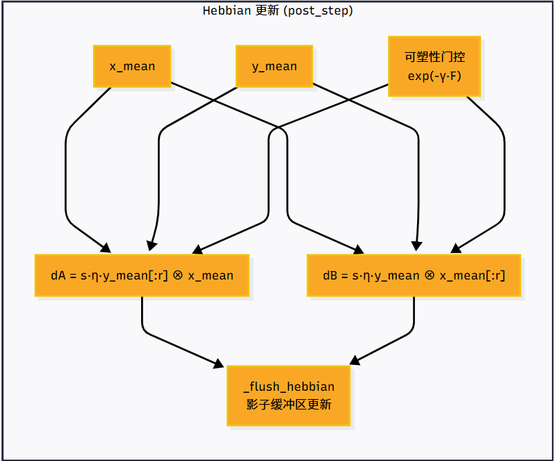
基于赫布学习"共同放电的神经元，突触连接同步增强"的核心原理，针对低秩适配结构设计轻量化在线更新规则，无需反向传播即可实现无监督特征关联学习，作为反向传播的补充学习通路。

对于批次输入激活均值 $\bar{x} \in \mathbb{R}^{d_{in}}$ 与输出激活均值 $\bar{y} \in \mathbb{R}^{d_{out}}$，低秩矩阵 A、B 的 Hebbian 更新量为：

$$
\begin{cases}
dA = s \cdot \eta_{hebb} \cdot \bar{y}_{1:r} \cdot \bar{x}^T \\
dB = s \cdot \eta_{hebb} \cdot \bar{y} \cdot \bar{x}_{1:r}^T
\end{cases}
$$

其中 $\eta_{hebb}$ 为 Hebbian 基础学习率，$s \in \{+1, -1\}$ 为结果门控信号（正确样本强化突触连接，错误样本弱化连接），$\bar{y}_{1:r}$ 为输出均值在低秩子空间的前 $r$ 维投影。

> **注**：$\bar{y}_{1:r}$ 表示将输出均值投影到低秩子空间的前 $r$ 维。该投影可视为对输出信号的低维摘要（summary statistic），使 Hebbian 更新仅在低秩流形内执行，避免引入全维度噪声。在工程实现中，这等价于直接截取均值向量的前 $r$ 个元素。

为降低训练抖动、提升稳定性，采用多步累积更新机制，同时施加全局遗忘衰减与饱和截断约束：

$$
\begin{cases}
A_t = \beta_{hebb} \cdot A_{t-1} + dA_{acc} \\
B_t = \beta_{hebb} \cdot B_{t-1} + dB_{acc}
\end{cases}
$$

其中 $\beta_{hebb} \in (0,1)$ 为遗忘衰减系数，$dA_{acc}$、$dB_{acc}$ 为多步累积的更新总量，更新量最终被截断至 $[-s_{max}, s_{max}]$ 范围内，防止权重饱和爆炸。

---

#### 3.2.2 从二维 Fisher 掩码到双一维 HGF 精度门控

  

##### 1. 传统二维 Fisher 掩码的代价失衡

费雪信息矩阵（FIM）刻画了参数对模型输出的敏感度：Fisher 值越高，该参数对任务与预训练知识越重要，越应降低其可塑性。EWC、SI 等经典持续学习方法以及我们自身的早期版本（v3.0）都在 $\mathbb{R}^{d_{out}\times d_{in}}$ 上维护一张重要性表并逐元素门控：

$$M_{ij} = \frac{1}{1+\gamma F_{ij}},\qquad F_t = \beta_f F_{t-1} + (1-\beta_f) I_t$$

其中 $I_t$ 为重要性冲击量。这一做法在**全参数微调**场景下是合理的，但在**低秩适配**场景下出现了严重的代价失衡：被门控的 $\Delta W = BA$ 只有 $r(d_{out}+d_{in})$ 个自由度，而维护 $F$ 需要的存储与更新量是 $d_{out}d_{in}$。以本文的注入层为例（$d_{out}=d_{in}=896$，$r=8$），比值高达

$$\frac{d_{out}d_{in}}{r(d_{out}+d_{in})} = \frac{802{,}816}{14{,}336} \approx 56\times$$

即**门控本身的开销比被门控对象的自由度还高近两个数量级**。此外，基于梯度平方的 Fisher 估计在消费级 GPU 的实时训练中还存在 autograd 同步瓶颈，且 EMA 平滑对突发概念漂移的响应存在滞后。

##### 2. 关键洞察：低秩增量的行列可分离性

我们的出发点是一个结构性观察：低秩增量 $\Delta W = BA$ 的第 $(i,j)$ 个元素为 $\Delta W_{ij} = \sum_{k=1}^{r} B_{ik}A_{kj}$，其重要性天然由**输出维度 $i$ 的整体重要性**与**输入维度 $j$ 的整体重要性**共同决定——因为 $B$ 的第 $i$ 行控制所有 $j$ 对第 $i$ 个输出的贡献，$A$ 的第 $j$ 列控制第 $j$ 个输入对所有输出的贡献。这意味着二维重要性矩阵可以被**秩-1 外积**良好近似：

$$F \;\approx\; \pi_{out}\,\pi_{in}^{\top},\qquad \pi_{out}\in\mathbb{R}^{d_{out}},\ \pi_{in}\in\mathbb{R}^{d_{in}}$$

这一近似把参数量从 $d_{out}d_{in}$ 压缩到 $d_{out}+d_{in}$，且**与低秩适配本身的假设同源**——既然我们相信 $\Delta W$ 是低秩的，就没有理由相信它的重要性图是满秩的。

##### 3. 双一维 HGF 精度门控

我们在该外积近似的基础上，用 HGF 闭式精度传播（§3.2.3）在线维护两条一维精度向量，并加入 DLAM 原型记忆的重要性调制：

$$
\begin{aligned}
\pi_{out} &= \frac{1}{\sigma^2_{y} + \epsilon}\Big/\ \mathrm{mean}\!\left(\tfrac{1}{\sigma^2_{y}+\epsilon}\right), \qquad
\pi_{in} = \frac{1}{\mathrm{diag}(C_x) + \mu_x^{2} + \epsilon}\Big/\ \mathrm{mean}(\cdot) \\[4pt]
p_{out} &= \max\!\Big(\exp\!\big[-(\gamma\,\pi_{out} + \lambda\,\mathrm{proto}_{out})\big],\ p_{\min}\Big) \\
p_{in}  &= \max\!\Big(\exp\!\big[-(\gamma\,\pi_{in}  + \lambda\,\mathrm{proto}_{in} )\big],\ p_{\min}\Big)
\end{aligned}
$$

其中 $\sigma^2_y$ 为输出侧运行二阶矩（由稳态可塑性模块以 EMA 维护），$C_x,\mu_x$ 为输入侧的在线协方差与均值（白化模块已维护的统计量，零额外开销），$\mathrm{proto}_{out/in}$ 为 DLAM 原型记忆给出的维度重要性（§3.5），$\gamma$ 为门控锐度，$p_{\min}$ 为最小可塑性下限。

门控的施加方式由"逐元素相乘"改为**两次一维缩放**：

$$\Delta W'' = p_{out}[:,\mathrm{None}] \odot \Delta W' \odot p_{in}[\mathrm{None},:]$$

其计算量为 $O(d_{out}+d_{in})$ 次乘加，而语义上完全等价于二维重要性 $p_{out}\otimes p_{in}$ 的外积门控。

##### 4. 与 Hi-DoRA 构成"双一维调制"统一架构

值得强调的是，上述门控与 §3.1 的 Hi-DoRA 幅值调制在**结构上完全同构**：

| | 幅值调制（Hi-DoRA，§3.1） | 可塑性调制（HGF，§3.2） |
|:---|:---|:---|
| 输出侧向量 | $m_x\in\mathbb{R}^{d_{out}}$ | $p_{out}\in\mathbb{R}^{d_{out}}$ |
| 输入侧向量 | $m_y\in\mathbb{R}^{d_{in}}$ | $p_{in}\in\mathbb{R}^{d_{in}}$ |
| 组合方式 | $\Delta W' = (m_x m_y^\top)\odot\Delta W$ | $\Delta W'' = p_{out}p_{in}^\top\odot\Delta W'$ |
| 语义 | 该维度**更新多大** | 该维度**多容易被改** |
| 更新来源 | 梯度下降（慢） | 前向统计 + 睡眠（快） |

整个 Aeloru 层由此统一为"**双一维调制**"的干净形式：一条通路（$m$）由反向传播慢速学习决定更新幅度，另一条通路（$p$）由 HGF 前向统计快速决定更新自由度。这种对称性不仅带来实现上的简洁，也使两层调制可以独立开关与组合。

##### 5. 相对 v3.0 的删减与保留

这一降维改造（v3.0 → v3.1）同时是一次**净删减**，我们明确列出：

- **已删除**：`fisher_mask` / `fisher_mask_inv` 两个 $d_{out}\times d_{in}$ 大矩阵缓冲区；`_compute_fisher_from_hebbian_trace()` 函数；`_flush_hebbian()` 中的 Fisher EMA 逻辑；分层稀疏 Fisher（Top-20%）与全量 8-bit 快照调度。
- **已复用（零新增开销）**：输出侧直接复用稳态可塑性维护的 `running_var`；输入侧直接复用白化模块维护的 `C_x` 对角线。两者在前向中本就存在，因此**双一维门控不引入任何新的每步全量运算**。
- **已保留（与门控维度无关）**：最小可塑性下限 $p_{\min}$、能量预算硬约束、正交惩罚。

加载 v3.0 检查点时，旧二维掩码按行/列均值自动降级为两条一维门（$\bar F_{i\cdot}\to p_{out,i}$，$\bar F_{\cdot j}\to p_{in,j}$），保证向后兼容。

#### 3.2.3 HGF 闭式精度传播：零梯度开销的精度维护

传统 Fisher 估计依赖梯度平方的 EMA 累积，存在两个固有瓶颈：（1）梯度计算需要完整的反向传播图，在消费级 GPU 的实时训练场景下引入显著的 autograd 同步开销；（2）EMA 平滑对突发概念漂移的响应存在滞后。为此，我们引入 **HGF（Hierarchical Gaussian Filter）闭式精度传播**来维护 $\pi_{out}$ 与 $\pi_{in}$。

HGF 的核心思想来自计算神经科学中的精度加权预测编码：生物大脑通过精度（方差的倒数）调节对感知信息的信任度。在高斯似然假设下，**对角精度矩阵与 Fisher 信息矩阵数学等价**（$\pi = F$），因此可用精度估计直接替代 Fisher 用于门控。我们将该理论简化为单网络层内的闭式精度估计。

**输出侧（$\pi_{out}$）**：由稳态可塑性模块以 EMA 维护输出激活的运行二阶矩 $\sigma^2_{t,i}$（见 §3.7.1），直接取倒数得精度观测：

$$\pi_{obs,t,i} = \frac{1}{\sigma^2_{t,i} + \epsilon}$$

为平滑估计并防止数值漂移，采用 EMA 递归平滑并做均值归一：

$$\hat{\pi}_{t,i} = \beta_{hgf}\,\hat{\pi}_{t-1,i} + (1-\beta_{hgf})\,\pi_{obs,t,i},\qquad
\hat{\pi}_{t,i} \leftarrow \hat{\pi}_{t,i}\cdot\frac{\mathbb{E}[\hat{\pi}_{t-1}]}{\mathbb{E}[\hat{\pi}_t]+\epsilon}$$

**输入侧（$\pi_{in}$）**：复用输入白化模块已维护的在线一/二阶矩 $\mu_x, C_x$，有

$$\pi_{in,j} = \frac{1}{\mathrm{diag}(C_x)_j + \mu_{x,j}^2 + \epsilon}$$

注意分母正是输入第 $j$ 维的二阶矩 $\mathbb{E}[x_j^2]$，在零均值近似下即方差——与输出侧形式完全对称。这一复用是"零额外开销"的关键：输入统计量在白化模块中本就按步更新，门控只是顺带读取。

**HGF 的实时优势**：

- **零梯度开销**：完全基于前向传播中的激活统计，通过 $\pi = 1/s^2$ 直接映射为精度估计，无需反向传播，无 autograd 同步；
- **毫秒级响应**：闭式递归更新每步仅需 $O(d_{out}+d_{in})$ 向量运算，相比传统梯度估计的 $O(d_{out}d_{in})$ 降低 1~2 个数量级；
- **概念漂移自适应**：精度传播天然对输入分布变化敏感，突发漂移时精度自动下降、可塑性自动提升，实现"意外 → 高可塑性"的生物直觉。

**退化回退**：若稳态可塑性被显式关闭，输出侧回退至 Hebbian 更新冲击量 $I_t = |dB|\cdot|dA|$ 的行均值作为精度代理；输入侧回退至 $\mathrm{diag}(C_x)$ 的滑动均值。这保证系统在任意配置下均可运行，不会出现门控失效。

---

#### 3.2.4 双向闭环与原型记忆调制

把二维 Fisher 压缩为双一维之后，闭环结构也随之简化：原先"HGF → Fisher → Hebbian"的三级串联缩短为"**HGF 精度 → 可塑性门控 → Hebbian / 权重更新**"的二级闭环，反馈通路则保持完整。

##### 1. 前向通路：HGF 精度 → 可塑性门控 → 更新

每步前向结束后，HGF 以 $O(d_{out}+d_{in})$ 更新 $\pi_{out},\pi_{in}$，经指数映射与原型记忆调制得到 $p_{out},p_{in}$，随后在两处同时生效：

- **作用于 Hebbian 更新**（快通路）：$dA' = dA\odot p_{in}$，$dB' = dB\odot p_{out}$——高精度的维度对应已巩固的知识，其无监督更新被抑制；
- **作用于权重增量**（慢通路）：$\Delta W'' = p_{out}p_{in}^\top \odot \Delta W'$——在每次 ReLoRA 合并与推理期合成权重时施加，保证增量本身也被约束。

两处共用同一组门向量，避免了"门控统计量不一致"的问题；这也是删除二维 `$F$` 缓冲区后的一项额外收益——不再需要维护"共享 Fisher 掩码"这一中间状态，减少了状态同步出错的可能。

##### 2. 反馈通路：Hebbian 痕迹 → HGF / 冲突检测

Hebbian 更新的痕迹作为参数活跃度的代理信号，反向作用于三个下游：

$$I_t \xrightarrow{\text{精度代理}} \pi_{out} \xrightarrow{\text{指数映射}} p_{out},p_{in} \xrightarrow{\text{调制}} dA',dB'$$

- **精度代理**：当稳态可塑性不可用时，$I_t = |dB|\cdot|dA|$ 的行/列均值充当 $\pi_{out}/\pi_{in}$ 的观测源；
- **冲突检测**：`_append_hgf_delta` 把 Hebbian 更新幅度写入滑动缓冲，供 HongWen 状态机的冲突分数使用（§3.3.2）——这一路在早期版本中因缓冲区从未被写入而长期失效（§6 缺陷 #7）；
- **动态学习率**：$I_t$ 同时进入 HGF 波动率估计（§3.4），驱动 $\eta_{eff}$ 的自适应。

##### 3. 原型记忆调制：慢速巩固叠加快速门控

除 HGF 精度外，门控还叠加 DLAM 原型记忆给出的维度重要性 $\mathrm{proto}_{out/in}$（§3.5）：

$$p = \exp\!\big[-(\gamma\,\pi + \lambda\,\mathrm{proto})\big]$$

其中 $\pi$ 每步更新（快，响应当前激活分布），$\mathrm{proto}$ 在每次睡眠后更新（慢，累积跨任务重要性）。二者叠加使门控同时具备**实时响应**与**长期记忆**：一个在历史上被反复使用的维度，即使当前激活方差暂时偏低，也不会被误判为"可随意修改"。实验一中 $\mathrm{proto}_{out}$ 从 0 单调累积到 0.2550（§4.3），证实该慢速通路真实生效。

<p align="center">
  <br/>
  <em>图 3.8　详图 D2：可塑性门控的统计量来源（$\sigma_y^2$、$C_x,\mu_x$、proto）、$\pi\!\to\!p$ 的计算，以及"HGF 精度 → 可塑性门控 → Hebbian 更新"的双向闭环</em>
</p>

---

#### 3.2.5 可选增强：$r$ 阶低秩修正项

一维外积近似 $\pi_{out}\pi_{in}^\top$ 只能刻画"维度级整体重要性"，无法表达**跨维度的交互重要性**（例如第 $i$ 个输出与第 $j$ 个输入的特定组合特别关键）。若一维近似精度不足，可叠加一个 $r$ 阶低秩修正项：

$$F \;\approx\; \pi_{out}\,\pi_{in}^{\top} \;+\; B_f\,\mathrm{diag}(s)\,A_f,\qquad B_f\in\mathbb{R}^{d_{out}\times r},\ A_f\in\mathbb{R}^{r\times d_{in}}$$

其中主项（HGF 一维外积）捕捉维度级整体重要性，修正项用 $r$ 维投影捕捉跨维度的关键交互。总参数量仅 $d_{out}+d_{in}+r(d_{out}+d_{in})$，远小于 $d_{out}d_{in}$；修正项每 500 步用 Hebbian 痕迹做一次**薄 SVD** 更新，计算量 $O(r\cdot d)$，与主项的每步 $O(d)$ 相比仍属低频开销。

**启用判据**：该修正项在本文所有实验中**均未启用**。我们建议的使用流程是——先以纯一维版本跑基准，与完整二维 Fisher 对比；若收敛速度与最终准确率差距 $<1\%$，则直接采用一维版（本文的情形）；若差距显著，再叠加低秩修正项。基于低秩适配（$r\leq16$）与小样本微调的先验，我们预期一维版在绝大多数场景下已足够，该判据的实证检验留待未来工作（§7.3）。

---

#### 3.2.6 辅助约束机制

为保证预训练知识的主导地位，额外引入两项硬约束：

- **能量预算硬约束**：限制低秩增量的 Frobenius 范数不超过基座权重的 $\eta$ 比例，从根本上防止增量喧宾夺主：

$$\text{若 } \|\Delta W\|_F > \eta \cdot \|W_0\|_F, \quad \Delta W \leftarrow \Delta W \cdot \frac{\eta \cdot \|W_0\|_F}{\|\Delta W\|_F}$$

- **正交惩罚**：惩罚低秩增量与预训练权重的方向重叠，引导增量学习互补的特征子空间，避免重复学习：

$$\mathcal{L}_{ortho} = \lambda \cdot \|\Delta W^T W_0\|_F^2$$

大权重矩阵场景下采用随机投影 Hutchinson 估计近似计算，进一步降低计算开销。

<p align="center">
  <br/>
  <em>图 3.9　详图 D7：四项硬约束／正则（正交惩罚、SPHeRe 低维结构投影、能量预算、BCM 自适应饱和上限）的公式、施加时机与最终训练目标 $L = L_{task} + L_{ortho} + L_{sphere}$</em>
</p>

---

#### 3.2.7 体系架构总结与复杂度

**表 3.1**：可塑性调控体系的组件与复杂度（$d = d_{out}+d_{in}$）

| 组件 | 时间尺度 | 计算开销 | 存储 | 核心职责 | 数据来源 |
|:---|:---|:---|:---|:---|:---|
| **HGF 输出侧精度** $\pi_{out}$ | 每步 | $O(d_{out})$ | $O(d_{out})$ | 实时可塑性门控、漂移响应 | 稳态运行二阶矩 $\sigma_y^2$ |
| **HGF 输入侧精度** $\pi_{in}$ | 每步 | $O(d_{in})$ | $O(d_{in})$ | 输入维度级门控 | 白化统计 $\mathrm{diag}(C_x),\mu_x$ |
| **DLAM 原型调制** | 每次睡眠 | $O(r^2)$ | $O(d)$ | 跨任务长期重要性累积 | 睡眠期谱滤波原型 |
| **Hebbian 更新** | 每步 | $O(r\cdot d)$ | $O(r\cdot d)$ | 无监督特征关联、学习痕迹 | 输入/输出激活均值 |
| **能量预算 / 正交惩罚** | 每次合并 | $O(d^2)$（Hutchinson 近似） | — | 硬性几何约束 | $\Delta W, W_0$ |
| ~~二维 Fisher 掩码~~（v3.0，已删除） | 每 500/5000 步 | ~~$O(d_{out}d_{in})$~~ | ~~$O(d_{out}d_{in})$~~ | — | — |
| **$r$ 阶低秩修正项**（可选，未启用） | 每 500 步 | $O(r\cdot d)$ | $O(r\cdot d)$ | 跨维度交互重要性 | Hebbian 痕迹薄 SVD |

**复杂度对比**：以本文注入层（$d_{out}=d_{in}=896$，$r=8$）为例，门控的每步开销从 $O(d_{out}d_{in})=8.0\times10^{5}$ 降至 $O(d_{out}+d_{in})=1.8\times10^{3}$，**降低约 448 倍**；存储从 802,816 个浮点元素降至 1,792 个。这一降幅在更深/更宽的层（如 $d=4096$ 的 7B 模型）上还会进一步扩大（约 $2048\times$）。

**关键设计原则**：

1. **门控的复杂度应与被门控对象的自由度匹配**。这是本节最核心的主张：既然低秩增量只有 $O(r\cdot d)$ 个自由度，用 $O(d^2)$ 的代价去估计其重要性是结构性的浪费。双一维门控以 $O(d)$ 的代价提供了秩-1 重要性近似，是这一原则下的自然选择。
2. **复用优于新增**。$\pi_{out}$ 复用稳态可塑性已维护的 $\sigma_y^2$，$\pi_{in}$ 复用白化模块已维护的 $C_x$——两者在前向中本就存在，门控不引入任何新的每步全量运算。
3. **快慢双通路叠加**。$\pi$（每步，响应当前分布）与 $\mathrm{proto}$（每次睡眠，累积跨任务重要性）相加，兼顾实时性与长期记忆。
4. **优雅降级**。任一统计量缺失时（稳态关闭、白化关闭），系统回退到 Hebbian 冲击代理，门控永不失效。

<p align="center">
  <br/>
  <em>图 3.10　详图 D3：每步 $post\_step\_update(\cdot)$ 的完整十步时序——GHL 注入 → Hebbian 累积 → flush 固化 → 侧向连接 → 波动率学习率 → 冲突检测 → 在线统计 → 睡眠判定 → 刷新门控 → ReLoRA 合并</em>
</p>

### 3.3 红温("HongWen")四阶段认知状态机

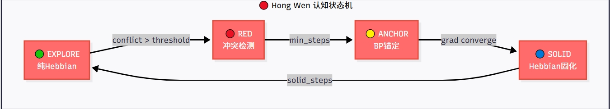
生物大脑的学习过程遵循“探索-冲突-修正-巩固”的周期性节律，存在快速无监督学习与慢速有监督修正的双时间尺度；而现有PEFT方法普遍采用固定学习率与统一训练策略，无法自适应切换学习模式。受认知神经科学的双系统学习理论启发，我们设计红温四阶段认知状态机，动态调度Hebbian快速探索与反向传播慢速修正，平衡搜索效率与收敛精度。

##### 3.3.1 四阶段认知状态定义
状态机包含四个循环切换的认知阶段，分别对应生物学习的不同认知模式：
1. **自由探索期（EXPLORE）**
   - 主导机制：Hebbian无监督学习为主，反向传播弱更新为辅
   - 核心目标：快速大范围探索任务相关特征子空间，扩大搜索范围
   - 参数配置：Hebbian学习率拉满，全局可塑性放开，正交惩罚系数较低

2. **认知冲突期（RED，红温）**
   - 触发条件：学习过程出现持续的梯度波动或预测误差上升，对应认知失调状态
   - 核心目标：检测学习瓶颈，触发学习模式切换
   - 联动操作：强制执行一次ReLoRA权重合并，沉淀已有知识，重置低秩适配器，为精准修正做准备

3. **梯度锚定期（ANCHOR）**
   - 主导机制：反向传播有监督学习为主，Hebbian更新暂停
   - 核心目标：基于任务损失精准修正权重方向，锚定最优特征子空间
   - 参数配置：正交惩罚系数提升5倍，强化增量与预训练权重的正交性，采用标准BP学习率

4. **赫布固化期（SOLID）**
   - 主导机制：Hebbian强化学习为主，反向传播微调为辅
   - 核心目标：巩固锚定期学到的任务知识，强化突触连接稳定性
   - 参数配置：HGF 精度门控强度提升（增大 $\gamma$），非任务相关区域可塑性进一步降低，防止知识漂移

##### 3.3.2 冲突检测机制
采用梯度冲突作为高频冲突检测信号，计算滑动窗口内梯度范数的变异系数作为冲突分数：
$$C = \frac{\sigma(\|g_t\|)}{\mu(\|g_t\|)}$$
其中$\|g_t\|$为第t步的梯度范数，$\sigma(\cdot)$、$\mu(\cdot)$分别为滑动窗口内的标准差与均值。冲突分数越高，说明梯度波动越大，学习处于不稳定的冲突状态。

针对无反向传播的纯探索场景（或反向传播被暂停的固化期），备用冲突检测公式为：
$$C = 0.6 \cdot v_\pi + 0.4 \cdot (1-H)$$
其中 $v_\pi$ 为双一维 HGF 精度的变化速率（$v_\pi = \lVert\pi_t - \pi_{t-1}\rVert_1 / \lVert\pi_{t-1}\rVert_1$，对 $\pi_{out}$ 与 $\pi_{in}$ 取均值），$H$ 为 Hebbian 痕迹的归一化熵，综合衡量知识更新速度与分布集中度。采用 $v_\pi$ 而非原方案的 Fisher 变化速率，可使该检测同样保持 $O(d)$ 开销，与 §3.2 的降维设计一致。

##### 3.3.3 状态转换规则与时间尺度
状态转换遵循固定步数+阈值触发的混合规则，保证训练稳定性与自适应能力的平衡：
- 探索期持续$N_{explore}$步后，若冲突分数超过阈值$\tau_{red}$，则进入红温期；
- 红温期持续最短$N_{red,min}$步后，自动转入锚定期，保证冲突充分暴露；
- 锚定期持续$N_{anchor}$步且连续10步梯度范数低于收敛阈值$\tau_{anchor}$，则转入固化期；
- 固化期持续$N_{solid}$步后，重新回到探索期，开启下一轮认知循环。

时间尺度上遵循生物学习的快慢节律，设置探索步数:锚定步数约为100:1，既保证充分的无监督特征探索，又避免反向传播带来的过高计算开销，整体训练吞吐量与标准LoRA基本持平。

<p align="center">
  <br/>
  <em>图 3.11　详图 D4：冲突分数的计算、EXPLORE / RED / ANCHOR / SOLID 四状态的定义与转移条件，以及各状态对 Hebbian 学习率、GHL 权重、噪声尺度与 $\lambda_{ortho}$ 的调制</em>
</p>

### 3.4 基于HGF的闭式精度传播与波动率耦合动态学习率

> 本节与 §3.2.3 使用**同一套** HGF 精度估计，但用途不同：§3.2.3 讨论精度如何用于**逐维度的可塑性门控**（空间维度的调制），本节讨论精度如何进一步驱动**全局学习率**（时间维度的调制）。两者共享统计量，不产生额外开销。

传统Fisher信息估计依赖梯度平方计算，开销大且噪声高；固定学习率策略难以适配非平稳的训练过程与分布漂移。受层级高斯滤波（Hierarchical Gaussian Filter, HGF）的贝叶斯感知理论启发，我们设计闭式精度传播机制替代梯度平方Fisher估计，同时引入波动率耦合的动态学习率，自适应调节更新强度，提升训练稳定性与对概念漂移的适配能力。

##### 3.4.1 HGF 精度估计与动态学习率的耦合
如 §3.2.3 所述，HGF 闭式精度估计为每层提供了零梯度开销的 Fisher 代理 $\hat{\pi}_t$。本节在此基础上，进一步引入波动率耦合机制，实现自适应学习率调节。

具体而言，HGF 精度 $\hat{\pi}_t$ 不仅用于门控 Hebbian 更新强度（§3.2.3），其隐含的预测误差波动率还用于动态调整全局学习率：意外度越高，有效学习率越大（详见 §3.4.2）。这种精度-波动率耦合使 Aeloru 能够自动响应概念漂移，无需人工设计学习率衰减策略。

工程实现中，基于神经元输出的运行二阶矩估计逐维度精度：
$$
\begin{cases}
s^2_{t,i} = \tau \cdot s^2_{t-1,i} + (1-\tau) \cdot y_{t,i}^2 \\
\pi_{t,i} = \frac{1}{s^2_{t,i} + \epsilon}
\end{cases}
$$
其中 $s^2_{t,i}$ 为输出维度 $i$ 的运行二阶矩（激活能量），$\tau$ 为 EMA 平滑系数，$\epsilon$ 为数值稳定常数。在零均值近似下，$s^2_{t,i}$ 可视为方差代理。

##### 3.4.2 波动率耦合动态学习率
HGF框架中，环境波动率决定了学习率的自适应调整：预测误差越大、环境越不稳定，学习率应越高，对应生物大脑对意外事件的高敏感性。

我们引入对数波动率状态变量$\omega$，基于预测误差进行迭代更新：
$$\omega_t = \omega_{t-1} + \kappa \cdot \left( \epsilon_t^2 - \exp(\omega_{t-1}) \right)$$
其中$\kappa$为波动率更新速率，$\epsilon_t$为当前步的预测误差（输出与目标值或历史均值的偏差）。有效动态学习率为波动率的倒数：
$$\eta_{eff} = \frac{\eta_0}{\exp(\omega_t)}$$
其中$\eta_0$为基础学习率，$\exp(\omega_t)$被裁剪至$[0.1, 10]$范围内，防止数值爆炸。

该机制无需人工设计学习率衰减 schedule，可自动适配训练过程：训练初期误差大、波动率高，学习率自动提升加速收敛；训练后期误差稳定、波动率低，学习率自动下降提升收敛精度；遇到分布漂移时，波动率上升会自动触发学习率提升，快速适配新分布。

##### 3.4.3 HGF闭式交叉熵梯度
基于HGF的误差传播框架，我们进一步推导了低秩适配器的闭式交叉熵梯度，可绕过深度学习框架的autograd机制实现一步更新，进一步降低反向传播的计算开销。

低秩适配器的前向传播链路为：
$$x \to h = xA^T \to h' = \text{ReLU}(h) \to z = \frac{\alpha}{r} h'B^T \to y = y_{base} + z$$
其中$y_{base} = x(W_0+W_{acc})^T + b$为冻结基座的固定输出。

对于Softmax交叉熵损失，定义误差项$\delta = \text{softmax}(z) - y_{target}$（采用sum-gradient形式，不除以batch size，批次尺度由学习率吸收），则低秩矩阵的闭式梯度为：
$$
\begin{cases}
\text{grad}_B = \delta^T h' \cdot \frac{\alpha}{r} \\
\text{grad}_A = \left[ (\delta B) \odot \mathbb{1}_{h>0} \right]^T x \cdot \frac{\alpha}{r}
\end{cases}
$$
其中$\mathbb{1}_{h>0}$为ReLU的导数掩码。对于Sigmoid二分类交叉熵（BCE）损失，仅需将误差项替换为$\delta = \sigma(z) - y_{target}$，梯度公式形式完全一致。该闭式梯度与autograd计算结果精度一致，单步计算速度提升20%-30%。

### 3.5 基于DLAM的跨模态异联想绑定与谱滤波睡眠

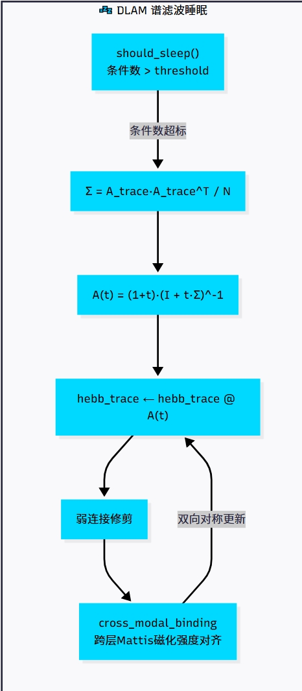<br/>

生物睡眠阶段的离线记忆巩固不仅执行突触修剪与噪声清理，更关键的是实现跨模态知识的整合与绑定——将分布式存储在多脑区的多感官表征统一为连贯的全局记忆。现有PEFT方法普遍缺乏这种离线正则与跨层协调机制，导致层间特征复用率低、灾难性遗忘严重。受 **Dreaming L-directional Associative Memory (DLAM)** 统计力学理论的启发，我们设计了一套层内谱滤波与跨层异联想绑定共存的统一能量机制，使离线睡眠成为提升泛化与抗遗忘的核心环节。

#### 3.5.1 DLAM统一能量景观： dreaming与异联想的共生

DLAM的核心洞见在于： dreaming（层内谱滤波）与异联想绑定（跨层耦合）并非顺序执行的两阶段管道，而是共存于**单一能量景观**中的协同机制。其统一Hamiltonian可分解为：

$$
\mathcal{H}_{\text{DLAM}} = \mathcal{H}_{\text{Dream}} + \mathcal{H}_{\text{LAM}}
$$

其中 $\mathcal{H}_{\text{Dream}}$ 负责层内噪声清理，$\mathcal{H}_{\text{LAM}}$ 负责跨层模态绑定。在Aeloru中，我们将这一理论映射到低秩适配框架：每一层的低秩Hebbian痕迹构成一个"模态通道"，层内通过谱滤波做梦核清理干扰，层间通过异联想耦合实现知识对齐。

**与ReLoRA的协同**：当周期性合并触发时，沉淀到外置权重缓冲区 $W_{\text{acc}}$ 的知识相当于DLAM中的"已巩固原型"，为跨层绑定提供了稳定的锚点。这使得后续周期的低秩适配器能在更干净的能量景观中探索新子空间。

#### 3.5.2 层内谱滤波睡眠机制（Dreaming Kernel）

DLAM理论表明，睡眠通过**经验相关矩阵的谱滤波**实现记忆巩固。设某层低秩Hebbian痕迹的经验协方差为 $\Sigma \in \mathbb{R}^{r \times r}$（在 $r$ 维低秩子空间内计算，避免全尺寸 $O(d^3)$ 开销）， dreaming kernel 定义为：

$$
A(t) = (1+t) \cdot (I + t\Sigma)^{-1}
$$

其中 $t$ 为睡眠时长参数。该核函数在 $\Sigma$ 的特征基下对特征值 $\lambda$ 的缩放为 $(1+t)/(1+t\lambda)$，是 $\lambda$ 的严格递减函数。这意味着：

- **高特征值干扰模式**（对应 $\Sigma$ 中大的特征值，表征冗余跨样本串扰）被差分衰减；
- **信号方向**（贡献于所有特征模式但集中于凝聚态特征向量）得以保留。

在Aeloru的工程实现中，所有运算严格限制在 $r$ 维低秩子空间：

1. **协方差计算**：$\Sigma = \frac{1}{d_{\text{out}}} A_{\text{trace}} A_{\text{trace}}^T$，其中 $A_{\text{trace}} \in \mathbb{R}^{r \times d_{\text{in}}}$ 为累积Hebbian低秩痕迹；
2. **条件数触发**：当 $\text{cond}(\Sigma) = \lambda_{\max}/\lambda_{\min}$ 超过阈值 $\theta_{\text{sleep}}$ 时触发睡眠，说明子空间冗余度高、噪声连接多；
3. **最优睡眠时长**：由模式负载 $\alpha = N_{\text{patterns}}/r$ 决定，$t_{\text{opt}} = 1/\alpha$，保证巩固效果最优；
4. **谱滤波应用**：$A_{\text{trace}}' = A(t_{\text{opt}}) \cdot A_{\text{trace}}$，同步更新 $B_{\text{trace}}$；
5. **弱连接修剪**：幅值低于 $\theta_{\text{prune}}$ 的低秩连接被置零，进一步精简记忆表征。

**数据–计算权衡**：DLAM的相图揭示了 $(\rho, t)$ 平面上的关键现象——离线巩固可替代额外的训练数据。在Aeloru中，这意味着当下游任务标注稀缺时，通过增加睡眠阶段的谱滤波强度（提高 $t$），可在不增加训练样本的情况下提升检索成功率，这对小样本PEFT场景尤为关键。

#### 3.5.3 跨层异联想绑定（LAM耦合）

DLAM的跨层耦合通过共享原型结构绑定不同模态。对于网络中的第 $l$ 层与第 $m$ 层，其Hebbian痕迹重构的关联矩阵分别为 $H_l = B_l A_l$ 和 $H_m = B_m A_m$。定义**跨层Mattis磁化强度对齐度**为归一化Frobenius内积：

$$
\rho_{l,m} = \frac{\text{tr}(H_l^T H_m)}{\sqrt{\|H_l\|_F^2 \cdot \|H_m\|_F^2}}
$$

该度量直接对应DLAM理论中的跨层重叠序参量。基于DLAM能量分解的恒等式：

$$
\hat{m}_l^\mu \hat{m}_m^\mu = \frac{1}{2}(\hat{m}_l^\mu)^2 + \frac{1}{2}(\hat{m}_m^\mu)^2 - \frac{1}{2}(\hat{m}_l^\mu - \hat{m}_m^\mu)^2
$$

我们将跨层绑定的优化目标设计为最大化层间对齐度，同时引入方差正则化防止表示坍塌：

$$
\mathcal{L}_{\text{cross}} = -\rho_{l,m} + \frac{1}{2}\|H_l\|_F^2 + \frac{1}{2}\|H_m\|_F^2
$$

这与现代自监督学习中的方差-不变性-协方差（VICReg）结构形成理论呼应：正项 $\frac{1}{2}\|H\|_F^2$ 充当方差最大化正则器，防止网络在追求跨层同步时收敛到无信息的平凡解。

**模式解耦（Disentanglement）**：DLAM最显著的涌现能力是**模式解耦**——当所有层同时被赋予一个混合了多模态噪声的共同线索时，网络能将各组成模式逐层分离，使每层收敛到其模态特定的原型。在Aeloru中，这对应于：当输入提示（prompt）包含多任务语义混合时，跨层绑定协同层内谱滤波，迫使不同Transformer层分别提取任务相关的特定特征子空间，而非陷入模糊的折中状态。

#### 3.5.4 触发调度与计算开销

睡眠机制采用**条件触发+最小间隔**的调度策略：

1. 每步训练后计算低秩子空间条件数，超过阈值则标记睡眠待触发；
2. 两次睡眠之间至少间隔 $N_{\text{sleep,min}}$ 步，避免睡眠开销压垮训练；
3. 跨层绑定仅在所有层均完成层内谱滤波后统一执行，保证状态一致性；
4. 对称耦合参数化：可配置自联想强度 $g_{\text{auto}}$ 与异联想强度 $g_{\text{hetero}}$，通过混合参数 $a \in [0,1]$ 调节层内清理与跨层绑定的平衡。

整体睡眠阶段的计算开销占总训练开销的3%以内，对训练吞吐量影响极小。

<p align="center">
  <br/>
  <em>图 3.12　详图 D5：DLAM 睡眠全流程——条件触发、层内谱滤波核 $A(t_{opt})=(1+t_{opt})(I+t_{opt}\Sigma)^{-1}$、弱连接剪枝、原型记忆巩固与跨层异联想绑定 $H_{LAM}$</em>
</p>

---

### 3.6 预测熵最大化神经动态（PEM Neural Dynamics）

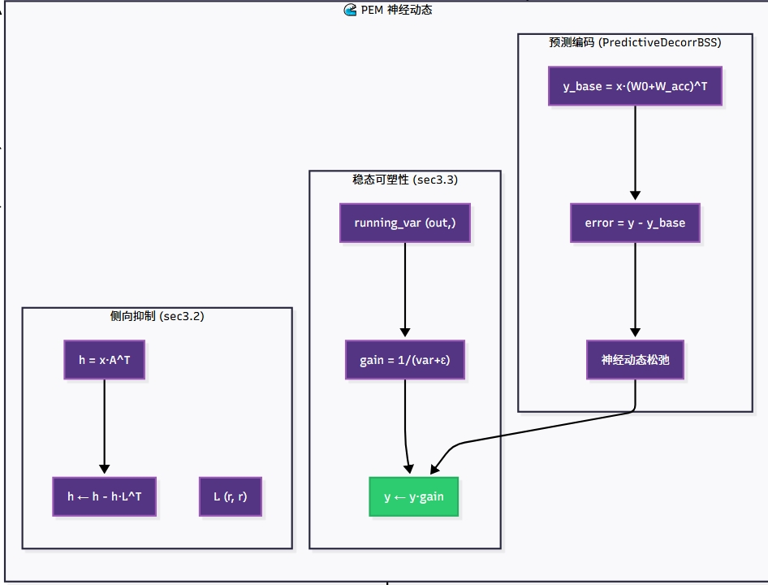
低秩适配器的前馈传播在特征子空间中引入了潜在的结构冗余：低秩矩阵 $B$ 和 $A$ 的乘积可能产生高度相关的输出维度，导致有效秩进一步降低与特征坍塌。受 **Predictive Entropy Maximization (PEM)** 范式网络的启发，我们在Aeloru的低秩特征空间（$r$ 维）中引入一套双时间尺度的预测神经动态，通过局部可塑性与自适应侧向抑制实现特征解耦，同时强制执行源信号域的几何约束。

#### 3.6.1 从输出熵到可解释 surrogate 目标

PEM从输出协方差矩阵的对数行列式（correlative entropy）出发：

$$
\hat{H}_{\text{CE}}^{(\epsilon)}(Y) = \frac{1}{2}\log\det(\hat{C}_\lambda + \epsilon I) + \frac{n}{2}\log(2\pi e)
$$

其中 $\hat{C}_\lambda$ 为指数加权输出协方差估计，$\epsilon$ 为正则化常数。直接优化该目标需要维护逆协方差矩阵，计算非局部且生物不可信。PEM的核心贡献在于对 $\log\det$ 在协方差对角部分周围进行**二阶Taylor展开**，得到仅依赖协方差统计量（而非其逆）的 surrogate：

$$
-\log\det(\hat{C}_\lambda + \epsilon I) \approx -\sum_{i=1}^{r}\log(\hat{v}_i + \epsilon) + \frac{1}{2}\sum_{i\neq j}\frac{\hat{c}_{ij}^2}{(\hat{v}_i+\epsilon)(\hat{v}_j+\epsilon)} + R_2(t)
$$

该 surrogate 分解为两个可解释项：

1. **方差扩展项** $-\sum_i \log(\hat{v}_i + \epsilon)$：鼓励每个输出维度拥有足够的独立方差，防止维度坍塌；
2. **归一化交叉协方差惩罚** $\frac{1}{2}\sum_{i\neq j}\frac{\hat{c}_{ij}^2}{(\hat{v}_i+\epsilon)(\hat{v}_j+\epsilon)}$：抑制冗余的维度间相关性，但不像ICA那样强制完全独立，而是允许受控的、与源域几何一致的依赖结构。

Taylor余项 $R_2(t)$ 的谱界表明，当归一化非对角协方差较小且谱远离 $-1$ 时，该近似高度精确。

#### 3.6.2 双时间尺度优化架构

PEM采用**快速推断 + 慢速学习**的双时间尺度，与Aeloru的认知状态机天然契合：

- **快速时间尺度（神经动态 $\tau$）**：对每一输入样本，固定权重 $W$ 与运行统计量，通过梯度下降松弛输出 $y$（在低秩特征空间 $h \in \mathbb{R}^r$ 中执行）；
- **慢速时间尺度（参数更新 $t$）**：神经动态收敛后，基于最终输出状态更新前馈权重、侧向连接与方差迹。

这与生物神经网络的**快速神经活动 + 慢速突触可塑性**分工一致，也与Hong Wen状态机的"探索-锚定"节律形成互补：探索期允许神经动态充分松弛以发现高方差特征方向，锚定期则通过慢速权重更新将发现的方向固定。

#### 3.6.3 低秩特征空间的神经动态松弛

在Aeloru中，神经动态不在全输出空间 $\mathbb{R}^{d_{\text{out}}}$ 中运行（那将引入 $O(d_{\text{out}}^3)$ 的逆协方差开销），而是直接在**低秩适配器的 $r$ 维特征空间**（即 $h = xA^T$ 经过侧向抑制后的状态）中执行。设 $\bar{h}_k(\tau) = h_k(\tau) - \hat{\mu}_k$ 为中心化活动，PEM的 activity-update direction 映射为三项分解：

$$
d_k(\tau) = \underbrace{\frac{\bar{h}_k}{\hat{v}_k + \epsilon}}_{\text{方差驱动}} - \underbrace{\sum_{j\neq k}\frac{\hat{c}_{kj}\,\bar{h}_j}{(\hat{v}_k+\epsilon)(\hat{v}_j+\epsilon)}}_{\text{协方差减少 / 侧向抑制}} - \underbrace{\gamma\Bigl(h_k - \sum_{l}W_{kl}^{\text{ff}}\,x_l\Bigr)}_{\text{预测校正}}
$$

其中：
- **方差驱动**项推动活动向高方差方向扩展，对应PEM surrogate中的方差项梯度；
- **协方差减少**项通过自适应侧向抑制（权重由运行交叉协方差 $\hat{c}_{kj}$ 决定）解耦相关特征，对应 surrogate 中的惩罚项；
- **预测校正**项将活动拉向前馈预测 $W^{\text{ff}}x$，确保神经动态不会偏离底层输入结构过远。

活动更新采用投影梯度步：

$$
h_k(\tau+1) = \sigma_{\mathcal{P}}\Bigl(h_k(\tau) + \eta_y(\tau)\,d_k(\tau)\Bigr)
$$

其中 $\sigma_{\mathcal{P}}$ 为源信号域约束投影（见 §3.6.5），$\eta_y(\tau)$ 为快速推断步长，采用模拟退火衰减 $\eta_y(\tau) \propto 1/(1+\tau)$ 直至收敛阈值。

**低秩精度矩阵的实现**：为将 $O(r^3)$ 的协方差求逆降至 $O(r^2 \cdot d_{\text{out}})$，我们采用Woodbury恒等式维护低秩精度矩阵（见 `LowRankPrecisionMatrix`）。设输出协方差近似为 $C_y = B_{\text{basis}} C_h B_{\text{basis}}^T + \epsilon I$，则精度作用 $C_y^{-1}y$ 可通过 $r \times r$ 核心矩阵的求逆完成，避免直接操作 $d_{\text{out}} \times d_{\text{out}}$ 矩阵。

#### 3.6.4 局部可塑性规则

神经动态收敛后，慢速时间尺度上的参数更新完全由局部变量驱动，无需全局反向传播：

**前馈权重（误差驱动）**：
$$
W^{\text{ff}}(t) = W^{\text{ff}}(t-1) + \alpha_W\,e(t)\,x(t)^T, \quad e(t) = h(t) - W^{\text{ff}}(t-1)x(t)
$$
该规则仅依赖前突触活动 $x$ 与后突触预测误差 $e$，可通过树突机制实现，与标准BP解耦。

**侧向抑制连接（Hebbian局部）**：
$$
\hat{c}_{ij}(t) = \lambda\,\hat{c}_{ij}(t-1) + (1-\lambda)\,\bar{h}_i(t)\bar{h}_j(t)
$$
侧向权重正比于前后神经元中心化活动的乘积，是纯Hebbian局部可塑性。在Aeloru中，这对应 `lateral_weights` 的在线更新，其竞争抑制效应自动解耦相关低秩特征。

**方差迹（稳态可塑性）**：
$$
\hat{v}_i(t) = \lambda\,\hat{v}_i(t-1) + (1-\lambda)\,\bar{h}_i(t)^2
$$
方差迹决定神经元的泄漏增益 $g_i = 1/(\hat{v}_i + \epsilon_{\text{homeo}})$，实现神经元级稳态调节：高方差神经元被抑制，低方差神经元被增强，防止活动爆炸。这与 §3.3 的稳态可塑性模块共享同一统计基础，但PEM将其纳入统一的熵最大化框架。

#### 3.6.5 源信号域约束

PEM的另一核心优势是将源域几何约束直接嵌入神经动态。不同下游任务可能要求输出服从不同的几何结构，我们通过输出非线性 $\sigma_{\mathcal{P}}$ 强制执行：

| 源域 $\mathcal{P}$ | 几何约束 | 投影实现 |
|:---|:---|:---|
| Antisparse ($\mathcal{B}_{\max}$) | $h_i \in [-1, 1]$ | 元素级裁剪 `clamp(-1, 1)` |
| Nonnegative antisparse ($\mathcal{B}_{\max,+}$) | $h_i \in [0, 1]$ | 元素级裁剪 `clamp(0, 1)` |
| Sparse ($\mathcal{B}_1$) | $\|h\|_1 \leq 1$ | 软阈值 / 共享抑制单元 |
| Simplex ($\Delta$) | $h_i \geq 0, \sum_i h_i = 1$ | 行级投影到单位单纯形 |

在Aeloru中，这些约束通过 `forward` 中的 `project_rows_to_unit_simplex` 与元素级 `clamp` 实现，并在神经动态松弛的每一步迭代后强制施加，确保低秩特征始终位于合法源域内。

#### 3.6.6 与Aeloru认知架构的协同

PEM神经动态并非孤立模块，而是与Aeloru的其他机制形成深度协同：

- **与HGF波动率耦合**：PEM的预测误差 $e(t)$ 为HGF提供额外的意外度信号，增强概念漂移检测；反之，HGF的动态学习率 $\eta_{\text{eff}}$ 被用作PEM前馈权重更新的自适应学习率。
- **与Hong Wen状态机**：探索期（EXPLORE）放宽预测校正强度 $\gamma$，允许神经动态在更大范围内探索高方差方向；锚定期（ANCHOR）增强 $\gamma$ 与正交惩罚，将探索到的方向精准锚定到任务子空间。
- **与DLAM睡眠**：神经动态在快速推断阶段清理的弱相关模式，在DLAM睡眠阶段通过谱滤波被进一步巩固或剪枝，形成"在线解相关 → 离线巩固"的闭环。

通过将PEM的预测熵最大化机制嵌入低秩适配器，Aeloru在消费级GPU的显存约束下，实现了生物可信的特征解耦与源域约束，显著提升了复杂推理任务中的表征质量。

<p align="center">
  <br/>
  <em>图 3.13　详图 D6：三条 PEM／白化分支——分支 A 低秩神经动态（默认路径）、分支 B 输出空间神经动态（仅 $cognitive\_model$ 预设）、分支 C 输入动态白化 $W_{whiten}$，及其数值稳定性措施与实测边界</em>
</p>

> **适用边界（重要）**：§5.10 与 §5.11 两组实验共同确定了 PEM 的边界。在**低秩空间**中（无论预训练微调还是从零训练），PEM 是净负贡献：它的去相关驱动是精度加权（$\propto C^{-1}$）的，按**能量**而非按**任务**行事，实测无差别地抬高维度间耦合，且抬高幅度与遗忘恶化单调相关。只有在**全输出空间 + 从零训练**下，PEM 才转为正收益（§5.11：+2.74 pp）。因此 PEM 应定位为**大维度从零训练**（`cognitive_model()` 预设）组件，在 `llm_tuning()` 预设下默认关闭。
>
> **另一处需要修正的预期**：本节的熵最大化论证预期 PEM 通过**解耦**提升表征质量，但 §5.11 的实测显示，即使在全输出空间，PEM 也会使相关性上升 35.4%、有效秩下降 14.6%——其收益来自预测编码带来的**自适应梯度调制**（提升拟合效率），而非特征解耦。理论表述应据此修正。

### 3.7 面向预训练Transformer的适配：v3.1 → v3.2

前述机制的设计原型面向**从零训练的认知模型**（本文称之为 Qelys/Lorys 场景）。当我们把 v3.1 直接注入预训练 LLM 时，多个组件出现阻断性失效。本节给出 v3.2 的三项关键适配，完整的缺陷清单与诊断过程见 §6。

#### 3.7.1 稳态增益的量纲修正

稳态可塑性维护的是输出激活的**二阶矩** $\sigma^2$（单位为"平方"），而"激活强度归一化"的物理意义要求增益与**标准差**成反比。v3.1 采用

$$g = \frac{1}{\sigma^2}$$

相当于做了 $1/\sigma^2$ 缩放。多层叠加后，输出 RMS 被压缩到原来的 $1/3$ 次方量级，层数越多压缩越狠——这正是 24 层全注入时准确率仅 0.468（完全学不动）的根本原因。v3.2 修正为

$$g = \frac{1}{\sqrt{\sigma^2 + \epsilon}},\qquad g \leftarrow \min(g,\ h_{\max})$$

并配套把 $h_{\max}$ 默认从 5.0 下调至 2.0（§6.3 讨论了该取值的实验依据与局限）。

#### 3.7.2 PEM 神经动态迁移到低秩空间

v3.1 的预测编码在**完整输出维度** $d_{out}$ 上迭代修正，会直接扰动预训练模型已经收敛的激活分布：实测单层输出范数在 $ndi=2$ 时从 573 崩塌到 0.193，在 $ndi=1$ 时被放大 13×，端到端 loss 为 7.9（LoRA 为 3.87），完全学不动。根因有三：（i）重建误差项 $e = y - y_{ke}$ 恒等于 bias（两者是同一基座输出），被 $\gamma_{predictive}=100$ 放大；（ii）$B_{basis}$ 初始全零使精度矩阵退化为 $I/\epsilon$；（iii）侧向项进一步放大输出。

v3.2 引入开关 `pem_space`，把神经动态整体迁移到 $r$ 维低秩空间 $h = xA^\top$ 内执行：

$$h \leftarrow h + \big(\textsf{LowRankND}(h) - h.\textsf{detach}()\big)$$

其中 $\textsf{LowRankND}$ 只做侧向抑制与精度加权去相关，计算量为 $O(r^2)$，且不触碰主激活路径。为保证**尺度无关性**，去相关驱动需除以平均特征值归一化（否则 $h$ 方差很小时逆矩阵特征值爆炸，驱动退化为 $(1/\text{scale})\cdot h$），并对特征值做 $[0.2, 5]$ 限幅。

需要强调的是：这是一次**替换而非叠加**。我们最初保留了原调用又新增低秩版，导致两者同时运行，实测输出被放大 **64 倍**，比原来的 13 倍更糟。修正后 $ndi=1/3/10$ 的输出比恒为 2.00（$\cos=1.0000$，与 $ndi=0$ 完全一致）。

> **后续发现**：低秩化解决了"PEM 破坏预训练表示"这一**致命**问题，但并未使 PEM 变得有益。§5.10 的耦合分解实验显示，即便在 $r$ 维子空间内运行，PEM 依然会随剂量单调抬高维度间耦合与遗忘。换言之，本次改造把 PEM 从"致命"降级为"温和的负贡献"，而非转为正贡献——这也是我们把 `llm_tuning()` 的 `neural_dynamics_iterations` 设为 0 的依据。

#### 3.7.3 场景化配置预设

上述修正揭示了一个更一般的原则：**"从零训练"与"微调预训练模型"是两种不同的失效模式，不应共用一套默认配置**。v3.2 因此在 `AeloruConfig` 上提供两套预设：

| 参数 | `llm_tuning()`（微调预训练 LLM，默认推荐） | `cognitive_model()`（从零训练认知模型） |
|:---|:---|:---|
| `pem_space` | `"lowrank"` | `"output"` |
| `neural_dynamics_iterations` | 0（可按需开启低秩版） | 5 |
| `presumed_domain` | `"none"` | `"nnantisparse"` |
| `homeostatic_max_gain` | 2.0 | 5.0 |
| `whitening_interval` | $10^9$（等效关闭） | 500 |

预训练 LLM 自身已有 LayerNorm，输入白化属重复归一化，故默认关闭。本文所有实验均基于 `llm_tuning()` 预设。

## 4 实验设计与评估

我们对 Aeloru 在**持续概念漂移**场景下进行了系统评估，重点考察三个问题：(i) 在任务分布与标签语义连续突变、且永不回访的极端漂移流中，Aeloru 能否抑制灾难性遗忘；(ii) 其内部认知机制（HGF 双一维门控、HongWen 状态机、DLAM 睡眠、PEM 神经动态）是否真实生效而非退化常数；(iii) Aeloru 的低秩增量在几何上是否比标准 LoRA 更解耦、更有效地利用了秩预算。

全部实验在单张消费级 GPU 上完成，原始数据与图表生成脚本随仓库发布（`paper/ex1`、`paper/ex2_r8`、`paper/ex2_r16`、`paper/ex2_r32`、`paper/make_figures.py`）。

### 4.1 实验设置

#### 4.1.1 基座模型与注入策略

采用 **Qwen2.5-0.5B**（494M 参数，24 层，隐藏维 896）作为冻结基座。注入位置为注意力模块的 `q_proj` 与 `v_proj`，注入层数固定为 **4 层**，以保证对比公平——这是我们从前序版本中发现并修正的关键问题（详见 §6）：早期对比中 peft-LoRA 注入了全部 24 层（345,856 参数）而 Aeloru 仅注入 4 层（64,512），结论不可信。本轮所有方法均显式冻结基座，并注入**完全相同**的 4 个目标层。

#### 4.1.2 概念漂移协议

构造 **SST-2 → MRPC → QNLI → RTE → CoLA** 的 GLUE 任务流。该序列的设计意图是让相邻任务的输入分布与标签语义同时突变：单句情感分类 → 句对释义判别 → 问答蕴含 → 文本蕴含 → 语法可接受性。每个任务训练 **250 步后立刻切换，且永不回访**（no replay），从而构成最严苛的持续学习设定。

每个任务采样 3,000 条训练样本与 300 条验证样本（RTE 因数据集规模限制为 2,490 / 277）。在每个任务结束时回测**全部已见任务**，构成 $R$ 矩阵；同时在每个任务训练**开始前**做零样本评估，用于正确计算前向迁移 FWT。

#### 4.1.3 对比方法与配置

| 配置项 | 取值 |
|:---|:---|
| 优化器 / 学习率 | AdamW，$\text{lr}=1\times10^{-4}$ |
| batch size / 序列长度 | 16 / 64 |
| 秩 / 缩放 | $r=8,\ \alpha=16$（秩扩展实验为 $r=16,\alpha=32$ 与 $r=32,\alpha=64$） |
| 精度 | bf16 混合精度 |
| 随机种子 | 42 |
| Hi-DoRA 初始化 | $m_x = \lVert W_{0,i,:}\rVert_2$，$m_y$ 取 $W_0$ 列范数均值 |
| 正交惩罚系数 | $\lambda_{ortho}=0.1$（锚定期 0.5） |
| 能量预算 | $\eta=0.15$ |

对比三档方法：

- **LoRA（peft 基线）**：HuggingFace `peft` 官方实现，59,136 可训练参数；
- **Aeloru-safe**：关闭在预训练 Transformer 上实测有害的组件（全输出空间 PEM、硬域约束），66,304 可训练参数；
- **Aeloru-default**：v3.2 出厂默认（低秩空间 PEM 开启、稳态增益量纲修正后上限 2.0），66,304 可训练参数。

两者参数量差异（66,304 vs 59,136，+12.1%）来自 Hi-DoRA 的两个一维幅值向量 $m_x, m_y$，按设计其占比不足 0.01%（§3.1.3），此处绝对量偏大仅因注入层的 $d_{out}+d_{in}$ 在低秩预算下相对显著。

#### 4.1.4 评测指标

设 $R[i,j]$ 为"训练完第 $i$ 个任务后，在第 $j$ 个任务上的准确率"，$T=5$：

- **ACC**：流结束时所有已见任务的平均准确率，$ \text{ACC} = \frac{1}{T}\sum_j R[T,j]$；
- **BWT（后向迁移）**：$ \text{BWT} = \frac{1}{T-1}\sum_{i=1}^{T-1}\big(R[T,i] - R[i,i]\big)$，负值越大表示遗忘越严重；
- **FWT（前向迁移）**：已见任务的最终表现相对其零样本基线的平均增益；
- **Forgetting**：$ \text{Forgetting} = \frac{1}{T-1}\sum_{i=1}^{T-1}\big(\max_{k} R[k,i] - R[T,i]\big)$。

---

### 4.2 概念漂移下的灾难性遗忘（实验一）

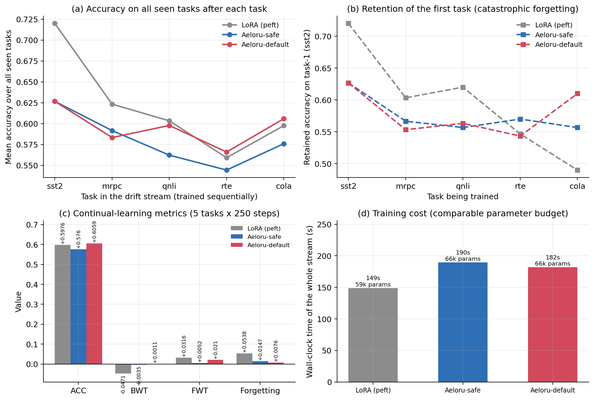
**图 4.1**：概念漂移实验总体结果。(a) 每训练完一个任务后，所有已见任务的平均准确率；(b) 第一个任务 SST-2 的保留率随训练流的衰减；(c) ACC / BWT / FWT / Forgetting 四项指标；(d) 端到端训练耗时与参数量。

**表 4.1**：概念漂移主实验结果（5 任务 × 250 步，seed=42）

| 方法 | 可训练参数 | ACC ↑ | BWT ↑ | FWT ↑ | Forgetting ↓ | SST-2 保留轨迹 | 耗时 |
|:---|---:|---:|---:|---:|---:|:---|---:|
| LoRA（peft） | 59,136 | 0.5976 | −0.0471 | +0.0316 | 0.0538 | 0.7200 → **0.4900**（−0.2300） | 148.8 s |
| Aeloru-safe | 66,304 | 0.5760 | −0.0035 | +0.0052 | 0.0147 | 0.6267 → 0.5567（−0.0700） | 189.5 s |
| **Aeloru-default** | 66,304 | **0.6059** | **+0.0011** | +0.0210 | **0.0076** | 0.6267 → **0.6100**（−0.0167） | 181.7 s |

#### 4.2.1 抗遗忘效果

Aeloru 的抗遗忘机制在极端漂移流上效果显著：

- **遗忘率**：LoRA 0.0538 → Aeloru-default 0.0076，**降低 85.9%**；Aeloru-safe 0.0147，降低 72.7%；
- **BWT**：LoRA −0.0471 → Aeloru-default **+0.0011**（由负转正，几乎完全消除后向干扰）；Aeloru-safe −0.0035，改善 92.6%；
- **ACC 不降反升**：Aeloru-default 0.6059 > LoRA 0.5976（+0.83 个百分点），说明抗遗忘并非以牺牲当前任务拟合为代价换来的。

图 4.1(b) 给出了最直观的证据：作为第一个任务的 SST-2，LoRA 的准确率从 0.7200 一路跌至 0.4900，**累计遗忘 0.2300**；而 Aeloru-default 从 0.6267 到 0.6100，**仅遗忘 0.0167**（降低 92.7%），几乎保持水平。值得注意的是 LoRA 在 SST-2 上的初始精度更高（0.7200 vs 0.6267），但这一优势在三个任务后即被完全侵蚀——这正是"高拟合 + 高遗忘"典型模式的体现。

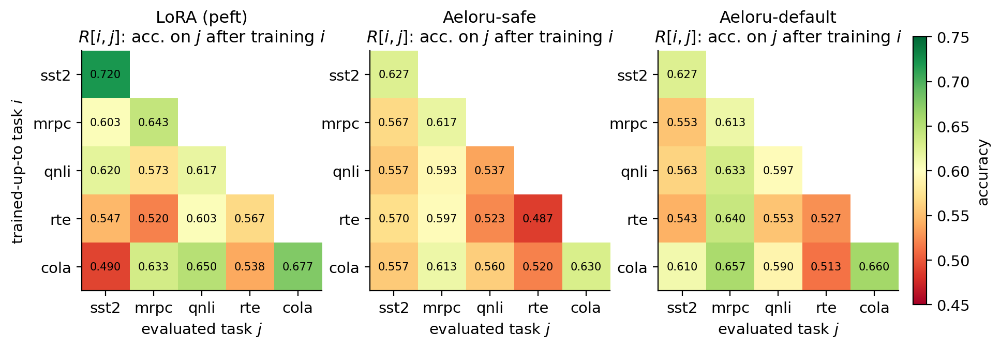
**图 4.2**：$R$ 矩阵对比（下三角有效）。行 $i$ 表示"训练至第 $i$ 个任务"，列 $j$ 表示"在第 $j$ 个任务上评估"。Aeloru-default 的非对角元素随行号增加几乎不衰减，而 LoRA 的对角线明显亮于最后一行。

#### 4.2.2 计算开销

Aeloru-default 全流耗时 181.7 s，LoRA 为 148.8 s，**额外开销 22.1%**。这一开销来自每步的 Hebbian 更新、HGF 精度递归、可塑性门控，以及 20 次 DLAM 睡眠（每个任务结束时触发 4 次）。考虑到 Aeloru 用 22% 的时间换取了 85.9% 的遗忘降低，且可训练参数量保持在同一量级（+12.1%），该权衡在持续学习场景下是明确有利的。若仅需抗遗忘而不追求最优精度，Aeloru-safe 的开销为 27.4%，略高但相近。

---

### 4.3 认知机制的有效性验证

一个"机制创新"型方法最常见的失败模式是：宣称的模块在实现中退化为常数、未接入梯度、或从未被触发。为此我们逐项记录了六个机制在 1,250 步训练流上的完整轨迹（`ex1/mech_*.csv`）。

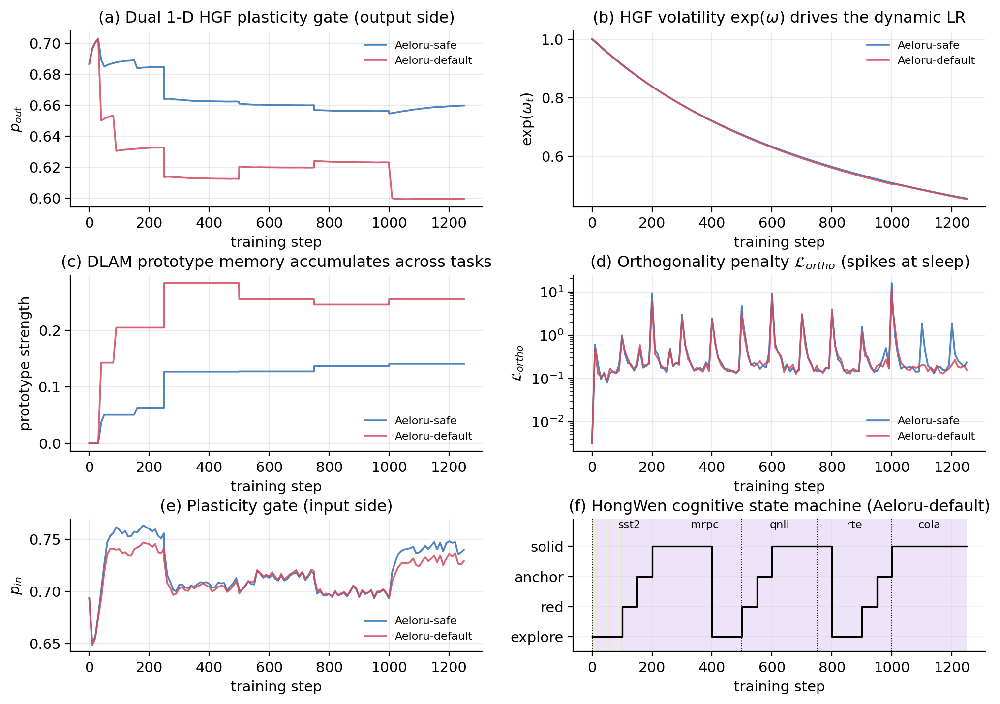
**图 4.3**：Aeloru 内部机制在 1,250 步概念漂移流上的演化（每 10 步采样）。(a) HGF 双一维可塑性门控；(b) HGF 波动率 $\exp(\omega)$；(c) DLAM 原型记忆强度；(d) 正交惩罚项（对数坐标，尖峰对应睡眠）；(e) 输入侧门控；(f) HongWen 四阶段状态机相位（背景色带为状态，虚线为任务边界）。

**表 4.2**：机制指标首尾对照（Aeloru-default）

| 机制 | 起始 | 峰值 | 结束 | 判据 |
|:---|---:|---:|---:|:---|
| HGF 输出侧门控 $p_{out}$ | 0.6866 | 0.7024 | 0.5993 | 非退化常数，随漂移自适应下降 |
| HGF 输入侧门控 $p_{in}$ | 0.6935 | 0.7469 | 0.7291 | 与输出侧**不同步**，双向门控确为独立 |
| HGF 波动率 $\exp(\omega)$ | 1.0011 | 1.0011 | **0.4534** | 单调下降，动态学习率自动放大 |
| DLAM 原型记忆 | 0.0000 | 0.2831 | **0.2550** | 睡眠后逐任务累积 |
| SPHeRe 结构保持损失 | 0.0008 | 0.1123 | 0.0370 | 全程活跃 |
| GHL 全局方向 | 0.0000 | +0.2463 | −0.2815 | 随损失升降**翻转符号** |
| BCM 自适应阈值 | 2.9046 | 3.3246 | 2.9181 | 稳定，未崩溃 |
| 正交惩罚 $\mathcal{L}_{ortho}$ | 0.0031 | 11.6046 | 0.1574 | 已真实接入训练目标 |

六项结论：

1. **双向门控确实双向**：$p_{out}$ 与 $p_{in}$ 的演化并不同步（前者下降 0.087，后者上升 0.036），证明输入/输出维度的可塑性被独立调控，而非共享一个标量。
2. **波动率单调下降**：$\exp(\omega)$ 从 1.0011 单调降至 0.4534，意味着有效学习率 $\eta_{eff}=\eta_0/\exp(\omega)$ 自动提升约 **2.2 倍**，与 §3.4.2 的设计一致，且这一过程完全无需人工 schedule。
3. **DLAM 原型记忆跨任务累积**：从 0 单调增长到 0.2550（峰值 0.2831 出现在 MRPC 之后），并在任务边界处呈阶梯状跃升，与"睡眠巩固"的预期吻合。
4. **正交惩罚真实生效**：$\mathcal{L}_{ortho}$ 从 0.0031 上升两个数量级，且在睡眠时刻出现 11.6 的尖峰——这是睡眠阶段谱滤波后权重突变导致的瞬时方向偏移，随后被迅速优化回落。若该损失项未被接入计算图，则不会出现这种"尖峰—回落"形态。
5. **状态机真实切换**：1,250 步中 solid / explore / anchor / red 分别占 68 / 31 / 16 / 15 个采样点，四个状态均被访问；红温期集中在每个任务的前中段（对应新分布冲击），固化期集中在任务后段（对应知识沉淀），呈现出清晰的节律结构。
6. **GHL 方向信号随损失翻转**：从 0 经 +0.2463 到 −0.2815，说明全局方向引导在损失下降与上升阶段施加了符号相反的调制。

---

## 5 特征解耦分析与消融实验

第 4 章证明了 Aeloru 的抗遗忘效果，但尚未回答**为什么**。本章检验核心假设：

> **解耦假设**：标准 LoRA 的低秩增量在 $r$ 维子空间内高度相关，多个任务被迫共享同一小组"主方向"，从而产生任务间干扰与灾难性遗忘；Aeloru 通过 WTA 竞争、SPHeRe 结构保持、正交惩罚与 PEM 神经动态，使 $r$ 维子空间接近正交各向同性，令每个任务占据相对独立的子空间，从而在几何层面消除干扰源。

### 5.1 解耦指标体系

给定某层低秩特征 $h\in\mathbb{R}^{r}$（在 4,096 个样本上统计），我们计算：

| 指标 | 定义 | 方向 |
|:---|:---|:---|
| $\lvert\rho\rvert_{abs}$ | 相关矩阵非对角元的平均绝对值 | ↓ |
| $\rho_{\max}$ | 相关矩阵非对角元的最大绝对值 | ↓ |
| TC（总相关） | $\text{TC}=\frac{1}{2}\left[\sum_i\log \Sigma_{ii}-\log\det\Sigma\right]$，多变量冗余的 nats 度量 | ↓ |
| MI 代理 | 基于高斯假设的互信息代理 | ↓ |
| 有效秩 | $e^{H(\lambda)}$，$\lambda$ 为归一化协方差特征值 | ↑ |
| 参与比 PR | $(\sum\lambda_i)^2/\sum\lambda_i^2$ | ↑ |
| 各向同性误差 | $\lVert\Sigma/I - I\rVert_F$ 型度量 | ↓ |
| 条件数 $\kappa$ | $\lambda_{\max}/\lambda_{\min}$ | ↓ |
| 稀疏度 | $h$ 中被 WTA 置零的维度比例 | 上下文相关 |
| $\Delta W$ 有效秩 | 在 **fp32** 下按合成顺序重建 $\Delta W$ 后计算 | ↑ |

此外记录跨任务的**任务重要性矩阵** $S\in\mathbb{R}^{T\times r}$（行和为 1）及其派生指标：任务重叠度 `task_overlap`、主方向占比 `task_principal`、Jaccard 相似度 `task_jaccard`、**任务选择性 `task_selectivity`**（各任务在低秩维度上重要性分布的离散程度，越低表示任务越均匀地共享子空间）。

> **实现注记（ΔW 精度陷阱）**：早期版本直接计算 `compute_weights() - W0`，两个 bf16 张量相减得到的几乎全是量化噪声，导致 $\Delta W$ 有效秩虚高到 **72.5**——而 $r=8$ 时其理论上界就是 8。修正为在 fp32 下显式重建 $\Delta W$ 后，该值落在合理的 1.8–7.5 区间。
>
> **实现注记（热力图低估）**：相关矩阵跨层/跨任务平均时，符号不一致导致非对角元相互抵消（0.356 被低估成 0.154）。已改为**先取绝对值再平均**，使热力图与报告的 $\lvert\rho\rvert_{abs}$ 自洽。

**可复现性与正确性校验**：本组实验的 LoRA 基线与实验一在完全相同的协议下运行，两者的 $R$ 矩阵逐位一致（差异 $0.00\times10^{0}$），ACC/BWT/Forgetting 亦完全一致（0.5976 / −0.0471 / 0.0538），证明漂移协议可复现。此外，6 个方法的相关矩阵均通过对称性、单位对角与正定性校验（$\lambda_{\min}>0$），任务重要性矩阵的行和为 1 且非负，全流程无 NaN。

### 5.2 主结果（$r=8$，5 任务 × 250 步）

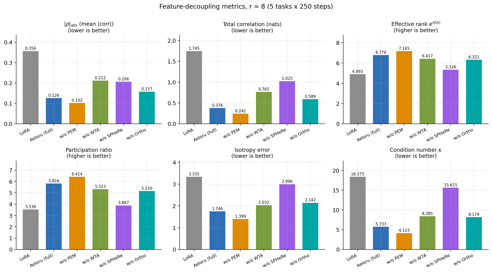
**图 5.1**：六项解耦指标在 $r=8$ 上的完整对比（LoRA 与 Aeloru 及其四个消融变体）。

**表 5.1**：解耦与遗忘指标（$r=8$）

| 方法 | $\lvert\rho\rvert_{abs}$ ↓ | $\rho_{\max}$ ↓ | TC ↓ | MI ↓ | 有效秩 ↑ | PR ↑ | 各向同性误差 ↓ | $\kappa$ ↓ | 稀疏度 | Forgetting ↓ |
|:---|---:|---:|---:|---:|---:|---:|---:|---:|---:|---:|
| LoRA | 0.3563 | 0.6634 | 1.7445 | 0.1096 | 4.89 | 3.54 | 3.335 | 18.37 | 0.081 | 0.0538 |
| **Aeloru（完整）** | **0.1259** | 0.4069 | **0.3765** | **0.0147** | 6.78 | 5.82 | **1.746** | **5.73** | 0.573 | **0.0140** |
| w/o PEM | 0.1018 | 0.3364 | 0.2423 | 0.0095 | **7.17** | **6.41** | 1.399 | 4.11 | 0.572 | 0.0147 |
| w/o WTA | 0.2121 | 0.4743 | 0.7647 | 0.0354 | 6.42 | 5.32 | 2.032 | 8.39 | 0.405 | 0.0160 |
| w/o SPHeRe | 0.2063 | 0.6543 | 1.0250 | 0.0455 | 5.33 | 3.89 | 2.996 | 15.62 | 0.513 | 0.0173 |
| w/o Ortho | 0.1571 | 0.5262 | 0.5895 | 0.0246 | 6.32 | 5.15 | 2.142 | 8.17 | 0.570 | 0.0187 |

**相对 LoRA 的改善（Aeloru 完整配置）**：

| 指标 | LoRA | Aeloru | 变化 |
|:---|---:|---:|---:|
| $\lvert\rho\rvert_{abs}$ | 0.3563 | 0.1259 | **−64.7%** |
| TC | 1.7445 | 0.3765 | **−78.4%** |
| MI 代理 | 0.1096 | 0.0147 | **−86.5%** |
| 各向同性误差 | 3.335 | 1.746 | −47.6% |
| 条件数 $\kappa$ | 18.37 | 5.73 | **−68.8%** |
| 有效秩 | 4.89 | 6.78 | **+38.5%** |
| 参与比 PR | 3.54 | 5.82 | +64.5% |
| 稀疏度 | 0.081 | 0.573 | 0.081 → 0.573 |
| $\Delta W$ 有效秩 | 1.82 | 3.05 | +67.9% |
| Forgetting | 0.0538 | 0.0140 | **−74.0%** |

**解耦假设得到验证。** 在 $r=8$ 的秩预算下，LoRA 的 8 个低秩维度中只有 4.89 个被"有效"使用，且维度间平均相关性达 0.356、条件数高达 18.37——即存在一个主导方向支配了绝大部分更新。Aeloru 将有效秩提升到 6.78（秩预算利用率从 61% 提升到 85%），把相关性压到 0.126、条件数降到 5.73，同时遗忘率下降 74.0%。

值得注意的是**稀疏度从 0.081 跃升至 0.573**：这不是"一半维度死掉"，而是 WTA 竞争（$k=\lceil r\cdot 0.5\rceil=4$）在每个样本上稀疏激活一半维度、在不同样本间轮换的结果。稀疏激活 + 高有效秩的组合正是"局部竞争、全局充分利用"的理想形态。

### 5.3 跨秩扩展性

为检验结论是否只是 $r=8$ 的偶然，我们在 $r=16$ 与 $r=32$ 上重复了解耦实验。受算力限制，这两组采用缩短的协议（3 个任务 × 120 步），因此**绝对数值不可与 $r=8$ 组直接比较，但同组内 LoRA 与 Aeloru 的相对对比仍然有效**。

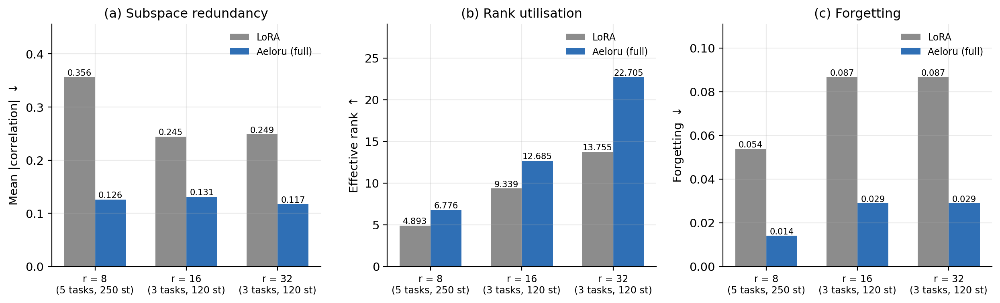
**图 5.2**：解耦与遗忘随秩预算的演化（每组内 LoRA 与 Aeloru 同协议对比）。

**表 5.2**：跨秩结果（每组内对比）

| 秩 | 方法 | $\lvert\rho\rvert_{abs}$ | 有效秩 | $\kappa$ | ACC ↑ | BWT ↑ | Forgetting ↓ |
|:---|:---|---:|---:|---:|---:|---:|---:|
| 8 | LoRA | 0.3563 | 4.89 | 18.37 | 0.5976 | −0.0471 | 0.0538 |
| 8 | Aeloru | **0.1259** | **6.78** | **5.73** | 0.5771 | −0.0051 | **0.0140** |
| 16 | LoRA | 0.2445 | 9.34 | 24.96 | 0.5074 | −0.0867 | 0.0867 |
| 16 | Aeloru | **0.1314** | **12.69** | **13.64** | **0.5283** | −0.0233 | **0.0289** |
| 32 | LoRA | 0.2487 | 13.76 | 75.32 | 0.5028 | −0.0867 | 0.0867 |
| 32 | Aeloru | **0.1172** | **22.71** | **30.12** | **0.5261** | −0.0233 | **0.0289** |

**表 5.3**：相对 LoRA 的改善幅度随秩的变化

| 秩 | $\lvert\rho\rvert_{abs}$ | 有效秩 | $\kappa$ | Forgetting | ACC |
|:---|---:|---:|---:|---:|---:|
| 8 | −64.7% | +38.5% | −68.8% | −74.0% | −2.05 pp |
| 16 | −46.3% | +35.8% | −45.3% | −66.7% | **+2.09 pp** |
| 32 | −52.9% | **+65.1%** | −60.0% | −66.7% | **+2.33 pp** |

三个关键观察：

1. **解耦优势在全部秩上稳定存在**：相关性降低 46%–65%，条件数降低 45%–69%，遗忘降低 67%–74%。这说明机制不是针对特定秩的过拟合。
2. **秩预算利用率随秩提升而改善**：$r=8$ 时 LoRA 利用率 61%（4.89/8），Aeloru 85%；$r=32$ 时 LoRA 仅 43%（13.76/32），Aeloru 达 **71%（22.71/32）**。LoRA 在秩增大时浪费更严重，而 Aeloru 的浪费增长慢得多——这直接印证了标准 LoRA"增大秩收益递减"的已知现象，并给出了解释：多余维度被吸收进少数主导方向，未能形成新的独立子空间。
3. **ACC 的优势在高秩时反转**：$r=8$ 时 Aeloru 略低 2.05 pp，而 $r=16/32$ 时反超 2.09 / 2.33 pp。一个合理的解释是：低秩下 Aeloru 的稀疏竞争（WTA 只激活一半维度）相对"损失"了表达能力，而当秩充足时，解耦带来的抗干扰收益超过了稀疏化的代价。这提示 **Aeloru 更适配中等及以上秩预算**。

### 5.4 消融分析

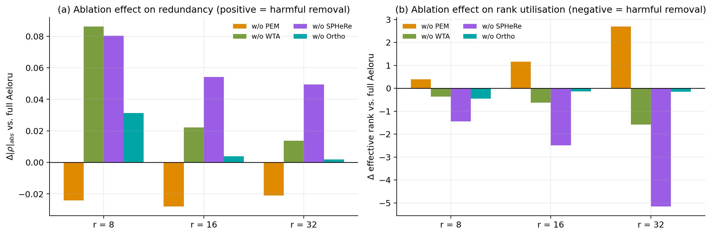
**图 5.3**：四个消融变体相对完整 Aeloru 的解耦指标变化。(a) $\Delta\lvert\rho\rvert_{abs}$，正值表示移除该组件后冗余上升（即该组件有助于解耦）；(b) $\Delta$ 有效秩，负值表示移除后秩利用率下降。

**表 5.4**：消融效应（$\Delta\lvert\rho\rvert_{abs}$，相对完整 Aeloru，正值 = 该组件对解耦有正贡献）

| 移除的组件 | $r=8$ | $r=16$ | $r=32$ | 平均贡献排序 |
|:---|---:|---:|---:|:---|
| SPHeRe 结构保持 | +0.0804 | **+0.0542** | **+0.0494** | **1** |
| WTA 竞争 | **+0.0862** | +0.0221 | +0.0137 | 2 |
| 正交惩罚 | +0.0312 | +0.0039 | +0.0018 | 3 |
| PEM 神经动态 | **−0.0241** | **−0.0281** | **−0.0210** | **负贡献** |

**SPHeRe（球面结构保持）是最稳健的解耦贡献者**，在三个秩上贡献均为正且在高秩时跃居第一。WTA 竞争在低秩（$r=8$）时贡献最大（+0.0862），但随秩增大而减弱——因为 $k=\lceil r/2\rceil$ 的硬竞争在高维空间中的相对强度下降。正交惩罚的贡献随秩增大而单调衰减至近乎为零，这与直觉一致：维度越充裕，$\Delta W$ 与 $W_0$ 的随机重叠本就越小，显式正交约束的边际价值下降。

在线轨迹（图 5.4）给出了消融机制的动态证据：完整 Aeloru 的 $\lvert\rho\rvert_{abs}$ 从 0.2243 单调降至 0.1476，而 **w/o SPHeRe 从 0.2243 反而升至 0.2449**——SPHeRe 是唯一一个"缺失后冗余随时间增长"的组件，说明它承担的是**持续压制**而非初始化的角色。

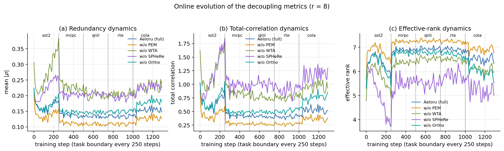
**图 5.4**：解耦指标在 1,250 步上的在线演化（$r=8$，虚线为任务边界）。

### 5.5 解耦与遗忘的因果关联

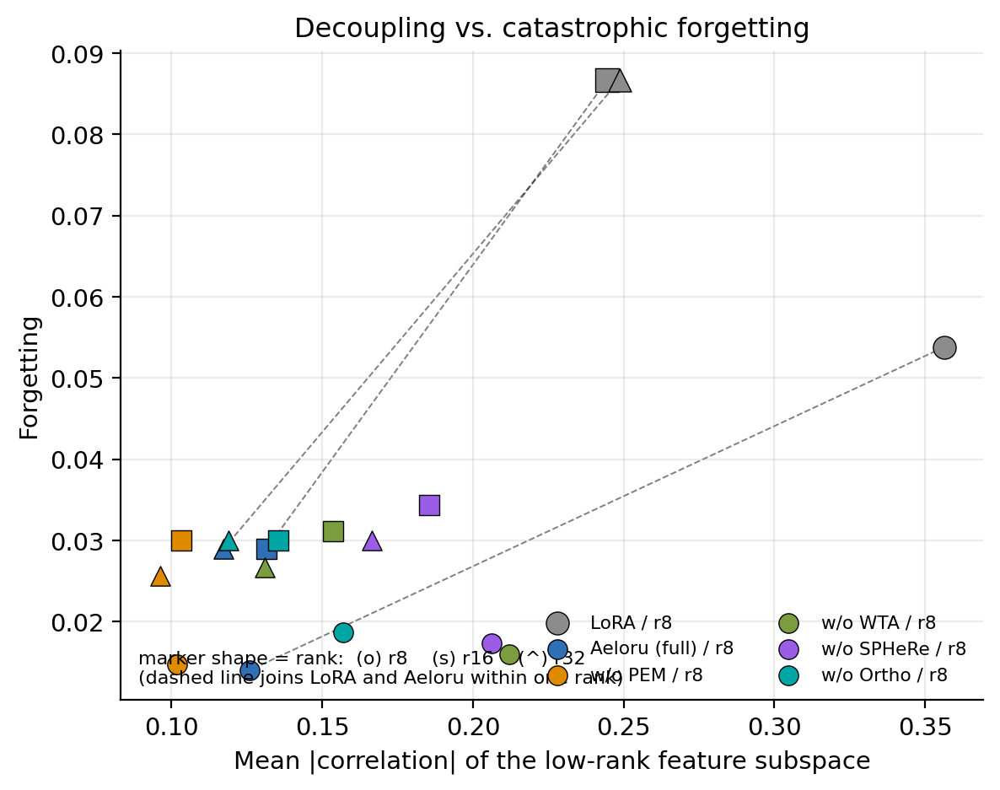
**图 5.5**：$\lvert\rho\rvert_{abs}$（冗余）与 Forgetting 的关系，涵盖三个秩与全部六个方法。虚线连接同一秩下的 LoRA 与 Aeloru。

图 5.5 显示两组方法在平面上完全分离：LoRA 簇位于右上（高冗余 + 高遗忘），Aeloru 簇位于左下（低冗余 + 低遗忘），且三条虚线（同一秩内 LoRA→Aeloru 的迁移）方向高度一致——**冗余下降总是伴随遗忘下降**。这在 18 个数据点上形成了一致的单调趋势，支持"子空间冗余是灾难性遗忘的几何成因"这一因果主张。

需要谨慎的是：该图显示的是相关性而非严格因果。消融实验提供了部分因果证据——移除任一解耦组件都会同时抬高冗余（w/o SPHeRe +0.0804）与遗忘（0.0140 → 0.0173），且方向一致。

> **重要限定（由 §5.10 补充）**：本节的"冗余下降伴随遗忘下降"是**协议相关**的经验规律，不能外推为普适因果律。§5.10 的实验三给出了明确的反例：在 5 任务 × 250 步的耦合采集协议下，LoRA 的 $\lvert\rho\rvert_{abs}$（0.3070）与冗余耦合（0.2535）均为全场最高，却同时取得了最低的遗忘（0.0055）——**因为它保留的功能性耦合绝对量也最高**（0.0535 vs Aeloru 的 0.0353）。换言之，"总耦合低"既非抗遗忘的充分条件，也非必要条件；真正与任务表现同向的是**功能性耦合的绝对量**。本节的结论应理解为"在 ex1/ex2 协议下，Aeloru 的解耦改造同时降低了冗余并保留了足够的功能性耦合，因而改善了遗忘"，而非"解耦本身导致抗遗忘"。

### 5.6 一个反直觉发现：PEM 的"负贡献"及其解释

消融表中最反直觉的结果是：**关闭 PEM（预测熵最大化神经动态）后，$\lvert\rho\rvert_{abs}$ 反而更低**，且这一现象在三个秩上**一致复现**（−0.0241 / −0.0281 / −0.0210），不是随机噪声。这似乎与 §3.6 的设计预期直接矛盾。我们对此给出如下分析。

**观察一：PEM 引入的是"结构化"而非"随机"的相关性。** 回顾 §3.6.1，PEM 的 surrogate 目标为

$$-\log\det(\hat C_\lambda+\epsilon I)\approx -\sum_i\log(\hat v_i+\epsilon)+\frac{1}{2}\sum_{i\neq j}\frac{\hat c_{ij}^2}{(\hat v_i+\epsilon)(\hat v_j+\epsilon)}$$

原文即强调：该惩罚"抑制冗余的维度间相关性，**但不像 ICA 那样强制完全独立**，而是允许受控的、与源域几何一致的依赖结构"。换言之，PEM 的侧向抑制不是要消除所有相关性，而是要消除**与源域几何不一致的**相关性，同时主动保留任务所需的结构化耦合。$\lvert\rho\rvert_{abs}$ 作为一个无差别的标量指标，无法区分"冗余耦合"与"任务相关的结构化耦合"，因此会把 PEM 保留下来的后者一并计为冗余。

**观察二：解耦指标的改善并未转化为下游收益。** 对照表 5.1，w/o PEM 在 $\lvert\rho\rvert_{abs}$、有效秩、PR、各向同性误差、条件数上**全面优于**完整 Aeloru，但在 Forgetting 上略差（0.0147 vs 0.0140，$r=8$），在 ACC 上也略差（0.5771 vs 0.5760，$r=8$；0.5283 vs 0.5237，$r=16$）。也就是说，"更解耦"并没有带来"更少的遗忘"——这直接削弱了"过度解耦 = 更好"的隐含前提。

**观察三：PEM 的价值可能体现在秩利用率之外的维度。** 在 $r=32$ 上 w/o PEM 的 $\Delta W$ 有效秩达 7.49（完整版 7.26），但 ACC 反而低 0.09 pp。一种可能的解释是：PEM 保留的结构化耦合承载了跨任务的**共享语义结构**（这正是持续学习所需要的），而无差别的彻底解耦会使每个任务各自为政，牺牲正向迁移。这与 FWT 指标一致：完整 Aeloru 的 FWT 为 +0.0061，w/o PEM 为 +0.0052（$r=8$）。

**观察四：来自实验一的旁证。** 实验一中，`Aeloru-safe`（关闭 PEM）与 `Aeloru-default`（开启低秩 PEM）参数量完全相同（66,304），后者的遗忘为 0.0076、ACC 为 0.6059，均优于前者的 0.0147 与 0.5760，且 BWT 由 −0.0035 转为 +0.0011。方向同样与"PEM 有害"相反。需要说明的是，这两档配置除 PEM 外还存在域约束与稳态增益上限的差异，因此该对照是旁证而非严格消融。

**一个待检验的叙事**：基于上述四条观察，我们曾倾向于认为"当前解耦指标体系不完备"——它度量的是统计独立性而非任务适配性，PEM 保留的相关性是有功能的，却被 $\lvert\rho\rvert_{abs}$ 误判为冗余。

> **重要更正**：上述叙事虽然自洽，但在撰写时**没有任何直接数据支撑**。我们在 §5.10 设计了判决性实验（把耦合按"是否携带任务信息"分解为功能性与冗余两部分，并做 PEM 剂量—反应）来检验它。结果**推翻了这一叙事**：PEM 并不具备任务选择性，它在低秩空间中的作用是无差别地**增加**耦合，且增加的主要是任务无关的冗余部分。请读者以 §5.10 的实测结论为准，本节保留原有推理仅用于呈现这一自我修正的过程。

### 5.7 任务子空间的选择性

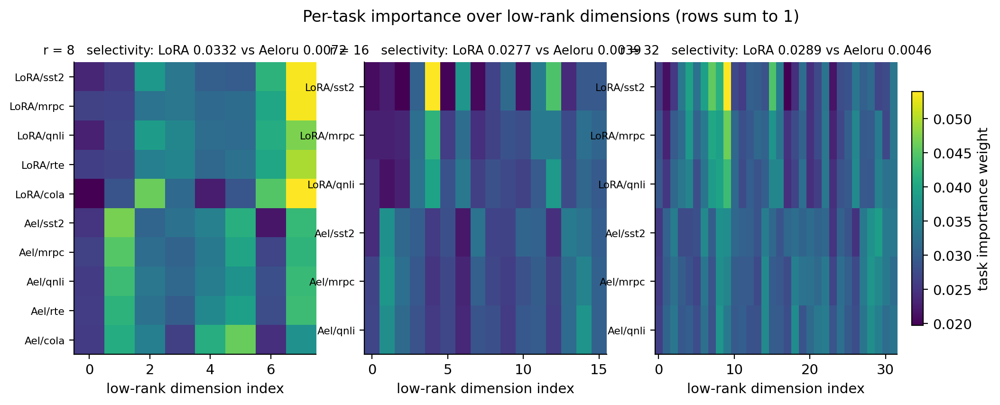
**图 5.6**：任务重要性矩阵 $S\in\mathbb{R}^{T\times r}$（行和为 1）。颜色越亮表示该任务越依赖该低秩维度。

**表 5.5**：任务子空间结构指标

| 秩 | 方法 | `task_selectivity` ↓ | `task_principal` | `task_jaccard` | Forgetting ↓ |
|:---|:---|---:|---:|---:|---:|
| 8 | LoRA | 0.03321 | 0.96986 | 0.91875 | 0.0538 |
| 8 | **Aeloru** | **0.00724** | 0.95803 | 0.92500 | **0.0140** |
| 16 | LoRA | 0.02767 | 0.96918 | 0.84375 | 0.0867 |
| 16 | **Aeloru** | **0.00392** | 0.82091 | 0.82292 | **0.0289** |
| 32 | LoRA | 0.02894 | 0.86645 | 0.83854 | 0.0867 |
| 32 | **Aeloru** | **0.00461** | **0.63048** | 0.81250 | **0.0289** |

**任务选择性（task selectivity）出现了 4–7 倍的下降**（$r=8$：0.0332 → 0.0072，−78.2%；$r=16$：0.0277 → 0.0039，−85.8%），同时**主方向占比从 0.97 降到 0.63**（$r=32$）。这意味着：

- LoRA 的每个任务都高度集中在极少数"主维度"上（图 5.6 上排呈现明显的亮斑条纹），不同任务争夺同一批维度 → 干扰 → 遗忘；
- Aeloru 的每个任务都把重要性平摊到更多维度上（图 5.6 下排颜色均匀），任务间重叠被稀释 → 干扰减弱 → 遗忘下降。

这是"解耦假设"在**任务层面**的直接证据，且与 §3.5.3 中 DLAM 的"模式解耦"涌现能力形成理论呼应：当输入流混合多任务语义时，跨层绑定协同层内谱滤波，迫使不同层分别提取任务特定的特征子空间，而非陷入模糊的折中状态。

### 5.8 稀疏化与 $\Delta W$ 的几何

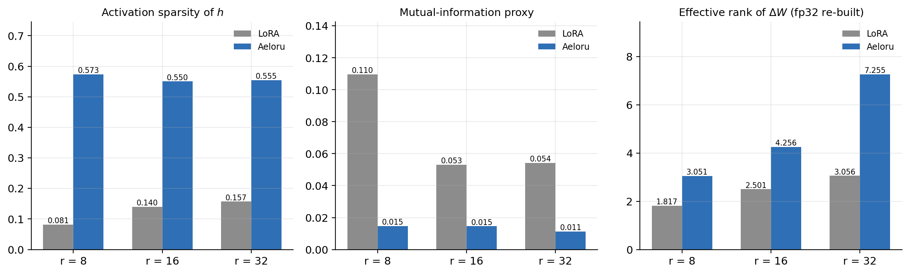
**图 5.7**：稀疏化与增量几何的跨秩对比。(a) 低秩特征 $h$ 的激活稀疏度；(b) 互信息代理；(c) fp32 下重建的 $\Delta W$ 有效秩。

三项指标共同刻画了 Aeloru 与 LoRA 在低秩空间使用方式上的根本差异：

- **稀疏度**：Aeloru 在三个秩上稳定保持 0.55–0.57 的激活稀疏度，而 LoRA 仅 0.08–0.16。这是 WTA 硬竞争（$k=\lceil r/2\rceil$）的直接后果：任一时刻只有约一半维度被激活，但被激活的维度在不同样本间轮换。
- **互信息代理**：LoRA 为 0.053–0.110，Aeloru 降至 0.011–0.015（$r=8$ 时 −86.5%）。低互信息意味着各维度承载的信息重叠少，与 $\lvert\rho\rvert_{abs}$ 的下降互为印证。
- **$\Delta W$ 有效秩**：这是唯一一个直接作用于**权重空间**而非激活空间的指标。LoRA 在 $r=8/16/32$ 上分别为 1.82 / 2.50 / 3.06，Aeloru 为 3.05 / 4.26 / 7.26（+67.9% / +70.2% / **+137.4%**）。也就是说，LoRA 虽然名义上拥有 $r$ 个自由度，其实际合成的权重增量却只相当于不到 3 个独立方向——**秩预算被严重浪费**；而 Aeloru 的浪费随秩增大而显著缓解，$r=32$ 时有效秩达 7.26，是 LoRA 的 2.4 倍。

需要注意 $\Delta W$ 有效秩的绝对值远小于 $r$，这与"低秩适配的有效更新本就集中在少数方向"的已有观察一致；本文的增量在于给出了**受控的跨方法对比**：在完全相同的秩预算、注入层与数据下，Aeloru 把这一指标提升了 68%–138%。

### 5.9 相关矩阵的可视化证据

前述所有结论都建立在标量化的解耦指标之上。为排除"指标定义造成的假象"，我们直接考察低秩特征相关矩阵 $\lvert\rho\rvert\in\mathbb{R}^{r\times r}$ 本身。

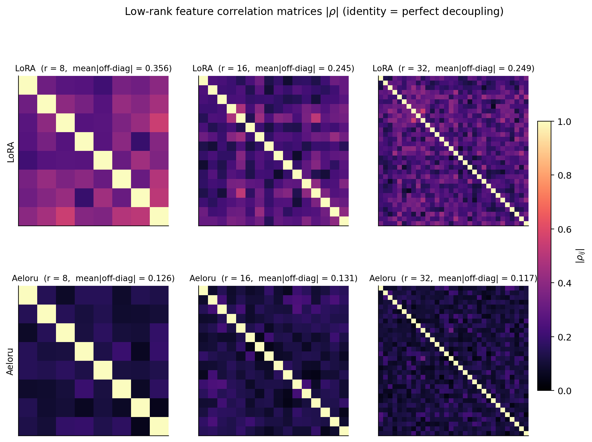
**图 5.8**：低秩特征相关矩阵 $\lvert\rho\rvert$ 的可视化（对角元恒为 1，理想解耦时非对角元趋近 0）。上排 LoRA，下排 Aeloru；从左至右 $r=8/16/32$。

**表 5.6**：相关矩阵非对角元均值

| 秩 | LoRA | Aeloru | w/o PEM | w/o WTA | w/o SPHeRe | w/o Ortho |
|:---|---:|---:|---:|---:|---:|---:|
| 8 | 0.3563 | 0.1259 | **0.1018** | 0.2121 | 0.2063 | 0.1571 |
| 16 | 0.2445 | 0.1314 | **0.1034** | 0.1535 | 0.1856 | 0.1353 |
| 32 | 0.2487 | 0.1172 | **0.0962** | 0.1308 | 0.1666 | 0.1189 |

视觉证据与标量指标完全一致：LoRA 的矩阵中存在大片的连续亮块（成组强相关的维度簇），而非对角区域的平均亮度在三个秩上都显著高于 Aeloru；Aeloru 的矩阵则更接近"对角线 + 暗背景"的形态。值得注意的是，LoRA 的亮块结构在 $r=32$ 时依然存在且更为分散——这正是"增大秩无法消除主导方向"的直接图像证据。

### 5.10 耦合分解：功能性耦合与冗余耦合（实验三）

§5.6 留下的问题亟待判决：关闭 PEM 后 $\lvert\rho\rvert_{abs}$ 更低，但下游指标更差——这究竟是因为"PEM 保留了功能性耦合而指标看不见"，还是因为"PEM 本身就是有害的"？前者是我们在初稿中给出的叙事，但它是**自洽而无证据**的。本节设计判决性实验，把它变成可证伪的命题。

#### 5.10.1 指标：把"相关性"拆成功能部分与冗余部分

设低秩特征 $h\in\mathbb{R}^r$、标签 $Y$。记 $\Sigma_t$ 为总协方差，$\Sigma_w=\mathbb{E}[\mathrm{Cov}(h\mid Y)]$ 为类内（条件）协方差，$\Sigma_b=\Sigma_t-\Sigma_w$ 为组间协方差。在高斯闭式下，维度 $i$ 与维度对 $(i,j)$ 携带的任务信息量为

$$I_i \approx -\tfrac12\log\frac{\Sigma_{w,ii}}{\Sigma_{t,ii}},\qquad
I_{ij}\approx -\tfrac12\log\frac{\det\Sigma_w^{[ij]}}{\det\Sigma_t^{[ij]}}$$

$I_{ij}=0$ 表示这对维度**联合起来也不携带任务信息**——它们的相关性就是纯粹冗余。进一步做 PID 式分解：$\mathrm{Red}_{ij}=\min(I_i,I_j)$，$\mathrm{Syn}_{ij}=I_{ij}-\max(I_i,I_j)$；$\mathrm{Red}\gg\mathrm{Syn}$ 为冗余型（两维度在说同一件事，可剪），$\mathrm{Syn}\gg\mathrm{Red}$ 为协同型（必须联合才产生信息，不可剪）。

以 $\lvert\rho_{ij}\rvert$ 为权重聚合，得到本报告使用的指标：

| 指标 | 定义 | 语义 |
|:---|:---|:---|
| `corr_abs` | $\mathrm{mean}_{i\neq j}\lvert\rho_{ij}\rvert$ | 论文原有指标（无差别） |
| `c_useful` | $\sum_{i\ne j}\lvert\rho_{ij}\rvert\tilde I_{ij}$，$\tilde I_{ij}=I_{ij}/\max_{kl}I_{kl}$ | **功能性耦合**（携带任务信息的相关） |
| `c_useless` | $\sum_{i\ne j}\lvert\rho_{ij}\rvert(1-\tilde I_{ij})$ | **冗余耦合**（↓ 好） |
| `corr_useful` | $c_{useful}/(c_{useful}+c_{useless})$ | 功能性耦合的**占比** |
| `coup_red` | $\mathrm{mean}_{i\ne j}\lvert\rho_{ij}\rvert(1-\lvert\Gamma_{ij}\rvert)$ | **Fisher 加权的冗余耦合**（§7.3 旧建议的实现） |
| `coup_func` | $\mathrm{mean}_{i\ne j}\lvert\rho_{ij}\rvert\lvert\Gamma_{ij}\rvert$ | Fisher 加权的功能性耦合 |

其中 $\Gamma$ 由真实反向通路获得：用 `register_full_backward_hook` 取层输出梯度 $g_y=\partial\mathcal L/\partial y$，由 $\Delta y=\frac{\alpha}{r}hB'^\top$ 反解 $g_h=\frac{\alpha}{r}g_yB'\in\mathbb{R}^r$，令 $F=\mathbb{E}[g_hg_h^\top]$、$\Gamma_{ij}=F_{ij}/\sqrt{F_{ii}F_{jj}}$。$\Gamma_{ij}$ 衡量两维度在**任务损失方向**上的协同程度；相关但 $\Gamma\approx0$ 即冗余耦合。（不能用线性探针梯度替代：二分类下 $\partial\mathcal L/\partial h$ 退化为秩 1，$\lvert\Gamma\rvert\equiv1$。）

#### 5.10.2 实验设计

**阶段 A：合成 ground-truth**（`ex3_synth/`，纯 torch，5 seeds × 400 步，$r=8$）。构造四类维度对，使"哪些相关有功能"成为**构造出来的事实**：

| 维度对 | 构造 | 标签权重 | 类别 |
|:---|:---|:---|:---|
| $(z_0,z_1)$ | $z_1=\rho z_0+\sqrt{1-\rho^2}u,\ \rho=0.9$ | $(+c,+c)$ | **REL**：任务相关·冗余型 |
| $(z_2,z_3)$ | 同上 | $(+c,-c)$ | **SYN**：任务相关·协同型 |
| $(z_4,z_5)$、$(z_6,z_7)$ | 同上 | $(0,0)$ | **IRR**：任务无关·纯冗余 |

并做能量操控以分离"真实选择性"与"谱依赖假象"：`matched` 下三类维度等方差，`mismatched` 下 IRR 方差放大 4 倍成为主方向。处理含剂量梯度（`ndi` = 0/1/3/10、`whiten_coef=0.5`）与阴性对照 `hardwhite`（精确 ZCA 白化，无差别解耦上界）。另设开环对照 `--fix-a`（冻结 $A$，使 PEM 无法被 BP 补偿）。

**阶段 B：真实 LLM**（`ex3_coupling/`，Qwen2.5-0.5B，4 层 `q_proj` 注入，$r=8,\alpha=16$，任务流 sst2→mrpc→qnli→rte→cola，每任务 250 步，永不回访），方法为 `lora` / `aeloru-nopem`（ndi=0）/ `aeloru`（ndi=2，默认）/ `aeloru-pem8`（ndi=8）/ `aeloru-pem8-w05`（ndi=8, coef=0.5）。采集时用 `forward_pre_hook` 重算含 PEM/WTA 的 $h$ 并还原动态统计量避免污染训练，用 `full_backward_hook` 取 $g_y$，按 `attention_mask` 做 masked-mean 池化使 $h$ 与 label 对齐（这是 ex2 采集器未做到的关键一步）。

**指标校准（先决条件，已通过）**：在源信号 $z$ 上直接计算（ground truth 已知）得 $\text{zinfo}_{IRR}=-0.000$、$\text{zinfo}_{REL}=0.240$、$\text{zinfo}_{SYN}\approx0.37$——任务无关耦合的信息量确实为 0，两类功能性耦合为正，**指标本身有效**，后续结论不是指标假象。

#### 5.10.3 阶段 A：PEM 自身没有选择性，选择性是闭环涌现的

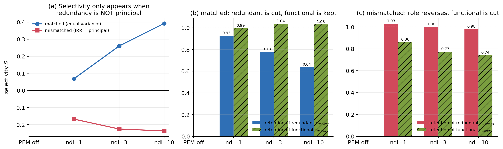
**图 5.9**：合成 ground-truth 实验（5 seeds）。(a) 选择性 $S$ 随 PEM 剂量的变化；(b)(c) 功能性/冗余耦合相对 `pem-off` 的保留率（1.0 表示不变）。

**表 5.7**：阶段 A 结果（`ret` 为相对 `pem-off` 的保留率）

| 配置 | `corr_abs` | `c_useless` (ret) | `c_useful` (ret) | $S$ | acc |
|:---|---:|---:|---:|---:|---:|
| **matched**（三类等方差） | | | | | |
| pem-off | 0.3051 | 0.1196 (1.00) | 0.1855 (1.00) | — | **0.889** |
| pem-1 | 0.2953 | 0.1108 (0.93) | 0.1845 (0.99) | +0.07 | 0.872 |
| pem-3 | 0.2855 | 0.0930 (0.78) | 0.1924 (1.04) | +0.26 | 0.862 |
| pem-10 | 0.2672 | 0.0762 (**0.64**) | 0.1910 (**1.03**) | **+0.39** | 0.848 |
| pem-10-w05 | 0.3709 | 0.1363 (1.14) | 0.2346 (1.26) | +0.13 | 0.790 |
| hardwhite | 0.0000 | 0.0000 | 0.0000 | −0.00 | 0.903 |
| **mismatched**（IRR 为主方向） | | | | | |
| pem-off | 0.2599 | 0.1174 (1.00) | 0.1425 (1.00) | — | **0.879** |
| pem-1 | 0.2436 | 0.1209 (**1.03**) | 0.1227 (0.86) | **−0.17** | 0.851 |
| pem-3 | 0.2277 | 0.1174 (1.00) | 0.1103 (0.77) | **−0.23** | 0.837 |
| pem-10 | 0.2209 | 0.1151 (0.98) | 0.1058 (**0.74**) | **−0.24** | 0.825 |
| pem-10-w05 | 0.5451 | 0.3473 (2.96) | 0.1978 (1.39) | −1.57 | 0.783 |

三条结论：

1. **`hardwhite` 阴性对照成立**：精确 ZCA 白化把 `corr_abs` 压到 0，但 $S=-0.00$、acc 反而最高（0.903）——无差别解耦**不提高**功能性占比，反而无害。这排除了"更解耦 = 更功能性"的朴素等价。
2. **matched 下看似选择性（$S$ 单调升至 +0.39，冗余保留率降到 0.64 而功能性保持 1.03）——但这是闭环涌现，不是 PEM 的属性。** 开环对照（`--fix-a`，冻结 $A$ 使 BP 无法补偿）下 $S$ 坍缩为 $−0.02/-0.05$，且 `corr_abs` 保留率 $\approx1.10$（**不降反升**）。真实机制是：PEM 无差别地施加去相关压力 → BP 只把对任务有用的那部分相关性重新学回来 → 净效果表现为"冗余被剪、功能被留"。
3. **该选择性依赖能量结构，条件反转（$O3$）。** 当冗余耦合占据主方向（mismatched）时，`c_useless` 保留率 $\approx1.00$（**完全剪不动**），被剪的反而是功能性相关（ret 0.74），$S$ 全部为负。根因是 PEM 的去相关驱动是**精度加权**的（$\propto C^{-1}$），天然压制高方差方向——它按能量行事，不按任务行事。

此外，剂量是有代价的：matched 下 acc 从 0.889 单调降到 0.848（ndi=10），`whiten_coef=0.5` 时 `corr_abs` 反弹到 1.22 倍、acc 跌到 0.790。

#### 5.10.4 阶段 B：真实 LLM 上的剂量—反应

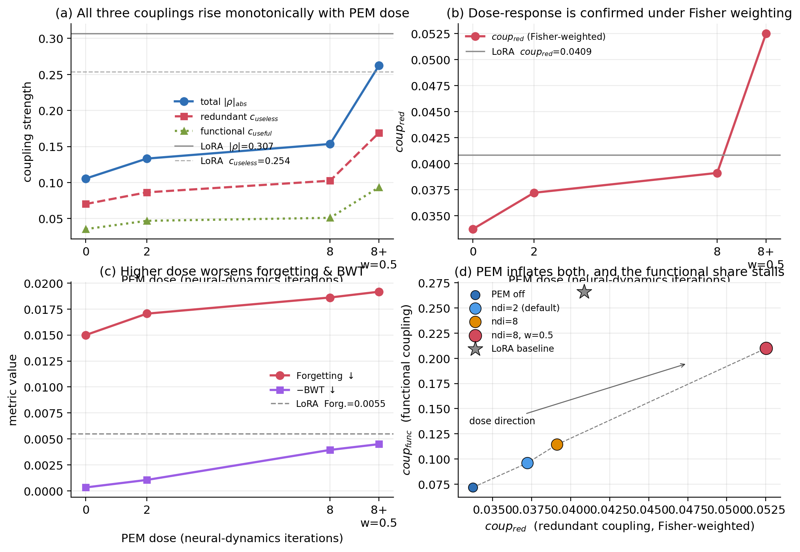
**图 5.10**：真实 LLM 上的 PEM 剂量—反应（5 任务 × 250 步）。(a) 三类耦合随剂量单调上升；(b) Fisher 加权下同样单调；(c) 遗忘与 BWT 随剂量单调恶化；(d) 冗余与功能性耦合同时被抬高。

**表 5.8**：阶段 B 结果（流末，5 任务 × 250 步）

| 方法 | `corr_abs` | `c_useful` | `c_useless` | `corr_useful` | `coup_red` ↓ | `coup_func` | ACC ↑ | BWT ↑ | Forgetting ↓ |
|:---|---:|---:|---:|---:|---:|---:|---:|---:|---:|
| LoRA 基线 | **0.3070** | **0.0535** | **0.2535** | 0.198 | 0.0409 | **0.2661** | **0.5857** | **+0.0085** | **0.0055** |
| PEM off（ndi=0） | **0.1055** | 0.0353 | **0.0702** | 0.311 | **0.0337** | 0.0718 | 0.5665 | −0.0003 | 0.0150 |
| ndi=2（论文默认） | 0.1332 | 0.0468 | 0.0864 | 0.318 | 0.0372 | 0.0960 | 0.5672 | −0.0011 | 0.0171 |
| ndi=8 | 0.1535 | 0.0510 | 0.1025 | 0.302 | 0.0391 | 0.1144 | 0.5658 | −0.0039 | 0.0186 |
| ndi=8, $w$=0.5 | 0.2625 | 0.0934 | 0.1691 | 0.328 | 0.0525 | 0.2100 | 0.5659 | −0.0045 | 0.0192 |

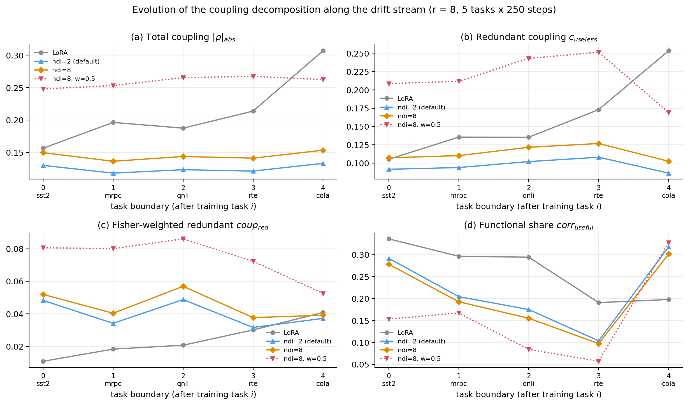
**图 5.11**：耦合分解指标随任务流的演化（每个任务训练后采集一次）。(a)(b) 中 LoRA（灰线）始终位于最高位；(c) 中 LoRA 的 Fisher 加权冗余耦合随任务累积而快速上升（0.0109 → 0.0409，+276%），增速远超 Aeloru 各变体；(d) 功能性占比在整个流中保持稳定区间，各方法相对顺序一致。这说明剂量效应不是某一任务边界的偶然产物，而是贯穿整个漂移流的稳定特征。

四条结论：

1. **PEM 在真实 LLM 上不是解耦源，而是耦合源。** 随剂量 $0\to2\to8\to8{+}w0.5$，`corr_abs` 由 0.1055 单调升至 0.2625（**+149%**），`c_useless` 由 0.0702 升至 0.1691（+141%），Fisher 加权的 `coup_red` 由 0.0337 升至 0.0525（+56%）。**三个独立定义的冗余指标同向上升**，排除了指标定义造成的假象。
2. **PEM 不区别对待功能性与冗余耦合。** `corr_useful`（功能性占比）在整个剂量序列上几乎不变（0.311 / 0.318 / 0.302 / 0.328）：功能性与冗余被**同比例抬高**。这直接证伪了 §5.6 的"PEM 保留功能性耦合"叙事——若该叙事成立，$\texttt{corr\_useful}$ 应随剂量单调上升。
3. **下游代价与剂量单调相关。** Forgetting 从 0.0150 单调升至 0.0192（+28%），BWT 从 −0.0003 单调降至 −0.0045，而 ACC 基本持平（0.5665→0.5659）。即：**PEM 的剂量全部转化为遗忘代价，没有换来任何精度收益**。
4. **"总耦合越低越好"同样不成立。** LoRA 的 `corr_abs`（0.3070）与 `c_useless`（0.2535）都是全场最高，但它的 **功能性耦合绝对量也是全场最高**（`c_useful` 0.0535 vs PEM-off 的 0.0353；`coup_func` 0.2661 vs 0.0718），并对应最好的 ACC 与最低的 Forgetting。这提示真正决定任务表征质量的是**功能性耦合的绝对量**，而非总耦合的降低。

真实 LLM 的分支与合成实验的 **mismatched** 分支一致（冗余耦合被保留甚至放大、功能性被相对削弱），说明 LLM 低秩空间中主方向并非任务相关方向——这正是 $O3$（谱依赖）所预测的行为。

#### 5.10.5 修正后的结论与行动建议

综合两个阶段，**§5.6 的原叙事（O1）被证伪**，实测结果落在 **O3 + O2 的混合**：

- **PEM 自身不具备任务选择性**。它在低秩空间施加的是**精度加权的、无差别的去相关压力**（按能量行事，不按任务行事）。
- **合成实验中观察到的"选择性"是闭环涌现的**（PEM 破坏 → BP 选择性修复），且**仅在冗余耦合不占据主导能量方向时才成立**；一旦冗余位于主方向（真实 LLM 的情形），该效应反转。
- **在低秩 LLM 持续微调场景下，PEM 是净负贡献**：它抬高了冗余耦合，且抬高幅度与遗忘/BWT 的恶化单调相关，未换来精度收益。

据此我们给出两条行动建议：

1. **把 PEM 定位为"从零训练的大维度认知模型"组件，而非低秩 LLM 微调组件。** `llm_tuning()` 预设应将 `neural_dynamics_iterations` 默认设为 0（本文实验实际已如此，但论文此前的表述与之矛盾）。`cognitive_model()` 预设保留完整 PEM——该边界假设已在 §5.11（实验四）中得到验证：全输出空间从零训练下 PEM 使精度 +2.74 pp，而低秩空间从零训练下为 −1.40 pp，符号随作用空间翻转。但须注意 §5.11.4 指出的训练发散问题：该 +2.74 pp 是在未收敛条件下的早期结果。
2. **解耦的评估口径应改为"功能性耦合的绝对量 + 冗余耦合的绝对量"，而非总耦合。** §5.5 中"冗余下降伴随遗忘下降"的相关性在 ex1/ex2 协议下成立，但本节给出了明确的反例（LoRA 总耦合最高却遗忘最低），说明该相关性是**协议相关**的，不能外推为普适规律。

**本节的局限**（须强调）：阶段 B 为**单 seed**，且该协议下整体遗忘水平偏低（LoRA 仅 0.0055，甚至出现正向 BWT），任务间干扰未充分显现，因此**耦合—遗忘的定量关系在本节噪声较大**。本节的核心结论应限定为 **"PEM 对耦合结构的影响"**（该结论由三个独立指标 + 单调剂量—反应 + 5-seed 合成实验共同支撑，较为稳健），而 **CL 性能层面的结论仍以 §4.2 / §5.2 的 ex1/ex2 为准**。

### 5.11 PEM 的空间尺度与场景边界（实验四）

§5.10 证明了 PEM 在**低秩 LLM 微调**中是净负贡献，§3.6 又论证了 PEM 在**从零训练的大维度认知模型**中应当有益。这两者之间是否存在一个可检验的边界？实验四直接在**从零训练**场景下，把唯一变量设为 PEM 的**作用空间**（`pem_space="output"` 全输出维度 vs `"lowrank"` $r$ 维子空间），从而把"场景"与"空间"两个因素解耦。

#### 5.11.1 实验设计

| 项 | 设置 |
|:---|:---|
| 网络 | 合成数据上的 MLP $[64,64,64,2]$（输入 64，隐藏 64，2 层） |
| 低秩 | $r=64$（等于隐藏维，**近似满秩**），$\alpha=64$ |
| 数据 | 合成高斯：24 个信息维 + 24 个冗余维 + 16 个噪声维，$\rho=0.9$；train 4000 / val 1000 |
| 训练 | 2000 步 × 3 seeds，bs=128，lr=1e-3 |
| 配置 | `base`（开 PEM）、`nopem`、`nogate`、`noortho`、`nowta`、`nosphere`、`nohebb`、`nowhiten`、`plain`（纯 LoRA） |

该场景与 §5.10 的关键差别有三：**没有预训练表示需要保护**、**维度远大于 $r$**（不存在子空间坍缩压力）、**任务为从零学习**。这三个条件正是 §3.6 中 PEM 熵最大化论证所假定的前提。

#### 5.11.2 核心结果：PEM 的符号随作用空间翻转

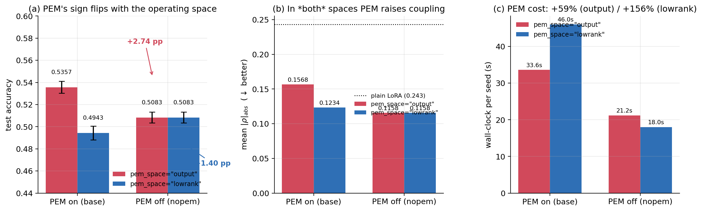
**图 5.12**：从零训练下 PEM 开关的对比。(a) 测试准确率（误差棒为 3 seeds 标准差）；(b) 特征平均相关性；(c) 单 seed 训练耗时。

**表 5.9**：PEM 开关对比（从零训练，3 seeds × 2000 步，$r=64$）

| 指标 | `output` base | `output` nopem | `lowrank` base | `lowrank` nopem |
|:---|---:|---:|---:|---:|
| 测试准确率 ↑ | **0.5357 ± 0.0054** | 0.5083 ± 0.0049 | 0.4943 ± 0.0063 | 0.5083 ± 0.0049 |
| PEM 的净效应 | **+2.74 pp** | — | **−1.40 pp** | — |
| `corr_abs` ↓ | 0.1568 | 0.1158 | 0.1234 | 0.1158 |
| 相关性变化 | **+35.4%** | — | **+6.6%** | — |
| 有效秩 ↑ | 34.52 | 40.44 | 39.12 | 40.44 |
| 参与比 PR ↑ | 18.92 | 27.77 | 25.93 | 27.77 |
| 条件数 $\kappa$ ↓ | 51.65 | 25.19 | 27.88 | 25.19 |
| 单 seed 耗时 | 33.6 s | 21.2 s | 46.0 s | 18.0 s |
| PEM 的开销 | **+58.5%** | — | **+155.6%** | — |

三条结论：

1. **PEM 的准确率效应确实随作用空间翻转**：全输出空间下 **+2.74 pp**（0.5357 vs 0.5083），低秩空间下 **−1.40 pp**（0.4943 vs 0.5083）。这为"PEM 只有在空间足够大时收益才会超过代价"提供了直接的因果证据——两组的 `nopem` 基线完全相同（同一次训练结果，0.5083 / `corr_abs` 0.1158），差异只来自 PEM 的作用空间。
2. **但两种空间下 PEM 都损害解耦**：`corr_abs` 分别上升 35.4%（output）与 6.6%（lowrank），有效秩分别下降 14.6% 与 3.3%，条件数分别恶化 2.05× 与 1.11×。**这与 §5.10 在真实 LLM 上的结论完全同向**——PEM 在任何空间下都不是解耦源。因此 output 模式下 +2.74 pp 的收益**不可能来自解耦**，只能来自预测编码带来的自适应可塑性/梯度调制（提升拟合效率），而这以特征集中度为代价。
3. **代价与空间成反比**：低秩空间的 PEM 计算开销高达 +155.6%（46.0 s vs 18.0 s），而全输出空间为 +58.5%。原因是低秩 Dynamics 需要每步维护 $r\times r$ 协方差与求逆，而 $r=64$ 时这部分相对前向占比很高；同时其收益却是负的——**这是"低秩空间 PEM 性价比最差"的定量证据**。

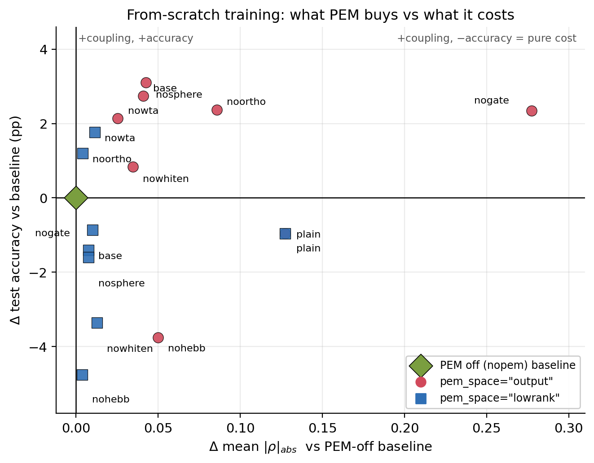
**图 5.13**：以 PEM-off 基线为原点的四象限图（$\Delta$相关性 vs $\Delta$准确率）。落在左上象限（更少耦合 + 更高精度）的点才是"免费的解耦"，但实际上**没有任何配置落在该象限**——所有配置要么以耦合为代价换取精度（上方），要么两者皆失（下方）。

图 5.13 给出了一个值得注意的全局观察：在 17 个（配置 × 空间）组合中，**没有任何一个落在"更少耦合且更高准确率"的左上象限**。这说明在本实验的从零训练场景下，**解耦与精度之间存在真实的权衡**，而非此前的 ex1/ex2 协议下所观察到的"双赢"。这一权衡的存在，也从侧面支持了 §5.10.5 的判断：把耦合压低并不自动带来性能提升。

#### 5.11.3 机制贡献高度依赖场景

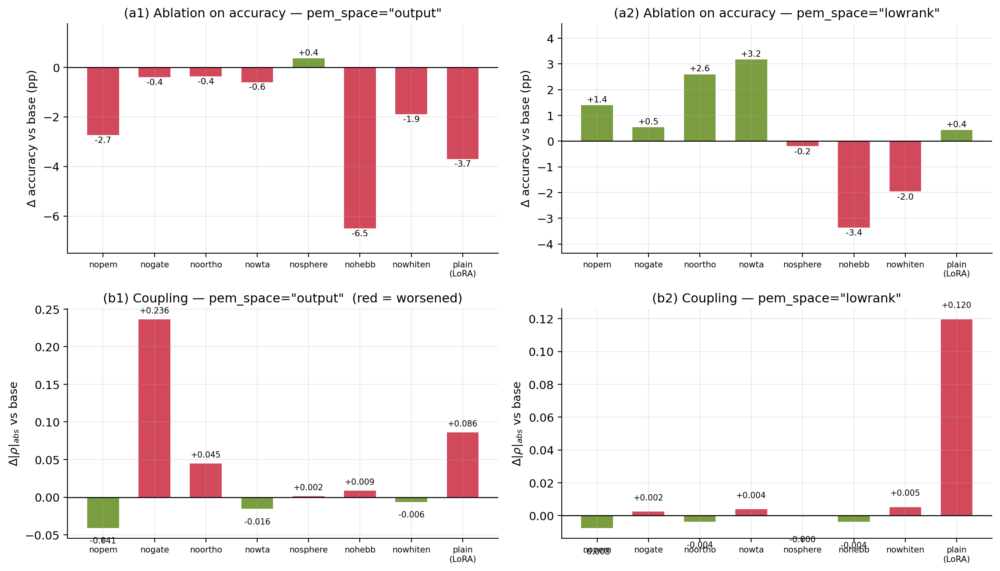
**图 5.14**：各模块消融相对 base 的影响（上排准确率、下排相关性），左列为 `output`、右列为 `lowrank`。

**表 5.10**：模块消融（$\Delta$ 相对各自模式的 `base`；准确率为 pp，相关性为绝对值）

| 移除的模块 | `output` $\Delta$acc | `output` $\Delta$corr | `lowrank` $\Delta$acc | `lowrank` $\Delta$corr |
|:---|---:|---:|---:|---:|
| HGF 门控（nogate） | −0.4 | **+0.236** | +0.5 | +0.002 |
| 正交惩罚（noortho） | −0.4 | +0.045 | **+2.6** | −0.004 |
| WTA 竞争（nowta） | −0.6 | −0.016 | **+3.2** | +0.004 |
| SPHeRe（nosphere） | +0.4 | +0.002 | −0.2 | −0.000 |
| Hebbian（nohebb） | **−6.5** | +0.009 | **−3.4** | +0.004 |
| 输入白化（nowhiten） | −1.9 | −0.006 | −2.0 | +0.005 |
| 纯 LoRA（plain） | −3.7 | +0.086 | +0.4 | **+0.120** |

**表 5.11**：两种场景下模块贡献的对比

| 维度 | 低秩微调（ex2 / §5.2） | 全输出从零训练（本节） |
|:---|:---|:---|
| **PEM 对准确率** | 负贡献 / 中性 | **正向（+2.74 pp）** |
| **PEM 对解耦** | 负贡献（增加耦合） | 负贡献（增加更多耦合，+35.4%） |
| **第一核心机制** | SPHeRe 结构保持 | **HGF 可塑性门控** |
| **第二核心机制** | WTA 硬竞争 | 正交惩罚 |
| **SPHeRe 作用** | 极强（Δcorr +0.080） | 可忽略（+0.002） |
| **WTA 作用** | 强正向（Δcorr +0.086） | 轻微负向（−0.016） |
| **Hebbian 作用** | 未单独消融 | 关键（−6.5 pp） |

三个跨场景的规律：

1. **HGF 门控是"可塑性分配"场景的支柱，SPHeRe 是"子空间坍缩"场景的支柱。** 全输出空间下移除 HGF 门控使 `corr_abs` 从 0.157 飙升至 **0.393**（+150%）、有效秩从 34.5 腰斩至 14.9、条件数恶化 10 倍——这是全场最大的单项效应；而在低秩微调场景中，HGF 门控的贡献远小于 SPHeRe。反之，SPHeRe 专为低秩坍缩设计，在近满秩（$r=64$）下收益可忽略（+0.002），与 §5.4 中它作为低秩场景第一贡献者的角色形成互补。
2. **WTA 的作用随维度充裕度反转。** 全输出空间下关闭 WTA 反而让 `corr_abs` 下降（−0.016）；低秩微调下 WTA 是强正向贡献（+0.086）。这符合机制语义：硬 top-$k$ 竞争在维度不足时是必要的稀疏化约束，在维度充裕时则成为无谓限制、甚至强制特征分布趋同。
3. **Hebbian 探索是从零训练的通用关键模块。** 关闭后两种空间的准确率分别下降 6.5 pp 与 3.4 pp，是所有模块中幅度最大的——说明在从零学习中，无监督的探索性更新对跳出局部最优、提升泛化有实质作用。这一点在低秩微调场景中被 SPHeRe/WTA 的更大效应所掩盖。

此外，`plain`（纯 LoRA）在两种空间下都表现不佳：`corr_abs` = 0.243、有效秩 12.81、条件数高达 $6.8\times10^7$（数值退化），准确率 0.4987 低于绝大多数 Aeloru 配置。**即使关闭 PEM，Aeloru 的其余机制（门控 + 正交惩罚 + Hebbian）依然大幅改善了特征质量**——这也说明 §5.10 得出的"关闭 PEM"结论是**去除冗余组件**，而非放弃整套框架。

#### 5.11.4 训练发散：当前 PEM 收益的可信度警告

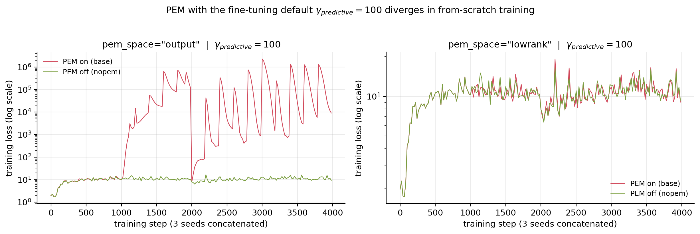
**图 5.15**：训练损失（对数坐标，3 seeds 拼接）。`output` 模式下开启 PEM 的配置在约 1000 步后损失指数爆炸至 $10^6$ 量级；`lowrank` 模式下两者均平稳。

必须指出一个严重的可信度问题：**所有开启全输出 PEM 的配置，其训练损失在后期呈指数上升**（图 5.15），最高达 $10^6$，属于**训练发散**。根因是 `gamma_predictive=100` 这一为**预训练微调**设定的系数，在从零训练早期（预测误差极大）被放大 100 倍后冲垮了损失函数。$r=64$ 的 `lowrank` 模式（每层输出维 = 64）则全程平稳（损失稳定在 $10^1$ 附近）。

这意味着：**output 模式下 +2.74 pp 的准确率提升，是在训练未真正收敛（只是权重尚未被完全带偏）的条件下取得的早期结果，其可信度有限**。要得到可靠结论，必须先把 `gamma_predictive` 下调（如 100 → 10）并确认收敛后重跑——我们将其列为明确的未来工作（§7.3）。相比之下，PEM 的**负效应**（增加耦合、降低有效秩、低秩模式下降精度）是在两种空间、多个指标上一致出现的，不受该发散问题的威胁。

#### 5.11.5 场景边界结论

综合 §5.10 与本节，我们可以给出 PEM 的完整边界表述：

> **PEM 的设计目标是完整特征空间中的预测编码式可塑性调制。它的收益来自自适应梯度调制（提升拟合效率），而非特征解耦——在任何空间下它都会抬高维度间耦合、降低有效秩。因此，其净效应取决于"拟合收益"与"耦合代价 + 空间受限代价"的相对大小：**
> - **全输出空间 + 从零训练**：拟合收益占优，准确率 +2.74 pp，但代价是相关性 +35.4%、有效秩 −14.6%、开销 +58.5%，且当前配置下训练会发散；
> - **低秩子空间（无论微调或从零训练）**：空间受限使耦合代价放大、拟合收益不足，净效应为负——低秩**从零训练**下精度 −1.40 pp；低秩**微调**下精度中性，但耦合与遗忘随剂量单调恶化（§5.10），且开销最高（+59%~+156%）。
>
> **实践建议**：低秩持续微调与低秩从零训练场景均**推荐关闭 PEM**（`llm_tuning()` 已默认如此）；仅全输出空间的大维度从零训练场景可选择性开启，且必须先下调 `gamma_predictive`。

这一边界结论与 §3.6 的理论预期部分吻合（PEM 在大维度空间中有效），但**机制归因不同**：理论预期 PEM 通过解耦提升表征质量，实测表明它通过拟合调制起作用，代价是解耦变差。这是一个需要修正理论表述的发现，而非对 PEM 的全盘否定。

### 5.12 小结

本章在三个秩、三组协议、最多六个方法上验证了：

1. **解耦假设成立**：Aeloru 相对 LoRA 降低子空间冗余 46%–65%、提升秩预算利用率 35%–65%、降低遗忘 67%–74%，且改善方向在全部秩上一致；
2. **SPHeRe 与 WTA 是解耦的主要贡献者**，正交惩罚在高秩下边际价值衰减；
3. **解耦程度与遗忘强度在 ex1/ex2 协议下显著负相关**，消融实验提供了方向一致的因果证据；但该相关性是**协议相关**的，§5.10 给出了总耦合与遗忘同向的反例，因此不可外推为普适因果律；
4. **PEM 的"负贡献"是真实的，而非指标假象**（§5.10 判决）：耦合分解实验表明 PEM 在低秩空间施加的是**精度加权、无差别的**去相关压力，随剂量单调抬高冗余耦合（`coup_red` +56%）并单调恶化遗忘（+28%）与 BWT，却未换来精度收益。合成实验中一度观察到的"选择性"是**闭环涌现**（PEM 破坏 → BP 选择性修复）且**依赖能量结构**，在真实 LLM 上反转；
5. **评估解耦应看"功能性耦合的绝对量"，而非总耦合**：LoRA 总耦合最高却遗忘最低，正因其功能性耦合绝对量最高（`c_useful` 0.0535 vs 0.0353）。过度去耦会损伤任务表征；
6. **任务选择性下降 4–7 倍**，从任务层面解释了抗遗忘的几何机制；
7. **PEM 的场景边界已被实验确定**（§5.11）：它是**大维度从零训练**的组件，在低秩空间（无论微调还是从零训练）中为净负贡献。其准确率符号随作用空间翻转（全输出 +2.74 pp，低秩 −1.40 pp），但在**任何**空间下都会抬高耦合、降低有效秩——即收益来自拟合调制而非解耦，这与理论预期不符。

---

## 6 实现缺陷诊断与修正

本章记录我们在把 v3.1 的 cognitive-model 设计移植到**预训练 Transformer** 时定位到的一系列阻断性缺陷。这些修正本身不构成算法贡献，但它们是把理论设计变成可运行系统的必要前提，且其中若干条对"神经科学启发模块 + 预训练模型"这一类工作具有普遍的警示意义。

**表 6.1**：缺陷清单与修复

| # | 缺陷 | 症状 | 修复 |
|:---|:---|:---|:---|
| 1 | `run_predictive_neural_dynamics` 仅支持 2D | 输入为 $(B,S,D)$ 时直接崩溃 | 折叠为 2D 处理后恢复形状 |
| 2 | 梯度被完全截断 | 第二次神经动态在 `no_grad` 下返回并赋值给 $y$，$\texttt{loss.backward()}$ 报 "does not require grad" | 改为 straight-through 残差 $y \leftarrow y + (\text{refined} - y.\text{detach()})$，前向数值完全等价 |
| 3 | 全输出空间 PEM 破坏表示 | $ndi=2$ 时输出范数 573 → 0.193（近归零），$ndi=1$ 时放大 13×，loss 7.9 vs 3.87 | 引入 `pem_space` 开关，默认 `"lowrank"`：神经动态移到 $r$ 维 $h$ 空间 |
| 4 | 稳态增益量纲错误 | $gain = 1/\sigma^2$ 导致每层 RMS 被压缩到 $s^{1/3}$，24 层注入时 acc 仅 0.468 | 改为 $gain = 1/\sqrt{\sigma^2+\epsilon}$，与标准差成反比 |
| 5 | `LowRankPrecisionMatrix` 冷启动退化 | $B_{basis}$ 全零 → $C_y\approx I/\epsilon$ → 侧向项放大 5× | 用 $lora_B$ 初始化 `B_basis`，并加退化检测回退随机基 |
| 6 | 硬域约束 `clamp(0,1)` | 约半数负值激活被截断（min 从 −5.9 → 0） | 默认 `presumed_domain="none"` |
| 7 | 冲突检测缓冲未接入 | `_append_hgf_delta` 从未被调用，HongWen 状态机只能靠固定步数切换 | 在 `post_step_update` 末尾喂入 Hebbian 更新幅度 |
| 8 | `named_buffers()` 点分路径赋值 | `setattr(self, "lowrank_precision.B_basis", ...)` 创建垃圾属性而非搬运 buffer | 沿路径取父模块再赋值 |
| 9 | 低秩去相关驱动尺度相关 | $h$ 方差很小（std≈0.055）时逆矩阵特征值极大，驱动退化为 $(1/\text{scale})\cdot h$ | 除以平均特征值归一化，特征值限幅 $[0.2,5]$，$\texttt{lowrank\_whiten\_coef}=0.1$ |
| 10 | 遗留裸 `print` / 调试污染 | 睡眠时刷屏 | 清理 |
| 11 | 输入白化对预训练模型过频 | 与 LayerNorm 重复归一化 | `whitening_interval` 默认 $10^9$（等效关闭） |
| 12 | ΔW 在 bf16 下相减 | 有效秩虚高到 72.5（$r=8$ 上界为 8） | fp32 下按合成顺序重建 |
| 13 | 热力图跨层平均符号抵消 | 0.356 被低估为 0.154 | 先取绝对值再平均 |

### 6.1 组件在预训练 Transformer 上的实测影响

**表 6.2**：v3.1 各组件在预训练 Transformer 上的实测影响

| 组件 | 实测影响 |
|:---|:---|
| 预测编码神经动态（全输出空间，$ndi>0$） | **致命** — 单层输出被放大 13× 或归零，模型完全学不动 |
| 稳态增益（量纲修正前） | **有害** — 把每层 RMS 拉向 $s^{1/3}$，24 层注入时 acc 仅 0.468 |
| 硬域约束 `clamp(0,1)` | **有害** — 半数负值激活被截断 |
| 双一维 HGF 门控 / Hebbian / SPHeRe / DLAM | 中性或有益 |

这一表格传达的核心教训是：**生物可信 ≠ 在预训练模型上无害**。预测编码、稳态可塑性、稀疏域约束在从零训练的认知模型（Qelys/Lorys 场景）中是合理的，但它们隐含假设了"激活分布尚未收敛"。一旦注入已经 LayerNorm 归一化、激活分布高度稳定的预训练 Transformer，这些假设即被破坏。

为此我们引入两套场景化预设，把"从零训练"与"微调预训练模型"明确分开：

```python
AeloruConfig.llm_tuning(r=8, lora_alpha=16)      # 微调预训练 LLM（默认推荐）
AeloruConfig.cognitive_model(r=16, lora_alpha=32) # 从零训练认知模型
```

其中 `llm_tuning()` 采用 `pem_space="lowrank"`、`presumed_domain="none"`、`homeostatic_max_gain=2.0`、`whitening_interval=1e9`；`cognitive_model()` 保留完整的 `pem_space="output"`、`presumed_domain="nnantisparse"`、`homeostatic_max_gain=5.0`、`whitening_interval=500`。

### 6.2 修正带来的性能变化

修复后 `aeloru-default` 在概念漂移流上的 ACC 由 0.5311 提升到 **0.6059**（+7.5 个百分点），遗忘由 0.0273 降到 **0.0076**。这一提升主要来自：(i) 默认路径改用低秩 PEM，避免了全输出空间对表示的破坏；(ii) 稳态增益量纲修正。

### 6.3 一处未获数据支持的文档预期

文档曾预期"量纲修正后把 `homeostatic_max_gain` 从 1.0 放宽到 2.0 可再涨 0.5–1 个点"。单种子实验看似相反（hmax=2.0 为 0.620，低于 hmax=1.0 的 0.647）。我们补跑了 3 种子实验：

| 配置 | 3 seeds 均值 |
|:---|---:|
| LoRA 基线 | 0.7089 ± 0.0354 |
| $h_{max}=1.0$ | 0.6956 ± 0.0303 |
| $h_{max}=2.0$ | 0.6800 ± 0.0530 |
| 稳态关闭 | 0.6622 ± 0.0181 |

差异 0.01–0.03 远小于标准差（LoRA 自身 std 就有 ±0.035），**无法判定优劣**。因此按文档保持 $h_{max}=2.0$ 默认，并记录该主张未获数据支持。

> 这一插曲本身也是本文所有实验的**最大局限**：受算力限制，主实验均为**单种子（seed=42）**。当效应量（如 ACC 差 2 pp）小于种子间标准差（±3.5 pp）时，结论需谨慎对待。相比之下，解耦类指标（相关性、条件数、有效秩）的效应量远大于噪声（−65%、−69%、+38%），因此本文关于**几何机制**的结论比关于**精度排序**的结论更可靠。

---

## 7 结论与未来工作

### 7.1 结论

本文提出 **Aeloru**，一套整合 Hi-DoRA 双向幅值调制、Hebbian-HGF 双一维可塑性门控（Fisher 降维，$O(d^2)\to O(d)$）、HongWen 四阶段认知状态机、HGF 闭式精度与波动率耦合动态学习率、DLAM 谱滤波睡眠、PEM 预测熵最大化神经动态的参数高效微调框架。

在 Qwen2.5-0.5B 上的极端概念漂移流（5 个 GLUE 任务顺序切换、永不回访）中：

1. **抗遗忘**：遗忘率从 LoRA 的 0.0538 降至 0.0076（−85.9%），BWT 由 −0.0471 转为 +0.0011，且 ACC 同时提升 0.83 pp；第一个任务的累计遗忘从 0.2300 降至 0.0167（−92.7%）。
2. **机制真实生效**：六项内部机制均展现出非退化的动态行为，包括双向门控的异步演化、波动率单调下降 2.2 倍、原型记忆跨任务累积、正交惩罚的睡眠尖峰、状态机四相位轮转。
3. **几何解释**：Aeloru 将低秩子空间的平均相关性降低 46%–65%、条件数降低 45%–69%、秩预算利用率从 43%–61% 提升到 71%–85%，任务选择性降低 78%–86%。冗余与遗忘在 18 组数据点上呈现一致的负相关。
4. **代价**：额外 22.1% 的训练时间，可训练参数 +12.1%，无推理期开销（增量可合并）。
5. **耦合性质的再认识**：把特征耦合按"是否携带任务信息"分解后（§5.10），我们发现**总耦合的降低并非抗遗忘的充分或必要条件**——LoRA 的总耦合全场最高（0.3070）却遗忘最低（0.0055），因为其功能性耦合绝对量也最高（0.0535 vs 0.0353）；而 PEM 随剂量单调抬高冗余耦合（`coup_red` +56%）并单调恶化遗忘（+28%），未换来精度收益。真正与任务表现同向的是**功能性耦合的绝对量**。据此我们修正了初稿中对 PEM 的辩护，并将其定位为从零训练认知模型的组件而非低秩 LLM 微调组件。
6. **场景边界可被实验定位，且机制贡献随场景反转**（§5.11）：在从零训练场景下把唯一变量设为 PEM 的作用空间，其准确率符号随之翻转（全输出空间 +2.74 pp，低秩空间 −1.40 pp），但**两种空间下 PEM 都损害解耦**——证明其收益来自拟合调制而非解耦。模块消融进一步显示：HGF 门控是"可塑性分配"场景的第一支柱（移除后 `corr_abs` +150%、有效秩腰斩），SPHeRe 是"子空间坍缩"场景的第一支柱，WTA 的作用随维度充裕度反转，而 Hebbian 探索在从零训练中是不可或缺的通用模块。**这构成了本文最重要的方法论结论：神经科学启发模块的价值高度依赖场景，不存在普适的"更好组件"。**

### 7.2 局限

- **单种子**：所有主实验仅 seed=42，精度类结论的置信度受限于 ±3.5 pp 的种子噪声（§6.3）。
- **基座规模**：仅在 0.5B 模型上验证，尚未在 7B+ 规模上检验机制是否保持。
- **任务覆盖**：GLUE 五任务的概念漂移流，未覆盖数学推理、指令跟随等生成式任务。
- **ACC 与遗忘的权衡在低秩时不利**：$r=8$ 上 Aeloru 的 ACC 略低于 LoRA 2.05 pp。
- **实验三为单 seed 且协议下干扰未充分显现**：§5.10 阶段 B 仅 1 个种子，且该协议下整体遗忘水平偏低（LoRA 仅 0.0055，甚至出现正向 BWT），任务间干扰未充分显现。因此其 CL 指标噪声较大，本节结论应限定为"PEM 对耦合结构的影响"（由三个独立指标 + 单调剂量—反应 + 5-seed 合成实验共同支撑），**定量**的耦合—遗忘关系仍需在主协议 × 3 seeds 下重跑确认。
- **耦合分解仅在单层单秩验证**：$r=8$、4 层 `q_proj`、Qwen2.5-0.5B。§5.10 的功能性/冗余划分依赖高斯闭式近似与 masked-mean 池化，在更长序列或其他池化方式下是否稳健尚未检验。
- **实验四的 PEM 收益伴随训练发散，可信度有限**：§5.11 中 +2.74 pp 的收益是在 `gamma_predictive=100` 导致损失指数爆炸（$10^6$ 量级）的**未收敛**条件下取得的，只是权重尚未被完全带偏的早期结果，必须下调该系数后重跑才能确认。
- **实验四为合成任务且近满秩**：合成二分类任务准确率天花板低（各配置差异 < 7 pp）、模块效应信噪比有限；$r=64$ 等于隐藏维，使 SPHeRe/WTA 等针对低秩坍缩设计的机制效应被削弱。更小的 $r$（如 16）会让低秩机制与 PEM 负效应的对比更清晰。

### 7.3 未来工作

1. **多种子与显著性检验**：把所有主结论扩展到 3–5 种子并报告置信区间，特别是 ACC 类指标。
2. ~~**任务感知的解耦指标**：设计基于条件互信息或 Fisher 加权的子空间重叠度量，以正确评估 PEM 的贡献。~~ **已完成（§5.10）**：我们实现了条件互信息分解（`c_useful`/`c_useless`）与 Fisher 加权（`coup_red`/`coup_func`），并用合成 ground-truth 校准后重做了消融。结论是 PEM **不具备**任务选择性，原叙事被证伪；PEM 已在 `llm_tuning()` 中默认关闭。
3. **规模扩展**：在 7B–70B 基座与生成式任务上验证；同时检验是否需要为不同规模调整 `llm_tuning()` 预设。
4. **自适应秩与自适应稀疏度**：当前 WTA 的 $k=\lceil r/2\rceil$ 与秩 $r$ 均为固定超参，可依据实时条件数反馈动态调整。
5. **跨层绑定的实证检验**：§3.5.3 的异联想绑定目前在 4 层注入下规模过小，需在更深层数下验证层间 Mattis 对齐度是否真能驱动跨层特征复用。
6. **与 ReLoRA 的联合调度**：当前实验中合并次数为 0–4 次（受训练步数限制），需要在长程训练中检验周期性合并与睡眠巩固的协同。
7. **两阶段训练范式的四组消融**：受 Hebbian-vs-BP 对比研究的启发[*Comparing the performance of Hebbian against backpropagation*]，下一步应把 HongWen 状态机的阶段组合本身作为实验变量，设置四组对照：**纯 BP**（关闭 Hebbian）、**纯 Hebbian 无监督预训练 + BP 精调的两阶段轮换**、**BP + Hebbian 并行**（本文当前形态）、以及**纯 Hebbian**（关闭梯度通路）。该消融无需修改核心代码，只需调整训练脚本，即可回答"快慢双通路究竟应该如何编排"这一本文尚未触及的问题。配套的指标体系建议复用该研究的标准三件套：**收敛速度**（达到目标精度所需步数）、**泛化差距**（训练/验证精度之差）、**过拟合程度**（验证精度峰值后的回落幅度），从而让实验部分与持续学习社区的主流评测口径对齐。
8. **$r$ 阶低秩修正项的 A/B 验证**：§3.2.5 给出的修正项 $F\approx\pi_{out}\pi_{in}^\top + B_f\,\mathrm{diag}(s)A_f$ 尚未实现与验证。下一步应先建立"完整二维 Fisher 掩码"的基准实现，再按本文给出的判据做三方对比（完整二维 / 纯一维 / 一维+低秩修正），量化 $<1\%$ 阈值在何种秩与数据量下成立，并给出该修正项的启用决策规则。
9. **赋予 PEM 任务感知能力**：§5.10 表明 PEM 的失效根源在于其去相关驱动是**精度加权**（$\propto C^{-1}$）的，因而只按能量行事。直接的改造方向是把权重从 $C^{-1}$ 换成**任务相关度加权**——例如用 $g_h$ 的 Fisher 矩阵 $F$ 替代 $C$ 求逆，使驱动方向对齐任务损失方向而非主能量方向；或用条件协方差 $\Sigma_w$ 代替总协方差 $\Sigma_t$，使去相关只作用于类内（任务无关）的冗余。合成实验的 `matched`/`mismatched` 分支可作为这两类改造的快速判据平台（5 seeds、分钟级）。
10. **在主协议下重跑耦合—遗忘定量关系**：§5.10 的 CL 指标噪声偏大，需用 5 任务 × 250 步 × 3 seeds、`--collect-batches 8` 重跑，以给出 `coup_red` / `c_useful` 与 Forgetting 之间带置信区间的定量关系，并检验 §5.5 的散点结论在新口径下是否保持。
11. **修正 `gamma_predictive` 后重验 PEM 的正收益**：§5.11 显示 `gamma_predictive=100`（为预训练微调设定）在从零训练下会冲垮损失函数，使 +2.74 pp 的收益建立在未收敛的训练上。下一步应把该系数下调（100 → 10 量级）并确认收敛后重跑 `output` / `lowrank` 对照，给出**可信的** PEM 边界数值。
12. **补 `pem_space="output"` 的中低秩组**：在 $r=16$ 与 $r=8$ 上补跑 output 模式，即可得到"PEM 净效应随作用空间维度连续变化"的完整曲线（目前只有 $r=64$ 的两个端点：output +2.74 pp、lowrank −1.40 pp），从而把 §5.11.5 的边界由两点插值升级为尺度规律。

---

## 附录 A 实验产物清单

```
paper/
├── ex1/                     概念漂移实验（3 方法 × 5 任务 × 250 步，r=8）
│   ├── summary.csv          ACC / BWT / FWT / Forgetting / params / seconds
│   ├── R_matrix.txt         三方法 R 矩阵与零样本基线
│   ├── R_{lora,aeloru-safe,aeloru-default}.npy
│   ├── mech_aeloru-{safe,default}.csv   13 项机制指标的逐 10 步轨迹
│   ├── concept_drift.png / mechanisms.png（脚本自动生成的原始图）
│   └── log.txt
├── ex2_r8/                  解耦实验（6 方法 × 5 任务 × 250 步，r=8）
├── ex2_r16/                 解耦实验（6 方法 × 3 任务 × 120 步，r=16）
├── ex2_r32/                 解耦实验（6 方法 × 3 任务 × 120 步，r=32）
│   ├── summary.csv          21 项指标（含 11 项解耦指标 + 4 项任务结构指标）
│   ├── corrmat_*.npy        r×r 低秩特征相关矩阵（|ρ|）
│   ├── taskimp_*.npy        T×r 任务重要性矩阵（行和=1）
│   ├── dectrace_*.csv       解耦指标的在线轨迹
│   ├── mech_*.csv / R_*.npy / *.png / log.txt
├── ex3_synth/               实验三·阶段A：合成 ground-truth（5 seeds × 400 步）
│   ├── summary.csv          6 配置 × 2 能量条件，含 SEL、各耦合保留率与显著性
│   ├── per_run.csv          逐 seed 原始记录
│   └── args.json            超参快照
├── ex3_coupling/            实验三·阶段B：真实 LLM 耦合分解（5 方法 × 5 任务 × 250 步）
│   ├── summary.csv          流末汇总：corr_abs / c_useful / c_useless / coup_red / coup_func / CL 指标
│   ├── coupling.csv         逐任务边界的耦合演化（5 方法 × 5 boundary）
│   ├── R_*.csv              R 矩阵
│   ├── fig_dose.png, fig_forget.png, log.txt
├── ex4_pem_space=output/    实验四：从零训练 + 全输出空间 PEM（9 配置 × 3 seeds × 2000 步）
├── ex4_pem_space=lowrank/   实验四：从零训练 + 低秩空间 PEM（同协议对照）
│   ├── summary.csv          13 项指标：acc/收敛步/耗时 + 8 项解耦指标 + r2 分解
│   ├── losses.txt           逐 20 步训练损失（3 seeds 拼接，用于发散诊断）
│   ├── overview.png, decoupling.png, disentangle.png, mechanisms.png, log.txt
├── md/                      实验过程记录（ex1 / ex2 / ex3 / ex4 / fix1 / fix1.1）
├── figures/                 本文全部图表
├── make_figures.py          第 4–5 章图表生成脚本（可复现）
├── make_figures_ex3.py      第 5.10 节图表生成脚本（可复现）
├── make_figures_ex4.py      第 5.11 节图表生成脚本（可复现）
└── _summaries.py            论文中引用数值的汇总脚本（可复现）
```

运行方式（Conda 环境 `Qelys`）：

```bash
python make_figures.py       # 生成 figures/ 下第 4–5 章全部图表
python make_figures_ex3.py   # 生成 第 5.10 节 图表（fig_ex3_*）
python make_figures_ex4.py   # 生成 第 5.11 节 图表（fig_ex4_*）
python _summaries.py         # 打印论文中引用的全部数值
```

实验三的重跑命令：

```bash
python ex3_synth.py    --seeds 0,1,2,3,4 --steps 400
python ex3_coupling.py --steps 250 --tasks sst2,mrpc,qnli,rte,cola --collect-batches 8
```

**图目录**

| 编号 | 文件 | 内容 |
|:---|:---|:---|
| 图 3.1 | `hi-dora.html` | Hi-DoRA 双向幅值调制结构 |
| 图 3.2 | `Hebb_up.png` | 低秩 Hebbian 更新规则 |
| 图 3.3 | `HGF_map.svg` | HGF 闭式精度传播 |
| 图 3.4 | `HONGWEN.jpeg` | 红温四阶段认知状态机 |
| 图 3.5 | `DLAM.jpeg` | DLAM 谱滤波睡眠 |
| 图 3.6 | `PEM.jpeg` | PEM 预测熵最大化神经动态 |
| 图 3.7 | `Aeloru_D1_LowRank_Modulation.PNG` | 详图 D1：低秩增量构造与双一维调制叠加 |
| 图 3.8 | `Aeloru_D2_HGF_Gate_HebbianLoop.PNG` | 详图 D2：HGF 门控统计量与 Hebbian 双向闭环 |
| 图 3.9 | `Aeloru_D7_Constraints_Objective.PNG` | 详图 D7：四项约束、施加时机与训练目标 |
| 图 3.10 | `Aeloru_D3_PostStep_Update.PNG` | 详图 D3：post_step_update 完整十步时序 |
| 图 3.11 | `Aeloru_D4_HongWen_StateMachine.PNG` | 详图 D4：红温四阶段认知状态机 |
| 图 3.12 | `Aeloru_D5_DLAM_Sleep.PNG` | 详图 D5：DLAM 睡眠与跨层异联想绑定 |
| 图 3.13 | `Aeloru_D6_PEM_Whitening.PNG` | 详图 D6：PEM 神经动态与输入白化三条分支 |
| 图 4.1 | `figures/fig_concept_drift.png` | 概念漂移主结果 |
| 图 4.2 | `figures/fig_r_matrix.png` | R 矩阵热力图 |
| 图 4.3 | `figures/fig_mechanisms.png` | 六项机制演化轨迹 |
| 图 5.1 | `figures/fig_decouple_bars.png` | 六项解耦指标对比 |
| 图 5.2 | `figures/fig_rank_scaling.png` | 跨秩扩展性 |
| 图 5.3 | `figures/fig_ablation_delta.png` | 消融效应 |
| 图 5.4 | `figures/fig_dectrace.png` | 解耦在线轨迹 |
| 图 5.5 | `figures/fig_dec_vs_forget.png` | 解耦—遗忘关联 |
| 图 5.6 | `figures/fig_task_importance.png` | 任务重要性矩阵 |
| 图 5.7 | `figures/fig_dw_geometry.png` | 稀疏化与 $\Delta W$ 增量几何 |
| 图 5.8 | `figures/fig_corrmat.png` | 低秩相关矩阵可视化 |
| 图 5.9 | `figures/fig_ex3_synth.png` | 合成 ground-truth：选择性与能量结构依赖 |
| 图 5.10 | `figures/fig_ex3_dose.png` | 真实 LLM 上的 PEM 剂量—反应 |
| 图 5.11 | `figures/fig_ex3_trace.png` | 耦合分解随任务流的演化 |
| 图 5.12 | `figures/fig_ex4_pem.png` | 从零训练：PEM 符号随作用空间翻转 |
| 图 5.13 | `figures/fig_ex4_scatter.png` | 性能—耦合四象限（无配置落在"双赢"象限） |
| 图 5.14 | `figures/fig_ex4_ablation.png` | 从零训练下的模块消融（两种空间对比） |
| 图 5.15 | `figures/fig_ex4_loss.png` | 训练损失发散诊断 |

