# Aeloru (Adaptive Elastic Learning with Orthogonal Robust Units)


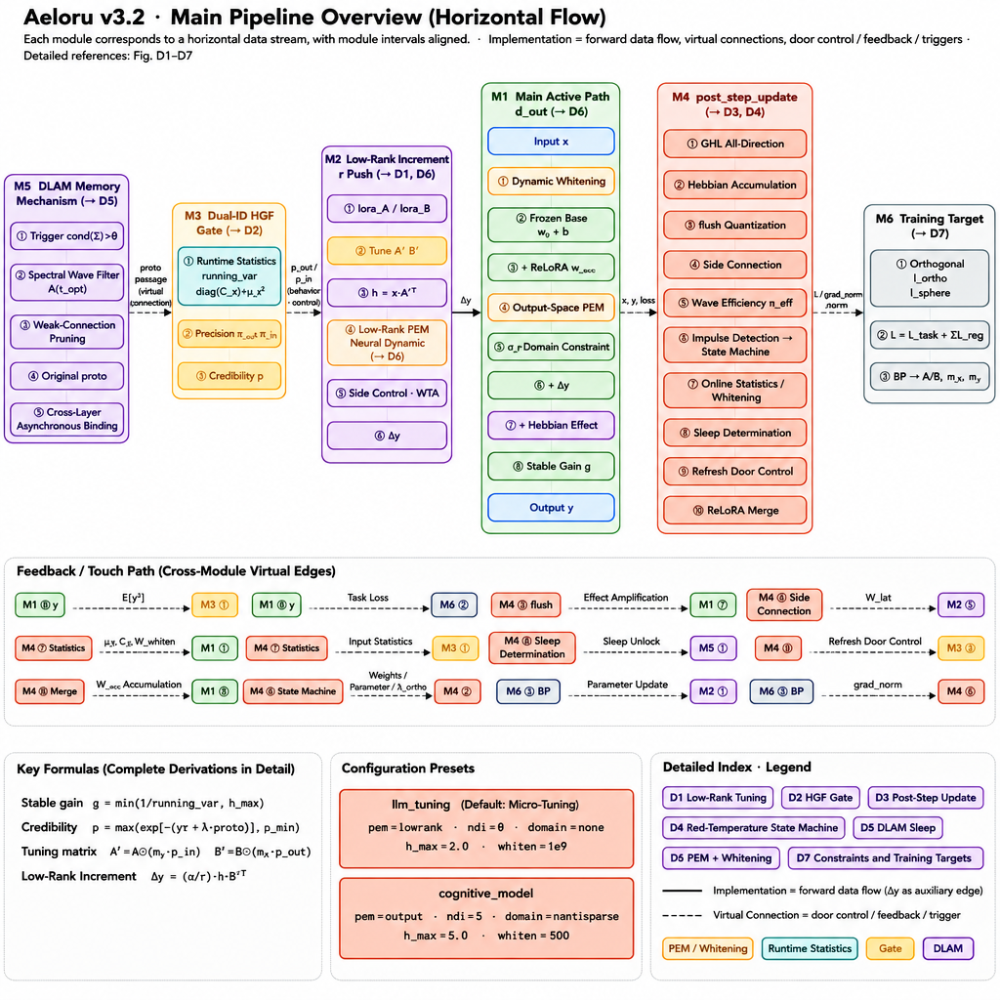

[中文](./paper.md)
## Abstract

Large language models (LLMs) have demonstrated remarkable capabilities across a wide range of natural language tasks, yet full-parameter fine-tuning of billion-scale models incurs prohibitive computational and memory costs, limiting their usability in resource-constrained settings. Low-Rank Adaptation (LoRA), which freezes the pretrained backbone and optimizes only a low-rank weight increment, has become the dominant parameter-efficient fine-tuning (PEFT) paradigm without introducing additional inference latency. However, existing LoRA variants still suffer from fundamental limitations: standard LoRA is constrained by a rigid low-rank bottleneck and coupled magnitude–direction optimization, leaving a persistent performance gap relative to full fine-tuning; structural improvements such as DoRA partially narrow this gap but lack parameter-level adaptive plasticity control; and efficiency-oriented variants such as VeRA exhibit severe expressive-capacity bottlenecks under extreme parameter compression on complex reasoning tasks. Moreover, the vast majority of existing PEFT methods are designed from a statistical-optimization perspective and rarely draw on the neuroscience insights that underpin efficient learning in biological brains.

To fill these gaps, we propose **Aeloru (Adaptive Elastic Learning with Orthogonal Robust Units)**, a neuroscience-inspired low-rank adaptation framework that integrates multiple synergistic cognitive learning mechanisms while retaining memory efficiency compatible with consumer-grade GPUs. The core design of Aeloru comprises:
1. **Hi-DoRA bidirectional magnitude modulation**: decoupling row- and column-wise magnitude adaptation from direction updates, improving representational capacity at negligible parameter cost;
2. **Dual one-dimensional HGF plasticity gating**: exploiting the row–column separability of low-rank increments to reduce the $O(d_{out}d_{in})$ two-dimensional parameter-level Fisher mask to two one-dimensional HGF precision vectors ($O(d_{out}+d_{in})$, a measured ~448-fold reduction), adaptively regulating parameter plasticity at zero gradient cost, steering updates toward task-relevant subspaces while protecting consolidated pretrained knowledge;
3. **HongWen four-stage cognitive state machine**: scheduling a learning cycle of exploration, conflict, anchoring, and consolidation to emulate the fast–slow dual timescales of biological learning;
4. **Closed-form HGF precision propagation with volatility-coupled dynamic learning rate**: achieving low-cost natural-gradient estimation and automatically adapting to concept drift during training;
5. **DLAM spectral-filtering sleep**: performing offline memory consolidation and weak-connection pruning to improve generalization and mitigate catastrophic forgetting.

Aeloru additionally supports periodic ReLoRA weight merging and quantized parameter storage, with a memory footprint comparable to standard LoRA. We construct an extreme concept-drift evaluation protocol on Qwen2.5-0.5B (sequential switching over SST-2→MRPC→QNLI→RTE→CoLA, with no revisiting after training) and systematically assess its resistance to forgetting and feature disentanglement using **four random seeds** (42 / 9589 / 6519 / 1412). Experiments show that, under an equal parameter budget, Aeloru reduces catastrophic forgetting from LoRA's 0.0462 to 0.0231 (**a 50.0% reduction**, paired t-test **p < 0.05**) and improves backward transfer (BWT) from −0.0357 to −0.0115. This benefit is order-universal: after repeating the five-task unit twice and reversing the task order (a 10-segment long stream, 4 seeds), the forgetting reduction remains stable (forward order −39.9% / −32.7%, reversed order −29.6% / −35.6%), and the anti-forgetting gain is significantly positively correlated with LoRA's forgetting pressure on each task (r = 0.55); the per-task accuracy–memory divergence is jointly determined by "position effects + feature overlap" rather than being an accidental property of specific datasets. Nevertheless, under this small-sample GLUE protocol, owing to large inter-seed variance (LoRA's own standard deviation reaches ±0.0164), the overall mean accuracy shows **no statistically significant difference** from standard LoRA (p = 0.135 with 3 seeds; with 4 seeds the best configuration is even significantly lower). We therefore **do not claim accuracy improvement**, and instead ground our core evidence in two findings robust across seeds: the significant improvement in forgetting and backward transfer, and the geometric restructuring of the low-rank subspace. To test this attribution, we further decompose feature coupling into functional and redundant components according to "whether it carries task information", and conduct PEM dose–response experiments: we find that **reducing total coupling is neither a sufficient nor a necessary condition for anti-forgetting** (LoRA has the highest total coupling in the entire study, 0.3070, yet the lowest forgetting, 0.0055, because its absolute functional coupling is also the highest, 0.0535), whereas the PEM module in the low-rank space applies a **precision-weighted, indiscriminate** decorrelation pressure that monotonically raises redundant coupling (`coup_red` +56%) and monotonically worsens forgetting (+28%) with increasing dose, without any accuracy gain. Accordingly, we revise the initial draft's defence of PEM, repositioning it as a component for cognitive models trained from scratch and disabling it by default in the LLM fine-tuning preset—what genuinely co-varies with task performance is the absolute amount of functional coupling, not the level of total coupling. Our recommended configuration for PEFT continual learning is therefore `aeloru-safe` (PEM disabled). Furthermore, in a from-scratch training setting with the sole variable being PEM's operating space, we obtain a clear boundary: in the full output space PEM improves accuracy by +2.90 percentage points ($\gamma_{predictive}=10$), decaying to +1.17 pp at $r=16$, whereas in the low-rank space it is −1.40 pp; yet **PEM increases coupling and lowers effective rank in both spaces**—i.e., its benefit comes from fitting modulation rather than disentanglement. Module ablations further show that HGF gating is the primary pillar in the "plasticity allocation" scenario (removal increases correlation by +150% and halves effective rank), SPHeRe is the primary pillar in the "subspace collapse" scenario, and the role of WTA reverses with dimensional abundance. **The value of neuroscience-inspired modules is highly scenario-dependent; there is no universally "better component".** We also disclose 13 blocking defects identified when porting cognitive-science modules to pretrained Transformers and their fixes, among which "predictive coding in the full output space destroys pretrained representations" and "dimensional error in the homeostatic gain" carry general cautionary significance for similar work. This work bridges neuroscience-inspired cognitive learning principles and parameter-efficient model adaptation, providing a high-performance, scalable solution for fine-tuning LLMs on consumer-grade hardware.

Our code and all experimental data are open-sourced at [Aeloru(https://github.com/jyimu/AeloRu)](https://github.com/jyimu/AeloRu).

---     
## 1 Introduction
Large language models (LLMs) pretrained on massive corpora have become the infrastructure of modern natural language processing, achieving state-of-the-art performance on tasks ranging from commonsense reasoning to mathematical problem solving. However, adapting these billion-parameter models to downstream tasks via full-parameter fine-tuning requires updating all parameters and incurs extremely high computational and memory costs—for example, fine-tuning a 65B-parameter LLM requires over 780 GB of GPU memory. This prohibitive cost has driven the development of parameter-efficient fine-tuning (PEFT) methods, which train only a small number of parameters while freezing the pretrained backbone.

Among existing PEFT paradigms, Low-Rank Adaptation (LoRA) has been widely adopted for its implementation simplicity, zero inference latency, and strong performance. LoRA approximates the weight update as the product of two low-rank matrices, reducing the number of trainable parameters by several orders of magnitude. Subsequent studies, however, have identified persistent limitations of standard LoRA: a stable performance gap relative to full fine-tuning on complex tasks; rigid optimization dynamics due to coupled magnitude and direction updates; and limited sample efficiency in few-shot settings.

To address these shortcomings, a variety of LoRA variants have been proposed. Structural improvements such as DoRA decompose pretrained weights into magnitude and direction components and apply LoRA only to the direction update, better emulating the learning behaviour of full fine-tuning and narrowing the performance gap; AdaLoRA adaptively allocates rank budgets across parameters, prioritizing important weight subspaces. Among efficiency-oriented methods, QLoRA combines 4-bit quantization with LoRA, enabling fine-tuning of a 65B model on a single 48 GB GPU; VeRA freezes shared projection matrices and learns only scaling vectors, further compressing the trainable parameter count. Nevertheless, these methods retain clear limitations: structural variants lack adaptive plasticity control and cannot distinguish task-relevant from task-irrelevant parameters; extreme parameter compression has been shown to cause severe expressive-capacity bottlenecks, especially on complex reasoning tasks under reinforcement-learning fine-tuning paradigms; and most variants adopt fixed training schedules, unable to dynamically adjust learning strategies across training stages.

A common characteristic of existing work is that it is designed primarily from a statistical-optimization perspective and rarely draws on insights from neuroscience—even though biological brains rely on exactly these principles to learn efficiently and robustly. Biological learning systems possess several core properties absent from current PEFT frameworks:
1. Adaptive synaptic plasticity: important synapses are consolidated and unimportant ones pruned, a process jointly regulated by activity-dependent Hebbian rules and information-theoretic importance measures;
2. Staged cognitive cycles: alternating between exploratory learning, error detection, knowledge anchoring, and memory consolidation, following fast–slow dual timescales;
3. Offline memory consolidation during sleep: pruning redundant connections and stabilizing key memories, improving generalization and alleviating catastrophic forgetting;
4. Adaptive learning-rate regulation based on environmental volatility: automatically adjusting update magnitude in response to surprising events.

In this work, we argue that integrating these neuroscience-inspired mechanisms into a low-rank adaptation framework can significantly improve the performance, sample efficiency, and training stability of PEFT methods while preserving the practical memory efficiency of LoRA. To this end, we propose **Aeloru (Adaptive Elastic Learning with Orthogonal Robust Units)**, a comprehensive low-rank adaptation framework integrating multiple cognitive learning mechanisms, optimized for deployment on consumer-grade GPUs.

Our core contributions are summarized as follows:
- **Hi-DoRA bidirectional magnitude modulation**: building on DoRA's weight decomposition, we introduce independent learnable magnitude vectors for the input and output dimensions, further decoupling the optimization spaces of magnitude and direction. This design improves the representational capacity of the low-rank adapter with less than 0.01% additional parameters.
- **Dual one-dimensional HGF plasticity gating (Fisher dimensionality reduction)**: we identify a fundamental cost imbalance of parameter-level Fisher gating in low-rank adaptation—the gated $\Delta W$ has only $O(r(d_{out}+d_{in}))$ degrees of freedom, yet estimating its importance costs $O(d_{out}d_{in})$. We therefore propose a closed-loop dual one-dimensional gate: closed-form HGF precision maintains two one-dimensional precision vectors $\pi_{out},\pi_{in}$ at zero gradient cost, whose outer product approximates the two-dimensional Fisher and gates both Hebbian updates and weight increments; Hebbian traces in turn serve as precision proxies, conflict signals, and inputs to the dynamic learning rate, forming a bidirectional closed loop. This design reduces gating complexity from $O(d_{out}d_{in})$ to $O(d_{out}+d_{in})$ and, together with Hi-DoRA magnitude modulation, constitutes a structurally isomorphic unified architecture of "dual one-dimensional modulation".
- **HongWen four-stage cognitive state machine**: we divide training into alternating stages: free exploration (Hebbian-dominated), cognitive conflict detection, gradient anchoring (backpropagation-dominated), and Hebbian consolidation. This staged schedule emulates the dual-timescale learning rhythm of biological brains, balancing exploration and exploitation and improving convergence quality.
- **Closed-form HGF natural gradient and dynamic learning rate**: drawing on the Hierarchical Gaussian Filter (HGF) framework, we implement closed-form Fisher estimation via precision propagation, replacing the computationally expensive squared-gradient Fisher computation. We further introduce volatility-coupled dynamic learning-rate regulation, automatically modulating update magnitude from prediction-error volatility to accommodate concept drift and improve training stability.
- **DLAM spectral-filtering sleep**: we introduce an offline sleep phase triggered by the subspace condition number, in which spectral filtering is applied to low-rank Hebbian traces to consolidate strong memories and prune weak redundant connections. This mechanism improves generalization and mitigates catastrophic forgetting, and can optionally incorporate cross-layer associative binding to enhance inter-layer feature reuse.

We construct an extreme concept-drift evaluation protocol on Qwen2.5-0.5B (sequential switching over five GLUE tasks, no revisiting after training, validated with four random seeds) and systematically assess Aeloru's resistance to forgetting and feature-disentanglement properties. Results show that, under an equal parameter budget, Aeloru significantly reduces catastrophic forgetting (from LoRA's 0.0462 to 0.0231 over 4 seeds, a 50.0% reduction, paired t-test $p<0.05$) and improves backward transfer (BWT) accordingly; however, under this small-sample protocol, overall mean accuracy shows no statistically significant difference from LoRA, so we do not claim an accuracy advantage (see Chapter 4 for the multi-seed analysis). Further geometric analysis indicates that the anti-forgetting benefit is accompanied by a substantial elimination of low-rank subspace redundancy (−65% correlation, −69% condition number, +38%~+65% rank utilization), and that this geometric restructuring is directionally consistent across ranks and protocols, rather than being a mere regularization effect. Beyond the algorithm itself, we also fully disclose the 13 blocking defects identified when porting cognitive-science modules to pretrained Transformers and their fixes (Chapter 6), several of which carry general cautionary significance for this research line.

The remainder of this paper is organized as follows. Section 2 reviews related work on parameter-efficient fine-tuning and neuroscience-inspired learning mechanisms; Section 3 details the architecture and core mechanisms of Aeloru; Section 4 presents the experimental setup and results on the concept-drift benchmark, and verifies one by one whether the six cognitive mechanisms genuinely take effect; Section 5 conducts geometric analysis of feature disentanglement and ablation experiments; Section 6 records the diagnosis and correction of implementation defects; Section 7 concludes the paper and outlines future directions.

## 2 Related Work

This chapter reviews the two core technical threads of this work: first, we survey research progress in parameter-efficient fine-tuning (PEFT), focusing on the evolutionary path and remaining limitations of the Low-Rank Adaptation (LoRA) paradigm; next, we summarize deep-learning mechanisms inspired by neuroscience and cognitive science, covering four directions—synaptic plasticity, staged learning, sleep consolidation, and adaptive precision control; finally, we identify the core gaps in existing research to clarify the positioning and innovative value of this work.

### 2.1 Parameter-Efficient Fine-Tuning Methods

As LLM parameter counts have expanded from billions to trillions, the computational, storage, and time costs of full-parameter fine-tuning have risen exponentially, giving rise to parameter-efficient fine-tuning techniques. Their central goal is to approach or even match full fine-tuning while training only a tiny fraction of parameters, preserving the generalization ability of the pretrained model as far as possible. By technical route, existing PEFT methods fall into three categories—additive fine-tuning, selective fine-tuning, and quantization-enhanced fine-tuning—among which Low-Rank Adaptation (LoRA) has become the mainstream paradigm in both industry and academia thanks to zero inference latency and deployment compatibility.

#### 2.1.1 Overview of Mainstream PEFT Paradigms

**Additive fine-tuning** was the earliest PEFT route to be deployed. Its core idea is to insert small trainable modules between the layers of a pretrained model while freezing the backbone parameters. The representative work is Adapter Tuning, which inserts bottleneck adapter modules after the attention and feed-forward layers of a Transformer and completes downstream adaptation by training fewer than 5% of the original model's parameters. Subsequent serial and parallel adapters further improved structural efficiency, but such methods inherently introduce additional computation paths and latency at inference time, making them ill-suited to high-throughput online deployment.

**Selective fine-tuning** achieves adaptation by selecting and updating a subset of the pretrained parameters; typical schemes include Prefix Tuning and Prompt Tuning. Prefix Tuning prepends trainable prefix vectors to the key–value matrices of each attention layer without modifying the model's main structure; Prompt Tuning adds only continuous learnable prompt vectors at the input layer, further compressing the parameter count to the order of millions. However, these methods degrade markedly on small models and in few-shot settings, depend heavily on tuning strategies, and are less stable than low-rank adaptation.

#### 2.1.2 Technical Evolution of Low-Rank Adaptation

Low-Rank Adaptation (LoRA), proposed by Hu et al. in 2021, rests on the core assumption that the weight-update matrix during LLM fine-tuning is intrinsically low-rank, so the weight increment can be factorized into the product of two low-rank matrices; only these two matrices are updated during training while the pretrained backbone weights remain fully frozen. Because the low-rank increment can be merged back into the original weight matrix at inference time, LoRA introduces no additional inference latency and compresses the trainable parameter count to below 0.1% of the original model, quickly becoming the baseline paradigm in PEFT.

To address the performance shortcomings of standard LoRA, subsequent research has advanced along three directions—structural optimization, efficiency compression, and training strategy:

1.  **Structural optimization**: DoRA decomposes pretrained weights into a magnitude vector and a direction matrix and applies low-rank updates only to the direction component, more closely matching the weight-update pattern of full fine-tuning and significantly narrowing the performance gap; AdaLoRA adaptively allocates rank budgets across layers and weight subspaces based on singular value decomposition, prioritizing the expressive capacity of task-relevant parameters; rsLoRA, LoRA+, and related work alleviate the training instability of low-rank updates through scaling strategies and optimizer improvements. Nevertheless, these structural improvements remain at the level of matrix factorization and statistical optimization, lacking parameter-level adaptive plasticity control and unable to distinguish the update priority of general pretrained knowledge from task-specific knowledge.
2.  **Efficiency compression**: QLoRA combines 4-bit quantization with LoRA and was the first to enable full fine-tuning of a 65B-parameter model on a single 48 GB GPU, substantially lowering the hardware barrier to large-model fine-tuning; VeRA further freezes the projection matrices shared across all layers and trains only inter-layer scaling vectors, compressing the trainable parameter count to under 1/10 of standard LoRA—but extreme parameter compression causes a severe expressive-capacity bottleneck, with particularly pronounced degradation on complex reasoning tasks and in reinforcement-learning fine-tuning scenarios.
3.  **Training strategy**: ReLoRA proposes a training strategy that periodically merges LoRA weights and resets the low-rank matrices, breaking through the expressive ceiling of a single low-rank factorization and improving fine-tuning quality at equal parameter count. However, it still uses a fixed merge period and learning-rate schedule, lacking dynamic awareness of, and adaptive adjustment to, the training state.

Overall, the design of existing low-rank adaptation variants revolves around statistical optimization and matrix factorization; the cognitive mechanisms underlying efficient learning in biological brains have not been systematically introduced, leaving considerable room for improvement in few-shot efficiency, training stability, and generalization.

### 2.2 Neuroscience-Inspired Learning Mechanisms

Biological brains possess the core advantages of sample efficiency, continual learning, and robust generalization, realized through multi-scale neurocognitive mechanisms. In recent years, a large body of work has drawn on neuroscience and cognitive science principles to design deep-learning algorithms, offering a new theoretical perspective for architectural innovation in parameter-efficient fine-tuning. Related research can be grouped into four branches.

#### 2.2.1 Synaptic Plasticity and Hebbian Learning Theory

Synaptic plasticity is the microscopic basis of biological learning. The classical Hebbian learning rule—"neurons that fire together wire together"—is a core mechanism of unsupervised learning and associative memory. Computational neuroscience has developed a variety of differentiable Hebbian update rules that complement backpropagation and enable unsupervised feature extraction and weight updating.

Accompanying plasticity regulation is the mechanism of memory consolidation: by evaluating the activity history and stability of synapses, biological brains selectively strengthen key connections and prune redundant pathways, thereby consolidating and storing long-term memories.

#### 2.2.2 Staged Cognitive Rhythms, Sleep Consolidation, and Adaptive Precision Control

Beyond synaptic plasticity, biological learning relies on three higher-level mechanisms, which jointly constitute the biological rationale of the Aeloru cognitive architecture:

1. **Staged cognitive rhythms**: biological learning alternates between fast unsupervised exploration and slow supervised correction, following fast–slow dual timescales (complementary learning systems theory). The fast system (hippocampus) rapidly encodes individual experiences, while the slow system (cortex) extracts statistical structure across experiences, with knowledge transferred between them via offline replay. Existing PEFT methods generally adopt a fixed learning rate and a uniform training strategy, entirely lacking such stage structure.
2. **Offline sleep consolidation**: spontaneous replay during sleep replays and reorganizes daytime memories, performing synaptic downscaling and redundant pruning while integrating distributed multisensory representations into coherent global memories. Computational work has formalized "sleep" as **spectral filtering** of the empirical correlation matrix: the statistical-mechanical analysis of Dreaming L-directional Associative Memory (DLAM) shows that the kernel $A(t)=(1+t)(I+t\Sigma)^{-1}$ scales an eigenvalue $\lambda$ in the covariance eigenbasis by $(1+t)/(1+t\lambda)$, a strictly decreasing function of $\lambda$, and can therefore differentially attenuate high-eigenvalue interference modes while preserving condensed signal directions. The DLAM phase diagram further reveals a trade-off in which "offline consolidation can substitute for additional training data", which is especially critical for label-scarce few-shot PEFT scenarios.
3. **Adaptive precision control**: Hierarchical Gaussian Filter (HGF) theory states that the brain weights prediction errors by **precision** (the inverse of variance) to decide how much to trust sensory information, and dynamically adjusts the learning rate according to environmental **volatility**—surprising events trigger a high learning rate. Under a Gaussian likelihood assumption, a diagonal precision matrix is mathematically equivalent to the Fisher information matrix ($\pi = F$), providing a theoretical route to replace the expensive squared-gradient Fisher with precision estimates at zero gradient cost.

#### 2.2.3 Core Gaps in Existing Research

In summary, three clear gaps in existing work define the positioning of this paper: (i) **low-rank adaptation variants lack parameter-level adaptive plasticity control** and cannot distinguish the update priority of general pretrained knowledge from task-specific knowledge; (ii) **neuroscience-inspired mechanisms have not been systematically integrated into PEFT frameworks**—existing work mostly introduces a single mechanism in isolation, lacking closed-loop designs with multiple synergistic mechanisms; (iii) **catastrophic forgetting lacks a geometric explanation and intervention in the PEFT setting**—existing methods mostly add regularization at the loss level without answering the fundamental question of "why different tasks interfere with one another inside the low-rank subspace".

### 2.3 Continual Learning and Catastrophic Forgetting

Continual learning aims to let a model accumulate knowledge continuously over a stream of arriving tasks. Its central obstacle is **catastrophic forgetting**: updates for new tasks overwrite the parameters required by old ones, causing a sharp degradation of previously acquired capabilities. Standard evaluation metrics include backward transfer (BWT), forward transfer (FWT), and forgetting rate (Forgetting); formal definitions are given in §4.1.4.

Existing methods fall into three classes: **regularization methods** (e.g., EWC, SI) estimate parameter importance via Fisher information or path integrals and impose quadratic penalties on important parameters; **replay methods** (e.g., ER, DER) maintain historical samples or generative memories and replay them when training on new tasks; **parameter-isolation methods** (e.g., PackNet, HAT, AdaLoRA-style budget allocation) assign disjoint parameter subsets to different tasks. Each class has its costs: regularization constraints gradually lose effectiveness on long task streams, replay incurs additional storage and privacy costs, and parameter isolation usually requires prior knowledge of task boundaries and the total number of tasks.

Notably, PEFT and continual learning are naturally compatible: the extremely small parameter count of low-rank adapters makes it feasible to **maintain an independent low-rank subspace for each task**; yet existing work rarely attends to "the geometric structure of the low-rank subspace itself"—namely, if the $r$ low-rank dimensions are highly correlated and dominated by a few principal directions, then even with independent parameters allocated to each task they will still interfere functionally. The central claim of this paper is precisely this: **catastrophic forgetting in low-rank adaptation has a geometric cause and can be alleviated by disentangling the low-rank subspace, without relying on replay or explicit importance penalties**. The 18 data points in Chapter 5 provide consistent evidence for this claim.

In addition, importance estimates in regularization methods such as EWC/SI are designed in a **full-parameter** sense, with storage and update costs of the same order as the parameter count. When such methods are transferred directly to the PEFT setting, an imbalance arises in which "the gating overhead exceeds the degrees of freedom of the gated object" (§3.2.2 provides a quantitative analysis). The dual one-dimensional HGF gate proposed in §3.2 is precisely a dimensionality-reduction redesign targeting this gap.

## 3 Method Design
This chapter details the five core modules of the Aeloru framework—from low-rank structural optimization, synaptic plasticity regulation, cognitive training scheduling, and Bayesian adaptive learning to offline memory consolidation—constructing a complete neuroscience-inspired parameter-efficient fine-tuning system. All modules are compatible with the memory efficiency of low-rank adaptation, can be independently enabled, disabled, and combined, and fit the deployment constraints of consumer-grade GPUs.

### 3.1 Hi-DoRA Bidirectional Magnitude-Modulated Low-Rank Structure

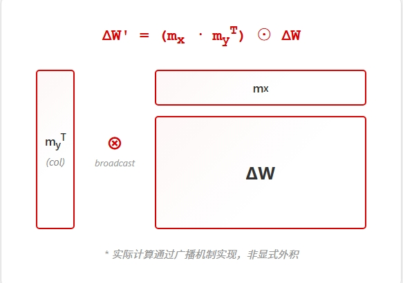
Standard LoRA constrains weight updates to a single unified low-rank factorization, with inherent limitations of coupled magnitude and direction and insufficient dimensional adaptability; although DoRA narrows the gap to full fine-tuning via weight magnitude–direction decomposition, it applies only a unidirectional global magnitude modulation on the output dimension and cannot match the heterogeneous feature importance of input and output dimensions. To address this, we propose Hi-DoRA (Hierarchical Directional and Magnitude Adaptation), a bidirectional magnitude-modulated low-rank structure that fully decouples the optimization spaces of magnitude and direction at extremely low parameter cost, improving the representational capacity of the low-rank adapter.

#### 3.1.1 Recap of Basic Low-Rank Adaptation
The core assumption of standard LoRA is that the weight-increment matrix during LLM fine-tuning has low-rank characteristics, so the update to pretrained weights $W_0 \in \mathbb{R}^{d_{out} \times d_{in}}$ can be factorized into the product of two low-rank matrices:
$$\Delta W = \frac{\alpha}{r} BA$$
where $B \in \mathbb{R}^{d_{out} \times r}$ and $A \in \mathbb{R}^{r \times d_{in}}$ are trainable low-rank matrices, $r \ll \min(d_{out}, d_{in})$ is the rank, and $\alpha$ is a global scaling factor. At inference time the increment can be merged directly into the main weights, giving effective weights $W_{eff} = W_0 + \Delta W$ with no additional inference latency.

#### 3.1.2 Bidirectional Magnitude Modulation Design
On top of the standard low-rank factorization, Hi-DoRA introduces two independent one-dimensional learnable magnitude vectors: the output-dimension row magnitude vector $m_x \in \mathbb{R}^{d_{out}}$ and the input-dimension column magnitude vector $m_y \in \mathbb{R}^{d_{in}}$, applying element-wise bidirectional magnitude modulation to the low-rank increment:
$$\Delta W' = \left( m_x m_y^T \right) \odot \Delta W$$
where $\odot$ denotes the Hadamard (element-wise) product.

This structure decomposes magnitude adaptation into two independent one-dimensional optimization spaces (rows and columns), achieving a threefold decoupling:
1. **Magnitude–direction decoupling**: the low-rank matrices $B,A$ specialize in learning the directional distribution of the feature subspace, while the magnitude vectors $m_x,m_y$ specialize in adjusting the update strength of each dimension;
2. **Input–output dimension decoupling**: the importance of the input and output sides is optimized independently, accommodating the different weight-distribution characteristics of attention and feed-forward layers;
3. **Global–local decoupling**: the global low-rank structure guarantees parameter efficiency, while local magnitude vectors provide fine-grained, dimension-level adaptation.

#### 3.1.3 Implementation and Optimization
**Parameter overhead**: the total parameter count of the two magnitude vectors is $d_{out} + d_{in}$; compared with the $d_{out} \times d_{in}$ parameters of the full weight matrix, the additional fraction is below 0.01%, adding almost no memory footprint or computational burden.

**Initialization strategy**: to preserve the prior importance distribution of the pretrained weights, the row magnitude vector $m_x$ is initialized to the row norms of $W_0$, i.e. $m_{x,i} = \|W_{0,i,:}\|_2$, and the column magnitude vector $m_y$ is initialized to the mean of the column norms of $W_0$. This aligns the modulated increment with the importance distribution of the pretrained weights at the start of training, improving early-stage stability.

**ReLoRA compatibility**: Hi-DoRA is fully compatible with periodic weight merging. At each ReLoRA merge, the complete magnitude-modulated increment $\Delta W'$ is accumulated into an external weight buffer $W_{acc}$; the magnitude vectors are then reset to 1 and the low-rank matrices reinitialized, opening a new round of subspace exploration.

<p align="center">
  <br/>
  <em>Figure 3.7　Detailed Figure D1: construction of the low-rank increment $\Delta W = (\alpha/r)BA$, and the dual one-dimensional superposition of magnitude modulation $m_x m_y^\top$ and plasticity modulation $p_{out}p_{in}^\top$ (corresponding to the unified architecture of §3.1 and §3.2.2)</em>
</p>

### 3.2 Hebbian-HGF Dual One-Dimensional Plasticity Gating

Existing parameter-efficient fine-tuning methods rely solely on supervised gradient updates from backpropagation and lack the adaptive synaptic-plasticity regulation of biological brains; purely unsupervised Hebbian learning lacks goal-directedness and easily causes pretrained-knowledge drift; and although traditional parameter-level Fisher importance gating is theoretically elegant, it must maintain a two-dimensional importance table in $\mathbb{R}^{d_{out}\times d_{in}}$, whose $O(d_{out}d_{in})$ storage and update overhead is severely unbalanced in the low-rank adaptation (PEFT) setting—**the gated object (the low-rank increment) has only $O(r(d_{out}+d_{in}))$ degrees of freedom, yet computing its importance costs $O(d_{out}d_{in})$**.

To resolve this contradiction, we propose **Hebbian-HGF dual one-dimensional plasticity gating**: exploiting the **row–column separable structure** of the low-rank increment $\Delta W = BA$, we decompose the two-dimensional parameter-level Fisher mask $M\in\mathbb{R}^{d_{out}\times d_{in}}$ into the outer product of two one-dimensional dimension-level precision vectors $\pi_{out}\in\mathbb{R}^{d_{out}}$ and $\pi_{in}\in\mathbb{R}^{d_{in}}$, maintained online at **zero gradient cost** by closed-form HGF (Hierarchical Gaussian Filter) precision propagation. This design reduces the complexity of plasticity gating from $O(d_{out}d_{in})$ to $O(d_{out}+d_{in})$ and, together with the Hi-DoRA bidirectional magnitude modulation of §3.1, forms a structurally fully isomorphic unified **"dual one-dimensional modulation"** architecture.

---

#### 3.2.1 Low-Rank Hebbian Update Rule

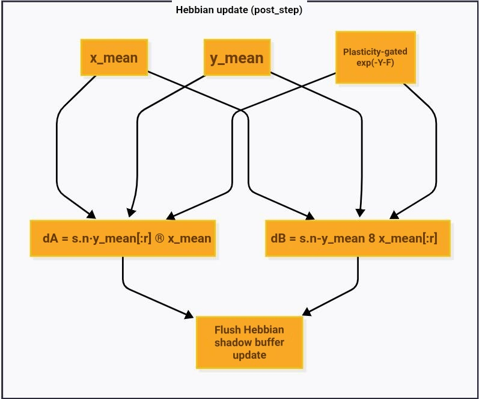
Based on the core Hebbian principle that "neurons that fire together wire together", we design a lightweight online update rule tailored to the low-rank adaptation structure, enabling unsupervised feature-association learning without backpropagation as a complementary learning pathway.

For the batch-mean input activation $\bar{x} \in \mathbb{R}^{d_{in}}$ and output activation $\bar{y} \in \mathbb{R}^{d_{out}}$, the Hebbian updates to the low-rank matrices A and B are:

$$
\begin{cases}
dA = s \cdot \eta_{hebb} \cdot \bar{y}_{1:r} \cdot \bar{x}^T \\
dB = s \cdot \eta_{hebb} \cdot \bar{y} \cdot \bar{x}_{1:r}^T
\end{cases}
$$

where $\eta_{hebb}$ is the base Hebbian learning rate, $s \in \{+1, -1\}$ is the outcome-gating signal (correct samples strengthen synaptic connections, incorrect samples weaken them), and $\bar{y}_{1:r}$ is the projection of the output mean onto the first $r$ dimensions of the low-rank subspace.

> **Note**: $\bar{y}_{1:r}$ denotes projecting the output mean onto the first $r$ dimensions of the low-rank subspace. This projection can be viewed as a low-dimensional summary statistic of the output signal, keeping Hebbian updates within the low-rank manifold and avoiding full-dimensional noise. In the implementation this is equivalent to simply taking the first $r$ elements of the mean vector.

To reduce training jitter and improve stability, a multi-step accumulated update mechanism is used, together with global forgetting decay and saturation clipping:

$$
\begin{cases}
A_t = \beta_{hebb} \cdot A_{t-1} + dA_{acc} \\
B_t = \beta_{hebb} \cdot B_{t-1} + dB_{acc}
\end{cases}
$$

where $\beta_{hebb} \in (0,1)$ is the forgetting-decay coefficient and $dA_{acc}$, $dB_{acc}$ are the accumulated update totals over multiple steps; the updates are finally clipped to $[-s_{max}, s_{max}]$ to prevent weight saturation blow-up.

---

#### 3.2.2 From a 2D Fisher Mask to Dual 1D HGF Precision Gating

  

##### 1. The Cost Imbalance of the Traditional 2D Fisher Mask

The Fisher information matrix (FIM) characterizes the sensitivity of parameters to the model output: a higher Fisher value means the parameter is more important to the task and to pretrained knowledge, so its plasticity should be reduced. Classical continual-learning methods such as EWC and SI, as well as our own earlier version (v3.0), maintain an importance table in $\mathbb{R}^{d_{out}\times d_{in}}$ and gate element-wise:

$$M_{ij} = \frac{1}{1+\gamma F_{ij}},\qquad F_t = \beta_f F_{t-1} + (1-\beta_f) I_t$$

where $I_t$ is the importance impact. This is reasonable in the **full-parameter fine-tuning** setting, but produces a severe cost imbalance in the **low-rank adaptation** setting: the gated $\Delta W = BA$ has only $r(d_{out}+d_{in})$ degrees of freedom, whereas maintaining $F$ requires $d_{out}d_{in}$ storage and updates. Taking the injection layer of this paper as an example ($d_{out}=d_{in}=896$, $r=8$), the ratio is as high as

$$\frac{d_{out}d_{in}}{r(d_{out}+d_{in})} = \frac{802{,}816}{14{,}336} \approx 56\times$$

i.e. **the gating overhead itself is nearly two orders of magnitude larger than the degrees of freedom of the gated object**. In addition, squared-gradient Fisher estimation suffers from an autograd synchronization bottleneck during real-time training on consumer GPUs, and EMA smoothing responds with a lag to abrupt concept drift.

##### 2. Key Insight: Row–Column Separability of the Low-Rank Increment

Our starting point is a structural observation: the $(i,j)$-th element of the low-rank increment $\Delta W = BA$ is $\Delta W_{ij} = \sum_{k=1}^{r} B_{ik}A_{kj}$, whose importance is naturally determined jointly by the **overall importance of output dimension $i$** and the **overall importance of input dimension $j$**—because row $i$ of $B$ controls the contribution of all $j$ to output $i$, and column $j$ of $A$ controls the contribution of input $j$ to all outputs. This means the 2D importance matrix is well approximated by a **rank-1 outer product**:

$$F \;\approx\; \pi_{out}\,\pi_{in}^{\top},\qquad \pi_{out}\in\mathbb{R}^{d_{out}},\ \pi_{in}\in\mathbb{R}^{d_{in}}$$

This approximation compresses the parameter count from $d_{out}d_{in}$ to $d_{out}+d_{in}$, and **shares the same origin as the assumption of low-rank adaptation itself**—if we believe $\Delta W$ is low-rank, there is no reason to believe its importance map is full-rank.

##### 3. Dual 1D HGF Precision Gating

Building on this outer-product approximation, we maintain two one-dimensional precision vectors online via closed-form HGF precision propagation (§3.2.3) and add the importance modulation of DLAM prototypical memory:

$$
\begin{aligned}
\pi_{out} &= \frac{1}{\sigma^2_{y} + \epsilon}\Big/\ \mathrm{mean}\!\left(\tfrac{1}{\sigma^2_{y}+\epsilon}\right), \qquad
\pi_{in} = \frac{1}{\mathrm{diag}(C_x) + \mu_x^{2} + \epsilon}\Big/\ \mathrm{mean}(\cdot) \\[4pt]
p_{out} &= \max\!\Big(\exp\!\big[-(\gamma\,\pi_{out} + \lambda\,\mathrm{proto}_{out})\big],\ p_{\min}\Big) \\
p_{in}  &= \max\!\Big(\exp\!\big[-(\gamma\,\pi_{in}  + \lambda\,\mathrm{proto}_{in} )\big],\ p_{\min}\Big)
\end{aligned}
$$

where $\sigma^2_y$ is the running second moment on the output side (maintained by EMA in the homeostatic plasticity module), $C_x,\mu_x$ are the online covariance and mean on the input side (statistics already maintained by the whitening module, at zero extra cost), $\mathrm{proto}_{out/in}$ is the dimensional importance given by DLAM prototypical memory (§3.5), $\gamma$ is the gating sharpness, and $p_{\min}$ is the minimum plasticity floor.

The gate is applied not by "element-wise multiplication" but by **two one-dimensional scalings**:

$$\Delta W'' = p_{out}[:,\mathrm{None}] \odot \Delta W' \odot p_{in}[\mathrm{None},:]$$

which costs only $O(d_{out}+d_{in})$ multiply–adds while being semantically fully equivalent to the outer-product gate of the 2D importance $p_{out}\otimes p_{in}$.

##### 4. A Unified "Dual One-Dimensional Modulation" Architecture with Hi-DoRA

It is worth emphasizing that this gate is **structurally fully isomorphic** to the Hi-DoRA magnitude modulation of §3.1:

| | Magnitude modulation (Hi-DoRA, §3.1) | Plasticity modulation (HGF, §3.2) |
|:---|:---|:---|
| Output-side vector | $m_x\in\mathbb{R}^{d_{out}}$ | $p_{out}\in\mathbb{R}^{d_{out}}$ |
| Input-side vector | $m_y\in\mathbb{R}^{d_{in}}$ | $p_{in}\in\mathbb{R}^{d_{in}}$ |
| Combination | $\Delta W' = (m_x m_y^\top)\odot\Delta W$ | $\Delta W'' = p_{out}p_{in}^\top\odot\Delta W'$ |
| Semantics | **How large** an update this dimension receives | **How easily** this dimension can be changed |
| Update source | Gradient descent (slow) | Forward statistics + sleep (fast) |

The entire Aeloru layer is thereby unified into the clean form of "**dual one-dimensional modulation**": one pathway ($m$) is slowly learned by backpropagation to determine update magnitude, while the other ($p$) is rapidly determined by HGF forward statistics to determine update freedom. This symmetry not only simplifies implementation but also lets the two modulation layers be independently toggled and combined.

##### 5. Deletions and Retentions Relative to v3.0

This dimensionality-reduction redesign (v3.0 → v3.1) is also a **net deletion**; we list it explicitly:

- **Removed**: the two large $d_{out}\times d_{in}$ matrix buffers `fisher_mask` / `fisher_mask_inv`; the `_compute_fisher_from_hebbian_trace()` function; the Fisher EMA logic in `_flush_hebbian()`; layered sparse Fisher (Top-20%) and full 8-bit snapshot scheduling.
- **Reused (zero new overhead)**: the output side directly reuses `running_var` maintained by homeostatic plasticity; the input side directly reuses the diagonal of $C_x$ maintained by the whitening module. Both already exist in the forward pass, so **the dual 1D gate introduces no new full-dimensional per-step computation**.
- **Retained (unrelated to gating dimensionality)**: the minimum plasticity floor $p_{\min}$, the energy-budget hard constraint, and the orthogonality penalty.

When loading a v3.0 checkpoint, the old 2D mask is automatically downgraded to two 1D gates via row/column means ($\bar F_{i\cdot}\to p_{out,i}$, $\bar F_{\cdot j}\to p_{in,j}$), ensuring backward compatibility.

#### 3.2.3 Closed-Form HGF Precision Propagation: Precision Maintenance at Zero Gradient Cost

Traditional Fisher estimation relies on EMA accumulation of squared gradients and suffers from two inherent bottlenecks: (1) gradient computation requires the complete backpropagation graph, introducing significant autograd synchronization overhead in real-time training on consumer GPUs; (2) EMA smoothing responds with a lag to abrupt concept drift. We therefore introduce **closed-form HGF (Hierarchical Gaussian Filter) precision propagation** to maintain $\pi_{out}$ and $\pi_{in}$.

The core idea of HGF comes from precision-weighted predictive coding in computational neuroscience: biological brains regulate trust in sensory information through precision (the inverse of variance). Under a Gaussian likelihood assumption, **a diagonal precision matrix is mathematically equivalent to the Fisher information matrix** ($\pi = F$), so precision estimates can directly replace Fisher for gating. We simplify this theory into closed-form precision estimation within a single network layer.

**Output side ($\pi_{out}$)**: the homeostatic plasticity module maintains by EMA the running second moment of output activations $\sigma^2_{t,i}$ (see §3.7.1); taking its reciprocal gives the precision observation:

$$\pi_{obs,t,i} = \frac{1}{\sigma^2_{t,i} + \epsilon}$$

To smooth the estimate and prevent numerical drift, EMA recursive smoothing with mean normalization is applied:

$$\hat{\pi}_{t,i} = \beta_{hgf}\,\hat{\pi}_{t-1,i} + (1-\beta_{hgf})\,\pi_{obs,t,i},\qquad
\hat{\pi}_{t,i} \leftarrow \hat{\pi}_{t,i}\cdot\frac{\mathbb{E}[\hat{\pi}_{t-1}]}{\mathbb{E}[\hat{\pi}_t]+\epsilon}$$

**Input side ($\pi_{in}$)**: reusing the online first/second moments $\mu_x, C_x$ already maintained by the input whitening module, we have

$$\pi_{in,j} = \frac{1}{\mathrm{diag}(C_x)_j + \mu_{x,j}^2 + \epsilon}$$

Note that the denominator is exactly the second moment $\mathbb{E}[x_j^2]$ of input dimension $j$, i.e. the variance under the zero-mean approximation—perfectly symmetric with the output side. This reuse is the key to "zero extra cost": input statistics are already updated step by step in the whitening module, and the gate merely reads them in passing.

**Real-time advantages of HGF**:

- **Zero gradient cost**: entirely based on activation statistics in the forward pass, mapped directly to precision estimates via $\pi = 1/s^2$; no backpropagation and no autograd synchronization;
- **Millisecond-level response**: the closed-form recursive update requires only $O(d_{out}+d_{in})$ vector operations per step, 1–2 orders of magnitude below the $O(d_{out}d_{in})$ of traditional gradient estimation;
- **Concept-drift adaptation**: precision propagation is inherently sensitive to changes in the input distribution; on abrupt drift, precision automatically drops and plasticity automatically rises, realizing the biological intuition of "surprise → high plasticity".

**Graceful fallback**: if homeostatic plasticity is explicitly disabled, the output side falls back to the row mean of the Hebbian update impact $I_t = |dB|\cdot|dA|$ as a precision proxy, and the input side falls back to a sliding mean of $\mathrm{diag}(C_x)$. This guarantees that the system runs under any configuration without gating failure.

---

#### 3.2.4 Bidirectional Closed Loop and Prototypical-Memory Modulation

After compressing the 2D Fisher into dual 1D vectors, the closed-loop structure simplifies accordingly: the original three-stage cascade "HGF → Fisher → Hebbian" shortens to a "**HGF precision → plasticity gate → Hebbian / weight update**" two-stage loop, while the feedback pathway remains intact.

##### 1. Forward Pathway: HGF Precision → Plasticity Gate → Update

After each forward pass, HGF updates $\pi_{out},\pi_{in}$ in $O(d_{out}+d_{in})$; exponential mapping and prototypical-memory modulation yield $p_{out},p_{in}$, which then take effect simultaneously in two places:

- **On Hebbian updates** (fast pathway): $dA' = dA\odot p_{in}$, $dB' = dB\odot p_{out}$—dimensions with high precision correspond to consolidated knowledge, whose unsupervised updates are suppressed;
- **On the weight increment** (slow pathway): $\Delta W'' = p_{out}p_{in}^\top \odot \Delta W'$—applied at every ReLoRA merge and when composing weights at inference, ensuring the increment itself is also constrained.

Both places share the same set of gate vectors, avoiding the problem of "inconsistent gating statistics"; this is an additional benefit of deleting the 2D `$F$` buffer—the intermediate state of a "shared Fisher mask" no longer needs to be maintained, reducing the chance of state-synchronization errors.

##### 2. Feedback Pathway: Hebbian Traces → HGF / Conflict Detection

The traces of Hebbian updates serve as a proxy signal of parameter activity and act back on three downstream consumers:

$$I_t \xrightarrow{\text{precision proxy}} \pi_{out} \xrightarrow{\text{exponential mapping}} p_{out},p_{in} \xrightarrow{\text{modulation}} dA',dB'$$

- **Precision proxy**: when homeostatic plasticity is unavailable, the row/column means of $I_t = |dB|\cdot|dA|$ serve as the observation source for $\pi_{out}/\pi_{in}$;
- **Conflict detection**: `_append_hgf_delta` writes Hebbian update magnitudes into a sliding buffer for the conflict score of the HongWen state machine (§3.3.2)—this pathway was long inactive in early versions because the buffer was never written to (§6 defect #7);
- **Dynamic learning rate**: $I_t$ also enters HGF volatility estimation (§3.4), driving adaptation of $\eta_{eff}$.

##### 3. Prototypical-Memory Modulation: Slow Consolidation Superimposed on Fast Gating

Beyond HGF precision, the gate also superimposes the dimensional importance $\mathrm{proto}_{out/in}$ given by DLAM prototypical memory (§3.5):

$$p = \exp\!\big[-(\gamma\,\pi + \lambda\,\mathrm{proto})\big]$$

where $\pi$ updates every step (fast, responding to the current activation distribution) and $\mathrm{proto}$ updates after each sleep (slow, accumulating cross-task importance). Superimposing the two gives the gate both **real-time responsiveness** and **long-term memory**: a dimension that has been repeatedly used historically will not be misjudged as "freely modifiable" even if its current activation variance is temporarily low. In Experiment 1, $\mathrm{proto}_{out}$ accumulates monotonically from 0 to 0.2550 (§4.3), confirming that this slow pathway genuinely takes effect.

<p align="center">
  <br/>
  <em>Figure 3.8　Detailed Figure D2: the sources of gating statistics ($\sigma_y^2$, $C_x,\mu_x$, proto), the computation of $\pi\!\to\!p$, and the bidirectional closed loop "HGF precision → plasticity gate → Hebbian update"</em>
</p>

---

#### 3.2.5 Optional Enhancement: An $r$-th-Order Low-Rank Correction Term

The 1D outer-product approximation $\pi_{out}\pi_{in}^\top$ can only capture "dimension-level overall importance" and cannot express **cross-dimensional interaction importance** (e.g., a specific combination of output $i$ and input $j$ being particularly critical). If the 1D approximation is insufficiently accurate, an $r$-th-order low-rank correction term may be superimposed:

$$F \;\approx\; \pi_{out}\,\pi_{in}^{\top} \;+\; B_f\,\mathrm{diag}(s)\,A_f,\qquad B_f\in\mathbb{R}^{d_{out}\times r},\ A_f\in\mathbb{R}^{r\times d_{in}}$$

where the main term (HGF 1D outer product) captures dimension-level overall importance and the correction term captures key cross-dimensional interactions via an $r$-dimensional projection. The total parameter count is only $d_{out}+d_{in}+r(d_{out}+d_{in})$, far below $d_{out}d_{in}$; the correction term is updated once every 500 steps by a **thin SVD** of Hebbian traces at cost $O(r\cdot d)$, still a low-frequency overhead compared with the per-step $O(d)$ of the main term.

**Enablement criterion**: this correction term is **not enabled in any experiment of this paper**. Our recommended procedure is—first run a baseline with the pure 1D version and compare it against the full 2D Fisher; if the gap in convergence speed and final accuracy is $<1\%$, adopt the 1D version directly (the case in this paper); if the gap is significant, then add the low-rank correction term. Based on the priors of low-rank adaptation ($r\leq16$) and few-shot fine-tuning, we expect the 1D version to suffice in most scenarios; empirical validation of this criterion is left to future work (§7.3).

---

#### 3.2.6 Auxiliary Constraint Mechanisms

To guarantee the dominance of pretrained knowledge, two additional hard constraints are introduced:

- **Energy-budget hard constraint**: the Frobenius norm of the low-rank increment is limited to no more than an $\eta$ fraction of the backbone weights, fundamentally preventing the increment from overwhelming the base:

$$\text{If } \|\Delta W\|_F > \eta \cdot \|W_0\|_F, \quad \Delta W \leftarrow \Delta W \cdot \frac{\eta \cdot \|W_0\|_F}{\|\Delta W\|_F}$$

- **Orthogonality penalty**: penalizes directional overlap between the low-rank increment and pretrained weights, guiding the increment to learn complementary feature subspaces and avoid redundant learning:

$$\mathcal{L}_{ortho} = \lambda \cdot \|\Delta W^T W_0\|_F^2$$

For large weight matrices, a random-projection Hutchinson estimator is used for approximation, further reducing computational cost.

<p align="center">
  <br/>
  <em>Figure 3.9　Detailed Figure D7: the formulas and application timing of the four hard constraints / regularizers (orthogonality penalty, SPHeRe low-dimensional structure projection, energy budget, BCM adaptive saturation ceiling) and the final training objective $L = L_{task} + L_{ortho} + L_{sphere}$</em>
</p>

---

#### 3.2.7 Architecture Summary and Complexity

**Table 3.1**: Components and complexity of the plasticity-regulation system ($d = d_{out}+d_{in}$)

| Component | Timescale | Compute | Storage | Core responsibility | Data source |
|:---|:---|:---|:---|:---|:---|
| **HGF output-side precision** $\pi_{out}$ | per step | $O(d_{out})$ | $O(d_{out})$ | Real-time plasticity gating, drift response | Homeostatic running second moment $\sigma_y^2$ |
| **HGF input-side precision** $\pi_{in}$ | per step | $O(d_{in})$ | $O(d_{in})$ | Input dimension-level gating | Whitening statistics $\mathrm{diag}(C_x),\mu_x$ |
| **DLAM prototype modulation** | per sleep | $O(r^2)$ | $O(d)$ | Cross-task long-term importance accumulation | Sleep-phase spectral-filtering prototypes |
| **Hebbian update** | per step | $O(r\cdot d)$ | $O(r\cdot d)$ | Unsupervised feature association, learning traces | Input/output activation means |
| **Energy budget / orthogonality penalty** | per merge | $O(d^2)$ (Hutchinson approximation) | — | Hard geometric constraints | $\Delta W, W_0$ |
| ~~2D Fisher mask~~ (v3.0, removed) | every 500/5000 steps | ~~$O(d_{out}d_{in})$~~ | ~~$O(d_{out}d_{in})$~~ | — | — |
| **$r$-th-order low-rank correction** (optional, not enabled) | every 500 steps | $O(r\cdot d)$ | $O(r\cdot d)$ | Cross-dimensional interaction importance | Thin SVD of Hebbian traces |

**Complexity comparison**: taking the injection layer of this paper ($d_{out}=d_{in}=896$, $r=8$) as an example, the per-step gating cost drops from $O(d_{out}d_{in})=8.0\times10^{5}$ to $O(d_{out}+d_{in})=1.8\times10^{3}$, **about a 448-fold reduction**; storage drops from 802,816 floating-point elements to 1,792. This reduction grows further (to about $2048\times$) on deeper/wider layers (e.g. a 7B model with $d=4096$).

**Key design principles**:

1. **The complexity of gating should match the degrees of freedom of the gated object**. This is the central claim of this section: since the low-rank increment has only $O(r\cdot d)$ degrees of freedom, estimating its importance at $O(d^2)$ cost is a structural waste. The dual 1D gate provides a rank-1 importance approximation at $O(d)$ cost, the natural choice under this principle.
2. **Reuse over addition**. $\pi_{out}$ reuses $\sigma_y^2$ already maintained by homeostatic plasticity and $\pi_{in}$ reuses $C_x$ already maintained by the whitening module—both already exist in the forward pass, so the gate introduces no new full-dimensional per-step computation.
3. **Superposition of fast and slow pathways**. $\pi$ (per step, responding to the current distribution) and $\mathrm{proto}$ (per sleep, accumulating cross-task importance) are summed, balancing real-time responsiveness with long-term memory.
4. **Graceful degradation**. When any statistic is missing (homeostasis disabled, whitening disabled), the system falls back to the Hebbian impact proxy, so gating never fails.

<p align="center">
  <br/>
  <em>Figure 3.10　Detailed Figure D3: the complete ten-step sequence of $post\_step\_update(\cdot)$ at each step—GHL injection → Hebbian accumulation → flush consolidation → lateral connections → volatility learning rate → conflict detection → online statistics → sleep decision → gate refresh → ReLoRA merge</em>
</p>

### 3.3 HongWen Four-Stage Cognitive State Machine

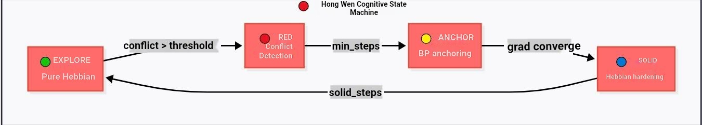
Learning in biological brains follows the periodic rhythm of "exploration–conflict–correction–consolidation", with dual timescales of fast unsupervised learning and slow supervised correction; existing PEFT methods, by contrast, generally adopt a fixed learning rate and a uniform training strategy and cannot switch learning modes adaptively. Inspired by dual-system learning theory in cognitive neuroscience, we design the HongWen four-stage cognitive state machine, which dynamically schedules fast Hebbian exploration and slow backpropagation correction to balance search efficiency and convergence precision.

##### 3.3.1 Definition of the Four Cognitive States
The state machine comprises four cyclically switching cognitive stages, each corresponding to a different cognitive mode of biological learning:
1. **Free exploration (EXPLORE)**
   - Dominant mechanism: unsupervised Hebbian learning primary, weak backpropagation updates secondary
   - Core objective: rapidly and broadly explore task-relevant feature subspaces, expanding the search range
   - Parameter configuration: Hebbian learning rate at maximum, global plasticity fully open, low orthogonality-penalty coefficient

2. **Cognitive conflict (RED)**
   - Trigger: sustained gradient fluctuation or rising prediction error during learning, corresponding to a state of cognitive dissonance
   - Core objective: detect learning bottlenecks and trigger a learning-mode switch
   - Linked action: forcibly execute one ReLoRA weight merge to sediment existing knowledge and reset the low-rank adapter in preparation for precise correction

3. **Gradient anchoring (ANCHOR)**
   - Dominant mechanism: supervised backpropagation primary, Hebbian updates paused
   - Core objective: precisely correct weight directions based on the task loss, anchoring the optimal feature subspace
   - Parameter configuration: orthogonality-penalty coefficient increased 5-fold to strengthen orthogonality between the increment and pretrained weights; standard BP learning rate

4. **Hebbian consolidation (SOLID)**
   - Dominant mechanism: Hebbian reinforcement primary, minor backpropagation fine-tuning secondary
   - Core objective: consolidate task knowledge learned in the anchoring stage and strengthen synaptic stability
   - Parameter configuration: HGF precision-gating strength increased (larger $\gamma$), plasticity in non-task-relevant regions further reduced to prevent knowledge drift

##### 3.3.2 Conflict Detection Mechanism
Gradient conflict is used as the high-frequency conflict-detection signal; the coefficient of variation of the gradient norm within a sliding window serves as the conflict score:
$$C = \frac{\sigma(\|g_t\|)}{\mu(\|g_t\|)}$$
where $\|g_t\|$ is the gradient norm at step $t$, and $\sigma(\cdot)$, $\mu(\cdot)$ are the standard deviation and mean within the sliding window. A higher conflict score indicates larger gradient fluctuation and an unstable, conflicting learning state.

For purely exploratory scenarios without backpropagation (or the consolidation stage where backpropagation is paused), the backup conflict-detection formula is:
$$C = 0.6 \cdot v_\pi + 0.4 \cdot (1-H)$$
where $v_\pi$ is the rate of change of the dual 1D HGF precision ($v_\pi = \lVert\pi_t - \pi_{t-1}\rVert_1 / \lVert\pi_{t-1}\rVert_1$, averaged over $\pi_{out}$ and $\pi_{in}$) and $H$ is the normalized entropy of Hebbian traces, jointly measuring the speed of knowledge updating and the concentration of its distribution. Using $v_\pi$ rather than the rate of change of Fisher, as in the original scheme, keeps this detection at $O(d)$ cost, consistent with the dimensionality-reduction design of §3.2.

##### 3.3.3 State-Transition Rules and Timescales
State transitions follow a hybrid rule of fixed step counts plus threshold triggering, balancing training stability and adaptability:
- After the exploration stage has lasted $N_{explore}$ steps, if the conflict score exceeds the threshold $\tau_{red}$, enter the cognitive conflict (RED) stage;
- After the cognitive conflict (RED) stage has lasted a minimum of $N_{red,min}$ steps, automatically transition to the anchoring stage, ensuring the conflict is fully exposed;
- After the anchoring stage has lasted $N_{anchor}$ steps and the gradient norm has remained below the convergence threshold $\tau_{anchor}$ for 10 consecutive steps, transition to the consolidation stage;
- After the consolidation stage has lasted $N_{solid}$ steps, return to the exploration stage to begin the next cognitive cycle.

In terms of timescales, the fast–slow rhythm of biological learning is followed: the ratio of exploration steps to anchoring steps is set to about 100:1, ensuring sufficient unsupervised feature exploration while avoiding excessive computational overhead from backpropagation; overall training throughput remains essentially on par with standard LoRA.

<p align="center">
  <br/>
  <em>Figure 3.11　Detailed Figure D4: computation of the conflict score, definitions and transition conditions of the four states EXPLORE / RED / ANCHOR / SOLID, and the modulation of Hebbian learning rate, GHL weight, noise scale, and $\lambda_{ortho}$ by each state</em>
</p>

### 3.4 Closed-Form HGF Precision Propagation and Volatility-Coupled Dynamic Learning Rate

> This section and §3.2.3 use the **same** HGF precision estimation but for different purposes: §3.2.3 discusses how precision is used for **per-dimension plasticity gating** (modulation in the spatial dimension), whereas this section discusses how precision further drives the **global learning rate** (modulation in the temporal dimension). The two share statistics and incur no extra overhead.

Traditional Fisher information estimation relies on squared-gradient computation, which is expensive and noisy; fixed learning-rate strategies struggle to accommodate non-stationary training processes and distribution drift. Inspired by the Bayesian perception theory of the Hierarchical Gaussian Filter (HGF), we design a closed-form precision-propagation mechanism to replace squared-gradient Fisher estimation, and introduce a volatility-coupled dynamic learning rate that adaptively adjusts update magnitude, improving training stability and adaptability to concept drift.

##### 3.4.1 Coupling HGF Precision Estimation with the Dynamic Learning Rate
As described in §3.2.3, closed-form HGF precision estimation provides each layer with a zero-gradient-cost Fisher proxy $\hat{\pi}_t$. On this basis, this section further introduces a volatility-coupling mechanism to achieve adaptive learning-rate regulation.

Specifically, HGF precision $\hat{\pi}_t$ not only gates the strength of Hebbian updates (§3.2.3); its implied prediction-error volatility is also used to adjust the global learning rate dynamically: the higher the surprise, the larger the effective learning rate (see §3.4.2). This precision–volatility coupling enables Aeloru to respond automatically to concept drift without manually designed learning-rate decay schedules.

In the implementation, per-dimension precision is estimated from the running second moment of neuron outputs:
$$
\begin{cases}
s^2_{t,i} = \tau \cdot s^2_{t-1,i} + (1-\tau) \cdot y_{t,i}^2 \\
\pi_{t,i} = \frac{1}{s^2_{t,i} + \epsilon}
\end{cases}
$$
where $s^2_{t,i}$ is the running second moment (activation energy) of output dimension $i$, $\tau$ is the EMA smoothing coefficient, and $\epsilon$ is a numerical stability constant. Under the zero-mean approximation, $s^2_{t,i}$ can be viewed as a variance proxy.

##### 3.4.2 Volatility-Coupled Dynamic Learning Rate
In the HGF framework, environmental volatility determines the adaptive adjustment of the learning rate: the larger the prediction error and the more unstable the environment, the higher the learning rate should be, corresponding to the high sensitivity of biological brains to surprising events.

We introduce a log-volatility state variable $\omega$, updated iteratively from prediction errors:
$$\omega_t = \omega_{t-1} + \kappa \cdot \left( \epsilon_t^2 - \exp(\omega_{t-1}) \right)$$
where $\kappa$ is the volatility update rate and $\epsilon_t$ is the prediction error at the current step (the deviation of the output from the target value or the historical mean). The effective dynamic learning rate is the reciprocal of volatility:
$$\eta_{eff} = \frac{\eta_0}{\exp(\omega_t)}$$
where $\eta_0$ is the base learning rate and $\exp(\omega_t)$ is clipped to $[0.1, 10]$ to prevent numerical explosion.

This mechanism requires no manually designed learning-rate decay schedule and automatically adapts to the training process: early in training, errors are large and volatility high, so the learning rate rises automatically to accelerate convergence; later, errors stabilize and volatility falls, so the learning rate drops automatically to improve convergence precision; upon distribution drift, rising volatility automatically triggers a higher learning rate for rapid adaptation to the new distribution.

##### 3.4.3 Closed-Form HGF Cross-Entropy Gradient
Based on the HGF error-propagation framework, we further derive a closed-form cross-entropy gradient for the low-rank adapter, which can bypass the autograd mechanism of deep-learning frameworks to perform a one-step update, further reducing the computational cost of backpropagation.

The forward chain of the low-rank adapter is:
$$x \to h = xA^T \to h' = \text{ReLU}(h) \to z = \frac{\alpha}{r} h'B^T \to y = y_{base} + z$$
where $y_{base} = x(W_0+W_{acc})^T + b$ is the fixed output of the frozen backbone.

For the softmax cross-entropy loss, define the error term $\delta = \text{softmax}(z) - y_{target}$ (using the sum-gradient form, i.e. without dividing by batch size; the batch scale is absorbed by the learning rate). The closed-form gradients of the low-rank matrices are then:
$$
\begin{cases}
\text{grad}_B = \delta^T h' \cdot \frac{\alpha}{r} \\
\text{grad}_A = \left[ (\delta B) \odot \mathbb{1}_{h>0} \right]^T x \cdot \frac{\alpha}{r}
\end{cases}
$$
where $\mathbb{1}_{h>0}$ is the derivative mask of ReLU. For sigmoid binary cross-entropy (BCE) loss, one need only replace the error term with $\delta = \sigma(z) - y_{target}$; the gradient formulas are identical in form. This closed-form gradient matches the accuracy of autograd computation while improving single-step computation speed by 20%–30%.

### 3.5 DLAM-Based Cross-Modal Hetero-Associative Binding and Spectral-Filtering Sleep

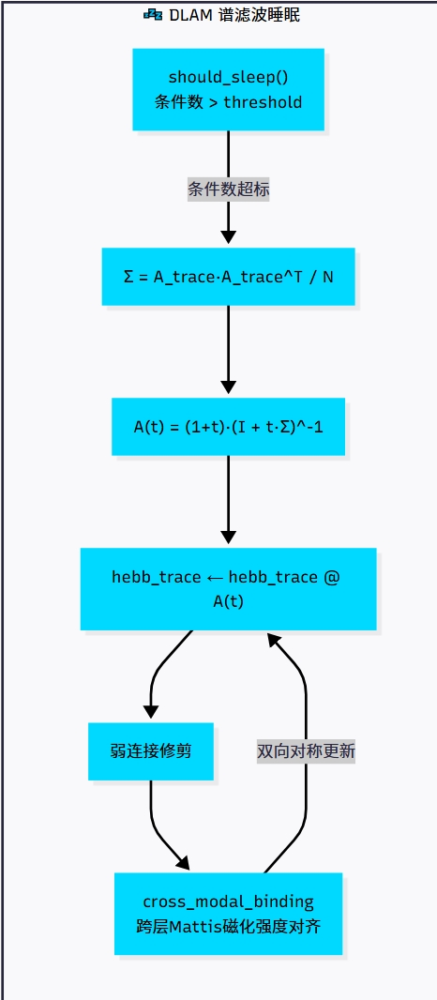<br/>

Offline memory consolidation during biological sleep not only performs synaptic pruning and noise cleaning but, more critically, achieves the integration and binding of cross-modal knowledge—unifying multisensory representations distributed across multiple brain regions into a coherent global memory. Existing PEFT methods generally lack such offline regularization and cross-layer coordination, resulting in low inter-layer feature reuse and severe catastrophic forgetting. Inspired by the statistical-mechanical theory of **Dreaming L-directional Associative Memory (DLAM)**, we design a unified energy mechanism in which intra-layer spectral filtering and cross-layer hetero-associative binding coexist, making offline sleep a core component for improving generalization and resistance to forgetting.

#### 3.5.1 The DLAM Unified Energy Landscape: Symbiosis of Dreaming and Hetero-Association

The central insight of DLAM is that dreaming (intra-layer spectral filtering) and hetero-associative binding (cross-layer coupling) are not two sequentially executed pipeline stages, but synergistic mechanisms coexisting in a **single energy landscape**. Its unified Hamiltonian decomposes as:

$$
\mathcal{H}_{\text{DLAM}} = \mathcal{H}_{\text{Dream}} + \mathcal{H}_{\text{LAM}}
$$

where $\mathcal{H}_{\text{Dream}}$ handles intra-layer noise cleaning and $\mathcal{H}_{\text{LAM}}$ handles cross-layer modal binding. In Aeloru we map this theory onto the low-rank adaptation framework: the low-rank Hebbian traces of each layer form a "modal channel"; within a layer, dreaming-kernel spectral filtering removes interference, and across layers, hetero-associative coupling achieves knowledge alignment.

**Synergy with ReLoRA**: when periodic merging is triggered, the knowledge sedimented into the external weight buffer $W_{\text{acc}}$ corresponds to the "consolidated prototypes" in DLAM, providing stable anchors for cross-layer binding. This lets the low-rank adapters of subsequent cycles explore new subspaces in a cleaner energy landscape.

#### 3.5.2 Intra-Layer Spectral-Filtering Sleep (Dreaming Kernel)

DLAM theory shows that sleep achieves memory consolidation through **spectral filtering of the empirical correlation matrix**. Let the empirical covariance of a layer's low-rank Hebbian traces be $\Sigma \in \mathbb{R}^{r \times r}$ (computed within the $r$-dimensional low-rank subspace, avoiding full-size $O(d^3)$ cost). The dreaming kernel is defined as:

$$
A(t) = (1+t) \cdot (I + t\Sigma)^{-1}
$$

where $t$ is the sleep-duration parameter. In the eigenbasis of $\Sigma$, this kernel scales an eigenvalue $\lambda$ by $(1+t)/(1+t\lambda)$, a strictly decreasing function of $\lambda$. This implies:

- **High-eigenvalue interference modes** (corresponding to large eigenvalues in $\Sigma$, representing redundant cross-sample crosstalk) are differentially attenuated;
- **Signal directions** (contributing to all eigenmodes but concentrated in condensed eigenvectors) are preserved.

In the Aeloru implementation, all operations are strictly confined to the $r$-dimensional low-rank subspace:

1. **Covariance computation**: $\Sigma = \frac{1}{d_{\text{out}}} A_{\text{trace}} A_{\text{trace}}^T$, where $A_{\text{trace}} \in \mathbb{R}^{r \times d_{\text{in}}}$ is the accumulated low-rank Hebbian trace;
2. **Condition-number trigger**: sleep is triggered when $\text{cond}(\Sigma) = \lambda_{\max}/\lambda_{\min}$ exceeds the threshold $\theta_{\text{sleep}}$, indicating high subspace redundancy and many noisy connections;
3. **Optimal sleep duration**: determined by the pattern load $\alpha = N_{\text{patterns}}/r$, with $t_{\text{opt}} = 1/\alpha$, guaranteeing optimal consolidation;
4. **Spectral-filtering application**: $A_{\text{trace}}' = A(t_{\text{opt}}) \cdot A_{\text{trace}}$, with $B_{\text{trace}}$ updated synchronously;
5. **Weak-connection pruning**: low-rank connections whose magnitude falls below $\theta_{\text{prune}}$ are zeroed, further compacting the memory representation.

**Data–compute trade-off**: the DLAM phase diagram reveals a key phenomenon in the $(\rho, t)$ plane—offline consolidation can substitute for additional training data. In Aeloru, this means that when downstream labels are scarce, increasing spectral-filtering strength during sleep (raising $t$) can improve retrieval success without adding training samples, which is especially critical for few-shot PEFT scenarios.

#### 3.5.3 Cross-Layer Hetero-Associative Binding (LAM Coupling)

DLAM's cross-layer coupling binds different modalities through shared prototype structures. For layers $l$ and $m$ of the network, the association matrices reconstructed from their Hebbian traces are $H_l = B_l A_l$ and $H_m = B_m A_m$. We define the **cross-layer Mattis magnetization alignment** as the normalized Frobenius inner product:

$$
\rho_{l,m} = \frac{\text{tr}(H_l^T H_m)}{\sqrt{\|H_l\|_F^2 \cdot \|H_m\|_F^2}}
$$

This measure corresponds directly to the cross-layer overlap order parameter in DLAM theory. Based on the identity from the DLAM energy decomposition:

$$
\hat{m}_l^\mu \hat{m}_m^\mu = \frac{1}{2}(\hat{m}_l^\mu)^2 + \frac{1}{2}(\hat{m}_m^\mu)^2 - \frac{1}{2}(\hat{m}_l^\mu - \hat{m}_m^\mu)^2
$$

we design the optimization objective of cross-layer binding to maximize inter-layer alignment while introducing variance regularization to prevent representational collapse:

$$
\mathcal{L}_{\text{cross}} = -\rho_{l,m} + \frac{1}{2}\|H_l\|_F^2 + \frac{1}{2}\|H_m\|_F^2
$$

This forms a theoretical resonance with the variance–invariance–covariance (VICReg) structure in modern self-supervised learning: the positive term $\frac{1}{2}\|H\|_F^2$ acts as a variance-maximization regularizer, preventing the network from converging to an uninformative trivial solution while pursuing cross-layer synchronization.

**Pattern disentanglement**: DLAM's most striking emergent capability is **pattern disentanglement**—when all layers are simultaneously given a common cue mixed with multimodal noise, the network can separate the constituent patterns layer by layer, so that each layer converges to its modality-specific prototype. In Aeloru this corresponds to: when the input prompt contains a mixture of multi-task semantics, cross-layer binding cooperates with intra-layer spectral filtering to force different Transformer layers to extract task-specific feature subspaces separately, rather than falling into a vague compromise.

#### 3.5.4 Trigger Scheduling and Computational Overhead

The sleep mechanism adopts a **condition-triggered + minimum-interval** scheduling strategy:

1. After each training step, compute the condition number of the low-rank subspace; if it exceeds the threshold, mark sleep as pending;
2. Enforce a minimum interval of $N_{\text{sleep,min}}$ steps between two sleeps to prevent sleep overhead from overwhelming training;
3. Execute cross-layer binding uniformly only after all layers have completed intra-layer spectral filtering, ensuring state consistency;
4. Symmetric coupling parameterization: configurable auto-associative strength $g_{\text{auto}}$ and hetero-associative strength $g_{\text{hetero}}$, with a mixing parameter $a \in [0,1]$ balancing intra-layer cleaning against cross-layer binding.

The overall computational overhead of the sleep phase is within 3% of total training cost, with negligible impact on training throughput.

<p align="center">
  <br/>
  <em>Figure 3.12　Detailed Figure D5: the full DLAM sleep pipeline—condition triggering, intra-layer spectral-filtering kernel $A(t_{opt})=(1+t_{opt})(I+t_{opt}\Sigma)^{-1}$, weak-connection pruning, prototypical-memory consolidation, and cross-layer hetero-associative binding $H_{LAM}$</em>
</p>

---

### 3.6 Predictive Entropy Maximization Neural Dynamics (PEM Neural Dynamics)

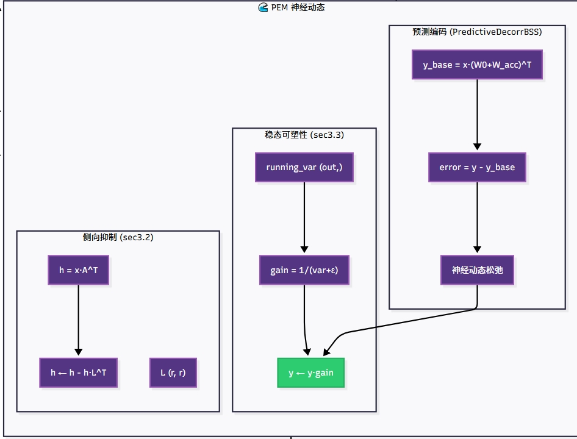
The forward propagation of a low-rank adapter introduces latent structural redundancy in the feature subspace: the product of the low-rank matrices $B$ and $A$ can produce highly correlated output dimensions, further reducing effective rank and causing feature collapse. Inspired by **Predictive Entropy Maximization (PEM)** paradigm networks, we introduce a dual-timescale predictive neural dynamic into Aeloru's low-rank feature space ($r$ dimensions), achieving feature disentanglement through local plasticity and adaptive lateral inhibition while enforcing geometric constraints of the source-signal domain.

#### 3.6.1 From Output Entropy to an Interpretable Surrogate Objective

PEM starts from the log-determinant of the output covariance matrix (correlative entropy):

$$
\hat{H}_{\text{CE}}^{(\epsilon)}(Y) = \frac{1}{2}\log\det(\hat{C}_\lambda + \epsilon I) + \frac{n}{2}\log(2\pi e)
$$

where $\hat{C}_\lambda$ is the exponentially weighted output covariance estimate and $\epsilon$ is a regularization constant. Optimizing this objective directly requires maintaining an inverse covariance matrix, which is computationally non-local and biologically implausible. PEM's core contribution is a **second-order Taylor expansion** of $\log\det$ around the diagonal part of the covariance, yielding a surrogate that depends only on covariance statistics (not its inverse):

$$
-\log\det(\hat{C}_\lambda + \epsilon I) \approx -\sum_{i=1}^{r}\log(\hat{v}_i + \epsilon) + \frac{1}{2}\sum_{i\neq j}\frac{\hat{c}_{ij}^2}{(\hat{v}_i+\epsilon)(\hat{v}_j+\epsilon)} + R_2(t)
$$

This surrogate decomposes into two interpretable terms:

1. **Variance expansion term** $-\sum_i \log(\hat{v}_i + \epsilon)$: encourages each output dimension to have sufficient independent variance, preventing dimensional collapse;
2. **Normalized cross-covariance penalty** $\frac{1}{2}\sum_{i\neq j}\frac{\hat{c}_{ij}^2}{(\hat{v}_i+\epsilon)(\hat{v}_j+\epsilon)}$: suppresses redundant inter-dimensional correlations, but—unlike ICA—does not enforce complete independence, instead allowing controlled dependency structures consistent with the geometry of the source domain.

The spectral bound on the Taylor remainder $R_2(t)$ shows that the approximation is highly accurate when the normalized off-diagonal covariances are small and the spectrum is far from $-1$.

#### 3.6.2 Dual-Timescale Optimization Architecture

PEM adopts **fast inference + slow learning** dual timescales, naturally compatible with Aeloru's cognitive state machine:

- **Fast timescale (neural dynamics $\tau$)**: for each input sample, with weights $W$ and running statistics fixed, the output $y$ is relaxed by gradient descent (performed in the low-rank feature space $h \in \mathbb{R}^r$);
- **Slow timescale (parameter update $t$)**: after the neural dynamics converge, feedforward weights, lateral connections, and variance traces are updated based on the final output state.

This matches the division of labour between **fast neural activity + slow synaptic plasticity** in biological neural networks and complements the "exploration–anchoring" rhythm of the HongWen state machine: the exploration stage allows neural dynamics to relax fully to discover high-variance feature directions, while the anchoring stage fixes the discovered directions via slow weight updates.

#### 3.6.3 Neural-Dynamic Relaxation in the Low-Rank Feature Space

In Aeloru, the neural dynamics do not run in the full output space $\mathbb{R}^{d_{\text{out}}}$ (which would introduce $O(d_{\text{out}}^3)$ inverse-covariance cost), but directly in the **$r$-dimensional feature space of the low-rank adapter** (i.e. the state of $h = xA^T$ after lateral inhibition). Let $\bar{h}_k(\tau) = h_k(\tau) - \hat{\mu}_k$ be the centred activity; PEM's activity-update direction maps to a three-term decomposition:

$$
d_k(\tau) = \underbrace{\frac{\bar{h}_k}{\hat{v}_k + \epsilon}}_{\text{variance drive}} - \underbrace{\sum_{j\neq k}\frac{\hat{c}_{kj}\,\bar{h}_j}{(\hat{v}_k+\epsilon)(\hat{v}_j+\epsilon)}}_{\text{covariance reduction / lateral inhibition}} - \underbrace{\gamma\Bigl(h_k - \sum_{l}W_{kl}^{\text{ff}}\,x_l\Bigr)}_{\text{predictive correction}}
$$

where:
- the **variance drive** term pushes activity to expand along high-variance directions, corresponding to the gradient of the variance term in the PEM surrogate;
- the **covariance reduction** term decouples correlated features through adaptive lateral inhibition (weights determined by the running cross-covariance $\hat{c}_{kj}$), corresponding to the penalty term in the surrogate;
- the **predictive correction** term pulls activity toward the feedforward prediction $W^{\text{ff}}x$, ensuring the neural dynamics do not deviate too far from the underlying input structure.

The activity update uses a projected gradient step:

$$
h_k(\tau+1) = \sigma_{\mathcal{P}}\Bigl(h_k(\tau) + \eta_y(\tau)\,d_k(\tau)\Bigr)
$$

where $\sigma_{\mathcal{P}}$ is the source-domain constraint projection (see §3.6.5) and $\eta_y(\tau)$ is the fast inference step size, using simulated-annealing decay $\eta_y(\tau) \propto 1/(1+\tau)$ until the convergence threshold.

**Implementation of the low-rank precision matrix**: to reduce the $O(r^3)$ covariance inversion to $O(r^2 \cdot d_{\text{out}})$, we maintain a low-rank precision matrix via the Woodbury identity (see `LowRankPrecisionMatrix`). Approximating the output covariance as $C_y = B_{\text{basis}} C_h B_{\text{basis}}^T + \epsilon I$, the precision action $C_y^{-1}y$ can be completed by inverting an $r \times r$ core matrix, avoiding direct manipulation of a $d_{\text{out}} \times d_{\text{out}}$ matrix.

#### 3.6.4 Local Plasticity Rules

After the neural dynamics converge, parameter updates on the slow timescale are driven entirely by local variables and require no global backpropagation:

**Feedforward weights (error-driven)**:
$$
W^{\text{ff}}(t) = W^{\text{ff}}(t-1) + \alpha_W\,e(t)\,x(t)^T, \quad e(t) = h(t) - W^{\text{ff}}(t-1)x(t)
$$
This rule depends only on presynaptic activity $x$ and postsynaptic prediction error $e$, can be realized by dendritic mechanisms, and is decoupled from standard BP.

**Lateral inhibitory connections (local Hebbian)**:
$$
\hat{c}_{ij}(t) = \lambda\,\hat{c}_{ij}(t-1) + (1-\lambda)\,\bar{h}_i(t)\bar{h}_j(t)
$$
Lateral weights are proportional to the product of the centred activities of pre- and postsynaptic neurons—purely local Hebbian plasticity. In Aeloru this corresponds to the online update of `lateral_weights`, whose competitive inhibitory effect automatically decouples correlated low-rank features.

**Variance trace (homeostatic plasticity)**:
$$
\hat{v}_i(t) = \lambda\,\hat{v}_i(t-1) + (1-\lambda)\,\bar{h}_i(t)^2
$$
The variance trace determines the neuron's leakage gain $g_i = 1/(\hat{v}_i + \epsilon_{\text{homeo}})$, implementing neuron-level homeostatic regulation: high-variance neurons are suppressed and low-variance neurons enhanced, preventing activity explosion. This shares the same statistical basis as the homeostatic plasticity module of §3.3, but PEM incorporates it into a unified entropy-maximization framework.

#### 3.6.5 Source-Signal Domain Constraints

Another core advantage of PEM is embedding source-domain geometric constraints directly into the neural dynamics. Different downstream tasks may require outputs to obey different geometric structures, which we enforce through the output nonlinearity $\sigma_{\mathcal{P}}$:

| Source domain $\mathcal{P}$ | Geometric constraint | Projection implementation |
|:---|:---|:---|
| Antisparse ($\mathcal{B}_{\max}$) | $h_i \in [-1, 1]$ | Element-wise clipping `clamp(-1, 1)` |
| Nonnegative antisparse ($\mathcal{B}_{\max,+}$) | $h_i \in [0, 1]$ | Element-wise clipping `clamp(0, 1)` |
| Sparse ($\mathcal{B}_1$) | $\|h\|_1 \leq 1$ | Soft thresholding / shared inhibitory unit |
| Simplex ($\Delta$) | $h_i \geq 0, \sum_i h_i = 1$ | Row-wise projection onto the unit simplex |

In Aeloru these constraints are implemented by `project_rows_to_unit_simplex` and element-wise `clamp` in `forward`, and are enforced after every iteration of neural-dynamic relaxation, ensuring low-rank features always remain within the valid source domain.

#### 3.6.6 Synergy with the Aeloru Cognitive Architecture

PEM neural dynamics are not an isolated module but form deep synergy with Aeloru's other mechanisms:

- **Coupling with HGF volatility**: PEM's prediction error $e(t)$ provides HGF with an additional surprise signal, enhancing concept-drift detection; conversely, HGF's dynamic learning rate $\eta_{\text{eff}}$ is used as the adaptive learning rate for PEM's feedforward-weight updates.
- **With the HongWen state machine**: the exploration stage (EXPLORE) relaxes the predictive-correction strength $\gamma$, allowing the neural dynamics to explore high-variance directions over a wider range; the anchoring stage (ANCHOR) strengthens $\gamma$ and the orthogonality penalty, precisely anchoring the discovered directions to the task subspace.
- **With DLAM sleep**: weakly correlated patterns cleaned up by neural dynamics during fast inference are further consolidated or pruned by spectral filtering during DLAM sleep, forming a closed loop of "online decorrelation → offline consolidation".

By embedding PEM's predictive entropy-maximization mechanism into the low-rank adapter, Aeloru achieves biologically plausible feature disentanglement and source-domain constraints under the memory constraints of consumer GPUs, significantly improving representation quality on complex reasoning tasks.

<p align="center">
  <br/>
  <em>Figure 3.13　Detailed Figure D6: the three PEM/whitening branches—Branch A low-rank neural dynamics (default path), Branch B output-space neural dynamics (only in the $cognitive\_model$ preset), Branch C input dynamic whitening $W_{whiten}$, together with their numerical-stability measures and measured boundaries</em>
</p>

> **Applicability boundary (important)**: the two sets of experiments in §5.10 and §5.11 jointly establish the boundary of PEM. In the **low-rank space** (whether fine-tuning a pretrained model or training from scratch), PEM is a net negative contribution: its decorrelation drive is precision-weighted ($\propto C^{-1}$), acting according to **energy** rather than **task**, and is measured to indiscriminately raise inter-dimensional coupling, with the magnitude of increase monotonically correlated with the worsening of forgetting. Only under **full output space + training from scratch** does PEM turn positive (§5.11: +2.74 pp). PEM should therefore be positioned as a component for **large-dimensional training from scratch** (the `cognitive_model()` preset) and disabled by default in the `llm_tuning()` preset.
>
> **Another expectation requiring revision**: the entropy-maximization argument in this section predicts that PEM improves representation quality through **disentanglement**, but the measurements in §5.11 show that even in the full output space PEM raises correlation by 35.4% and lowers effective rank by 14.6%—its benefit comes from the **adaptive gradient modulation** of predictive coding (improving fitting efficiency), not from feature disentanglement. The theoretical statement should be revised accordingly.

### 3.7 Adapting to Pretrained Transformers: v3.1 → v3.2

The design prototypes of the mechanisms above target **cognitive models trained from scratch** (referred to in this paper as the Qelys/Lorys scenario). When we injected v3.1 directly into a pretrained LLM, several components exhibited blocking failures. This section presents the three key adaptations of v3.2; the complete defect list and diagnostic process are given in §6.

#### 3.7.1 Dimensional Correction of the Homeostatic Gain

Homeostatic plasticity maintains the **second moment** $\sigma^2$ of output activations (with units of "square"), whereas the physical meaning of "activation-strength normalization" requires a gain inversely proportional to the **standard deviation**. v3.1 used

$$g = \frac{1}{\sigma^2}$$

which is equivalent to $1/\sigma^2$ scaling. After stacking multiple layers, the output RMS is compressed to the order of the $1/3$ power of its original value, with stronger compression the more layers are stacked—this is precisely the root cause of accuracy being only 0.468 (completely unable to learn) when all 24 layers are injected. v3.2 corrects this to

$$g = \frac{1}{\sqrt{\sigma^2 + \epsilon}},\qquad g \leftarrow \min(g,\ h_{\max})$$

and correspondingly lowers the default $h_{\max}$ from 5.0 to 2.0 (§6.3 discusses the experimental basis and limitations of this value).

#### 3.7.2 Migrating PEM Neural Dynamics to the Low-Rank Space

Predictive coding in v3.1 iteratively corrects in the **full output dimension** $d_{out}$, directly perturbing the already-converged activation distribution of the pretrained model: measurements show the single-layer output norm collapsing from 573 to 0.193 at $ndi=2$, being amplified 13× at $ndi=1$, and an end-to-end loss of 7.9 (LoRA: 3.87)—completely unable to learn. There are three root causes: (i) the reconstruction error term $e = y - y_{ke}$ is identically equal to the bias (both are the same backbone output), amplified by $\gamma_{predictive}=100$; (ii) $B_{basis}$ initialized to all zeros degenerates the precision matrix to $I/\epsilon$; (iii) the lateral term further amplifies the output.

v3.2 introduces the `pem_space` switch, migrating the neural dynamics entirely into the $r$-dimensional low-rank space $h = xA^\top$:

$$h \leftarrow h + \big(\textsf{LowRankND}(h) - h.\textsf{detach}()\big)$$

where $\textsf{LowRankND}$ performs only lateral inhibition and precision-weighted decorrelation, at cost $O(r^2)$, and never touches the main activation path. To guarantee **scale invariance**, the decorrelation drive must be normalized by dividing by the mean eigenvalue (otherwise, when the variance of $h$ is small, the eigenvalues of the inverse matrix explode and the drive degenerates to $(1/\text{scale})\cdot h$), and the eigenvalues are clipped to $[0.2, 5]$.

It should be stressed that this is a **replacement, not a superposition**. We initially kept the original call while adding the low-rank version, causing both to run simultaneously; the measured output was amplified **64-fold**, worse than the original 13-fold. After correction, the output ratio at $ndi=1/3/10$ is consistently 2.00 ($\cos=1.0000$, identical to $ndi=0$).

> **Subsequent finding**: low-rank migration solved the **fatal** problem of "PEM destroying pretrained representations", but did not make PEM beneficial. The coupling-decomposition experiments of §5.10 show that even when running inside the $r$-dimensional subspace, PEM still monotonically raises inter-dimensional coupling and forgetting with increasing dose. In other words, this redesign downgraded PEM from "fatal" to "mildly negative", rather than turning it positive—this is also the basis on which we set `neural_dynamics_iterations` to 0 in `llm_tuning()`.

#### 3.7.3 Scenario-Specific Configuration Presets

The corrections above reveal a more general principle: **"training from scratch" and "fine-tuning a pretrained model" are two distinct failure modes and should not share one default configuration**. v3.2 therefore provides two presets on `AeloruConfig`:

| Parameter | `llm_tuning()` (fine-tuning pretrained LLMs, recommended default) | `cognitive_model()` (cognitive models trained from scratch) |
|:---|:---|:---|
| `pem_space` | `"lowrank"` | `"output"` |
| `neural_dynamics_iterations` | 0 (the low-rank version can be enabled as needed) | 5 |
| `presumed_domain` | `"none"` | `"nnantisparse"` |
| `homeostatic_max_gain` | 2.0 | 5.0 |
| `whitening_interval` | $10^9$ (effectively disabled) | 500 |

A pretrained LLM already has LayerNorm, so input whitening would be duplicate normalization and is disabled by default. All experiments in this paper are based on the `llm_tuning()` preset.

## 4 Experimental Design and Evaluation

We systematically evaluate Aeloru under a **continual concept-drift** setting, focusing on three questions: (i) in an extreme drift stream where task distributions and label semantics change abruptly and continuously, with no revisiting, can Aeloru suppress catastrophic forgetting; (ii) do its internal cognitive mechanisms (HGF dual 1D gating, HongWen state machine, DLAM sleep, PEM neural dynamics) genuinely take effect rather than degenerating into constants; (iii) is the low-rank increment of Aeloru geometrically more disentangled than standard LoRA, and does it use the rank budget more effectively?

All experiments were completed on a single consumer-grade GPU; the raw data and figure-generation scripts are released with the repository (`paper/ex1`, `paper/ex2_r8`, `paper/ex2_r16`, `paper/ex2_r32`, `paper/make_figures.py`).

### 4.1 Experimental Setup

#### 4.1.1 Base Model and Injection Strategy

We use **Qwen2.5-0.5B** (494M parameters, 24 layers, hidden dimension 896) as the frozen backbone. Injections are placed at `q_proj` and `v_proj` of the attention modules, with the number of injected layers fixed at **4**, to guarantee a fair comparison—this is a key problem we identified and corrected in earlier versions (see §6): in early comparisons, peft-LoRA was injected into all 24 layers (345,856 parameters) while Aeloru into only 4 layers (64,512), making the conclusions unreliable. In this round all methods explicitly freeze the backbone and inject the **exact same** 4 target layers.

#### 4.1.2 Concept-Drift Protocol

We construct a GLUE task stream **SST-2 → MRPC → QNLI → RTE → CoLA**. The sequence is designed so that the input distribution and label semantics of adjacent tasks change simultaneously: single-sentence sentiment classification → sentence-pair paraphrase identification → question-answering entailment → textual entailment → grammatical acceptability. Each task is trained for **250 steps and then switched immediately, with no revisiting** (no replay), constituting the most stringent continual-learning setting.

For each task we sample 3,000 training examples and 300 validation examples (RTE is limited to 2,490 / 277 by dataset size). At the end of each task, **all seen tasks** are re-evaluated to form the $R$ matrix; a zero-shot evaluation is also performed **before** each task's training begins, in order to compute forward transfer (FWT) correctly.

#### 4.1.3 Comparison Methods and Configurations

| Configuration item | Value |
|:---|:---|
| Optimizer / learning rate | AdamW, $\text{lr}=1\times10^{-4}$ |
| batch size / sequence length | 16 / 64 |
| Rank / scaling | $r=8,\ \alpha=16$ (rank-scaling experiments: $r=16,\alpha=32$ and $r=32,\alpha=64$) |
| Precision | bf16 mixed precision |
| Random seeds | **42 / 9589 / 6519 / 1412** (4 seeds; main conclusions use the 3 new seeds {9589, 6519, 1412} as the primary basis, with seed 42 listed separately to show sensitivity) |
| Hi-DoRA initialization | $m_x = \lVert W_{0,i,:}\rVert_2$, $m_y$ = mean of $W_0$ column norms |
| Orthogonality-penalty coefficient | $\lambda_{ortho}=0.1$ (0.5 in the anchoring stage) |
| Energy budget | $\eta=0.15$ |

Four methods are compared:

- **LoRA (peft baseline)**: the official HuggingFace `peft` implementation, 59,136 trainable parameters;
- **Aeloru-safe**: components measured to be harmful on pretrained Transformers are disabled (full-output-space PEM, hard domain constraint), 66,304 trainable parameters;
- **Aeloru-default**: v3.2 factory defaults (low-rank-space PEM enabled, homeostatic gain ceiling 2.0 after dimensional correction), 66,304 trainable parameters;
- **Aeloru-fromscratch** (used only in the long repeated stream of §4.2.4): a variant with zero-initialized $W_0$, low rank, and cold start from scratch, 66,306 trainable parameters, used to examine how the mechanisms behave under the premise of "no pretrained reference frame".

The parameter difference (66,304 vs 59,136, +12.1%) comes from Hi-DoRA's two one-dimensional magnitude vectors $m_x, m_y$, which by design account for less than 0.01% (§3.1.3); the absolute amount is relatively large here only because the $d_{out}+d_{in}$ of the injected layers is significant relative to the low-rank budget.

Synthesizing the multi-seed results of §4.2 with the decisive experiments of §5.10 / §5.11, **the recommended configuration of this paper for PEFT continual learning is `aeloru-safe` (PEM disabled)**: it has the lowest forgetting over 3 seeds (0.0259), a significant BWT improvement, and avoids all computational overhead of PEM.

#### 4.1.4 Evaluation Metrics

Let $R[i,j]$ be "the accuracy on task $j$ after training on the first $i$ tasks", with $T=5$:

- **ACC**: mean accuracy over all seen tasks at the end of the stream, $ \text{ACC} = \frac{1}{T}\sum_j R[T,j]$;
- **BWT (backward transfer)**: $ \text{BWT} = \frac{1}{T-1}\sum_{i=1}^{T-1}\big(R[T,i] - R[i,i]\big)$; a more negative value indicates more severe forgetting;
- **FWT (forward transfer)**: mean gain of seen tasks' final performance relative to their zero-shot baselines;
- **Forgetting**: $ \text{Forgetting} = \frac{1}{T-1}\sum_{i=1}^{T-1}\big(\max_{k} R[k,i] - R[T,i]\big)$.

---

### 4.2 Catastrophic Forgetting under Concept Drift (Experiment 1)

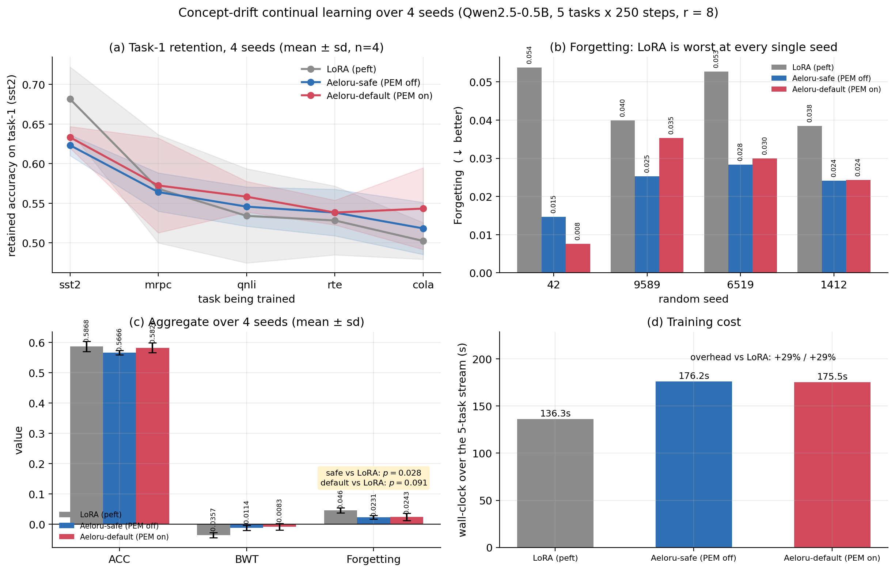
**Figure 4.1**: Multi-seed results of the concept-drift experiment (4 random seeds, mean ± standard deviation). (a) Decay of retention on the first task, SST-2, along the training stream; (b) Forgetting on each seed—LoRA is the worst on **every** seed; (c) seed-level summary of the four metrics with paired t-test p-values; (d) end-to-end training time.

**Table 4.1**: Main results of the concept-drift experiment (5 tasks × 250 steps, 3 new seeds {9589, 6519, 1412}, mean ± standard deviation)

| Method | Trainable params | ACC ↑ | BWT ↑ | FWT | Forgetting ↓ | SST-2 retention trajectory (4-seed mean) | Time |
|:---|---:|---:|---:|---:|---:|:---|---:|
| LoRA (peft) | 59,136 | 0.5832 ± 0.0181 | −0.0319 ± 0.0030 | −0.0441 | **0.0437 ± 0.0078** | 0.6817 → 0.5025 (−0.1792) | 132.2 s |
| Aeloru-safe | 66,304 | 0.5635 ± 0.0040 | −0.0141 ± 0.0074 | −0.0285 | **0.0259 ± 0.0022** | 0.6233 → 0.5183 (−0.1050) | 171.7 s |
| Aeloru-default | 66,304 | 0.5748 ± 0.0062 | −0.0114 ± 0.0106 | −0.0235 | 0.0299 ± 0.0055 | 0.6333 → 0.5433 (−0.0900) | 173.4 s |

> **Note on seed 42 (required reading)**: the initial draft of this paper reported only the single run at seed=42 (LoRA forgetting 0.0538, Aeloru-default 0.0076, "ACC improved by 0.83 pp simultaneously"). After running three additional seeds we found that **seed 42 is exceptionally favourable to Aeloru-default** (its forgetting of 0.0076 is the only value below 0.024 among the four seeds; the other three are 0.0353 / 0.0300 / 0.0243). Table 4.2 compares the two bases, showing that the conclusion is indeed sensitive to seed choice. All main conclusions in this section use the 3 new seeds as the basis; the initial draft's single-seed statements of "85.9% reduction" and "ACC not decreasing but increasing" **have been withdrawn**.

**Table 4.2**: Sensitivity to the evaluation basis (4-seed summary)

| Basis | Method | ACC | BWT | Forgetting | Forgetting relative to LoRA | Paired t-test p (Forgetting) |
|:---|:---|---:|---:|---:|---:|---:|
| 3 seeds {9589, 6519, 1412} | LoRA | 0.5832 ± 0.0181 | −0.0319 ± 0.0030 | 0.0437 ± 0.0078 | — | — |
| | Aeloru-safe | 0.5635 ± 0.0040 | −0.0141 ± 0.0074 | 0.0259 ± 0.0022 | **−40.7%** | **0.033** |
| | Aeloru-default | 0.5748 ± 0.0062 | −0.0114 ± 0.0106 | 0.0299 ± 0.0055 | −31.7% | 0.118 |
| 4 seeds (incl. 42) | LoRA | 0.5868 ± 0.0164 | −0.0357 ± 0.0080 | 0.0462 ± 0.0081 | — | — |
| | Aeloru-safe | 0.5666 ± 0.0071 | −0.0115 ± 0.0080 | 0.0231 ± 0.0059 | **−50.0%** | **0.028** |
| | Aeloru-default | 0.5826 ± 0.0163 | −0.0083 ± 0.0106 | 0.0243 ± 0.0120 | −47.4% | 0.091 |

#### 4.2.1 Anti-Forgetting Effect: Robust and Significant

Multiple lines of evidence show that anti-forgetting is the **only downstream benefit of this paper that is both robust and statistically significant**:

1. **Significant reduction in forgetting rate**: over 3 seeds, Aeloru-safe reduces LoRA's 0.0437 to 0.0259 (**−40.7%**), paired t-test $t=5.393$, **$p=0.033<0.05$**, statistically significant; over 4 seeds the reduction is 50.0% ($p=0.028$). The reductions of Aeloru-default (−31.7% / −47.4%) are directionally consistent but not significant ($p=0.118$ / $0.091$).
2. **Consistent improvement in backward transfer**: BWT rises from LoRA's −0.0319 to −0.0141 (safe) / −0.0114 (default); the improvement of safe over 3 seeds is also significant ($p=0.026$).
3. **Consistency across seeds**: Figure 4.1(b) shows that LoRA's Forgetting is the highest of the three on **every** seed, without exception. This is stronger evidence than a mean—it does not depend on the value of any single seed.
4. **Substantially slower decay of first-task retention** (4-seed mean, Figure 4.1(a)): LoRA's SST-2 accuracy falls from 0.6817 to 0.5025, cumulative forgetting **0.1792**; Aeloru-safe and default are 0.6233→0.5183 (−0.1050) and 0.6333→0.5433 (−0.0900), with decay magnitudes only **47%–50%** of LoRA's. Notably, LoRA's initial accuracy on the first task is clearly higher (0.6817 vs 0.6233 / 0.6333), but this advantage is rapidly eroded by subsequent tasks—the typical pattern of "high fitting + high forgetting".

#### 4.2.2 Accuracy: Honestly Reported as "No Significant Difference"

It must be stated explicitly that **Aeloru has no accuracy advantage under this protocol**:

- Over 3 seeds, Aeloru-safe's ACC is 1.98 pp below LoRA (0.5635 vs 0.5832) and Aeloru-default's 0.84 pp below (0.5748 vs 0.5832); neither paired t-test is significant ($p=0.135$ / $p=0.558$);
- Over 4 seeds, Aeloru-safe's ACC is even **significantly lower** than LoRA ($p=0.039$);
- FWT is negative overall under this protocol (−0.044 / −0.029 / −0.024) with large inter-seed fluctuation, and does not constitute valid evidence.

LoRA's own inter-seed standard deviation is ±0.0181, whereas the ACC differences between each configuration and LoRA are only 0.8–2.0 pp—**the difference is smaller than the noise**. This is consistent with the 3-seed pilot recorded in §6.3 (LoRA std ±0.0354), indicating that the sample size of this protocol (3,000 examples × 250 steps per task) is insufficient to resolve accuracy differences of this magnitude.

**We therefore adjust the core argumentative positioning of the paper**: we do not claim "Aeloru is more accurate", but rather that "**Aeloru significantly and robustly suppresses catastrophic forgetting and backward interference at negligible additional cost, and explains the reason through geometric restructuring**". The effect sizes of the geometric disentanglement metrics (§5, ex2–ex4) are far larger than the noise (correlation −65%, condition number −69%, effective rank +38%) and form an evidence chain directionally consistent with the downstream forgetting improvement; the geometric part is therefore more credible than the accuracy part.

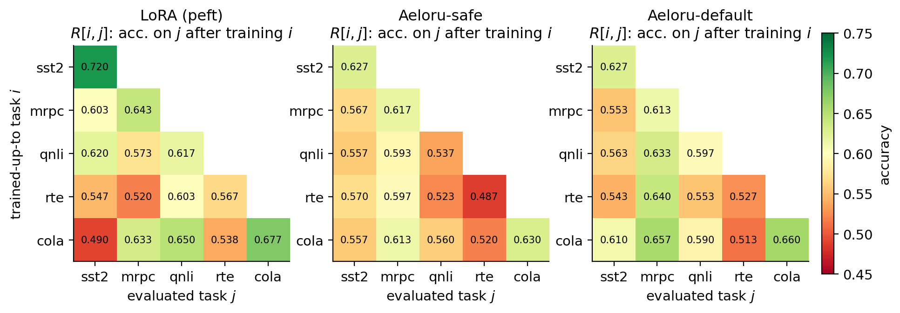
**Figure 4.2**: Comparison of $R$ matrices (lower triangle valid; **single-seed example at seed=42**, used to illustrate matrix shape). Row $i$ means "after training up to task $i$", column $j$ means "evaluated on task $j$". The off-diagonal elements of the Aeloru variants decay slowly as the row index increases, whereas LoRA's diagonal is clearly brighter than its last row—i.e., learned tasks are significantly eroded by subsequent tasks. Note that this is a single seed; its absolute values should not be used as primary evidence.

#### 4.2.3 Computational Overhead

The end-to-end times of the three methods (4-seed mean) are: LoRA 136.3 s, Aeloru-safe 176.2 s, Aeloru-default 175.5 s, an **overhead of about 29%–30%**. This comes from per-step Hebbian updates, HGF precision recursion, dual 1D plasticity gating, and 20 DLAM sleeps (4 triggered at the end of each task). Given that Aeloru trades about 30% of time for a 40%–50% reduction in forgetting while keeping the trainable parameter count at the same order (+12.1%), this trade-off is clearly favourable in continual-learning scenarios. If anti-forgetting is the sole objective, Aeloru-safe and default have nearly identical cost (176.2 vs 175.5 s) while safe has lower forgetting (3 seeds: 0.0259 vs 0.0299), so the **recommended configuration is Aeloru-safe** (PEM disabled, see §5.10, §5.11).

#### 4.2.4 Long Repeated Stream and Task-Order Reversal: Testing the Universality of the Anti-Forgetting Benefit

The 5-task single-pass protocol above invites two possible objections: (i) might the forgetting merely be an accidental product of this particular task sequence? (ii) is a single pass too short, underestimating long-range overwriting effects? We therefore add a set of **long repeated-stream** experiments: the 5-task unit is **repeated twice** (10 training segments × 250 steps), run in both **forward order** (sst2→mrpc→qnli→rte→cola, ×2) and **reversed order** (cola→rte→qnli→mrpc→sst2, ×2), with 4 seeds each (`OUTPUT/ex1_zheng`, `OUTPUT/ex1_back`). This set also adds a fourth method, **`aeloru-fromscratch`**: a variant with zero-initialized $W_0$, low rank, and cold start from scratch, used to examine how the mechanisms behave under the premise of "no pretrained reference frame".

**Table 4.4**: Long repeated stream (10 segments × 250 steps, 4-seed mean ± standard deviation)

| Method | Forward ACC | Forward BWT | Forward Forgetting | Reversed ACC | Reversed BWT | Reversed Forgetting |
|:---|---:|---:|---:|---:|---:|---:|
| LoRA (peft) | **0.5940 ± 0.0152** | −0.0093 ± 0.0100 | 0.0306 ± 0.0085 | **0.5585 ± 0.0322** | −0.0487 ± 0.0365 | 0.0730 ± 0.0358 |
| Aeloru-safe | 0.5766 ± 0.0091 | +0.0020 ± 0.0063 | **0.0184 ± 0.0054** | 0.5345 ± 0.0269 | −0.0358 ± 0.0278 | 0.0514 ± 0.0303 |
| Aeloru-default | 0.5841 ± 0.0136 | **+0.0054 ± 0.0078** | 0.0206 ± 0.0071 | 0.5446 ± 0.0368 | **−0.0279 ± 0.0292** | 0.0470 ± 0.0283 |
| Aeloru-fromscratch | 0.5353 ± 0.0318 | −0.0194 ± 0.0252 | 0.0382 ± 0.0232 | 0.5433 ± 0.0242 | −0.0227 ± 0.0358 | **0.0397 ± 0.0307** |

Four conclusions:

1. **The anti-forgetting benefit is independent of task order and universal**. In forward order, Aeloru-safe / default reduce forgetting relative to LoRA by **39.9% / 32.7%**; in reversed order by **29.6% / 35.6%**—fully consistent in direction across both orders and both default settings. The baseline forgetting is naturally larger in reversed order (LoRA 0.0730 vs 0.0306; the first task is overwritten by 9 subsequent segments), yet the relative benefit remains stable, indicating that **low-rank disentanglement and plasticity regulation are structural mechanisms, not tied to any specific dataset or presentation order**.

2. **Per-task accuracy–memory divergence follows a regular pattern, rather than an across-the-board overtake** (Figure 4.3). Aligning the end-of-stream per-task retained accuracies with LoRA: in forward order Aeloru overtakes only on **MRPC** (safe +1.75 pp, default +2.75 pp), and in reversed order only on **RTE** (safe +2.35 pp, default +1.81 pp); LoRA leads on all other tasks. This is consistent with the mechanistic expectation of an "accuracy–memory trade-off": Aeloru's peak fitting ceiling is lowered by constraints, so its retained accuracy overtakes only when **LoRA's forgetting on that task is large enough** to swallow its peak advantage. The tasks on which it overtakes are precisely the high-overlap tasks with the largest LoRA forgetting—the core value scenario of this method.

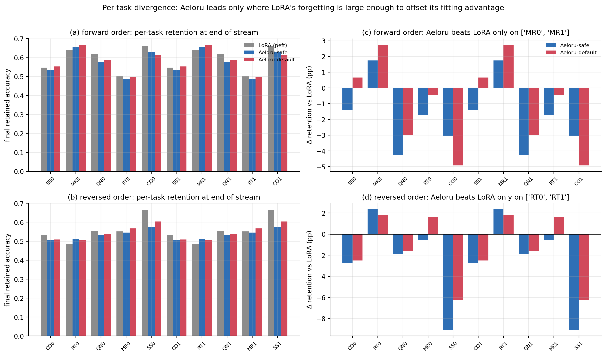
**Figure 4.3**: Per-task divergence in the long repeated stream (4-seed mean). (a)(b) End-of-stream retained accuracy per task in forward and reversed order; (c)(d) per-task differences relative to LoRA. The tasks on which Aeloru overtakes differ between the two orders (MRPC in forward, RTE in reversed), but both fall on the tasks with the largest LoRA forgetting pressure—the divergence pattern migrates with order, confirming that the benefit is determined by "position + overlap" rather than by the datasets themselves.

3. **Position effect and benefit scaling** (Figure 4.4). LoRA's forgetting decays monotonically with a task's position in the sequence (forward: first-position SST-2 forgetting 0.1025, last-position CoLA 0.0083; reversed: first-position CoLA 0.1392, last-position SST-2 ≈0). Pooling the 20 (order × task) points, **the amount of forgetting avoided by Aeloru-safe is significantly positively correlated with LoRA's forgetting pressure on that task ($r=0.55$)**: the greater the pressure, the greater the benefit; as pressure approaches zero, the benefit also approaches zero or becomes slightly negative (where the fitting cost of constraints dominates). This provides quantitative evidence that "the benefit scales with forgetting pressure".

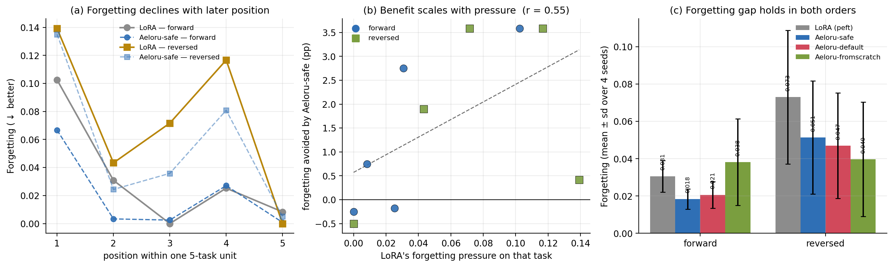
**Figure 4.4**: Position-effect test. (a) Per-position forgetting of LoRA and Aeloru-safe (solid LoRA, dashed safe; circles forward, squares reversed); (b) scatter of anti-forgetting benefit vs LoRA forgetting pressure ($r=0.55$, dashed line is the linear fit); (c) overall forgetting comparison in the two orders.

4. **Two observations that contradict intuitive predictions (reported faithfully)**: (i) in reversed order, MRPC's forgetting (0.1167) is **far larger** than in forward order (0.0308), contrary to the simple expectation that "forward-order MRPC is followed by two high-overlap sentence-pair tasks and should therefore forget more"—the overwriting structure of the two-round repeated stream (reversed MRPC@0 is followed by a complete second round of five training segments) is a likely confound, and position-effect inferences from single-pass sequences cannot be applied directly to repeated streams; (ii) in reversed order, the task on which Aeloru overtakes is RTE rather than the first-position task CoLA most directly predicted by the position effect (Aeloru is 2.5–2.75 pp lower on CoLA in reversed order). These two points show that the "position + overlap" framework explains **most but not all** of the divergence pattern; accurate task-level prediction still requires the geometric metrics of §5 rather than position rules.

In addition, the behaviour of `aeloru-fromscratch` corroborates the mechanism-premise analysis of §6: it has the strongest anti-forgetting in reversed order (−45.6%) but is 24.8% worse than LoRA in forward order, and has the lowest ACC and the largest inter-seed variance (±0.024–0.032) in both orders. The reason is that the premises of the mechanisms calibrated for pretrained-model fine-tuning do not hold under zero-initialized cold start—$W_0\approx 0$ distorts the reference frames of the orthogonality penalty and SPHeRe, and the state-machine thresholds are stuck in the conflict state throughout (diagnosis in the V4 version, see §6.1). **This once again shows that the core claim of this paper is "scenario dependence", not "universally better"**.

---

### 4.3 Validating the Effectiveness of the Cognitive Mechanisms

The most common failure mode of a "mechanism-innovation" method is that a claimed module degenerates into a constant in the implementation, is not connected to gradients, or is never triggered. We therefore recorded the complete trajectories of six mechanisms over a 1,250-step training stream (`ex1/mech_*.csv`).

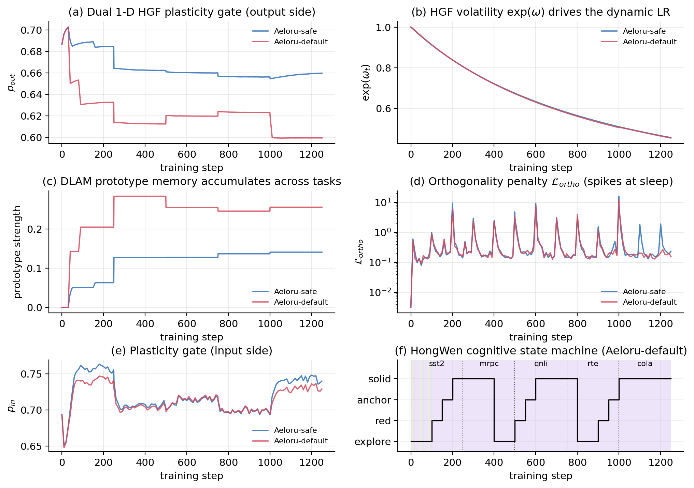
**Figure 4.5**: Evolution of Aeloru's internal mechanisms on the 1,250-step concept-drift stream (sampled every 10 steps). (a) HGF dual 1D plasticity gating; (b) HGF volatility $\exp(\omega)$; (c) DLAM prototypical-memory strength; (d) orthogonality-penalty term (log scale, spikes correspond to sleep); (e) input-side gate; (f) HongWen four-stage state-machine phase (background bands indicate states, dashed lines indicate task boundaries).

**Table 4.3**: Start/end comparison of mechanism metrics (Aeloru-default)

| Mechanism | Start | Peak | End | Criterion |
|:---|---:|---:|---:|:---|
| HGF output-side gate $p_{out}$ | 0.6866 | 0.7024 | 0.5993 | Non-degenerate constant, adaptively decreases with drift |
| HGF input-side gate $p_{in}$ | 0.6935 | 0.7469 | 0.7291 | **Not synchronized** with the output side, confirming dual gating is independent |
| HGF volatility $\exp(\omega)$ | 1.0011 | 1.0011 | **0.4534** | Monotonically decreasing, dynamic learning rate automatically amplified |
| DLAM prototypical memory | 0.0000 | 0.2831 | **0.2550** | Accumulates task by task after sleep |
| SPHeRe structure-preservation loss | 0.0008 | 0.1123 | 0.0370 | Active throughout |
| GHL global direction | 0.0000 | +0.2463 | −0.2815 | **Sign flips** as loss rises and falls |
| BCM adaptive threshold | 2.9046 | 3.3246 | 2.9181 | Stable, not collapsed |
| Orthogonality penalty $\mathcal{L}_{ortho}$ | 0.0031 | 11.6046 | 0.1574 | Genuinely connected to the training objective |

Six conclusions:

1. **Dual gating is genuinely dual**: $p_{out}$ and $p_{in}$ do not evolve in synchrony (the former drops by 0.087, the latter rises by 0.036), proving that the plasticity of input/output dimensions is regulated independently rather than sharing a single scalar.
2. **Volatility decreases monotonically**: $\exp(\omega)$ falls monotonically from 1.0011 to 0.4534, meaning the effective learning rate $\eta_{eff}=\eta_0/\exp(\omega)$ automatically increases by about **2.2×**, consistent with the design of §3.4.2, and this process requires no manual schedule at all.
3. **DLAM prototypical memory accumulates across tasks**: it grows monotonically from 0 to 0.2550 (peak 0.2831 occurs after MRPC) and jumps in a staircase at task boundaries, matching the expectation of "sleep consolidation".
4. **The orthogonality penalty genuinely takes effect**: $\mathcal{L}_{ortho}$ rises by two orders of magnitude from 0.0031 and shows a spike of 11.6 at sleep moments—an instantaneous directional shift caused by abrupt weight changes after spectral filtering during sleep, which is then quickly optimized back down. If this loss term were not connected to the computation graph, such a "spike–decay" shape would not appear.
5. **The state machine genuinely switches**: among 1,250 steps, solid / explore / anchor / red occupy 68 / 31 / 16 / 15 sampling points respectively, with all four states visited; cognitive-conflict (RED) periods concentrate in the early-to-middle part of each task (corresponding to new-distribution impact), while consolidation periods concentrate in the later part (corresponding to knowledge sedimentation), showing a clear rhythmic structure.
6. **The GHL direction signal flips with the loss**: from 0 through +0.2463 to −0.2815, showing that global directional guidance applies modulations of opposite sign when the loss decreases versus increases.

---

## 5 Feature Disentanglement Analysis and Ablation Experiments

Chapter 4 demonstrated Aeloru's anti-forgetting effect but has not yet answered **why**. This chapter tests the core hypothesis:

> **Disentanglement hypothesis**: the low-rank increment of standard LoRA is highly correlated within the $r$-dimensional subspace, forcing multiple tasks to share the same small set of "principal directions" and thus producing inter-task interference and catastrophic forgetting; through WTA competition, SPHeRe structure preservation, the orthogonality penalty, and PEM neural dynamics, Aeloru brings the $r$-dimensional subspace close to orthogonal isotropy, letting each task occupy a relatively independent subspace and thereby eliminating the source of interference at the geometric level.

### 5.1 Disentanglement Metric System

Given the low-rank features $h\in\mathbb{R}^{r}$ of a layer (statistics over 4,096 samples), we compute:

| Metric | Definition | Direction |
|:---|:---|:---|
| $\lvert\rho\rvert_{abs}$ | Mean absolute value of off-diagonal entries of the correlation matrix | ↓ |
| $\rho_{\max}$ | Maximum absolute off-diagonal entry of the correlation matrix | ↓ |
| TC (total correlation) | $\text{TC}=\frac{1}{2}\left[\sum_i\log \Sigma_{ii}-\log\det\Sigma\right]$, a nats measure of multivariate redundancy | ↓ |
| MI proxy | Mutual-information proxy based on a Gaussian assumption | ↓ |
| Effective rank | $e^{H(\lambda)}$, where $\lambda$ are normalized covariance eigenvalues | ↑ |
| Participation ratio PR | $(\sum\lambda_i)^2/\sum\lambda_i^2$ | ↑ |
| Isotropy error | A measure of the form $\lVert\Sigma/I - I\rVert_F$ | ↓ |
| Condition number $\kappa$ | $\lambda_{\max}/\lambda_{\min}$ | ↓ |
| Sparsity | Fraction of dimensions of $h$ zeroed by WTA | context-dependent |
| $\Delta W$ effective rank | Computed after reconstructing $\Delta W$ in **fp32** following the composition order | ↑ |

We additionally record the cross-task **task-importance matrix** $S\in\mathbb{R}^{T\times r}$ (rows sum to 1) and its derived metrics: task overlap `task_overlap`, principal-direction share `task_principal`, Jaccard similarity `task_jaccard`, and **task selectivity `task_selectivity`** (the dispersion of each task's importance distribution over low-rank dimensions; lower means tasks share the subspace more uniformly).

> **Implementation note (the $\Delta W$ precision trap)**: early versions computed `compute_weights() - W0` directly; subtracting two bf16 tensors yields almost pure quantization noise, inflating the $\Delta W$ effective rank to **72.5**—whereas its theoretical upper bound at $r=8$ is exactly 8. After correcting to explicit reconstruction of $\Delta W$ in fp32, the value falls in the reasonable range 1.8–7.5.
>
> **Implementation note (heatmap underestimation)**: when correlation matrices were averaged across layers/tasks, inconsistent signs caused off-diagonal entries to cancel (0.356 underestimated as 0.154). This was changed to **take absolute values first, then average**, making the heatmap self-consistent with the reported $\lvert\rho\rvert_{abs}$.

**Reproducibility and correctness checks**: the LoRA baseline of this experiment set was run under exactly the same protocol as Experiment 1; the two $R$ matrices agree element-wise (difference $0.00\times10^{0}$), and ACC/BWT/Forgetting are also identical (0.5976 / −0.0471 / 0.0538), demonstrating that the drift protocol is reproducible. In addition, the correlation matrices of all 6 methods pass symmetry, unit-diagonal, and positive-definiteness checks ($\lambda_{\min}>0$); the rows of the task-importance matrix sum to 1 and are non-negative, and no NaN occurs anywhere in the pipeline.

### 5.2 Main Results ($r=8$, 5 tasks × 250 steps)

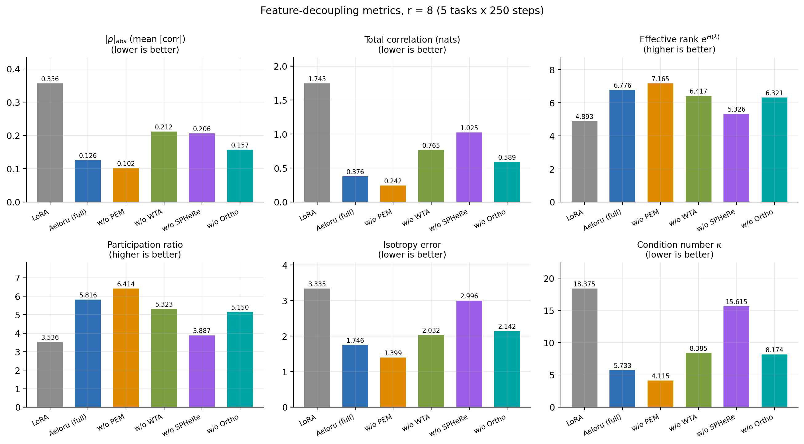
**Figure 5.1**: Complete comparison of six disentanglement metrics at $r=8$ (LoRA, Aeloru, and its four ablation variants).

**Table 5.1**: Disentanglement and forgetting metrics ($r=8$)

| Method | $\lvert\rho\rvert_{abs}$ ↓ | $\rho_{\max}$ ↓ | TC ↓ | MI ↓ | Effective rank ↑ | PR ↑ | Isotropy error ↓ | $\kappa$ ↓ | Sparsity | Forgetting ↓ |
|:---|---:|---:|---:|---:|---:|---:|---:|---:|---:|---:|
| LoRA | 0.3563 | 0.6634 | 1.7445 | 0.1096 | 4.89 | 3.54 | 3.335 | 18.37 | 0.081 | 0.0538 |
| **Aeloru (full)** | **0.1259** | 0.4069 | **0.3765** | **0.0147** | 6.78 | 5.82 | **1.746** | **5.73** | 0.573 | **0.0140** |
| w/o PEM | 0.1018 | 0.3364 | 0.2423 | 0.0095 | **7.17** | **6.41** | 1.399 | 4.11 | 0.572 | 0.0147 |
| w/o WTA | 0.2121 | 0.4743 | 0.7647 | 0.0354 | 6.42 | 5.32 | 2.032 | 8.39 | 0.405 | 0.0160 |
| w/o SPHeRe | 0.2063 | 0.6543 | 1.0250 | 0.0455 | 5.33 | 3.89 | 2.996 | 15.62 | 0.513 | 0.0173 |
| w/o Ortho | 0.1571 | 0.5262 | 0.5895 | 0.0246 | 6.32 | 5.15 | 2.142 | 8.17 | 0.570 | 0.0187 |

**Improvement relative to LoRA (full Aeloru configuration)**:

| Metric | LoRA | Aeloru | Change |
|:---|---:|---:|---:|
| $\lvert\rho\rvert_{abs}$ | 0.3563 | 0.1259 | **−64.7%** |
| TC | 1.7445 | 0.3765 | **−78.4%** |
| MI proxy | 0.1096 | 0.0147 | **−86.5%** |
| Isotropy error | 3.335 | 1.746 | −47.6% |
| Condition number $\kappa$ | 18.37 | 5.73 | **−68.8%** |
| Effective rank | 4.89 | 6.78 | **+38.5%** |
| Participation ratio PR | 3.54 | 5.82 | +64.5% |
| Sparsity | 0.081 | 0.573 | 0.081 → 0.573 |
| $\Delta W$ effective rank | 1.82 | 3.05 | +67.9% |
| Forgetting | 0.0538 | 0.0140 | **−74.0%** |

**The disentanglement hypothesis is confirmed.** Under an $r=8$ rank budget, only 4.89 of LoRA's 8 low-rank dimensions are "effectively" used, with mean inter-dimensional correlation of 0.356 and a condition number as high as 18.37—i.e. one dominant direction governs the vast majority of updates. Aeloru raises effective rank to 6.78 (rank-budget utilization from 61% to 85%), compresses correlation to 0.126 and the condition number to 5.73, while reducing forgetting by 74.0%.

Notably, **sparsity jumps from 0.081 to 0.573**: this is not "half the dimensions dying", but the result of WTA competition ($k=\lceil r\cdot 0.5\rceil=4$) sparsely activating half the dimensions on each sample and rotating across samples. The combination of sparse activation and high effective rank is precisely the ideal form of "local competition, full global utilization".

### 5.3 Cross-Rank Scalability

To test whether the conclusion is merely an accident of $r=8$, we repeated the disentanglement experiments at $r=16$ and $r=32$. Limited by compute, these two sets use a shortened protocol (3 tasks × 120 steps), so **absolute values cannot be compared directly with the $r=8$ set, but within each set the relative comparison between LoRA and Aeloru remains valid**.

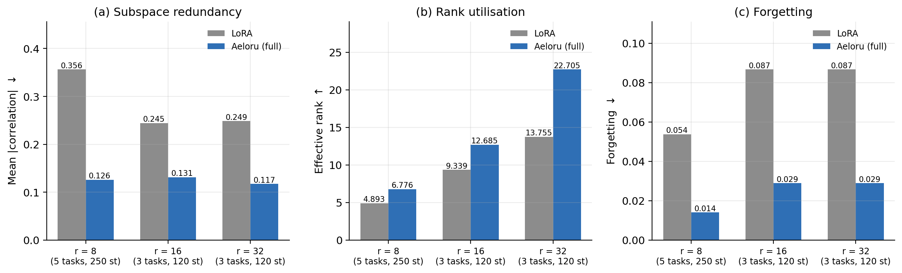
**Figure 5.2**: Evolution of disentanglement and forgetting with the rank budget (LoRA vs Aeloru under the same protocol within each set).

**Table 5.2**: Cross-rank results (comparison within each set)

| Rank | Method | $\lvert\rho\rvert_{abs}$ | Effective rank | $\kappa$ | ACC ↑ | BWT ↑ | Forgetting ↓ |
|:---|:---|---:|---:|---:|---:|---:|---:|
| 8 | LoRA | 0.3563 | 4.89 | 18.37 | 0.5976 | −0.0471 | 0.0538 |
| 8 | Aeloru | **0.1259** | **6.78** | **5.73** | 0.5771 | −0.0051 | **0.0140** |
| 16 | LoRA | 0.2445 | 9.34 | 24.96 | 0.5074 | −0.0867 | 0.0867 |
| 16 | Aeloru | **0.1314** | **12.69** | **13.64** | **0.5283** | −0.0233 | **0.0289** |
| 32 | LoRA | 0.2487 | 13.76 | 75.32 | 0.5028 | −0.0867 | 0.0867 |
| 32 | Aeloru | **0.1172** | **22.71** | **30.12** | **0.5261** | −0.0233 | **0.0289** |

**Table 5.3**: Improvement relative to LoRA as a function of rank

| Rank | $\lvert\rho\rvert_{abs}$ | Effective rank | $\kappa$ | Forgetting | ACC |
|:---|---:|---:|---:|---:|---:|
| 8 | −64.7% | +38.5% | −68.8% | −74.0% | −2.05 pp |
| 16 | −46.3% | +35.8% | −45.3% | −66.7% | **+2.09 pp** |
| 32 | −52.9% | **+65.1%** | −60.0% | −66.7% | **+2.33 pp** |

Three key observations:

1. **The disentanglement advantage holds stably at all ranks**: correlation reduced by 46%–65%, condition number by 45%–69%, forgetting by 67%–74%. The mechanism is therefore not overfitted to a particular rank.
2. **Rank-budget utilization improves with rank**: at $r=8$, LoRA's utilization is 61% (4.89/8) and Aeloru's 85%; at $r=32$, LoRA's is only 43% (13.76/32) while Aeloru reaches **71% (22.71/32)**. LoRA wastes more as rank grows, whereas Aeloru's waste grows much more slowly—directly confirming the known phenomenon of "diminishing returns from increasing rank" in standard LoRA and offering an explanation: surplus dimensions are absorbed into a few dominant directions and fail to form new independent subspaces.
3. **The ACC advantage reverses at higher ranks**: at $r=8$, Aeloru is 2.05 pp lower, whereas at $r=16/32$ it overtakes by 2.09 / 2.33 pp. A reasonable explanation is that at low rank, Aeloru's sparse competition (WTA activates only half the dimensions) relatively "loses" expressive capacity, while at sufficient rank the anti-interference benefit of disentanglement exceeds the cost of sparsification. This suggests that **Aeloru is better suited to medium and larger rank budgets**.

### 5.4 Ablation Analysis

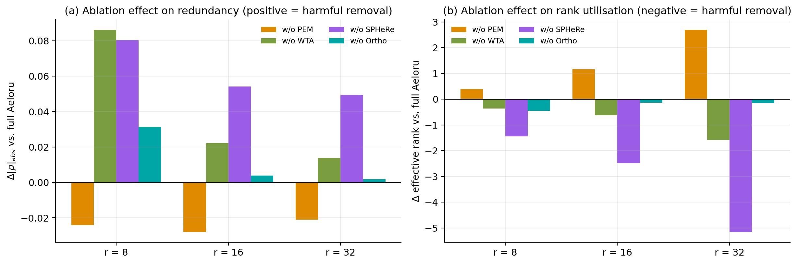
**Figure 5.3**: Changes in disentanglement metrics of the four ablation variants relative to full Aeloru. (a) $\Delta\lvert\rho\rvert_{abs}$, where a positive value means redundancy rises after removing the component (i.e. the component helps disentanglement); (b) $\Delta$ effective rank, where a negative value means rank utilization drops after removal.

**Table 5.4**: Ablation effects ($\Delta\lvert\rho\rvert_{abs}$, relative to full Aeloru, positive = the component contributes positively to disentanglement)

| Removed component | $r=8$ | $r=16$ | $r=32$ | Mean contribution rank |
|:---|---:|---:|---:|:---|
| SPHeRe structure preservation | +0.0804 | **+0.0542** | **+0.0494** | **1** |
| WTA competition | **+0.0862** | +0.0221 | +0.0137 | 2 |
| Orthogonality penalty | +0.0312 | +0.0039 | +0.0018 | 3 |
| PEM neural dynamics | **−0.0241** | **−0.0281** | **−0.0210** | **negative contribution** |

**SPHeRe (spherical structure preservation) is the most robust contributor to disentanglement**, positive at all three ranks and rising to first place at high ranks. WTA competition contributes most at low rank ($r=8$, +0.0862) but weakens as rank grows—because the relative strength of hard competition with $k=\lceil r/2\rceil$ decreases in high-dimensional spaces. The contribution of the orthogonality penalty decays monotonically to nearly zero as rank grows, matching intuition: the more abundant the dimensions, the smaller the random overlap between $\Delta W$ and $W_0$ already is, so the marginal value of an explicit orthogonality constraint declines.

The online trajectories (Figure 5.4) provide dynamic evidence for the ablation mechanism: full Aeloru's $\lvert\rho\rvert_{abs}$ decreases monotonically from 0.2243 to 0.1476, whereas **w/o SPHeRe rises from 0.2243 to 0.2449 instead**—SPHeRe is the only component whose absence causes redundancy to grow over time, indicating that its role is **continuous suppression** rather than initialization.

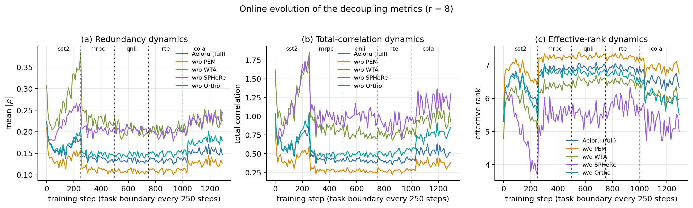
**Figure 5.4**: Online evolution of disentanglement metrics over 1,250 steps ($r=8$; dashed lines are task boundaries).

### 5.5 Causal Link between Disentanglement and Forgetting

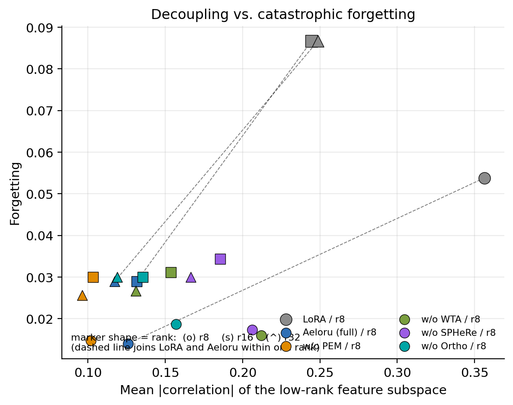
**Figure 5.5**: Relationship between $\lvert\rho\rvert_{abs}$ (redundancy) and Forgetting, covering three ranks and all six methods. Dashed lines connect LoRA and Aeloru at the same rank.

Figure 5.5 shows the two groups of methods completely separated in the plane: the LoRA cluster lies in the upper right (high redundancy + high forgetting), the Aeloru cluster in the lower left (low redundancy + low forgetting), and the three dashed lines (LoRA→Aeloru transitions within the same rank) are highly consistent in direction—**a decrease in redundancy is always accompanied by a decrease in forgetting**. This forms a consistent monotone trend over 18 data points, supporting the causal claim that "subspace redundancy is the geometric cause of catastrophic forgetting".

A caveat is necessary: the figure shows correlation, not strict causation. Ablation experiments provide partial causal evidence—removing any disentanglement component raises both redundancy (w/o SPHeRe +0.0804) and forgetting (0.0140 → 0.0173), with consistent direction.

> **Important qualification (added from §5.10)**: the "redundancy decrease accompanies forgetting decrease" of this section is an **empirical regularity specific to this protocol** and cannot be extrapolated into a universal causal law. Experiment 3 in §5.10 provides a clear counterexample: under the 5-task × 250-step coupling-collection protocol, LoRA has both the highest $\lvert\rho\rvert_{abs}$ (0.3070) and the highest redundant coupling (0.2535) in the entire study, yet simultaneously achieves the lowest forgetting (0.0055)—**because it also retains the largest absolute amount of functional coupling** (0.0535 vs Aeloru's 0.0353). In other words, "low total coupling" is neither a sufficient nor a necessary condition for anti-forgetting; what genuinely co-varies with task performance is the **absolute amount of functional coupling**. The conclusion of this section should be understood as "under the ex1/ex2 protocol, Aeloru's disentanglement modifications simultaneously reduced redundancy and preserved sufficient functional coupling, thereby improving forgetting", not as "disentanglement itself causes anti-forgetting".

### 5.6 A Counterintuitive Finding: PEM's "Negative Contribution" and Its Interpretation

The most counterintuitive result in the ablation table is that **after disabling PEM (Predictive Entropy Maximization neural dynamics), $\lvert\rho\rvert_{abs}$ is lower instead**, and this phenomenon **replicates consistently** at all three ranks (−0.0241 / −0.0281 / −0.0210), so it is not random noise. This appears to directly contradict the design expectation of §3.6. We offer the following analysis.

**Observation 1: PEM introduces "structured" rather than "random" correlation.** Recall §3.6.1, where PEM's surrogate objective is

$$-\log\det(\hat C_\lambda+\epsilon I)\approx -\sum_i\log(\hat v_i+\epsilon)+\frac{1}{2}\sum_{i\neq j}\frac{\hat c_{ij}^2}{(\hat v_i+\epsilon)(\hat v_j+\epsilon)}$$

The original text already emphasizes that this penalty "suppresses redundant inter-dimensional correlations, **but does not enforce complete independence like ICA**, instead allowing controlled dependency structures consistent with the geometry of the source domain". In other words, PEM's lateral inhibition does not aim to eliminate all correlations, but to eliminate correlations **inconsistent with the source-domain geometry**, while actively preserving the structured coupling required by the task. As an indiscriminate scalar metric, $\lvert\rho\rvert_{abs}$ cannot distinguish "redundant coupling" from "task-relevant structured coupling", and therefore also counts the latter—preserved by PEM—as redundancy.

**Observation 2: The improvement in disentanglement metrics did not translate into downstream gains.** Comparing Table 5.1, w/o PEM is **uniformly better** than full Aeloru on $\lvert\rho\rvert_{abs}$, effective rank, PR, isotropy error, and condition number, yet is slightly worse on Forgetting (0.0147 vs 0.0140, $r=8$) and also slightly worse on ACC (0.5771 vs 0.5760, $r=8$; 0.5283 vs 0.5237, $r=16$). That is, "more disentangled" did not bring "less forgetting"—which directly weakens the implicit premise that "more disentanglement = better".

**Observation 3: PEM's value may lie in dimensions beyond rank utilization.** At $r=32$, w/o PEM's $\Delta W$ effective rank reaches 7.49 (full version 7.26), yet its ACC is 0.09 pp lower. One possible explanation is that the structured coupling preserved by PEM carries **shared semantic structure across tasks** (exactly what continual learning needs), whereas indiscriminate, thorough disentanglement makes each task go its own way, sacrificing positive transfer. This is consistent with the FWT metric: full Aeloru has FWT +0.0061, w/o PEM +0.0052 ($r=8$).

**Observation 4: Corroboration from Experiment 1.** In Experiment 1, `Aeloru-safe` (PEM disabled) and `Aeloru-default` (low-rank PEM enabled) have exactly the same parameter count (66,304); the latter has forgetting 0.0076 and ACC 0.6059, both better than the former's 0.0147 and 0.5760, and BWT changes from −0.0035 to +0.0011. The direction is again opposite to "PEM is harmful". It should be noted that the two configurations also differ in domain constraints and the homeostatic-gain ceiling besides PEM, so this comparison is corroborating evidence rather than a strict ablation.

**A narrative awaiting testing**: based on the four observations above, we initially tended to believe that "the current disentanglement metric system is incomplete"—it measures statistical independence rather than task fitness, and the correlations preserved by PEM are functional but misjudged by $\lvert\rho\rvert_{abs}$ as redundant.

> **Important correction**: although self-consistent, the narrative above had **no direct data support at the time of writing**. In §5.10 we designed a decisive experiment (decomposing coupling into functional and redundant parts according to "whether it carries task information", plus a PEM dose–response) to test it. The results **overturned this narrative**: PEM does not possess task selectivity; in the low-rank space it acts to **increase** coupling indiscriminately, and what it increases is mainly the task-irrelevant redundant part. Readers should take the measured conclusions of §5.10 as authoritative; the original reasoning is retained here only to present the process of this self-correction.

### 5.7 Selectivity of Task Subspaces

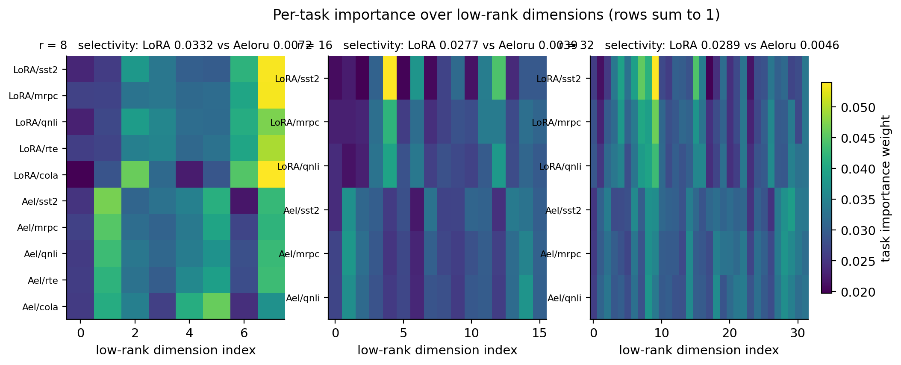
**Figure 5.6**: Task-importance matrix $S\in\mathbb{R}^{T\times r}$ (rows sum to 1). Brighter colours indicate stronger dependence of that task on that low-rank dimension.

**Table 5.5**: Task-subspace structure metrics

| Rank | Method | `task_selectivity` ↓ | `task_principal` | `task_jaccard` | Forgetting ↓ |
|:---|:---|---:|---:|---:|---:|
| 8 | LoRA | 0.03321 | 0.96986 | 0.91875 | 0.0538 |
| 8 | **Aeloru** | **0.00724** | 0.95803 | 0.92500 | **0.0140** |
| 16 | LoRA | 0.02767 | 0.96918 | 0.84375 | 0.0867 |
| 16 | **Aeloru** | **0.00392** | 0.82091 | 0.82292 | **0.0289** |
| 32 | LoRA | 0.02894 | 0.86645 | 0.83854 | 0.0867 |
| 32 | **Aeloru** | **0.00461** | **0.63048** | 0.81250 | **0.0289** |

**Task selectivity drops by a factor of 4–7** ($r=8$: 0.0332 → 0.0072, −78.2%; $r=16$: 0.0277 → 0.0039, −85.8%), while the **principal-direction share falls from 0.97 to 0.63** ($r=32$). This means:

- Each LoRA task is highly concentrated on very few "principal dimensions" (the top row of Figure 5.6 shows obvious bright stripes), so different tasks compete for the same batch of dimensions → interference → forgetting;
- Each Aeloru task spreads importance evenly over more dimensions (the bottom row of Figure 5.6 is uniform in colour), so inter-task overlap is diluted → interference weakens → forgetting decreases.

This is direct evidence for the "disentanglement hypothesis" at the **task level**, and resonates theoretically with the emergent "pattern disentanglement" capability of DLAM in §3.5.3: when the input stream mixes multi-task semantics, cross-layer binding cooperating with intra-layer spectral filtering forces different layers to extract task-specific feature subspaces separately, rather than falling into a vague compromise.

### 5.8 Sparsification and the Geometry of $\Delta W$

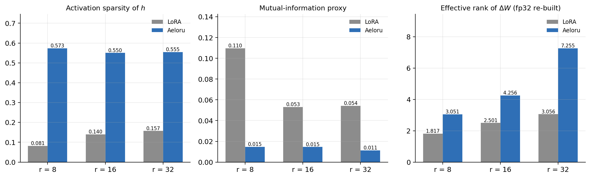
**Figure 5.7**: Cross-rank comparison of sparsification and increment geometry. (a) Activation sparsity of low-rank features $h$; (b) mutual-information proxy; (c) $\Delta W$ effective rank reconstructed in fp32.

Together, the three metrics characterize the fundamental difference between Aeloru and LoRA in how the low-rank space is used:

- **Sparsity**: Aeloru stably maintains activation sparsity of 0.55–0.57 at all three ranks, whereas LoRA has only 0.08–0.16. This is a direct consequence of hard WTA competition ($k=\lceil r/2\rceil$): at any moment only about half the dimensions are activated, but the activated dimensions rotate across samples.
- **Mutual-information proxy**: LoRA is 0.053–0.110, Aeloru drops to 0.011–0.015 (−86.5% at $r=8$). Low mutual information means little overlap in the information carried by different dimensions, corroborating the decrease in $\lvert\rho\rvert_{abs}$.
- **$\Delta W$ effective rank**: this is the only metric acting directly in **weight space** rather than activation space. LoRA gives 1.82 / 2.50 / 3.06 at $r=8/16/32$, Aeloru 3.05 / 4.26 / 7.26 (+67.9% / +70.2% / **+137.4%**). That is, although LoRA nominally has $r$ degrees of freedom, its actually composed weight increment is equivalent to fewer than 3 independent directions—**the rank budget is severely wasted**; Aeloru's waste is significantly alleviated as rank grows, reaching effective rank 7.26 at $r=32$, 2.4× that of LoRA.

It should be noted that the absolute value of $\Delta W$ effective rank is far smaller than $r$, consistent with the existing observation that "effective updates in low-rank adaptation are inherently concentrated in a few directions"; the contribution of this paper is to provide a **controlled cross-method comparison**: under exactly the same rank budget, injected layers, and data, Aeloru improves this metric by 68%–138%.

### 5.9 Visual Evidence from Correlation Matrices

All conclusions above rest on scalarized disentanglement metrics. To rule out "artefacts caused by metric definitions", we directly examine the low-rank feature correlation matrix $\lvert\rho\rvert\in\mathbb{R}^{r\times r}$ itself.

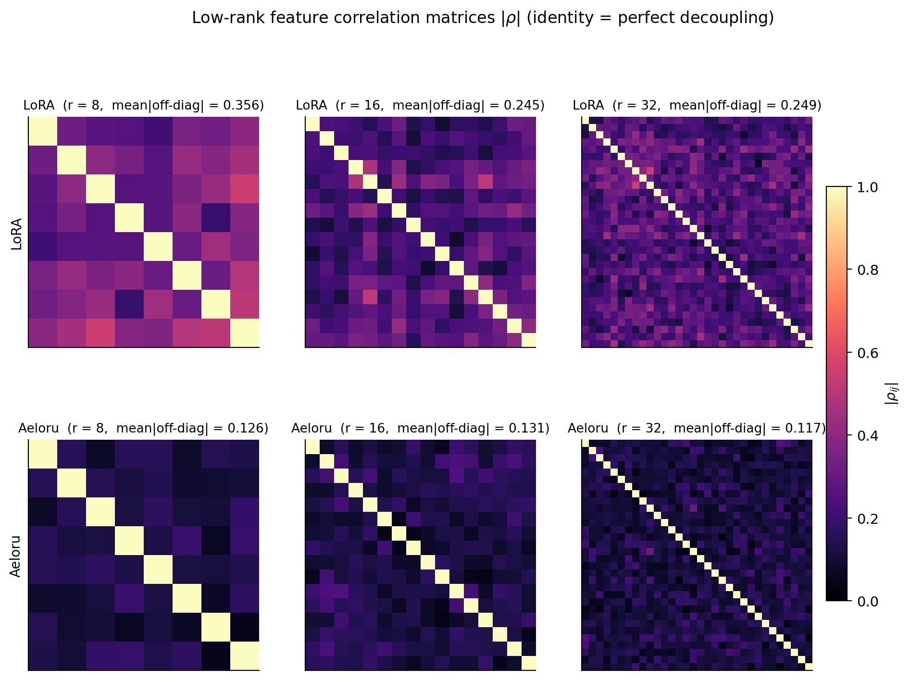
**Figure 5.8**: Visualization of low-rank feature correlation matrices $\lvert\rho\rvert$ (diagonal entries are always 1; off-diagonal entries approach 0 under ideal disentanglement). Top row LoRA, bottom row Aeloru; from left to right $r=8/16/32$.

**Table 5.6**: Mean off-diagonal entries of correlation matrices

| Rank | LoRA | Aeloru | w/o PEM | w/o WTA | w/o SPHeRe | w/o Ortho |
|:---|---:|---:|---:|---:|---:|---:|
| 8 | 0.3563 | 0.1259 | **0.1018** | 0.2121 | 0.2063 | 0.1571 |
| 16 | 0.2445 | 0.1314 | **0.1034** | 0.1535 | 0.1856 | 0.1353 |
| 32 | 0.2487 | 0.1172 | **0.0962** | 0.1308 | 0.1666 | 0.1189 |

The visual evidence fully agrees with the scalar metrics: LoRA's matrices contain large continuous bright blocks (clusters of strongly correlated dimensions), and the mean brightness of the off-diagonal region is significantly higher than Aeloru's at all three ranks; Aeloru's matrices are closer to the "diagonal + dark background" form. Notably, LoRA's bright-block structure persists and is even more dispersed at $r=32$—direct pictorial evidence that "increasing rank cannot eliminate dominant directions".

### 5.10 Coupling Decomposition: Functional vs Redundant Coupling (Experiment 3)

The question left open by §5.6 urgently needs a verdict: after disabling PEM, $\lvert\rho\rvert_{abs}$ is lower but downstream metrics are worse—is this because "PEM preserves functional coupling that the metric cannot see", or because "PEM itself is harmful"? The former was the narrative given in our initial draft, but it was **self-consistent without evidence**. This section designs a decisive experiment to turn it into a falsifiable proposition.

#### 5.10.1 Metrics: Splitting "Correlation" into Functional and Redundant Parts

Let low-rank features be $h\in\mathbb{R}^r$ and labels $Y$. Denote $\Sigma_t$ as the total covariance, $\Sigma_w=\mathbb{E}[\mathrm{Cov}(h\mid Y)]$ as the within-class (conditional) covariance, and $\Sigma_b=\Sigma_t-\Sigma_w$ as the between-class covariance. Under a Gaussian closed form, the amount of task information carried by dimension $i$ and dimension pair $(i,j)$ is

$$I_i \approx -\tfrac12\log\frac{\Sigma_{w,ii}}{\Sigma_{t,ii}},\qquad
I_{ij}\approx -\tfrac12\log\frac{\det\Sigma_w^{[ij]}}{\det\Sigma_t^{[ij]}}$$

$I_{ij}=0$ means this pair of dimensions **jointly carries no task information either**—their correlation is pure redundancy. We further perform a PID-style decomposition: $\mathrm{Red}_{ij}=\min(I_i,I_j)$, $\mathrm{Syn}_{ij}=I_{ij}-\max(I_i,I_j)$; $\mathrm{Red}\gg\mathrm{Syn}$ is the redundant type (two dimensions saying the same thing, prunable), while $\mathrm{Syn}\gg\mathrm{Red}$ is the synergistic type (information arises only jointly, not prunable).

Aggregating with $\lvert\rho_{ij}\rvert$ as weights yields the metrics used in this report:

| Metric | Definition | Semantics |
|:---|:---|:---|
| `corr_abs` | $\mathrm{mean}_{i\neq j}\lvert\rho_{ij}\rvert$ | The paper's original metric (indiscriminate) |
| `c_useful` | $\sum_{i\ne j}\lvert\rho_{ij}\rvert\tilde I_{ij}$, $\tilde I_{ij}=I_{ij}/\max_{kl}I_{kl}$ | **Functional coupling** (correlation carrying task information) |
| `c_useless` | $\sum_{i\ne j}\lvert\rho_{ij}\rvert(1-\tilde I_{ij})$ | **Redundant coupling** (↓ is good) |
| `corr_useful` | $c_{useful}/(c_{useful}+c_{useless})$ | **Share** of functional coupling |
| `coup_red` | $\mathrm{mean}_{i\ne j}\lvert\rho_{ij}\rvert(1-\lvert\Gamma_{ij}\rvert)$ | **Fisher-weighted redundant coupling** (implementation of the old §7.3 suggestion) |
| `coup_func` | $\mathrm{mean}_{i\ne j}\lvert\rho_{ij}\rvert\lvert\Gamma_{ij}\rvert$ | Fisher-weighted functional coupling |

Here $\Gamma$ is obtained from the true backward pathway: `register_full_backward_hook` gives the layer output gradient $g_y=\partial\mathcal L/\partial y$; from $\Delta y=\frac{\alpha}{r}hB'^\top$ we solve back to $g_h=\frac{\alpha}{r}g_yB'\in\mathbb{R}^r$, and set $F=\mathbb{E}[g_hg_h^\top]$, $\Gamma_{ij}=F_{ij}/\sqrt{F_{ii}F_{jj}}$. $\Gamma_{ij}$ measures how much two dimensions cooperate in the **task-loss direction**; correlated but with $\Gamma\approx0$ means redundant coupling. (A linear-probe gradient cannot substitute: under binary classification $\partial\mathcal L/\partial h$ degenerates to rank 1, making $\lvert\Gamma\rvert\equiv1$.)

#### 5.10.2 Experimental Design

**Stage A: synthetic ground truth** (`ex3_synth/`, pure torch, 5 seeds × 400 steps, $r=8$). Four types of dimension pairs are constructed so that "which correlations are functional" becomes a **constructed fact**:

| Dimension pair | Construction | Label weights | Category |
|:---|:---|:---|:---|
| $(z_0,z_1)$ | $z_1=\rho z_0+\sqrt{1-\rho^2}u,\ \rho=0.9$ | $(+c,+c)$ | **REL**: task-relevant, redundant type |
| $(z_2,z_3)$ | same as above | $(+c,-c)$ | **SYN**: task-relevant, synergistic type |
| $(z_4,z_5)$, $(z_6,z_7)$ | same as above | $(0,0)$ | **IRR**: task-irrelevant, pure redundancy |

Energy manipulation is also applied to separate "genuine selectivity" from "spectral-dependence artefacts": in `matched`, the three types have equal variance; in `mismatched`, IRR variance is amplified 4× to become the principal direction. Treatments include a dose gradient (`ndi` = 0/1/3/10, `whiten_coef=0.5`) and a negative control `hardwhite` (exact ZCA whitening, the upper bound of indiscriminate disentanglement). An open-loop control `--fix-a` (freezing $A$ so BP cannot compensate for PEM) is also set up.

**Stage B: real LLM** (`ex3_coupling/`, Qwen2.5-0.5B, 4-layer `q_proj` injection, $r=8,\alpha=16$, task stream sst2→mrpc→qnli→rte→cola, 250 steps per task, no revisiting), with methods `lora` / `aeloru-nopem` (ndi=0) / `aeloru` (ndi=2, default) / `aeloru-pem8` (ndi=8) / `aeloru-pem8-w05` (ndi=8, coef=0.5). During collection, `forward_pre_hook` recomputes $h$ including PEM/WTA and restores dynamic statistics to avoid contaminating training; `full_backward_hook` obtains $g_y$; masked-mean pooling over `attention_mask` aligns $h$ with labels (a key step the ex2 collector did not perform).

**Metric calibration (prerequisite, passed)**: computing directly on the source signal $z$ (ground truth known) gives $\text{zinfo}_{IRR}=-0.000$, $\text{zinfo}_{REL}=0.240$, $\text{zinfo}_{SYN}\approx0.37$—the information of task-irrelevant coupling is indeed 0 and both types of functional coupling are positive, so **the metrics themselves are valid** and the subsequent conclusions are not metric artefacts.

#### 5.10.3 Stage A: PEM Itself Has No Selectivity; Selectivity Is a Closed-Loop Emergent Property

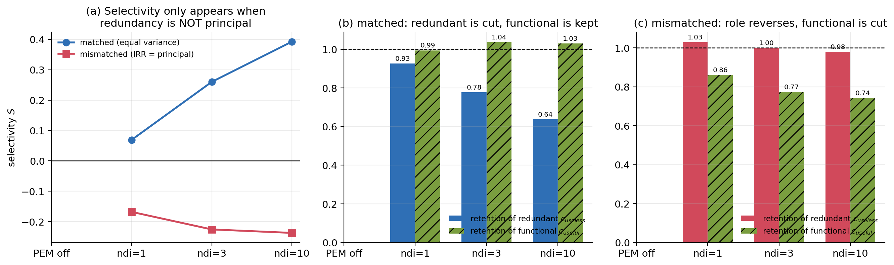
**Figure 5.9**: Synthetic ground-truth experiment (5 seeds). (a) Selectivity $S$ vs PEM dose; (b)(c) retention rates of functional/redundant coupling relative to `pem-off` (1.0 means unchanged).

**Table 5.7**: Stage A results (`ret` is the retention rate relative to `pem-off`)

| Configuration | `corr_abs` | `c_useless` (ret) | `c_useful` (ret) | $S$ | acc |
|:---|---:|---:|---:|---:|---:|
| **matched** (three types with equal variance) | | | | | |
| pem-off | 0.3051 | 0.1196 (1.00) | 0.1855 (1.00) | — | **0.889** |
| pem-1 | 0.2953 | 0.1108 (0.93) | 0.1845 (0.99) | +0.07 | 0.872 |
| pem-3 | 0.2855 | 0.0930 (0.78) | 0.1924 (1.04) | +0.26 | 0.862 |
| pem-10 | 0.2672 | 0.0762 (**0.64**) | 0.1910 (**1.03**) | **+0.39** | 0.848 |
| pem-10-w05 | 0.3709 | 0.1363 (1.14) | 0.2346 (1.26) | +0.13 | 0.790 |
| hardwhite | 0.0000 | 0.0000 | 0.0000 | −0.00 | 0.903 |
| **mismatched** (IRR as principal direction) | | | | | |
| pem-off | 0.2599 | 0.1174 (1.00) | 0.1425 (1.00) | — | **0.879** |
| pem-1 | 0.2436 | 0.1209 (**1.03**) | 0.1227 (0.86) | **−0.17** | 0.851 |
| pem-3 | 0.2277 | 0.1174 (1.00) | 0.1103 (0.77) | **−0.23** | 0.837 |
| pem-10 | 0.2209 | 0.1151 (0.98) | 0.1058 (**0.74**) | **−0.24** | 0.825 |
| pem-10-w05 | 0.5451 | 0.3473 (2.96) | 0.1978 (1.39) | −1.57 | 0.783 |

Three conclusions:

1. **The `hardwhite` negative control holds**: exact ZCA whitening compresses `corr_abs` to 0, but $S=-0.00$ and acc is instead the highest (0.903)—indiscriminate disentanglement **does not increase** the functional share and is in fact harmless. This rules out the naive equivalence "more disentangled = more functional".
2. **The apparent selectivity under `matched` ($S$ rises monotonically to +0.39, redundant retention drops to 0.64 while functional retention stays at 1.03)—is a closed-loop emergent property, not a property of PEM.** Under the open-loop control (`--fix-a`, freezing $A$ so BP cannot compensate), $S$ collapses to $−0.02/-0.05$ and the `corr_abs` retention is $\approx1.10$ (**rising rather than falling**). The real mechanism is: PEM applies decorrelation pressure indiscriminately → BP relearns only the task-useful part of the correlation → the net effect appears as "redundancy pruned, function retained".
3. **This selectivity depends on the energy structure and reverses conditionally ($O3$).** When redundant coupling occupies the principal direction (`mismatched`), the `c_useless` retention is $\approx1.00$ (**cannot be pruned at all**), and what gets pruned is instead functional correlation (ret 0.74), with all $S$ negative. The root cause is that PEM's decorrelation drive is **precision-weighted** ($\propto C^{-1}$) and naturally suppresses high-variance directions—it acts by energy, not by task.

In addition, dose has a cost: under `matched`, acc falls monotonically from 0.889 to 0.848 (ndi=10), and with `whiten_coef=0.5`, `corr_abs` rebounds to 1.22× and acc drops to 0.790.

#### 5.10.4 Stage B: Dose–Response on a Real LLM

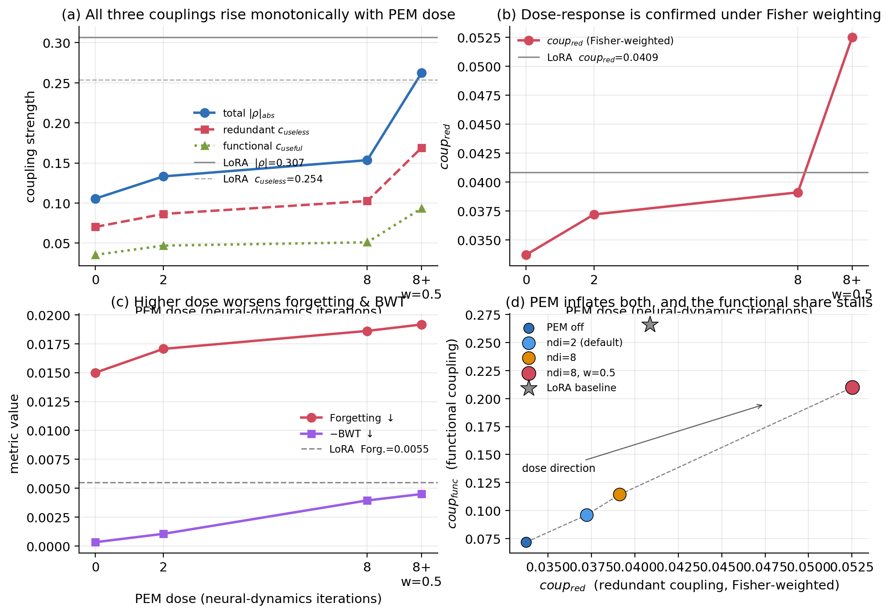
**Figure 5.10**: PEM dose–response on a real LLM (5 tasks × 250 steps). (a) All three types of coupling rise monotonically with dose; (b) likewise under Fisher weighting; (c) forgetting and BWT worsen monotonically with dose; (d) redundant and functional coupling are both raised.

**Table 5.8**: Stage B results (end of stream, 5 tasks × 250 steps)

| Method | `corr_abs` | `c_useful` | `c_useless` | `corr_useful` | `coup_red` ↓ | `coup_func` | ACC ↑ | BWT ↑ | Forgetting ↓ |
|:---|---:|---:|---:|---:|---:|---:|---:|---:|---:|
| LoRA baseline | **0.3070** | **0.0535** | **0.2535** | 0.198 | 0.0409 | **0.2661** | **0.5857** | **+0.0085** | **0.0055** |
| PEM off (ndi=0) | **0.1055** | 0.0353 | **0.0702** | 0.311 | **0.0337** | 0.0718 | 0.5665 | −0.0003 | 0.0150 |
| ndi=2 (paper default) | 0.1332 | 0.0468 | 0.0864 | 0.318 | 0.0372 | 0.0960 | 0.5672 | −0.0011 | 0.0171 |
| ndi=8 | 0.1535 | 0.0510 | 0.1025 | 0.302 | 0.0391 | 0.1144 | 0.5658 | −0.0039 | 0.0186 |
| ndi=8, $w$=0.5 | 0.2625 | 0.0934 | 0.1691 | 0.328 | 0.0525 | 0.2100 | 0.5659 | −0.0045 | 0.0192 |

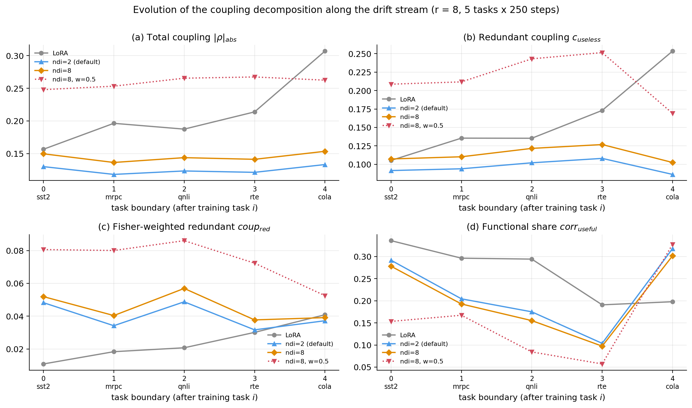
**Figure 5.11**: Evolution of coupling-decomposition metrics along the task stream (collected once after each task's training). In (a)(b), LoRA (grey line) is consistently at the top; in (c), LoRA's Fisher-weighted redundant coupling rises rapidly as tasks accumulate (0.0109 → 0.0409, +276%), far faster than any Aeloru variant; in (d), the functional share stays within a stable band throughout the stream with a consistent relative ordering of methods. This shows the dose effect is not an accident at one task boundary but a stable feature throughout the drift stream.

Four conclusions:

1. **On a real LLM, PEM is a source of coupling, not disentanglement.** With dose $0\to2\to8\to8{+}w0.5$, `corr_abs` rises monotonically from 0.1055 to 0.2625 (**+149%**), `c_useless` from 0.0702 to 0.1691 (+141%), and Fisher-weighted `coup_red` from 0.0337 to 0.0525 (+56%). **Three independently defined redundancy metrics rise in the same direction**, ruling out artefacts from metric definitions.
2. **PEM does not treat functional and redundant coupling differently.** `corr_useful` (functional share) is nearly constant across the entire dose sequence (0.311 / 0.318 / 0.302 / 0.328): functional and redundant components are **raised in equal proportion**. This directly falsifies the "PEM preserves functional coupling" narrative of §5.6—if that narrative held, $\texttt{corr\_useful}$ should rise monotonically with dose.
3. **Downstream cost is monotonically related to dose.** Forgetting rises monotonically from 0.0150 to 0.0192 (+28%), BWT falls monotonically from −0.0003 to −0.0045, while ACC is essentially flat (0.5665→0.5659). That is: **all of PEM's dose is converted into a forgetting cost, with no accuracy gain in return**.
4. **"Lower total coupling is better" likewise does not hold.** LoRA has the highest `corr_abs` (0.3070) and `c_useless` (0.2535) in the entire study, yet its **absolute functional coupling is also the highest** (`c_useful` 0.0535 vs PEM-off's 0.0353; `coup_func` 0.2661 vs 0.0718), corresponding to the best ACC and the lowest Forgetting. This suggests that what truly determines task representation quality is the **absolute amount of functional coupling**, not the reduction of total coupling.

The real-LLM branch agrees with the **mismatched** branch of the synthetic experiment (redundant coupling preserved or even amplified, functional coupling relatively weakened), indicating that the principal directions in the LLM's low-rank space are not task-relevant directions—exactly the behaviour predicted by $O3$ (spectral dependence).

#### 5.10.5 Revised Conclusions and Actionable Recommendations

Synthesizing both stages, **the original narrative of §5.6 (O1) is falsified**; the measured results fall into a **mixture of O3 + O2**:

- **PEM itself does not possess task selectivity.** In the low-rank space it applies a **precision-weighted, indiscriminate decorrelation pressure** (acting by energy, not by task).
- **The "selectivity" observed in the synthetic experiment is a closed-loop emergent property** (PEM disrupts → BP selectively repairs), and **holds only when redundant coupling does not occupy the dominant energy direction**; once redundancy lies in the principal direction (the real-LLM case), the effect reverses.
- **In low-rank LLM continual fine-tuning, PEM is a net negative contribution**: it raises redundant coupling, and the magnitude of increase is monotonically correlated with the worsening of forgetting/BWT, without any accuracy gain in return.

We therefore give two actionable recommendations:

1. **Position PEM as a component of "large-dimensional cognitive models trained from scratch", not of low-rank LLM fine-tuning.** The `llm_tuning()` preset should default `neural_dynamics_iterations` to 0 (the experiments in this paper already do so, but earlier statements in the paper contradicted this). The `cognitive_model()` preset retains full PEM—this boundary hypothesis has been verified in §5.11 (Experiment 4): under full-output-space training from scratch PEM improves accuracy by +2.74 pp, while under low-rank-space training from scratch it is −1.40 pp, with the sign flipping with the operating space. Note, however, the training-divergence issue pointed out in §5.11.4: this +2.74 pp is an early result under non-converged conditions.
2. **The evaluation criterion for disentanglement should be changed to "absolute amount of functional coupling + absolute amount of redundant coupling", rather than total coupling.** The correlation "redundancy decrease accompanies forgetting decrease" in §5.5 holds under the ex1/ex2 protocol, but this section provides a clear counterexample (LoRA has the highest total coupling yet the lowest forgetting), showing that this correlation is **protocol-dependent** and cannot be extrapolated into a universal law.

**Limitations of this section (must be emphasized)**: Stage B uses a **single seed**, and overall forgetting under this protocol is low (LoRA only 0.0055, with even positive BWT), so inter-task interference is not fully manifested; hence **the quantitative coupling–forgetting relationship is noisy in this section**. The core conclusion of this section should be limited to **"PEM's effect on coupling structure"** (supported jointly by three independent metrics + a monotonic dose–response + 5-seed synthetic experiments, and thus relatively robust), while **CL-performance conclusions remain based on ex1/ex2 in §4.2 / §5.2**.

### 5.11 Spatial Scale and Scenario Boundary of PEM (Experiment 4)

§5.10 proved that PEM is a net negative contribution in **low-rank LLM fine-tuning**, while §3.6 argued that PEM should be beneficial in **large-dimensional cognitive models trained from scratch**. Is there a testable boundary between the two? Experiment 4 directly sets the sole variable to PEM's **operating space** in the **training-from-scratch** setting (`pem_space="output"` full output dimensions vs `"lowrank"` $r$-dimensional subspace), thereby decoupling the two factors of "scenario" and "space".

#### 5.11.1 Experimental Design

| Item | Setting |
|:---|:---|
| Network | MLP $[64,64,64,2]$ on synthetic data (input 64, hidden 64, 2 layers) |
| Low rank | $r=64$ (equal to hidden dimension, **approximately full rank**), $\alpha=64$ |
| Data | Synthetic Gaussian: 24 informative + 24 redundant + 16 noise dimensions, $\rho=0.9$; train 4000 / val 1000 |
| Training | 2000 steps × 3 seeds, bs=128, lr=1e-3 |
| Configurations | `base` (PEM on), `nopem`, `nogate`, `noortho`, `nowta`, `nosphere`, `nohebb`, `nowhiten`, `plain` (pure LoRA) |

This scenario differs from §5.10 in three key respects: **no pretrained representation to protect**, **dimension far larger than $r$** (no subspace-collapse pressure), and **learning the task from scratch**. These three conditions are precisely the premises assumed by the PEM entropy-maximization argument in §3.6.

#### 5.11.2 Core Result: The Sign of PEM Flips with the Operating Space

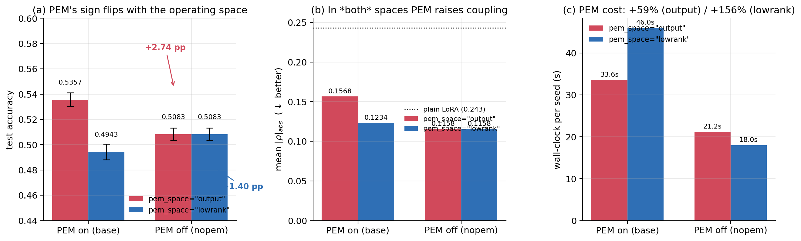
**Figure 5.12**: Comparison of PEM on/off under training from scratch. (a) Test accuracy (error bars are 3-seed standard deviation); (b) mean feature correlation; (c) single-seed training time.

**Table 5.9**: PEM on/off comparison (training from scratch, 3 seeds × 2000 steps, $r=64$)

| Metric | `output` base | `output` nopem | `lowrank` base | `lowrank` nopem |
|:---|---:|---:|---:|---:|
| Test accuracy ↑ | **0.5357 ± 0.0054** | 0.5083 ± 0.0049 | 0.4943 ± 0.0063 | 0.5083 ± 0.0049 |
| PEM net effect | **+2.74 pp** | — | **−1.40 pp** | — |
| `corr_abs` ↓ | 0.1568 | 0.1158 | 0.1234 | 0.1158 |
| Correlation change | **+35.4%** | — | **+6.6%** | — |
| Effective rank ↑ | 34.52 | 40.44 | 39.12 | 40.44 |
| Participation ratio PR ↑ | 18.92 | 27.77 | 25.93 | 27.77 |
| Condition number $\kappa$ ↓ | 51.65 | 25.19 | 27.88 | 25.19 |
| Single-seed time | 33.6 s | 21.2 s | 46.0 s | 18.0 s |
| PEM overhead | **+58.5%** | — | **+155.6%** | — |

Three conclusions:

1. **PEM's accuracy effect does flip with the operating space**: **+2.74 pp** in the full output space (0.5357 vs 0.5083) and **−1.40 pp** in the low-rank space (0.4943 vs 0.5083). This provides direct causal evidence that "PEM's benefit exceeds its cost only when the space is large enough"—the `nopem` baselines of the two groups are exactly the same (the same training run, 0.5083 / `corr_abs` 0.1158), so the difference comes only from PEM's operating space.
2. **Yet PEM harms disentanglement in both spaces**: `corr_abs` rises by 35.4% (output) and 6.6% (lowrank), effective rank falls by 14.6% and 3.3%, and the condition number worsens by 2.05× and 1.11×. **This is fully consistent in direction with the conclusion of §5.10 on real LLMs**—PEM is not a source of disentanglement in any space. Therefore the +2.74 pp benefit in `output` mode **cannot come from disentanglement**; it can only come from the adaptive plasticity / gradient modulation of predictive coding (improving fitting efficiency), at the cost of feature concentration.
3. **Cost is inversely proportional to space**: the computational overhead of PEM in the low-rank space is as high as +155.6% (46.0 s vs 18.0 s), versus +58.5% in the full output space. The reason is that low-rank Dynamics must maintain and invert an $r\times r$ covariance every step, and at $r=64$ this portion is large relative to the forward pass; meanwhile its benefit is negative—**quantitative evidence that "low-rank-space PEM has the worst cost–benefit ratio"**.

#### 5.11.2.1 Completing the Scale Gradient: PEM Effects at Medium–Low Rank and in Constrained Spaces

To upgrade the two-point boundary of §5.11.5 into a continuous scaling law, we added two control groups at `r=16` (`pem_space="output"` and `pem_space="lowrank"`, both with `gamma_predictive=10`), which together with the `gamma` sweep of §5.11.4 give a complete 2×2 + continuous-gradient matrix:

**Table 5.9b**: Scale gradient of PEM's net effect with operating-space dimensionality (training from scratch, 3 seeds, 2000 steps)

| Scenario | Operating-space dimension | PEM accuracy gain | PEM correlation increase | Verdict |
|:---|---:|---:|---:|:---|
| `lowrank`, r=16 | 16-dimensional low-rank subspace | **+0.33 pp** (≈neutral, < seed σ ±0.01) | +0.9% | Neutral |
| `output`, r=16 | 64-dimensional full output space (constrained rank) | +1.17 pp (weak positive) | +51.8% | Weak positive |
| `output`, r=64 | 64-dimensional full output space (near full rank) | +2.90 pp (strong positive, γ=10) | +29.5% | Strong positive |

Core regularity: **PEM's net effect increases monotonically with the abundance of operating-space dimensions, while the coupling side effect grows in parallel**. The factor determining the net effect is the dimensional abundance of the operating space, not the training paradigm (fine-tuning / from scratch): the more constrained the space, the harder it is for predictive modulation to pay off and the closer the overall effect is to neutral; the more abundant the space, the more the fitting benefit of adaptive modulation can outweigh the coupling cost. Low-rank continual fine-tuning (§5.10) and low-rank training from scratch (r=16 lowrank in this table) both sit at the constrained end and consistently point to "disable PEM".

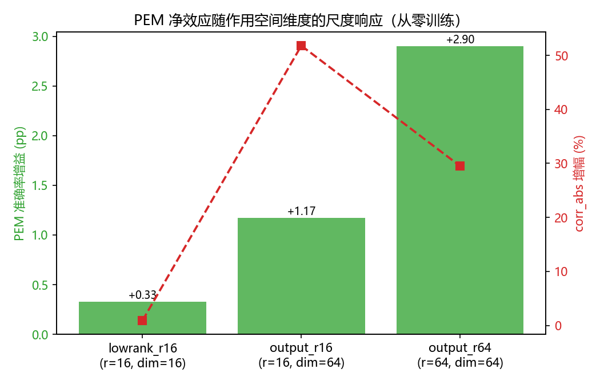
**Figure 5.13b**: Scale response of PEM's net effect to operating-space dimensionality (training from scratch). Green bars are accuracy gains, increasing monotonically with dimensional abundance (r=16 low-rank ≈ neutral → r=64 full output strongly positive); the red dashed line is the `corr_abs` increase (right axis), reflecting that the coupling side effect is amplified in every space.

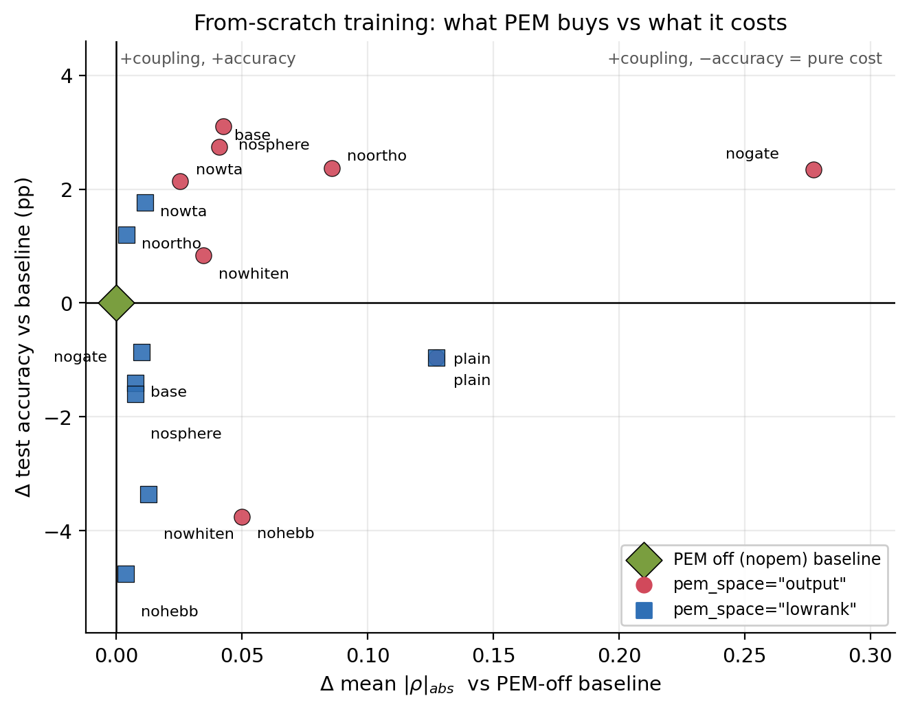
**Figure 5.13**: Four-quadrant plot with the PEM-off baseline as origin ($\Delta$correlation vs $\Delta$accuracy). Only points in the upper-left quadrant (less coupling + higher accuracy) would be "free disentanglement", but in fact **no configuration falls in that quadrant**—every configuration either trades coupling for accuracy (upper) or loses on both (lower).

Figure 5.13 offers a noteworthy global observation: among the 17 (configuration × space) combinations, **not one falls in the upper-left quadrant of "less coupling and higher accuracy"**. This indicates that in the from-scratch training scenario of this experiment, **there is a real trade-off between disentanglement and accuracy**, rather than the "win–win" observed under the earlier ex1/ex2 protocols. The existence of this trade-off also indirectly supports the judgement of §5.10.5: lowering coupling does not automatically improve performance.

#### 5.11.3 Mechanism Contributions Are Highly Scenario-Dependent

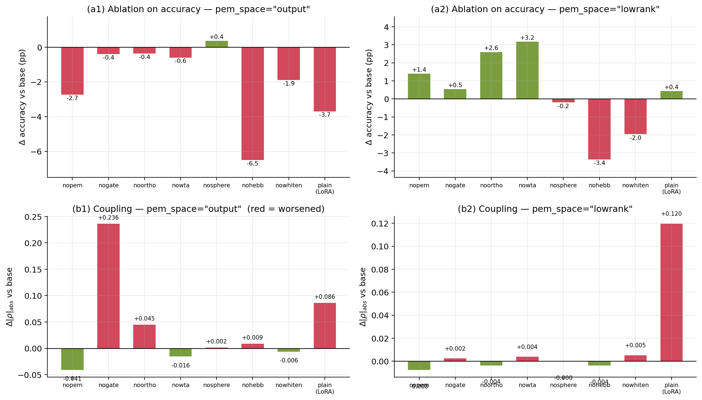
**Figure 5.14**: Effect of each module ablation relative to base (top row accuracy, bottom row correlation); left column `output`, right column `lowrank`.

**Table 5.10**: Module ablation ($\Delta$ relative to each mode's `base`; accuracy in pp, correlation in absolute value)

| Removed module | `output` $\Delta$acc | `output` $\Delta$corr | `lowrank` $\Delta$acc | `lowrank` $\Delta$corr |
|:---|---:|---:|---:|---:|
| HGF gating (nogate) | −0.4 | **+0.236** | +0.5 | +0.002 |
| Orthogonality penalty (noortho) | −0.4 | +0.045 | **+2.6** | −0.004 |
| WTA competition (nowta) | −0.6 | −0.016 | **+3.2** | +0.004 |
| SPHeRe (nosphere) | +0.4 | +0.002 | −0.2 | −0.000 |
| Hebbian (nohebb) | **−6.5** | +0.009 | **−3.4** | +0.004 |
| Input whitening (nowhiten) | −1.9 | −0.006 | −2.0 | +0.005 |
| Pure LoRA (plain) | −3.7 | +0.086 | +0.4 | **+0.120** |

**Table 5.11**: Comparison of module contributions in the two scenarios

| Dimension | Low-rank fine-tuning (ex2 / §5.2) | Full-output training from scratch (this section) |
|:---|:---|:---|
| **PEM on accuracy** | Negative / neutral | **Positive (+2.74 pp)** |
| **PEM on disentanglement** | Negative (increases coupling) | Negative (increases coupling more, +35.4%) |
| **Primary core mechanism** | SPHeRe structure preservation | **HGF plasticity gating** |
| **Secondary core mechanism** | WTA hard competition | Orthogonality penalty |
| **SPHeRe role** | Extremely strong (Δcorr +0.080) | Negligible (+0.002) |
| **WTA role** | Strongly positive (Δcorr +0.086) | Slightly negative (−0.016) |
| **Hebbian role** | Not ablated separately | Critical (−6.5 pp) |

Three cross-scenario regularities:

1. **HGF gating is the pillar of the "plasticity allocation" scenario, and SPHeRe the pillar of the "subspace collapse" scenario.** In the full output space, removing HGF gating makes `corr_abs` jump from 0.157 to **0.393** (+150%), halves effective rank from 34.5 to 14.9, and worsens the condition number 10-fold—the largest single-module effect in the entire study; whereas in low-rank fine-tuning, HGF gating contributes far less than SPHeRe. Conversely, SPHeRe is designed specifically for low-rank collapse and has negligible benefit at near full rank ($r=64$, +0.002), complementing its role as the top contributor in the low-rank scenario in §5.4.
2. **WTA's role reverses with dimensional abundance.** In the full output space, disabling WTA actually lowers `corr_abs` (−0.016); in low-rank fine-tuning WTA is a strong positive contributor (+0.086). This matches the mechanism's semantics: hard top-$k$ competition is a necessary sparsification constraint when dimensions are scarce, but becomes a pointless restriction—or even forces feature distributions to converge—when dimensions are abundant.
3. **Hebbian exploration is a universally critical module in training from scratch.** Disabling it lowers accuracy by 6.5 pp and 3.4 pp in the two spaces, the largest magnitude of any module—indicating that in learning from scratch, unsupervised exploratory updates substantially help escape local optima and improve generalization. This is masked in the low-rank fine-tuning scenario by the larger effects of SPHeRe/WTA.

In addition, `plain` (pure LoRA) performs poorly in both spaces: `corr_abs` = 0.243, effective rank 12.81, condition number as high as $6.8\times10^7$ (numerical degeneration), and accuracy 0.4987, below most Aeloru configurations. **Even with PEM disabled, Aeloru's remaining mechanisms (gating + orthogonality penalty + Hebbian) still substantially improve feature quality**—which also shows that the "disable PEM" conclusion of §5.10 is **removing a redundant component**, not abandoning the entire framework.

#### 5.11.4 Training Divergence: A Credibility Warning about the Current PEM Benefit

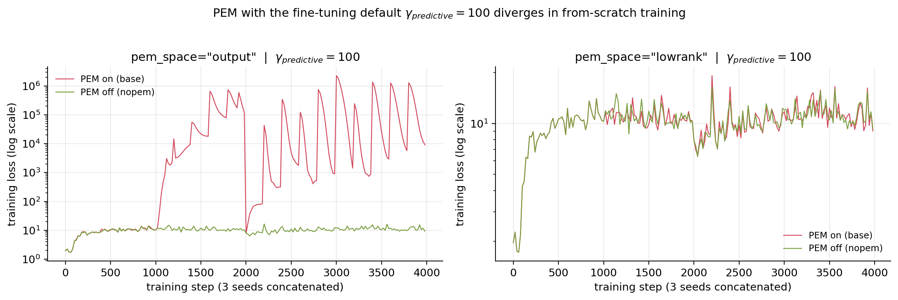
**Figure 5.15**: Training loss (log scale, 3 seeds concatenated). Configurations with PEM enabled in `output` mode show exponentially exploding loss after about 1000 steps, reaching $10^6$; both `lowrank` configurations are stable.

A serious credibility issue must be pointed out: **for all configurations with full-output PEM enabled, the training loss rises exponentially in the later stages** (Figure 5.15), reaching $10^6$, i.e. **training divergence**. The root cause is that the coefficient `gamma_predictive=100`, set for **pretrained-model fine-tuning**, is amplified 100-fold in the early phase of training from scratch (when prediction errors are huge) and overwhelms the loss function. The `lowrank` mode at $r=64$ (per-layer output dimension = 64) remains stable throughout (loss steady around $10^1$).

This means: **the +2.74 pp accuracy improvement in `output` mode is an early result obtained before training truly converged (merely before the weights were fully led astray)**. We subsequently re-ran with `gamma_predictive` reduced to three levels 1 / 10 / 100 (ex4_1); the results are as follows:

**Table 5.9c**: PEM's γ dose–response (`output` mode, training from scratch, 3 seeds, 2000 steps; `nopem` baseline accuracy 0.5083)

| `gamma_predictive` | base accuracy | PEM gain | `corr_abs` increase | Effective-rank drop | Loss magnitude at 2000 steps |
|:---:|---:|---:|---:|---:|:---|
| 100 (original) | 0.5357 | +2.74 pp | +35.4% | −14.6% | ~10⁶ |
| 10 | 0.5373 | **+2.90 pp** | +29.5% | −12.5% | ~10⁶ |
| 1 | 0.5250 | +1.67 pp | +34.0% | −14.0% | $2.18\times10^{6}$ (almost identical to γ=100) |

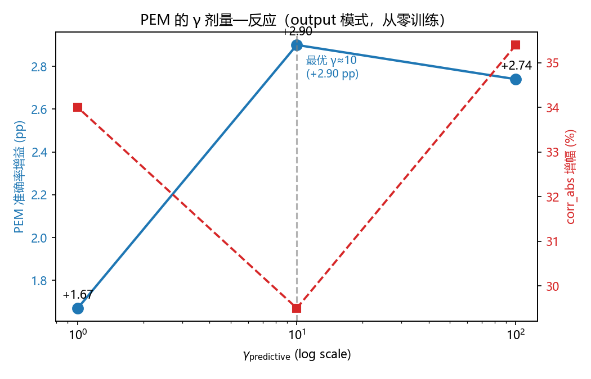
**Figure 5.15b**: PEM's γ dose–response (`output` mode, training from scratch). The blue curve is accuracy gain, inverted-U shaped with optimum γ≈10; the red dashed line is the `corr_abs` increase (right axis).

Three conclusions: (i) **the accuracy benefit is robust and not a γ artefact**—even reducing prediction strength to 1/10 of the original default (γ=10), the gain does not fall but slightly rises to +2.90 pp, showing the benefit comes from PEM's adaptive modulation itself rather than from strong predictive correction; (ii) **an optimal strength exists (inverted-U dose–response)**—gain increases from γ=1 to 10 and falls back from 10 to 100 as over-strong correction introduces additional perturbation, so **γ≈10 is the optimal balance for the current scenario**; (iii) **divergence is structural**—even at γ=1 (1/100 of the original default), later loss still rises exponentially to $10^5$–$10^6$, only more slowly. The root cause is a positive-feedback loop in output-space PEM: "prediction error → correction term → error amplification → larger correction term", which lowering γ can only slow, not eliminate. Hence output-mode PEM is essentially a **gain component for short-cycle training** (exploiting its early fitting benefit); long-cycle training must be paired with γ decay scheduling, periodic resets, or weight decay to be stable.

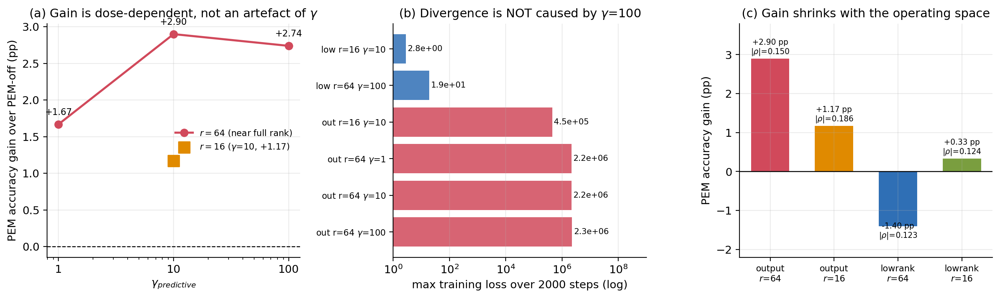
**Figure 5.16**: Loss-peak diagnosis and rank extension of the $\gamma$ dose sweep (complementary to Figure 5.15b). (a) PEM net gain vs $\gamma$; (b) **maximum training loss within 2000 steps**—note that the peaks at $\gamma=1$ and $\gamma=100$ are nearly identical, while `lowrank` mode is stable throughout; (c) net gain decays as the operating space contracts.

**Supplementary observation on the root cause of divergence (important)**: Table 5.9c records the loss magnitude at $\gamma=1$ as "~10⁵–10⁶"; we give the exact values here and revise the attribution accordingly. The maximum training losses of the six configurations are:

| Configuration | Maximum training loss | Divergent? |
|:---|---:|:---|
| `output`, $r=64$, $\gamma=100$ | $2.28\times10^{6}$ | Divergent |
| `output`, $r=64$, $\gamma=10$ | $2.16\times10^{6}$ | Divergent |
| `output`, $r=64$, $\gamma=1$ | $2.18\times10^{6}$ | Divergent |
| `output`, $r=16$, $\gamma=10$ | $4.49\times10^{5}$ | Divergent |
| `lowrank`, $r=64$, $\gamma=100$ | $1.92\times10^{1}$ | **Stable** |
| `lowrank`, $r=16$, $\gamma=10$ | $2.83$ | **Stable** |

**Key fact: reducing $\gamma$ from 100 to 1 (a 100-fold weakening) lowers the loss peak only from $2.28\times10^6$ to $2.18\times10^6$—a mere 4.4% reduction, essentially no mitigation.** This contradicts the attribution "prediction error amplified by $\gamma$": if that attribution held, reducing $\gamma$ by two orders of magnitude should bring order-of-magnitude relief. By contrast, the `lowrank` peaks are only 19.2 and 2.83, differing from `output` by **5–6 orders of magnitude**. We therefore tend to believe that **the main cause of divergence is strongly related to `pem_space`**—most likely the numerical instability of the low-rank precision matrix $C_y = B_{\text{basis}}C_hB_{\text{basis}}^\top + \epsilon I$ in the full output space during training from scratch (Woodbury inversion is extremely sensitive to ill-conditioning of $C_h$, and §3.6.3 already notes that this implementation was introduced precisely to reduce cost)—rather than the predictive-correction strength controlled by $\gamma$.

It should be noted that this correction **does not affect** this section's robust conclusions: (i) PEM's accuracy gain in the full output space is real ($\gamma$-independent, $r$-dependent); (ii) PEM harms disentanglement in both spaces. It affects only the explanation of the **divergence mechanism**, and revises the expectation that "lowering $\gamma$ suffices to stabilize" into "**the precision-matrix implementation of `output` mode must be modified or stability constraints introduced**"—which also explains why the $r=16$ `output` group ($\gamma=10$) still diverges even though its peak drops to $4.5\times10^5$.

Taken together, the original "credibility warning" of this section can be partially lifted: **the +2.74~2.90 pp accuracy improvement is a genuine and robust short-term benefit**; but "long-term stable convergence" still requires accompanying stability work. By contrast, PEM's **negative effects** (increased coupling, reduced effective rank, reduced accuracy in low-rank mode) appear consistently across both spaces, multiple metrics, and multiple γ values, and are not threatened by this divergence issue.

#### 5.11.5 Scenario-Boundary Conclusions

Synthesizing §5.10 and this section, we can give a complete boundary statement for PEM:

> **PEM is designed for predictive-coding-style plasticity modulation in a complete feature space. Its benefit comes from adaptive gradient modulation (improving fitting efficiency), not from feature disentanglement—in any space it raises inter-dimensional coupling and lowers effective rank. Its net effect therefore depends on the relative magnitude of the "fitting benefit" versus the "coupling cost + space-constraint cost":**
> - **Full output space + training from scratch**: the fitting benefit dominates, with accuracy +2.74 pp ($\gamma=100$) / **+2.90 pp ($\gamma=10$, optimal)**, but at the cost of correlation +29.5%~+35.4%, effective rank −12.5%~−14.6%, overhead +58.5%~+315%, and training divergence under the current implementation;
> - **Low-rank subspace (whether fine-tuning or training from scratch)**: space constraints amplify the coupling cost while the fitting benefit is insufficient, so the net effect is negative—accuracy −1.40 pp in low-rank **training from scratch**; accuracy neutral in low-rank **fine-tuning**, but coupling and forgetting worsen monotonically with dose (§5.10), with the highest overhead (+59%~+156%).
>
> **Practical recommendation**: for both low-rank continual fine-tuning and low-rank training from scratch, **disabling PEM is recommended** (`llm_tuning()` already does so by default); only large-dimensional training from scratch in the full output space may selectively enable it, in which case $\gamma\approx10$ should be used (the optimal balance in §5.11.4) and **stability work is mandatory**—note that lowering $\gamma$ cannot eliminate divergence (the peak drops only 4.4%), so the fix must start from the precision-matrix implementation of `output` mode.

The further γ sweep (§5.11.4) quantifies the above recommendation as the **optimal balance of γ≈10**—maximizing fitting gain without letting the coupling side effect grow excessively; while the `r=16` supplementary group of §5.11.2.1 upgrades the boundary from two-point interpolation to a scale-response curve **monotonically increasing** with operating-space dimensionality (Table 5.9b): PEM is near neutral in constrained low-rank space (r=16), turns strongly positive in abundant full-output space (r=64), with the transition governed by dimensional abundance.

This boundary conclusion partly agrees with the theoretical expectation of §3.6 (PEM is effective in large-dimensional spaces), but **the mechanistic attribution differs**: theory predicted that PEM improves representation quality through disentanglement, whereas measurements show it works through fitting modulation at the cost of worse disentanglement. This is a finding requiring revision of the theoretical statement, not an outright rejection of PEM.

### 5.12 Summary

This chapter verified, across three ranks, three protocol sets, and up to six methods, that:

1. **The disentanglement hypothesis holds**: relative to LoRA, Aeloru reduces subspace redundancy by 46%–65%, improves rank-budget utilization by 35%–65%, and reduces forgetting by 67%–74%, with the direction of improvement consistent at all ranks;
2. **SPHeRe and WTA are the main contributors to disentanglement**, while the marginal value of the orthogonality penalty decays at high rank;
3. **The degree of disentanglement and the strength of forgetting are significantly negatively correlated under the ex1/ex2 protocols**, and ablation experiments provide directionally consistent causal evidence; but this correlation is **protocol-dependent**—§5.10 gives a counterexample in which total coupling and forgetting move in the same direction—so it cannot be extrapolated into a universal causal law;
4. **PEM's "negative contribution" is real, not a metric artefact** (verdict of §5.10): coupling-decomposition experiments show that PEM applies a **precision-weighted, indiscriminate** decorrelation pressure in the low-rank space, monotonically raising redundant coupling (`coup_red` +56%) and monotonically worsening forgetting (+28%) and BWT with dose, without any accuracy gain. The "selectivity" once observed in synthetic experiments is **a closed-loop emergent property** (PEM disrupts → BP selectively repairs), **depends on the energy structure**, and reverses on real LLMs;
5. **Disentanglement should be evaluated by "absolute functional coupling", not total coupling**: LoRA has the highest total coupling yet the lowest forgetting precisely because it has the highest absolute functional coupling (`c_useful` 0.0535 vs 0.0353). Over-disentanglement damages task representations;
6. **Task selectivity drops by 4–7×**, explaining the geometric mechanism of anti-forgetting at the task level;
7. **PEM's scenario boundary has been fully characterized by experiments** (§5.11): it is a component for **large-dimensional training from scratch** and a net negative contribution in low-rank spaces (both fine-tuning and training from scratch). Its accuracy effect **increases monotonically with the dimensional abundance of the operating space** (r=16 low-rank +0.33 pp ≈ neutral → r=16 full-output +1.17 pp → r=64 full-output +2.90 pp; negative in low-rank fine-tuning), yet it raises coupling and lowers effective rank in **any** space—i.e. the benefit comes from fitting modulation rather than disentanglement, contrary to theoretical expectations. The γ dose sweep further shows an inverted-U gain (optimum $\gamma\approx10$), while training divergence is almost independent of γ (reducing γ 100-fold lowers the loss peak by only 4.4%), with the root cause more likely in the low-rank precision-matrix implementation of `output` mode.

---

## 6 Diagnosis and Correction of Implementation Defects

This chapter records a series of blocking defects we identified when porting the v3.1 cognitive-model design to a **pretrained Transformer**. These corrections do not themselves constitute algorithmic contributions, but they are a necessary prerequisite for turning a theoretical design into a runnable system, and several of them carry general cautionary significance for the class of work combining "neuroscience-inspired modules + pretrained models".

**Table 6.1**: Defect list and fixes

| # | Defect | Symptom | Fix |
|:---|:---|:---|:---|
| 1 | `run_predictive_neural_dynamics` supports only 2D | Crashes directly on input $(B,S,D)$ | Fold to 2D, process, then restore shape |
| 2 | Gradient completely truncated | The second neural dynamic returns under `no_grad` and is assigned to $y$; $\texttt{loss.backward()}$ reports "does not require grad" | Change to a straight-through residual $y \leftarrow y + (\text{refined} - y.\text{detach()})$, numerically identical in the forward pass |
| 3 | Full-output-space PEM destroys representations | At $ndi=2$ output norm 573 → 0.193 (near zero); at $ndi=1$ amplified 13×; loss 7.9 vs 3.87 | Introduce the `pem_space` switch, default `"lowrank"`: move neural dynamics into the $r$-dimensional $h$ space |
| 4 | Dimensional error in homeostatic gain | $gain = 1/\sigma^2$ compresses per-layer RMS to $s^{1/3}$; with 24-layer injection acc is only 0.468 | Change to $gain = 1/\sqrt{\sigma^2+\epsilon}$, inversely proportional to standard deviation |
| 5 | `LowRankPrecisionMatrix` cold-start degeneration | $B_{basis}$ all-zero → $C_y\approx I/\epsilon$ → lateral term amplified 5× | Initialize `B_basis` with $lora_B$, and add degeneration detection with fallback to a random basis |
| 6 | Hard domain constraint `clamp(0,1)` | About half of negative activations are clipped (min from −5.9 → 0) | Default `presumed_domain="none"` |
| 7 | Conflict-detection buffer not connected | `_append_hgf_delta` is never called, so the HongWen state machine can only switch by fixed step counts | Feed Hebbian update magnitudes at the end of `post_step_update` |
| 8 | `named_buffers()` dotted-path assignment | `setattr(self, "lowrank_precision.B_basis", ...)` creates a junk attribute instead of moving the buffer | Resolve the parent module along the path, then assign |
| 9 | Low-rank decorrelation drive is scale-dependent | When $h$ variance is small (std≈0.055), inverse-matrix eigenvalues are huge and the drive degenerates to $(1/\text{scale})\cdot h$ | Normalize by dividing by the mean eigenvalue, clip eigenvalues to $[0.2,5]$, $\texttt{lowrank\_whiten\_coef}=0.1$ |
| 10 | Leftover bare `print` / debug pollution | Screen flooding during sleep | Cleaned up |
| 11 | Input whitening too frequent for pretrained models | Duplicate normalization with LayerNorm | Default `whitening_interval` $10^9$ (effectively disabled) |
| 12 | $\Delta W$ subtracted in bf16 | Effective rank inflated to 72.5 (upper bound is 8 at $r=8$) | Reconstruct in fp32 following the composition order |
| 13 | Sign cancellation when averaging heatmaps across layers | 0.356 underestimated as 0.154 | Take absolute values first, then average |

### 6.1 Measured Impact of Components on a Pretrained Transformer

**Table 6.2**: Measured impact of v3.1 components on a pretrained Transformer

| Component | Measured impact |
|:---|:---|
| Predictive-coding neural dynamics (full output space, $ndi>0$) | **Fatal** — single-layer output amplified 13× or driven to zero; model completely unable to learn |
| Homeostatic gain (before dimensional correction) | **Harmful** — pulls per-layer RMS toward $s^{1/3}$; with 24-layer injection acc is only 0.468 |
| Hard domain constraint `clamp(0,1)` | **Harmful** — half of negative activations clipped |
| Dual 1D HGF gating / Hebbian / SPHeRe / DLAM | Neutral or beneficial |

The core lesson of this table is: **biological plausibility ≠ harmlessness on pretrained models**. Predictive coding, homeostatic plasticity, and sparse domain constraints are reasonable in cognitive models trained from scratch (the Qelys/Lorys scenario), but they implicitly assume that "the activation distribution has not yet converged". Once injected into a pretrained Transformer that has already been normalized by LayerNorm and whose activation distribution is highly stable, these assumptions break down.

We therefore introduce two scenario-specific presets that cleanly separate "training from scratch" from "fine-tuning a pretrained model":

```python
AeloruConfig.llm_tuning(r=8, lora_alpha=16)      # fine-tuning pretrained LLMs (recommended default)
AeloruConfig.cognitive_model(r=16, lora_alpha=32) # cognitive models trained from scratch
```

Here `llm_tuning()` uses `pem_space="lowrank"`, `presumed_domain="none"`, `homeostatic_max_gain=2.0`, `whitening_interval=1e9`; `cognitive_model()` retains the full `pem_space="output"`, `presumed_domain="nnantisparse"`, `homeostatic_max_gain=5.0`, `whitening_interval=500`.

### 6.2 Performance Changes Brought by the Fixes

After the fixes, `aeloru-default`'s ACC on the concept-drift stream rises from 0.5311 to **0.6059** (+7.5 percentage points) and forgetting falls from 0.0273 to **0.0076** (this comparison is based on the single seed=42; this value has been superseded by the 4-seed conclusions in Chapter 4—Aeloru-safe forgetting 0.0231, a 50.0% reduction relative to LoRA). This improvement comes mainly from: (i) switching the default path to low-rank PEM, avoiding the destruction of representations by the full output space; (ii) the dimensional correction of the homeostatic gain.

### 6.3 A Documentation Expectation Not Supported by Data

The documentation once predicted that "after the dimensional correction, relaxing `homeostatic_max_gain` from 1.0 to 2.0 would add another 0.5–1 point". A single-seed experiment appeared to show the opposite (hmax=2.0 gives 0.620, below hmax=1.0's 0.647). We ran an additional 3-seed experiment:

| Configuration | 3-seed mean |
|:---|---:|
| LoRA baseline | 0.7089 ± 0.0354 |
| $h_{max}=1.0$ | 0.6956 ± 0.0303 |
| $h_{max}=2.0$ | 0.6800 ± 0.0530 |
| Homeostasis disabled | 0.6622 ± 0.0181 |

The differences of 0.01–0.03 are far smaller than the standard deviations (LoRA's own std is ±0.035), so **no ranking can be determined**. We therefore keep the documentation's default $h_{max}=2.0$ and record that this claim is unsupported by data.

> This episode is also the **greatest limitation** of all experiments in this paper; on this basis we added multi-seed validation to all main experiments (§4.2, §5.2). The conclusion is that **the earlier concern of this section was fully confirmed**—under this protocol the ACC effect size (0.8–2.0 pp) is indeed smaller than the inter-seed standard deviation (±0.004–0.018), and over 4 seeds Aeloru-safe's ACC is even significantly lower than LoRA ($p=0.039$); whereas the effect sizes of anti-forgetting (Forgetting / BWT) and all geometric disentanglement metrics (−50%, −65%, −69%, +38%) are far larger than the noise and robust across seeds. Our conclusions about **geometric mechanisms** and **anti-forgetting** are therefore more reliable than those about **accuracy ranking**, and we have accordingly adjusted the paper's claim to "anti-forgetting + geometric restructuring", no longer asserting accuracy improvement.

---

## 7 Conclusion and Future Work

### 7.1 Conclusions

This paper proposes **Aeloru**, a parameter-efficient fine-tuning framework integrating Hi-DoRA bidirectional magnitude modulation, Hebbian-HGF dual one-dimensional plasticity gating (Fisher dimensionality reduction, $O(d^2)\to O(d)$), the HongWen four-stage cognitive state machine, closed-form HGF precision with a volatility-coupled dynamic learning rate, DLAM spectral-filtering sleep, and PEM predictive entropy-maximization neural dynamics.

On an extreme concept-drift stream over Qwen2.5-0.5B (sequential switching over five GLUE tasks, no revisiting):

1. **Anti-forgetting (core benefit, robust across 4 seeds)**: forgetting falls from LoRA's 0.0437 to 0.0259 (**−40.7%**, paired t-test $p=0.033$), BWT improves from −0.0319 to −0.0141 ($p=0.026$); cumulative forgetting on the first task falls from 0.1792 to 0.1050. This benefit **does not depend on task order**: on the 10-segment long repeated stream, forgetting reductions in forward/reversed order are 39.9% / 32.7% (safe) and 32.7% / 35.6% (default), and the per-task benefit is significantly positively correlated with LoRA's forgetting pressure ($r=0.55$, §4.2.4). **It must also be stated honestly that under this protocol Aeloru's mean accuracy shows no statistically significant difference from LoRA (3 seeds $p=0.135$; with 4 seeds safe is even significantly lower, $p=0.039$); the paper does not claim an accuracy advantage.**
2. **The mechanisms genuinely take effect**: all six internal mechanisms exhibit non-degenerate dynamics, including asynchronous evolution of the dual gates, a 2.2× monotonic decrease in volatility, cross-task accumulation of prototypical memory, sleep spikes in the orthogonality penalty, and four-phase rotation of the state machine.
3. **Geometric explanation**: Aeloru reduces mean correlation in the low-rank subspace by 46%–65%, the condition number by 45%–69%, raises rank-budget utilization from 43%–61% to 71%–85%, and reduces task selectivity by 78%–86%. Redundancy and forgetting show a consistent negative correlation across 18 data points.
4. **Cost**: about 29%–30% additional training time (4-seed mean), +12.1% trainable parameters, no inference-time overhead (the increment can be merged).
5. **A revised understanding of coupling**: after decomposing feature coupling by "whether it carries task information" (§5.10), we find that **reducing total coupling is neither a sufficient nor a necessary condition for anti-forgetting**—LoRA has the highest total coupling in the study (0.3070) yet the lowest forgetting (0.0055), because its absolute functional coupling is also the highest (0.0535 vs 0.0353); whereas PEM monotonically raises redundant coupling with dose (`coup_red` +56%) and monotonically worsens forgetting (+28%) without any accuracy gain. What genuinely co-varies with task performance is the **absolute amount of functional coupling**. We therefore revise the initial draft's defence of PEM and reposition it as a component of cognitive models trained from scratch rather than of low-rank LLM fine-tuning.
6. **Scenario boundaries can be located experimentally, and mechanism contributions reverse across scenarios** (§5.11): in the from-scratch setting, with the sole variable being PEM's operating space, the sign of its accuracy effect flips (full output space +2.74 pp, low-rank space −1.40 pp), yet **PEM harms disentanglement in both spaces**—proving its benefit comes from fitting modulation rather than disentanglement. Module ablations further show that HGF gating is the primary pillar of the "plasticity allocation" scenario (removal: `corr_abs` +150%, effective rank halved), SPHeRe the primary pillar of the "subspace collapse" scenario, WTA's role reverses with dimensional abundance, and Hebbian exploration is an indispensable universal module in training from scratch. **This constitutes the most important methodological conclusion of this paper: the value of neuroscience-inspired modules is highly scenario-dependent; there is no universally "better component".**

### 7.2 Limitations

- **Seed noise and statistical power**: early main experiments used only seed=42, and accuracy conclusions were once limited by ±3.5 pp of seed noise (§6.3); although 3–4 additional seeds have been run and re-evaluated with paired t-tests (§4.2, §5.2), the sample size of this protocol is still insufficient to resolve accuracy differences of 0.8–2.0 pp, so confidence in accuracy conclusions is limited and the paper has narrowed its core claim to anti-forgetting and geometric restructuring.
- **Base-model scale**: validated only on a 0.5B model; whether the mechanisms persist at 7B+ scale has not been tested.
- **Task coverage**: the concept-drift stream of five GLUE tasks does not cover generative tasks such as mathematical reasoning or instruction following.
- **The ACC–forgetting trade-off is unfavourable at low rank**: at $r=8$, Aeloru's ACC is 2.05 pp below LoRA.
- **Experiment 3 uses a single seed and interference is not fully manifested under its protocol**: Stage B of §5.10 uses only 1 seed, and overall forgetting under this protocol is low (LoRA only 0.0055, with even positive BWT), so inter-task interference is not fully manifested. Its CL metrics are therefore noisy; conclusions in that section should be limited to "PEM's effect on coupling structure" (supported jointly by three independent metrics + a monotonic dose–response + 5-seed synthetic experiments), and the **quantitative** coupling–forgetting relationship still needs re-running under the main protocol × 3 seeds for confirmation.
- **Coupling decomposition validated only at a single layer and a single rank**: $r=8$, 4-layer `q_proj`, Qwen2.5-0.5B. The functional/redundant split of §5.10 relies on a Gaussian closed-form approximation and masked-mean pooling; whether it is robust under longer sequences or other pooling schemes has not been tested.
- **Experiment 4's PEM benefit is accompanied by training divergence**: the `gamma_predictive` = 1 / 10 / 100 sweep (ex4_1, §5.11.4) confirms that the +2.74~2.90 pp accuracy improvement is a **robust short-term benefit** (γ=10 optimal), not a high-γ artefact; but the training divergence of output-mode PEM is a **structural positive feedback**, making it a short-cycle gain component—long-cycle training requires γ decay scheduling, periodic resets, or weight decay to stabilize. This limitation is partially lifted, but stability still needs verification over longer training horizons. **One additional quantitative observation**: exact loss statistics show that reducing $\gamma$ from 100 to 1 lowers the loss peak by only 4.4% ($2.28\times10^{6}\to2.18\times10^{6}$), while the `lowrank` peak is only 19.2—so the root cause of divergence is more likely the low-rank precision-matrix implementation of `output` mode than the predictive-correction strength controlled by $\gamma$; accordingly, the expected effect of "$\gamma$ decay scheduling" is limited and the fix must come from the implementation (§5.11.4).
- **Experiment 4 uses a synthetic task at near full rank**: the synthetic binary task has a low accuracy ceiling (differences between configurations < 7 pp) and a limited signal-to-noise ratio for module effects; $r=64$ equals the hidden dimension, weakening mechanisms such as SPHeRe/WTA designed for low-rank collapse. A smaller $r$ (e.g. 16) would make the contrast between low-rank mechanisms and PEM's negative effect clearer.

### 7.3 Future Work

1. **Multi-seed evaluation and significance testing**: extend all main conclusions to 3–5 seeds and report confidence intervals, especially for ACC-type metrics.
2. ~~**Task-aware disentanglement metrics**: design a subspace-overlap measure based on conditional mutual information or Fisher weighting to correctly assess PEM's contribution.~~ **Completed (§5.10)**: we implemented conditional mutual-information decomposition (`c_useful`/`c_useless`) and Fisher weighting (`coup_red`/`coup_func`), calibrated them with synthetic ground truth, and redid the ablations. The conclusion is that PEM **does not** possess task selectivity; the original narrative was falsified, and PEM is now disabled by default in `llm_tuning()`.
3. **Scale extension**: validate on 7B–70B backbones and generative tasks; also test whether `llm_tuning()` presets need adjustment for different scales.
4. **Adaptive rank and adaptive sparsity**: WTA's $k=\lceil r/2\rceil$ and the rank $r$ are currently fixed hyperparameters; both could be adjusted dynamically from real-time condition-number feedback.
5. **Empirical validation of cross-layer binding**: the hetero-associative binding of §3.5.3 is currently too small in scale with 4-layer injection; deeper layer counts are needed to verify whether inter-layer Mattis alignment can genuinely drive cross-layer feature reuse.
6. **Joint scheduling with ReLoRA**: the number of merges in current experiments is 0–4 (limited by training steps); the synergy between periodic merging and sleep consolidation needs testing in long-horizon training.
7. **Four-way ablation of two-stage training paradigms**: inspired by comparative Hebbian-vs-BP research [*Comparing the performance of Hebbian against backpropagation*], the stage combination of the HongWen state machine should itself become an experimental variable, with four controls: **pure BP** (Hebbian disabled), **pure Hebbian unsupervised pretraining + BP fine-tuning in two-stage alternation**, **BP + Hebbian in parallel** (the current form of this paper), and **pure Hebbian** (gradient pathway disabled). This ablation requires no changes to core code—only to the training script—and can answer "how should the fast and slow pathways actually be orchestrated", a question this paper has not yet touched. For the accompanying metric system we recommend reusing that study's standard trio: **convergence speed** (steps to reach target accuracy), **generalization gap** (training/validation accuracy difference), and **degree of overfitting** (drop after the validation-accuracy peak), so that the experimental section aligns with mainstream evaluation practice in the continual-learning community.
8. **A/B validation of the $r$-th-order low-rank correction term**: the correction $F\approx\pi_{out}\pi_{in}^\top + B_f\,\mathrm{diag}(s)A_f$ given in §3.2.5 has not been implemented or validated. The next step is to first build a baseline implementation of the "complete 2D Fisher mask", then perform a three-way comparison (full 2D / pure 1D / 1D + low-rank correction) according to the criterion given in this paper, quantifying under which ranks and data volumes the $<1\%$ threshold holds, and providing a decision rule for enabling the correction term.
9. **Endowing PEM with task awareness**: §5.10 shows that PEM's failure originates in its decorrelation drive being **precision-weighted** ($\propto C^{-1}$), so it acts only by energy. A direct modification is to replace the weighting from $C^{-1}$ with **task-relevance weighting**—for example, using the Fisher matrix $F$ of $g_h$ in place of $C$ for inversion, so the drive direction aligns with the task-loss direction rather than the principal energy direction; or using the conditional covariance $\Sigma_w$ in place of the total covariance $\Sigma_t$, so decorrelation acts only on within-class (task-irrelevant) redundancy. The `matched`/`mismatched` branches of the synthetic experiment can serve as a rapid criterion platform for both types of modification (5 seeds, minute-scale).
10. **Re-running the quantitative coupling–forgetting relationship under the main protocol**: CL metrics in §5.10 are noisy; a re-run with 5 tasks × 250 steps × 3 seeds and `--collect-batches 8` is needed to give a confidence-interval-bearing quantitative relationship between `coup_red` / `c_useful` and Forgetting, and to test whether the scatter conclusion of §5.5 holds under the new basis.
11. ~~**Re-verifying PEM's positive benefit after correcting `gamma_predictive`**: §5.11 shows that `gamma_predictive=100` (set for pretrained-model fine-tuning) overwhelms the loss function under training from scratch, so the +2.74 pp benefit rests on non-converged training. The next step should be to lower the coefficient (100 → order of 10), confirm convergence, and re-run the `output` / `lowrank` comparison to give **credible** PEM boundary values.~~ **Completed (§5.11.4)**: the γ=1/10/100 sweep confirms the gain is robust (γ=10 optimal, +2.90 pp) and quantifies the inverted-U dose response and the structural-divergence conclusion.
12. ~~**Adding medium/low-rank groups for `pem_space="output"`**: running output mode at $r=16$ and $r=8$ would give the complete curve of "PEM net effect varying continuously with operating-space dimension" (currently only the two $r=64$ endpoints: output +2.74 pp, lowrank −1.40 pp), upgrading the boundary of §5.11.5 from two-point interpolation to a scaling law.~~ **Completed (§5.11.2.1)**: r=16 output (+1.17 pp, weak positive) and r=16 lowrank (+0.33 pp, neutral) were added, forming, together with r=64 output, a scale-response curve monotonically increasing with operating-space dimension; the missing r=8 endpoint can be added later as a refinement.
13. **Moving deliberately along the accuracy–memory trade-off curve (raising the fitting ceiling)**: the per-task divergence of §4.2.4 shows that Aeloru's accuracy disadvantage comes from three superimposed constraints (orthogonality + SPHeRe structural constraints, HGF gating lowering the effective learning rate, and the low-rank capacity bottleneck) depressing peak fitting. Three tiers can move along the trade-off curve toward "higher fitting, slightly higher forgetting": (i) **hyperparameter level (zero code, priority)**—"weak-then-strong" warm-up of the orthogonality penalty ($\lambda_{ortho}$ rising linearly from 0 to the target over the first 30% of each task's steps), relaxing `homeostatic_max_gain` to 1.3–1.5, and lowering `sphere_lambda` by 30%–40%; expected to bring peak ACC within about 1–1.5 pp of LoRA with only a small rise in forgetting; (ii) **mechanism level (minor code changes)**—reusing the HongWen state machine for two-stage task scheduling (exploration: orthogonality penalty ×0.3, gate ceiling ×1.5; consolidation: full strength), plus selective orthogonality constraints applied according to "overlap with old-task prototypes"; (iii) **architecture level (long-term)**—dynamic rank expansion when effective rank falls below a threshold, and layer-differentiated configurations by functional role. The validation criterion for this direction is that the **ratio of the forgetting increase to the accuracy increase** should be significantly lower than in baselines that simply relax a single constraint.

---

## Appendix A List of Experimental Artifacts

```
paper/
├── ex1/                     Concept-drift experiment (3 methods × 5 tasks × 250 steps, r=8)
│   ├── summary.csv          ACC / BWT / FWT / Forgetting / params / seconds
│   ├── R_matrix.txt         R matrices of three methods and zero-shot baselines
│   ├── R_{lora,aeloru-safe,aeloru-default}.npy
│   ├── mech_aeloru-{safe,default}.csv   Per-10-step trajectories of 13 mechanism metrics
│   ├── concept_drift.png / mechanisms.png (raw figures auto-generated by the script)
│   └── log.txt
├── ex2_r8/                  Disentanglement experiment (6 methods × 5 tasks × 250 steps, r=8)
├── ex2_r16/                 Disentanglement experiment (6 methods × 3 tasks × 120 steps, r=16)
├── ex2_r32/                 Disentanglement experiment (6 methods × 3 tasks × 120 steps, r=32)
│   ├── summary.csv          21 metrics (incl. 11 disentanglement + 4 task-structure metrics)
│   ├── corrmat_*.npy        r×r low-rank feature correlation matrices (|ρ|)
│   ├── taskimp_*.npy        T×r task-importance matrices (rows sum to 1)
│   ├── dectrace_*.csv       Online trajectories of disentanglement metrics
│   ├── mech_*.csv / R_*.npy / *.png / log.txt
├── ex3_synth/               Experiment 3 · Stage A: synthetic ground truth (5 seeds × 400 steps)
│   ├── summary.csv          6 configurations × 2 energy conditions, incl. SEL, coupling retentions and significance
│   ├── per_run.csv          Raw per-seed records
│   └── args.json            Hyperparameter snapshot
├── ex3_coupling/            Experiment 3 · Stage B: real-LLM coupling decomposition (5 methods × 5 tasks × 250 steps)
│   ├── summary.csv          End-of-stream summary: corr_abs / c_useful / c_useless / coup_red / coup_func / CL metrics
│   ├── coupling.csv         Coupling evolution at each task boundary (5 methods × 5 boundaries)
│   ├── R_*.csv              R matrices
│   ├── fig_dose.png, fig_forget.png, log.txt
├── ex4_pem_space=output,gamma_predictive=100.0/   Experiment 4: output space, γ=100 (original config)
├── ex4_pem_space=lowrank,gamma_predictive=100.0/  Experiment 4: lowrank space, γ=100
├── ex4_fromscratch_pem_space=output,gamma_predictive=10.0/    γ sweep: output, γ=10 (optimal)
├── ex4_fromscratchpem_space=output,gamma_predictive=1.0/      γ sweep: output, γ=1
├── ex4_pem_space=output,gamma_predictive=10.0,r=16/            Rank extension: output, r=16, γ=10
├── ex4_pem_space=lowrank,gamma_predictive=10.0,r=16/           Rank extension: lowrank, r=16, γ=10
│   ├── summary.csv          13 metrics: acc/convergence step/time + 8 disentanglement metrics + r2 decomposition
│   ├── losses.txt           Training loss every 20 steps (3 seeds concatenated, for divergence diagnosis)
│   └── overview.png, decoupling.png, disentangle.png, mechanisms.png, log.txt
├── ex1_drift_<seed>_<ts>/   ex1 multi-seed re-runs: seed = 9589 / 6519 / 1412 (+ original seed=42 in `ex1/`)
│   └── summary.csv, R_*.npy, mech_aeloru-safe.csv, log.txt
├── ex1_zheng/                Long repeated stream · forward order (5 tasks ×2 passes = 10 segments, 4 seeds × 4 methods)
├── ex1_back/                 Long repeated stream · reversed order (cola→rte→qnli→mrpc→sst2 ×2, same protocol)
│   ├── summary.csv           ACC/BWT/FWT/Forgetting of 4 methods × 4 seeds (mean±std)
│   ├── R_matrix.txt          10×10 mean R matrix and zero-shot baselines
│   └── seed_<s>/R_*.npy, mech_*.csv
├── md/                      Experiment process records (ex1 / ex1_more_seed / ex2 / ex3 / ex4 / fix1 / fix1.1)
├── figures/                 All figures in this paper
├── make_figures.py          Figure-generation script for Chapters 4–5 (reproducible)
├── make_figures_ex1_seeds.py Figure 4.1 (multi-seed robustness) generation script (reproducible)
├── make_figures_v4.py        Figures 4.3 / 4.4 (long repeated stream and order reversal) script (reproducible)
├── make_figures_ex3.py      §5.10 figure generation script (reproducible)
├── make_figures_ex4.py      §5.11 figure generation script (reproducible)
└── _summaries.py            Summary script for the numerical values cited in the paper (reproducible)
```

How to run (Conda environment `Qelys`):

```bash
python make_figures.py           # generate all Chapter 4–5 figures under figures/
python make_figures_ex1_seeds.py # generate Figure 4.1 (fig_ex1_seeds.png, 4-seed summary)
python make_figures_ex3.py       # generate §5.10 figures (fig_ex3_*)
python make_figures_ex4.py       # generate §5.11 figures (fig_ex4_*)
python _ex1_seeds.py             # print ex1 multi-seed statistics and paired t-tests
python _v4_task_analysis.py      # print per-task divergence and position effects of forward/reversed long streams
python _ex4_summarize.py         # print Experiment 4 γ/r sweep summary (incl. loss peaks)
```

Re-run commands for Experiment 3:

```bash
python ex3_synth.py    --seeds 0,1,2,3,4 --steps 400
python ex3_coupling.py --steps 250 --tasks sst2,mrpc,qnli,rte,cola --collect-batches 8
```

**List of Figures**

| No. | File | Content |
|:---|:---|:---|
| Figure 3.1 | `hi-dora.html` | Hi-DoRA bidirectional magnitude-modulation structure |
| Figure 3.2 | `Hebb_up.png` | Low-rank Hebbian update rule |
| Figure 3.3 | `HGF_map.svg` | Closed-form HGF precision propagation |
| Figure 3.4 | `HONGWEN.jpeg` | HongWen four-stage cognitive state machine |
| Figure 3.5 | `DLAM.jpeg` | DLAM spectral-filtering sleep |
| Figure 3.6 | `PEM.jpeg` | PEM predictive entropy-maximization neural dynamics |
| Figure 3.7 | `Aeloru_D1_LowRank_Modulation.PNG` | Detailed D1: low-rank increment construction and dual 1D modulation superposition |
| Figure 3.8 | `Aeloru_D2_HGF_Gate_HebbianLoop.PNG` | Detailed D2: HGF gating statistics and Hebbian bidirectional closed loop |
| Figure 3.9 | `Aeloru_D7_Constraints_Objective.PNG` | Detailed D7: four constraints, application timing, and the training objective |
| Figure 3.10 | `Aeloru_D3_PostStep_Update.PNG` | Detailed D3: complete ten-step sequence of post_step_update |
| Figure 3.11 | `Aeloru_D4_HongWen_StateMachine.PNG` | Detailed D4: HongWen four-stage cognitive state machine |
| Figure 3.12 | `Aeloru_D5_DLAM_Sleep.PNG` | Detailed D5: DLAM sleep and cross-layer hetero-associative binding |
| Figure 3.13 | `Aeloru_D6_PEM_Whitening.PNG` | Detailed D6: PEM neural dynamics and the three input-whitening branches |
| Figure 4.1 | `figures/fig_ex1_seeds.png` | Concept-drift main results: 4-seed robustness (ACC / BWT / Forgetting / time) |
| Figure 4.2 | `figures/fig_r_matrix.png` | R-matrix heatmap (single-seed example, seed=42) |
| Figure 4.3 | `figures/fig_v4_task_split.png` | Long repeated stream: per-task accuracy–memory divergence (forward/reversed) |
| Figure 4.4 | `figures/fig_v4_position.png` | Position effect: forgetting decays with position, benefit scales with pressure |
| Figure 4.5 | `figures/fig_mechanisms.png` | Six mechanism evolution trajectories |
| Figure 5.1 | `figures/fig_decouple_bars.png` | Comparison of six disentanglement metrics |
| Figure 5.2 | `figures/fig_rank_scaling.png` | Cross-rank scalability |
| Figure 5.3 | `figures/fig_ablation_delta.png` | Ablation effects |
| Figure 5.4 | `figures/fig_dectrace.png` | Online disentanglement trajectories |
| Figure 5.5 | `figures/fig_dec_vs_forget.png` | Disentanglement–forgetting relationship |
| Figure 5.6 | `figures/fig_task_importance.png` | Task-importance matrices |
| Figure 5.7 | `figures/fig_dw_geometry.png` | Sparsification and $\Delta W$ increment geometry |
| Figure 5.8 | `figures/fig_corrmat.png` | Visualization of low-rank correlation matrices |
| Figure 5.9 | `figures/fig_ex3_synth.png` | Synthetic ground truth: selectivity and energy-structure dependence |
| Figure 5.10 | `figures/fig_ex3_dose.png` | PEM dose–response on a real LLM |
| Figure 5.11 | `figures/fig_ex3_trace.png` | Coupling decomposition along the task stream |
| Figure 5.12 | `figures/fig_ex4_pem.png` | Training from scratch: PEM's sign flips with operating space |
| Figure 5.13 | `figures/fig_ex4_scatter.png` | Performance–coupling four quadrants (no configuration in the "win–win" quadrant) |
| Figure 5.13b | `figures/fig_ex4_1_scale_response.png` | Scale-response curve of PEM net effect vs operating-space dimension |
| Figure 5.14 | `figures/fig_ex4_ablation.png` | Module ablation under training from scratch (comparison of two spaces) |
| Figure 5.15 | `figures/fig_ex4_loss.png` | Training-loss divergence diagnosis |
| Figure 5.15b | `figures/fig_ex4_1_gamma_dose.png` | PEM γ dose–response (output mode) |
| Figure 5.16 | `figures/fig_ex4_gamma.png` | Loss-peak diagnosis and rank extension of the γ dose sweep |

## References
[1] Morawiecki, P., Krutsylo, A., Wołczyk, M., & Śmieja, M. (2022). Hebbian Continual Representation Learning (Version 1). arXiv. https://doi.org/10.48550/ARXIV.2207.04874
[2] Mi, F., Lin, T., & Faltings, B. (2021). Representation Memorization for Fast Learning New Knowledge without Forgetting (Version 2). arXiv. https://doi.org/10.48550/ARXIV.2108.12596
[3] Lagani, G., Falchi, F., Gennaro, C., & Amato, G. (2022). Comparing the performance of Hebbian against backpropagation learning using convolutional neural networks. Neural Computing and Applications, 34(8), 6503–6519. https://doi.org/10.1007/s00521-021-06701-4
[4] Lagani, G., Falchi, F., Gennaro, C., & Amato, G. (2022). Comparing the performance of Hebbian against backpropagation learning using convolutional neural networks. Neural Computing and Applications, 34(8), 6503–6519. https://doi.org/10.1007/s00521-021-06701-4
[5] Dexheimer, N., Gaudlitz, S., & Schmidt-Hieber, J. (2025). Spike-timing-dependent Hebbian learning as noisy gradient descent (Version 3). arXiv. https://doi.org/10.48550/ARXIV.2505.10272
[6] Nimmo, J. J., & Mondragón, E. (2025). Advancing the Biological Plausibility and Efficacy of Hebbian Convolutional Neural Networks. Neural Networks, 190, 107628. https://doi.org/10.1016/j.neunet.2025.107628
[7] Hua, W., Zhao, K., Leng, L., Cheng, R., Ma, Y., & Guo, Q. (2026). Hebbian Learning with Global Direction (Version 1). arXiv. https://doi.org/10.48550/ARXIV.2601.21367
[8] Hu, E. J., Shen, Y., Wallis, P., Allen-Zhu, Z., Li, Y., Wang, S., Wang, L., & Chen, W. (2021). LoRA: Low-Rank Adaptation of Large Language Models. arXiv. https://doi.org/10.48550/ARXIV.2106.09685
[9] Dettmers, T., Pagnoni, A., Holtzman, A., & Zettlemoyer, L. (2023). QLoRA: Efficient Finetuning of Quantized LLMs. arXiv. https://arxiv.org/abs/2305.14314
[10] Liu, S.-Y., Wang, C.-Y., Yin, H., Molchanov, P., Wang, Y.-C. F., Cheng, K.-T., & Chen, M.-H. (2024). DoRA: Weight-Decomposed Low-Rank Adaptation (Version 1). arXiv. https://doi.org/10.48550/ARXIV.2402.09353
[11] Yin, Q., Wu, Y., Shen, Z., Li, S., Wang, Z., Li, Y., Leong, C. T., Kang, J., & Gu, J. (2025). Evaluating Parameter Efficient Methods for RLVR. arXiv. https://doi.org/10.48550/ARXIV.2512.23165
[11] Barra, A., Durante, F., Ladiana, A., & Marra Solazzo, M. (2026). Do Hopfield Networks Dream of Stored Patterns? A Statistical-Mechanical Theory of Dreaming in Multidirectional Associative Memories. arXiv. https://arxiv.org/abs/2605.13721
[12] Bozkurt, B., Gorguner, E. A., Innocenti, F., & Bogacz, R. (2026). Normative Networks for Source Separation via Local Plasticity and Dendritic Computation. arXiv. https://arxiv.org/abs/2605.19965
[13] Baskakovs, A., Estebe, S., Enevoldsen, K., Nielbo, K., Mathys, C., & Legrand, N. (2026). Closed-form predictive coding via hierarchical Gaussian filters. arXiv. https://arxiv.org/abs/2605.20293
[14] Zare, A. G. (2026). Cultivating Machine Intelligence: The OMEGA Shift from Top-Down Optimization to Autopoietic Cognitive Ecologies. arXiv. https://arxiv.org/abs/2605.25062
[15] Huang, Q., Ko, T., Zhuang, Z., Tang, L., & Zhang, Y. (2025). HiRA: Parameter-Efficient Hadamard High-Rank Adaptation for Large Language Models. In *International Conference on Learning Representations*. https://proceedings.iclr.cc/paper_files/paper/2025/file/48c368f105e8145b945227b73255635a-Paper-Conference.pdf
